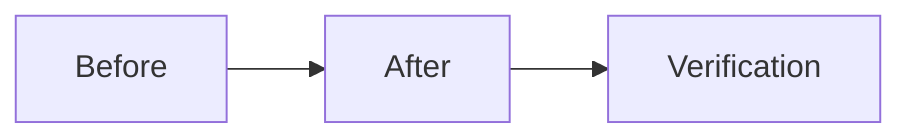

## Change

- **Change ID**: `<change-id>`
- **Issue**: #<issue>
- **Lane**: <M|S|L>
- **Base**: `master` · **Head**: `<sha>`

## Decision Card (≤ 5 min)

| Field | Value |
|---|---|
| What ships | One line. |
| Why | One line. |
| Blast radius | Services, crates, contracts, chains. |
| Risk | Low / Medium / High. |
| Rollback | One step. |

## Stage verdicts

| Stage | Round | Reviewer | Verdict | Reviewed SHA |
|---|---|---|---|---|
| spec | — | — | — | — |
| plan | — | — | — | — |
| dev | — | — | — | — |

## Verification

| Command | Result |
|---|---|
| `cd engine-rs && cargo test` | — |
| `PYTHONPATH=. python3 -m unittest discover -s backend/tests -v` | — |
| `cd frontend && npm run build` | — |
| `openspec validate <change-id> --strict` | — |
| `scripts/sdlc/sdlc.sh check <change-id>` | — |

## Checklist

- [ ] Only approved scope in the diff.
- [ ] Every claimed behavior has a test.
- [ ] No secrets, keys, or production data.
- [ ] Invariants preserved (hot path, risk gate, PolicyEnvelope, capital, vault, chain isolation).
- [ ] Rollback documented.
- [ ] Human merge decision recorded.

---

🤖 Generated with [Claude Code](https://claude.com/claude-code)
