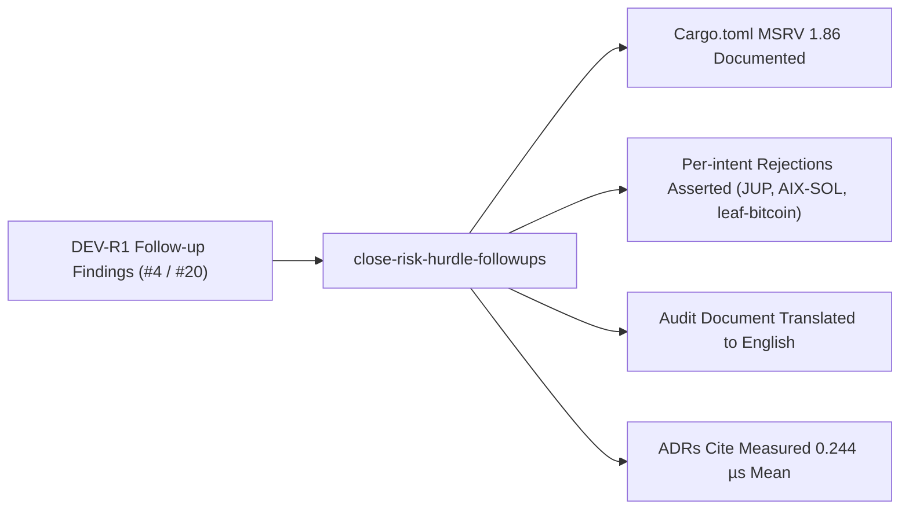

## Change

- **Change ID**: `close-risk-hurdle-followups`
- **Issue**: #4
- **Lane**: S
- **Base**: `master` · **Head**: `fb1d736`

## Decision Card (≤ 5 min)

| Field | Value |
|---|---|
| What ships | Dev-dependency MSRV documentation, per-intent rejection unit tests, English audit translation, and benchmark citations for all hot-path latency claims. |
| Why | Resolves agreed non-blocking follow-up items DEV-R1-F01..F04 from issue #4 / PR #20. |
| Blast radius | `engine-rs/crates/risk-gate`, `engine-rs/crates/backtest`, `docs/PERFORMANCE_AND_COST_AUDIT.md`, `docs/adr/0001..0003`. |
| Risk | Low. Purely additive unit test assertions, documentation translation, MSRV annotations, and citation updates. Zero execution logic changed. |
| Rollback | `git revert HEAD` |

## Stage verdicts

| Stage | Round | Reviewer | Verdict | Reviewed SHA |
|---|---|---|---|---|
| spec | 1 | sdlc-spec-reviewer | APPROVE | `a3c131e5cc585fa4b4af22e204a7d78d54d73d3b` |
| dev | 1 | sdlc-dev | in progress | `fb1d736` |

## Diff

- Files: 8 · +276 / -101
- Areas: `risk-gate`, `backtest`, `docs`
- New dependencies: none

## Verification

| Command | Result | Evidence |
|---|---|---|
| `cd engine-rs && cargo test` | PASS (7 backtest, 23 risk-gate, 14 contract tests) | `.sdlc/close-risk-hurdle-followups/evidence/dev-r1-verification.txt` |
| `cargo build --manifest-path engine-rs/Cargo.toml --bin robotrader-node` | PASS | `.sdlc/close-risk-hurdle-followups/evidence/dev-r1-verification.txt` |
| `PYTHONPATH=. python3 -m unittest discover -s backend/tests -v` | PASS (240 tests passed) | `.sdlc/close-risk-hurdle-followups/evidence/dev-r1-verification.txt` |
| `cd frontend && npm run build` | PASS (built in 346ms) | `.sdlc/close-risk-hurdle-followups/evidence/dev-r1-verification.txt` |
| `cargo bench --manifest-path engine-rs/Cargo.toml -p robotrader-risk-gate -- --test` | PASS | `.sdlc/close-risk-hurdle-followups/evidence/dev-r1-verification.txt` |
| `git grep -n -E "< ?50 ?[uµ]s" docs/adr/` | PASS (all 3 occurrences cite 0.244 µs mean and bench command) | `.sdlc/close-risk-hurdle-followups/evidence/dev-r1-verification.txt` |
| `git grep -n -E "< ?50 ?[uµ]s" README.md AGENTS.md docs/architecture.md docs/PERFORMANCE_AND_COST_AUDIT.md docs/adr/` | PASS (zero bare unannotated claims) | `.sdlc/close-risk-hurdle-followups/evidence/dev-r1-verification.txt` |
| `openspec validate close-risk-hurdle-followups --strict` | PASS | `.sdlc/close-risk-hurdle-followups/evidence/dev-r1-verification.txt` |
| `python3 scripts/sdlc/spec-lint.py --change close-risk-hurdle-followups` | PASS (0 open tasks) | `.sdlc/close-risk-hurdle-followups/evidence/dev-r1-verification.txt` |

## Residual risk and follow-ups

- Aggregate exposure caps (`asset_exposures_usd` / `pod_exposures_usd`) remain deferred on issue #4 pending an architectural decision.

## Checklist

- [x] Only approved scope in the diff.
- [x] Every claimed behavior has a test.
- [x] No secrets, keys, or production data.
- [x] Invariants preserved (hot path, risk gate, PolicyEnvelope, capital, vault, chain isolation).
- [x] Rollback documented.
- [ ] Human merge decision recorded.
