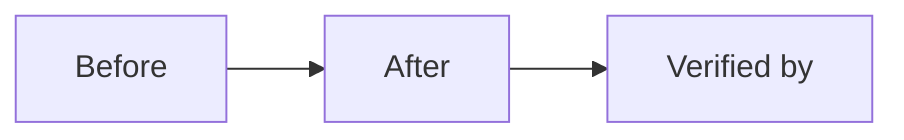

# Merge Dossier — fix-risk-gate-cost-hurdle

## Decision Card (≤ 5 min)

| Field | Value |
|---|---|
| What ships | One line. |
| Why | One line. |
| Blast radius | Services, crates, contracts, chains. |
| Worst failure | One line + detection. |
| Rollback | One command or one step. |
| Risk | Low / Medium / High. |
| Recommendation | Merge / Merge with follow-up / Do not merge. |

## Evidence

| Gate | Result | Evidence |
|---|---|---|
| SPEC | APPROVE (round 2) | `.sdlc/fix-risk-gate-cost-hurdle/reviews/spec-r2.md` @ `3a0502917099763084bf0fc6b2ff4bbcd13895eb` |
| PLAN | APPROVE (round 1) | `.sdlc/fix-risk-gate-cost-hurdle/reviews/plan-r1.md` @ `6ed356c35e5380e6cfc5dc676b6861b75350a16d` |
| DEV | APPROVE (round 1) | `.sdlc/fix-risk-gate-cost-hurdle/reviews/dev-r1.md` @ `e3498862655c265bcfc431e5407b5e5158fe1df6` |
| CI | green | `gh pr checks` output |
| Tests | pass | command + summary |
| Lints | pass | command + summary |

## Diff

- Files: <n> · +<add> / -<del>
- Areas: <crates/services>
- New dependencies: <none | list + rationale>

## Residual risk and follow-ups

- <none | item + issue link>

## Human decision

- [ ] Merge
- [ ] Merge with follow-up
- [ ] Request changes
- [ ] Abandon
