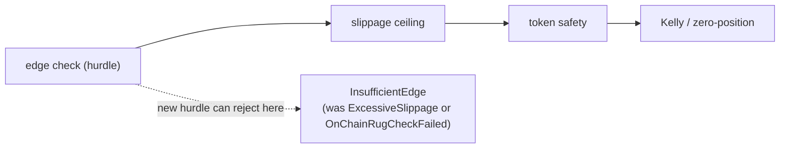

# SPEC Review — Round 1

## Summary

**CHANGES_REQUESTED.** The cost formula, the 2× round-trip fee, the buffer, the strict boundaries, and the benchmark requirement are sound and verified against `exec-router` and `risk-gate`. One blocker: requirement 6 claims every other gate returns today's rejection variant, but the stricter hurdle stays ahead of slippage and token safety and preempts them. The repository's own SCAM-SOL fixture proves it: edge 81.0 against hurdle 87.8 now yields `InsufficientEdge`, where today it reaches `OnChainRugCheckFailed`, removing the deterministic anti-rug proof. One major: backtest/fixture regeneration lives only in the proposal's Impact, not in a normative requirement; the existing Solana test (6 trades, 1 rejection, 4 pods) fails, and the `[FIXTURE]` figures (Sharpe 28.22, +$22.78, one rug rejection) become false. Minors cover spread parity, benchmark publication scope, non-regression coverage, and allocation verification.



## Findings

### SPEC-R1-F01 — [blocker] Requirement 6's "same rejection variant" invariant is contradicted by the new hurdle's precedence

- Location: `openspec/changes/fix-risk-gate-cost-hurdle/specs/risk-hurdle/spec.md#L128-L158` (Requirement: All other risk gates keep their current behavior), together with `#L12` (the hurdle is computed inside `validate` before the other gates).
- Evidence: The requirement says: "For an intent rejected by any of those gates, `validate` MUST return the same `RiskRejection` variant it returns today." The code order is unchanged: edge check at `engine-rs/crates/risk-gate/src/lib.rs#L254`, slippage ceiling at `#L267`, token safety at `#L275`. The hurdle stays at the edge-check position, so making it stricter lets it preempt the later gates. Concrete counter-example from the repository's own deterministic fixture: `benchmark_market_stream()` emits SCAM-SOL with `whale_wallet_winrate: 0.80` (`engine-rs/crates/backtest/src/lib.rs#L298`), which `OnChainAlphaPod` turns into edge `45.0 + 0.20 × 180.0 = 81.0` bps, `OnchainDexAggregator`, `MevBundleAtomic`, `max_slippage_bps = 65` (`engine-rs/crates/strategies/src/lib.rs#L340,L345,L347,L353`). Today it passes the 12 bps floor and is rejected by `validate_token_safety` as `OnChainRugCheckFailed` (assertion comment `backtest/src/lib.rs#L512`; documented at `docs/PERFORMANCE_AND_COST_AUDIT.md#L89`). Under the spec's hurdle it becomes `16.0 (2 × 8.0 fee) + 4.8 (0.6 × tip 8) + 65 + 2.0 = 87.8`, so edge 81.0 < 87.8 and it is rejected earlier as `InsufficientEdge`. The same preemption applies to the slippage ceiling: an intent with edge below the hurdle and `max_slippage_bps` above the pod cap now returns `InsufficientEdge` instead of `ExcessiveSlippage`; the only slippage scenario (`spec.md#L149-L153`) dodges this by using `expected_edge_bps = 200.0`. The token-safety scenario (`spec.md#L155-L158`) dodges it by requiring a "hurdle-passing edge". The Review Card's "Decision needed: None" (`proposal.md#L10`) hides a real precedence decision.
- Required fix: Decide and state the intended precedence. Either (a) keep the current gate order and scope requirement 6 to "an intent that reaches that gate", add scenarios for a malicious-token intent and an excessive-slippage intent whose edge is below the hurdle, and keep the deterministic backtest exercising `OnChainRugCheckFailed` (for example a high-edge malicious fixture) so the anti-rug proof survives; or (b) reorder the hurdle after the token-safety and slippage gates, state the new order, and update requirement 6 and the fixture expectations accordingly. Update the Review Card's Decision needed.
- Status: open
- Origin: initial

### SPEC-R1-F02 — [major] Backtest and `[FIXTURE]` regeneration is not a normative acceptance criterion

- Location: `openspec/changes/fix-risk-gate-cost-hurdle/proposal.md#L66` (Impact) and the absence of a corresponding requirement/scenario in `specs/risk-hurdle/spec.md`.
- Evidence: The proposal says the fixture intents keep their declared edges and slippage and that rejection counts, PnL, win rate, and Sharpe "must be regenerated from a real run", but the spec has no requirement, scenario, or verification for that outcome. The existing deterministic test will fail: `engine-rs/crates/backtest/src/lib.rs#L506-L516` asserts `total_trades == 6`, `rejected_orders == 1`, and `pod_pnl_attribution.len() == 4`. Under the spec's hurdle the clean JUP smart-money intent (edge 70.2, hurdle 87.2), SCAM-SOL (81.0 vs 87.8), and the AIX sniper (95 vs 151.4) are all rejected, leaving 4 approved trades, 3 rejections, and 2 pods; three assertions fail. The published figures in `docs/PERFORMANCE_AND_COST_AUDIT.md#L38,L84-L89,L97` (6 trades, 100% win, +$22.78, Sharpe 28.22, one rug rejection, 4 leaf-bitcoin trades) become false. The 26-leaf test (`backtest/src/lib.rs#L518-L566`) also changes its per-leaf counts and PnL. Without a normative criterion, DEV can silently re-baseline the counts, and the anti-rug assertion is lost (see SPEC-R1-F01).
- Required fix: Add a requirement plus scenario: fixture edges/slippages remain unchanged; the deterministic backtest assertions are re-derived from a real run; the `[FIXTURE]` figures in `docs/PERFORMANCE_AND_COST_AUDIT.md` are regenerated from a real run and matched to the command output; the anti-rug rejection path remains asserted. Put the exact commands (`cargo test -p robotrader-backtest` and the regeneration command) in the PLAN Verification section.
- Status: open
- Origin: initial

### SPEC-R1-F03 — [minor] Spread single-source parity is under-tested and the pre-trade refactor is only implied

- Location: `openspec/changes/fix-risk-gate-cost-hurdle/specs/risk-hurdle/spec.md#L36-L55`.
- Evidence: The fee requirement has a parity scenario for every `(Venue, OrderType)` pair (`#L46-L50`), but the spread scenario only asserts that `Market` is exactly 6.0 bps above `Limit` (`#L52-L55`). It does not check `PostOnlyMaker = 0.5` or `MevBundleAtomic = 0.6 × tip`, so a duplicated spread table inside `robotrader-risk-gate` would pass. The canonical spread source, `SmartExecutionRouter::slippage_bps_for(&ApprovedOrder)` (`engine-rs/crates/exec-router/src/lib.rs#L33-L40`), is post-trade and needs an `ApprovedOrder`; a pre-trade call is impossible without either constructing a throwaway order (which would allocate, violating requirement 5) or extracting a shared helper. The proposal anticipates "the canonical fee and spread values exposed for shared use" (`proposal.md#L63`), but the spec does not pin the test that proves it.
- Required fix: Add a spread-parity scenario mirroring the fee one across all four order types, including the tip-derived `MevBundleAtomic` case, and assert the gate's spread term equals `slippage_bps_for` (directly or through the extracted shared helper).
- Status: open
- Origin: initial

### SPEC-R1-F04 — [minor] Benchmark publication locations are ambiguous and the audit document is omitted

- Location: `openspec/changes/fix-risk-gate-cost-hurdle/specs/risk-hurdle/spec.md#L108-L121`.
- Evidence: The requirement says the measured value and command must be "stated where the `<50µs` claim appears in `README.md` and `docs/architecture.md`". `README.md` has four occurrences (`#L8`, `#L42`, `#L48`, `#L75`) and `docs/architecture.md` has one (`#L52`); the requirement does not say all occurrences or which one, so a single insertion satisfies a literal reading. `docs/PERFORMANCE_AND_COST_AUDIT.md` carries five more `<50µs` claims (`#L4`, `#L37`, `#L65`, `#L79`, `#L145`) and is not named, even though the proposal already touches that file for fixture figures.
- Required fix: Name the exact locations (or say "every occurrence in these files") and either include `docs/PERFORMANCE_AND_COST_AUDIT.md` or explicitly scope it out.
- Status: open
- Origin: initial

### SPEC-R1-F05 — [minor] Non-regression scenarios omit gates named by requirement 6

- Location: `openspec/changes/fix-risk-gate-cost-hurdle/specs/risk-hurdle/spec.md#L128-L163`.
- Evidence: Requirement 6 names the kill switch, fractional-Kelly sizing, the zero-position rejection, and `validate_inference_refill`, but the six scenarios cover only drawdown-triggered kill switch, pod-disabled, TTL fallback, excessive slippage, token safety, and leverage clamping. There is no scenario for an already-active kill switch returning `KillSwitchActive`, a zero/negative Kelly size returning `ZeroPositionSize`, or an inference refill. The universal "same variant" claim therefore has no coverage for four named behaviors, beyond the contradiction in SPEC-R1-F01.
- Required fix: Add scenarios for the already-active kill switch, zero-position/Kelly, and `validate_inference_refill`, or scope the requirement to the gates whose code is genuinely untouched and list them explicitly.
- Status: open
- Origin: initial

### SPEC-R1-F06 — [minor] The allocation-free claim has no observable verification

- Location: `openspec/changes/fix-risk-gate-cost-hurdle/specs/risk-hurdle/spec.md#L108-L126`.
- Evidence: Requirement 5 says the hurdle must add no heap allocation, but the only specified evidence is a `criterion` time benchmark (`#L112-L121`) and a scenario whose THEN is an internal property ("no logging, no I/O, no sleeping, and no allocation inside the hurdle computation", `#L123-L126`). A timing benchmark cannot prove allocation-free behavior. The pre-existing effective-envelope and `ApprovedOrder` clones are explicitly grandfathered (`#L110`), so any allocation test needs a stated baseline.
- Required fix: Add an allocation-counting test around the hurdle path (for example a counting global allocator) or state that code review is the evidence and how the reviewer verifies it.
- Status: open
- Origin: initial

## Checks run

- `openspec validate fix-risk-gate-cost-hurdle --strict` → `Change 'fix-risk-gate-cost-hurdle' is valid` (exit 0).
- `scripts/sdlc/spec-lint.py --change fix-risk-gate-cost-hurdle` → PASS; Review Card 168 words, 1 diagram, ~1.3 min; warnings that `design.md` and `tasks.md` are absent at PLAN.
- `scripts/sdlc/sdlc.sh check fix-risk-gate-cost-hurdle` → PASS (OpenSpec, spec-lint, verdict-lint).
- `cd engine-rs && cargo test -p robotrader-backtest test_full_multi_pod_backtest_and_rug_rejection` → passed at the reviewed SHA, confirming the current 6 trades / 1 rejection / 4 pods baseline that the new hurdle invalidates.
- Read time: 1.3 min for the Review Card (168 words, 1 diagram); full artifact review ~40 min.

## Machine Verdict

```json
{
  "schema": "sdlc.verdict/v1",
  "change_id": "fix-risk-gate-cost-hurdle",
  "stage": "spec",
  "round": 1,
  "reviewer": "sdlc-spec-reviewer",
  "reviewed_sha": "1a2ce17761620d11670d8b633391c7f1b5f5a197",
  "verdict": "CHANGES_REQUESTED",
  "summary": "The cost formula, 2x round-trip fee, buffer, strict boundaries and benchmark requirement are sound; requirement 6's same-variant invariant is falsified by the SCAM-SOL fixture, and backtest/fixture regeneration is not a normative acceptance criterion.",
  "findings": [
    {
      "id": "SPEC-R1-F01",
      "severity": "blocker",
      "origin": "initial",
      "status": "open",
      "location": "openspec/changes/fix-risk-gate-cost-hurdle/specs/risk-hurdle/spec.md#L128-L158",
      "evidence": "Requirement 6 says an intent rejected by any untouched gate must keep today's RiskRejection variant, but the stricter hurdle stays at the edge-check position before slippage (risk-gate/src/lib.rs#L254 vs #L267) and token safety (#L275). The SCAM-SOL fixture (backtest/src/lib.rs#L298, strategies/src/lib.rs#L340,L345,L347,L353) has edge 81.0 and hurdle 16.0 + 4.8 + 65 + 2.0 = 87.8, so it now returns InsufficientEdge where today it reaches OnChainRugCheckFailed (docs/PERFORMANCE_AND_COST_AUDIT.md#L89). The slippage scenario uses edge 200 and the token-safety scenario a hurdle-passing edge, dodging the conflict.",
      "required_fix": "Decide and state the intended precedence: either keep the order and scope requirement 6 to intents that reach the gate, add scenarios for malicious-token and excessive-slippage intents below the hurdle, and keep the backtest exercising OnChainRugCheckFailed; or reorder the hurdle after slippage and token safety and update requirement 6 and fixture expectations. Update the Review Card's Decision needed."
    },
    {
      "id": "SPEC-R1-F02",
      "severity": "major",
      "origin": "initial",
      "status": "open",
      "location": "openspec/changes/fix-risk-gate-cost-hurdle/proposal.md#L66 and specs/risk-hurdle/spec.md (no requirement/scenario)",
      "evidence": "The proposal says fixture figures must be regenerated, but the spec has no normative criterion. backtest/src/lib.rs#L506-L516 asserts 6 trades, 1 rejection and 4 pods; under the hurdle the JUP alpha (70.2 vs 87.2), SCAM-SOL (81.0 vs 87.8) and AIX sniper (95 vs 151.4) reject, leaving 4 trades, 3 rejections and 2 pods. docs/PERFORMANCE_AND_COST_AUDIT.md#L38,L84-L89,L97 publish figures that become false.",
      "required_fix": "Add a requirement and scenario: fixture edges/slippages unchanged, backtest assertions re-derived from a real run, [FIXTURE] figures regenerated from a real run and matched to the command output, and the anti-rug path still asserted; add the commands to PLAN Verification."
    },
    {
      "id": "SPEC-R1-F03",
      "severity": "minor",
      "origin": "initial",
      "status": "open",
      "location": "openspec/changes/fix-risk-gate-cost-hurdle/specs/risk-hurdle/spec.md#L36-L55",
      "evidence": "The fee parity scenario covers every (Venue, OrderType) pair, but the spread scenario only checks that Market is 6.0 bps above Limit. PostOnlyMaker 0.5 and MevBundleAtomic 0.6 x tip are unverified, so a duplicated spread table in risk-gate would pass. slippage_bps_for takes a post-trade ApprovedOrder, so the pre-trade shared helper is implied but not pinned by a test.",
      "required_fix": "Add a spread-parity scenario across all four order types, including the tip-derived MevBundleAtomic case, asserting the gate's spread term equals slippage_bps_for."
    },
    {
      "id": "SPEC-R1-F04",
      "severity": "minor",
      "origin": "initial",
      "status": "open",
      "location": "openspec/changes/fix-risk-gate-cost-hurdle/specs/risk-hurdle/spec.md#L108-L121",
      "evidence": "The requirement says to publish the measured value where the <50us claim appears in README.md and docs/architecture.md, but README has four occurrences and the requirement does not say all or which. docs/PERFORMANCE_AND_COST_AUDIT.md has five more <50us claims and is not named, although the proposal already touches that file for fixture figures.",
      "required_fix": "Name the exact locations or say every occurrence, and include the audit document or explicitly scope it out."
    },
    {
      "id": "SPEC-R1-F05",
      "severity": "minor",
      "origin": "initial",
      "status": "open",
      "location": "openspec/changes/fix-risk-gate-cost-hurdle/specs/risk-hurdle/spec.md#L128-L163",
      "evidence": "Requirement 6 names the kill switch, fractional-Kelly sizing, the zero-position rejection and validate_inference_refill, but no scenario covers an already-active kill switch, a zero/negative Kelly size, or an inference refill. The universal same-variant claim therefore has uncovered named behaviors.",
      "required_fix": "Add scenarios for the already-active kill switch, zero-position/Kelly and validate_inference_refill, or scope the requirement to the explicitly listed untouched gates."
    },
    {
      "id": "SPEC-R1-F06",
      "severity": "minor",
      "origin": "initial",
      "status": "open",
      "location": "openspec/changes/fix-risk-gate-cost-hurdle/specs/risk-hurdle/spec.md#L108-L126",
      "evidence": "Requirement 5 forbids new heap allocation on the hurdle path, but the only evidence specified is a criterion time benchmark and a scenario whose THEN is an internal property (no logging, I/O, sleeping or allocation). Timing cannot prove allocation-free behavior, and the pre-existing clones are grandfathered, so a baseline is needed.",
      "required_fix": "Add an allocation-counting test around the hurdle path or state that code review is the evidence and how the reviewer verifies it."
    }
  ],
  "closed": []
}
```
