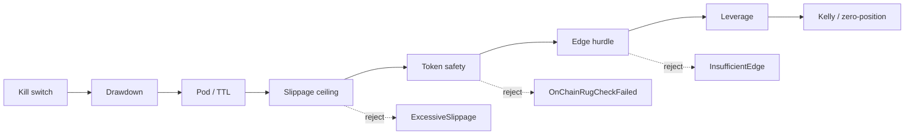

# SPEC Review — Round 2

## Summary

**APPROVE.** All six R1 findings are closed at `3a05029`. The revised gate order is stated normatively, the SCAM-SOL fixture keeps `OnChainRugCheckFailed` at edge 81.0 against a hurdle of 87.8, and an excessive-slippage intent below the hurdle keeps `ExcessiveSlippage`. Fixture regeneration is a requirement with exact commands and the 4-trade / 3-rejection / 2-pod baseline, which I re-derived independently from the unchanged pod formulas. Spread parity covers all four order types including the tip-derived MEV bundle, the benchmark locations name the audit document, the missing non-regression scenarios are present, and the allocation claim is now diff-review evidence. Nine requirements and 35 distinct, testable scenarios validate strictly.



## Findings

### SPEC-R1-F01 — [blocker] Requirement 6's "same rejection variant" invariant is contradicted by the new hurdle's precedence

- Location: `openspec/changes/fix-risk-gate-cost-hurdle/specs/risk-hurdle/spec.md#L114-L129` (Requirement: Safety gates precede the edge hurdle).
- Evidence: The requirement now fixes the order as kill switch, drawdown, effective-envelope/pod, slippage ceiling, token safety, edge hurdle, leverage, Kelly/zero-position, and forbids the hurdle from preempting slippage or token safety. The SCAM-SOL scenario (`#L118-L123`) uses the fixture's exact inputs and reordering: fee `2 × 8.0 = 16.0`, spread `0.6 × 8 = 4.8`, impact `65`, buffer `2.0` gives a hurdle of `87.8`; with the token-safety gate ahead of the hurdle, edge `81.0` returns `OnChainRugCheckFailed`. The excessive-slippage scenario (`#L125-L129`) uses edge `1.0`, slippage `30` against a cap of `25`, and asserts `ExcessiveSlippage { requested_bps: 30, max_bps: 25 }`, not `InsufficientEdge`. I independently recomputed both values from the current fixture and `exec-router` table. Requirement 6 is now scoped to "an intent that reaches it".
- Required fix (R1): Decide and state the precedence, cover the malicious-token and excessive-slippage-below-hurdle cases, and keep the anti-rug proof. Closure: satisfied.
- Status: closed
- Origin: initial

### SPEC-R1-F02 — [major] Backtest and `[FIXTURE]` regeneration is not a normative acceptance criterion

- Location: `openspec/changes/fix-risk-gate-cost-hurdle/specs/risk-hurdle/spec.md#L179-L206` (Requirement: Fixture baselines are regenerated from a real run).
- Evidence: The requirement keeps fixture inputs and edge/slippage values unchanged, forbids restoring old counts by tuning, pins `4` trades / `3` rejections / `2` pods, preserves the anti-rug and `<= 4` pod assertions, and requires every `[FIXTURE]` figure to match the node JSON. Both commands are real: `cargo test --manifest-path engine-rs/Cargo.toml -p robotrader-backtest`; `cargo run --manifest-path engine-rs/Cargo.toml -p robotrader-node -- --leaf-id <leaf>` (`engine-rs/crates/node/src/main.rs#L21-L23,L138-L144` prints the `BacktestSummary` JSON). From the unchanged fixture and pod formulas I re-derived: approved SOL carry `49.69 > 21.1`, RAY carry `44.72 > 21.1`, SOL momentum `69.31 > 24.5`, JUP momentum `68.66 > 24.5`; rejected JUP alpha `70.2 < 87.2`, SCAM-SOL by token safety at `81.0 < 87.8`, AIX sniper `95 < 151.4` — exactly 4 trades, 3 rejections, and carry+momentum = 2 pods. The current code asserts 6/1/4 (`engine-rs/crates/backtest/src/lib.rs#L506-L516`) and is unchanged by this commit.
- Required fix (R1): Add a normative requirement and scenarios with the exact commands, re-derived baselines, regenerated figures, and the retained anti-rug path. Closure: satisfied.
- Status: closed
- Origin: initial

### SPEC-R1-F03 — [minor] Spread single-source parity is under-tested and the pre-trade refactor is only implied

- Location: `openspec/changes/fix-risk-gate-cost-hurdle/specs/risk-hurdle/spec.md#L36-L61`.
- Evidence: The parity scenario at `#L52-L56` now covers `PostOnlyMaker`, `Limit`, `Market`, and `MevBundleAtomic` at `mev_priority_tip_bps = 10`, asserting `0.5`, `2.0`, `8.0`, and `6.0` (`0.6 × 10`) on both sides, plus "no spread value is declared inside `robotrader-risk-gate`". The requirement forbids constructing a throwaway `ApprovedOrder` inside the gate and explicitly permits one in the parity test, resolving the pre-trade/post-trade tension.
- Required fix (R1): Add a spread-parity scenario across all four order types and pin the shared canonical helper. Closure: satisfied.
- Status: closed
- Origin: initial

### SPEC-R1-F04 — [minor] Benchmark publication locations are ambiguous and the audit document is omitted

- Location: `openspec/changes/fix-risk-gate-cost-hurdle/specs/risk-hurdle/spec.md#L208-L226`.
- Evidence: The requirement now names `README.md` lines 8, 42, 48, 75, `docs/architecture.md` line 52, and `docs/PERFORMANCE_AND_COST_AUDIT.md` lines 4, 37, 65, 79, 145, and the scenario requires "no bare `<50µs` claim remains in those files". Grep at the reviewed SHA confirms those occurrences and the audit inclusion. The parenthetical inventory omits the fifth README occurrence at line 147, but the normative "every occurrence" clause and the scenario's universal THEN cover it; recorded as a non-blocking follow-up below.
- Required fix (R1): Name the exact locations or say "every occurrence", and include or exclude the audit document explicitly. Closure: satisfied.
- Status: closed
- Origin: initial

### SPEC-R1-F05 — [minor] Non-regression scenarios omit gates named by requirement 6

- Location: `openspec/changes/fix-risk-gate-cost-hurdle/specs/risk-hurdle/spec.md#L131-L177`.
- Evidence: Scenarios now cover an already-active kill switch (`#L135-L139`), zero/negative Kelly sizing (`#L163-L167`), and both `validate_inference_refill` verdicts (`#L169-L177`), alongside drawdown, pod-disabled, TTL fallback, and leverage clamp. I checked the refill arguments against `engine-rs/crates/risk-gate/src/lib.rs#L99-L136`: `(10.0, 1.20, 2.00, 5.0, 25.0)` returns `Ok(10.0)`; `(10.0, 4.50, 2.00, 5.0, 25.0)` returns `InferenceRefillRejected` because `4.50 > 2.00`. The zero-Kelly arguments yield a negative raw Kelly and therefore `ZeroPositionSize`.
- Required fix (R1): Add the missing scenarios or scope the requirement explicitly. Closure: satisfied.
- Status: closed
- Origin: initial

### SPEC-R1-F06 — [minor] The allocation-free claim has no observable verification

- Location: `openspec/changes/fix-risk-gate-cost-hurdle/specs/risk-hurdle/spec.md#L208-L232`.
- Evidence: The claim is softened from "no heap allocation" to "MUST NOT add any allocation site, logging, blocking I/O, sleeping, or unbounded loop". The evidence is now a cold dev diff review, the pre-existing effective-envelope and `ApprovedOrder` clones are explicitly grandfathered unchanged, and the scenario `#L228-L232` states the reviewer's check. The timing benchmark is no longer presented as proof of allocation-freedom.
- Required fix (R1): Add an allocation-counting test or state that code review is the evidence and how it is verified. Closure: satisfied.
- Status: closed
- Origin: initial

## Follow-ups (non-blocking, for the issue or DEV)

- Requirement 8's parenthetical inventory omits `README.md:147` (`risk-gate/ # Synchronous HardRiskGate (<50µs) ...`). Correct the list so DEV does not stop at four occurrences; `AGENTS.md` also carries a `<50µs` claim and is currently out of scope.
- The Review Card's Effort cell still says "one SPEC round"; this is round 2.
- `docs/PERFORMANCE_AND_COST_AUDIT.md#L89` labels the rejection `AntiRugRejected`, while the actual variant is `OnChainRugCheckFailed`; align the label during figure regeneration.
- When re-deriving the 26-leaf assertions, keep a deterministic expected value per leaf rather than silently dropping a failing positivity assertion.

## Checks run

- `openspec validate fix-risk-gate-cost-hurdle --strict` → `Change 'fix-risk-gate-cost-hurdle' is valid` (exit 0).
- `scripts/sdlc/spec-lint.py --change fix-risk-gate-cost-hurdle` → PASS; Review Card 191 words, 1 diagram, ~1.5 min (≤400 words, ≤5.0 min).
- `scripts/sdlc/sdlc.sh check fix-risk-gate-cost-hurdle` → PASS (OpenSpec + spec-lint + verdict-lint).
- Independent fixture arithmetic (`python3 -I`) → SCAM-SOL hurdle 87.8; approved/rejected split 4/3; two pods; all scenario boundary values reproduced (6.5, 8.1, 22.0, 177.2, 6.0).
- Structural audit → 9 requirements, 35 scenarios, no duplicate names, every scenario has `WHEN` and `THEN`, every requirement uses `MUST`/`SHALL`.
- Read time: 1.5 min for the Review Card; full artifact review ~25 min.

## Machine Verdict

```json
{
  "schema": "sdlc.verdict/v1",
  "change_id": "fix-risk-gate-cost-hurdle",
  "stage": "spec",
  "round": 2,
  "reviewer": "sdlc-spec-reviewer",
  "reviewed_sha": "3a0502917099763084bf0fc6b2ff4bbcd13895eb",
  "verdict": "APPROVE",
  "summary": "All six R1 findings are closed at 3a05029; the reordered gate, the 4/3/2 fixture baseline, spread parity, benchmark locations, non-regression scenarios and diff-review allocation evidence are verified, with no open blocker or major.",
  "findings": [
    {
      "id": "SPEC-R1-F01",
      "severity": "blocker",
      "origin": "initial",
      "status": "closed",
      "location": "openspec/changes/fix-risk-gate-cost-hurdle/specs/risk-hurdle/spec.md#L114-L129",
      "evidence": "Requirement 5 states kill switch, drawdown, pod/TTL, slippage ceiling, token safety, hurdle, leverage, Kelly/zero-position, and forbids the hurdle from preempting slippage or token safety. The SCAM-SOL scenario uses the fixture values and returns OnChainRugCheckFailed at edge 81.0 against a recomputed hurdle of 87.8; the excessive-slippage scenario returns ExcessiveSlippage { requested_bps: 30, max_bps: 25 } below the hurdle. Requirement 6 is scoped to intents that reach each gate.",
      "required_fix": "R1: decide and state the precedence, add malicious-token and excessive-slippage-below-hurdle scenarios, and keep the anti-rug proof. The revision adopts the reorder and adds both scenarios."
    },
    {
      "id": "SPEC-R1-F02",
      "severity": "major",
      "origin": "initial",
      "status": "closed",
      "location": "openspec/changes/fix-risk-gate-cost-hurdle/specs/risk-hurdle/spec.md#L179-L206",
      "evidence": "The new requirement keeps fixture inputs unchanged, forbids tuning, pins 4 trades / 3 rejections / 2 pods, retains the anti-rug and <= 4 pod assertions, and requires every [FIXTURE] figure to match the node JSON. Both commands are valid; the node prints BacktestSummary JSON for --leaf-id. Independent recomputation from the unchanged pod formulas reproduces the 4/3/2 split (carry 49.69 and 44.72 above 21.1; momentum 69.31 and 68.66 above 24.5; JUP alpha 70.2 below 87.2; SCAM-SOL by token safety; AIX sniper 95 below 151.4).",
      "required_fix": "R1: add a normative requirement and scenarios with exact commands, re-derived baselines, regenerated figures, and the retained anti-rug path. The revision does so."
    },
    {
      "id": "SPEC-R1-F03",
      "severity": "minor",
      "origin": "initial",
      "status": "closed",
      "location": "openspec/changes/fix-risk-gate-cost-hurdle/specs/risk-hurdle/spec.md#L36-L61",
      "evidence": "The spread-parity scenario covers PostOnlyMaker, Limit, Market and MevBundleAtomic at tip 10, asserting 0.5, 2.0, 8.0 and 6.0 on both sides, and states no spread value is declared inside risk-gate. The requirement forbids a throwaway ApprovedOrder inside the gate while permitting one in the test.",
      "required_fix": "R1: add a four-order-type spread-parity scenario and pin the shared canonical helper. The revision does so."
    },
    {
      "id": "SPEC-R1-F04",
      "severity": "minor",
      "origin": "initial",
      "status": "closed",
      "location": "openspec/changes/fix-risk-gate-cost-hurdle/specs/risk-hurdle/spec.md#L208-L226",
      "evidence": "The requirement names README.md lines 8, 42, 48, 75; docs/architecture.md line 52; and docs/PERFORMANCE_AND_COST_AUDIT.md lines 4, 37, 65, 79, 145, and the scenario requires no bare <50us claim in those files. Grep confirms those occurrences. The parenthetical omits README.md:147, but the normative every-occurrence clause and universal THEN cover it (follow-up).",
      "required_fix": "R1: name the exact locations or say every occurrence, and include or exclude the audit document. The revision names the locations and includes the audit document."
    },
    {
      "id": "SPEC-R1-F05",
      "severity": "minor",
      "origin": "initial",
      "status": "closed",
      "location": "openspec/changes/fix-risk-gate-cost-hurdle/specs/risk-hurdle/spec.md#L131-L177",
      "evidence": "Scenarios now cover an already-active kill switch, zero/negative Kelly sizing, and both validate_inference_refill verdicts, alongside drawdown, pod-disabled, TTL fallback and leverage clamp. The refill arguments match risk-gate/src/lib.rs#L99-L136: (10.0,1.20,2.00,5.0,25.0) -> Ok(10.0) and (10.0,4.50,2.00,5.0,25.0) -> InferenceRefillRejected because 4.50 > 2.00.",
      "required_fix": "R1: add the missing scenarios or scope the requirement explicitly. The revision adds all three."
    },
    {
      "id": "SPEC-R1-F06",
      "severity": "minor",
      "origin": "initial",
      "status": "closed",
      "location": "openspec/changes/fix-risk-gate-cost-hurdle/specs/risk-hurdle/spec.md#L208-L232",
      "evidence": "The claim is softened to MUST NOT add any allocation site, logging, blocking I/O, sleeping or unbounded loop. The evidence is a cold dev diff review, the pre-existing effective-envelope and ApprovedOrder clones are grandfathered unchanged, and the scenario states the reviewer's check. Timing is no longer presented as allocation proof.",
      "required_fix": "R1: add allocation-counting evidence or state that code review is the evidence and how it is verified. The revision adopts the diff-review route with a scenario."
    }
  ],
  "closed": [
    "SPEC-R1-F01",
    "SPEC-R1-F02",
    "SPEC-R1-F03",
    "SPEC-R1-F04",
    "SPEC-R1-F05",
    "SPEC-R1-F06"
  ]
}
```
