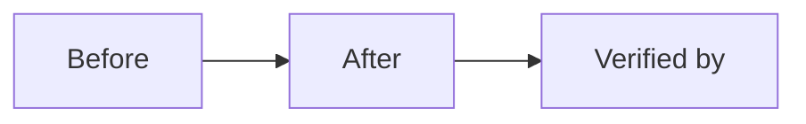

# Merge Dossier — harden-control-plane-and-restore

## Decision Card (≤ 5 min)

| Field | Value |
|---|---|
| What ships | One line. |
| Why | One line. |
| Blast radius | Services, crates, contracts, chains. |
| Worst failure | One line + detection. |
| Rollback | One command or one step. |
| Risk | Low / Medium / High. |
| Recommendation | Merge / Merge with follow-up / Do not merge. |

## Evidence

| Gate | Result | Evidence |
|---|---|---|
| SPEC | APPROVE (round 1) | `.sdlc/harden-control-plane-and-restore/reviews/spec-r1.md` @ `c41da755023cc5cec8b99dfe232eac8942c37586` |
| DEV | APPROVE (round 1) | `.sdlc/harden-control-plane-and-restore/reviews/dev-r1.md` @ `fd2b4d087b76e995cc535b39bffbb68df189dd53` |
| CI | green | `gh pr checks` output |
| Tests | pass | command + summary |
| Lints | pass | command + summary |

## Diff

- Files: <n> · +<add> / -<del>
- Areas: <crates/services>
- New dependencies: <none | list + rationale>

## Residual risk and follow-ups

- <none | item + issue link>

## Human decision

- [ ] Merge
- [ ] Merge with follow-up
- [ ] Request changes
- [ ] Abandon
