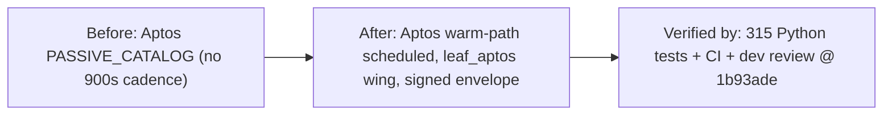

# Merge Dossier — leaf-aptos-warm-path

## Decision Card (≤ 5 min)

| Field | Value |
|---|---|
| What ships | Wire Aptos leaf into warm-path reflection: 900s cadence, MemPalace wing `leaf_aptos`, signed PolicyEnvelope (`APT-USDC`, `THL-APT`). |
| Why | Issue #90 dimension 3 warm-path scheduling (part of #87). |
| Blast radius | 3 backend files: `orchestrator.py`, `core/hierarchy.py`, `tests/test_hierarchy_v3.py`. No Rust, frontend, or public contract change. |
| Worst failure | Shared-file rebase mis-merges the Aptos block into a sibling leaf's block → wrong cadence/override; detected by `test_aptos_warm_path_reflection_and_policy_compilation`. |
| Rollback | Revert PR #233 (single commit `1b93ade`) on `master`; no data migration, no infra change. |
| Risk | Low (code). Merge is currently BLOCKED — see failing gates. |
| Recommendation | Do not merge (pending rebase + fresh dev review). |

## Status: NOT READY (failing gate)

| Failing gate | Evidence |
|---|---|
| PR mergeability | `gh pr view 233` → `mergeable: CONFLICTING`, `headRefOid = 1b93ade016824dea51f20ada8ef88292006bb2b4` |
| Rebase onto `master` | `git merge-tree --write-tree --messages origin/master HEAD` reports conflicts in all 3 changed files (`backend/agents/orchestrator.py`, `backend/core/hierarchy.py`, `backend/tests/test_hierarchy_v3.py`). `master` advanced from base `88a000d` to `389b0e2` via merged PR #231 (leaf-cosmos). This is NOT a byte-identical/mechanical rebase; patch-ids will differ, so a fresh DEV review round is required after resolution. |

## Evidence

| Gate | Result | Evidence |
|---|---|---|
| Lane | M (spec & plan skipped by rubric) | state.json `lane: M` |
| DEV | APPROVE (round 1) | `.sdlc/leaf-aptos-warm-path/reviews/dev-r1.md` @ `1b93ade016824dea51f20ada8ef88292006bb2b4` |
| reviewed_sha == PR head | match | `1b93ade016824dea51f20ada8ef88292006bb2b4` |
| Open blocker/major | 0 | dev-r1.md Findings: none |
| Round count | 1 (≤ 3) | state.json stages.dev.rounds = 1 |
| CI (PR #233) | green (rust, python, frontend, helm) | `gh pr checks 233` |
| Rust tests (local) | pass | `cargo test --manifest-path engine-rs/Cargo.toml` → ok |
| Python tests (local, py3.11) | pass (315/315) | `PYTHONPATH=. python3.11 -m unittest discover -s backend/tests` → 315 tests OK |
| Aptos test | pass | `test_aptos_warm_path_reflection_and_policy_compilation` OK |
| SDLC check | pass | `scripts/sdlc/sdlc.sh check leaf-aptos-warm-path` → PASS |
| Secrets / prod data in diff | none | diff grep: no key/token/secret/password; one `cg.daily_budget_usd` usage in test |
| Rollback documented | yes | "Revert commit" / revert PR |
| OpenSpec validate | N/A (lane M, no change dir) | `openspec validate` reports "Unknown item" |

## Diff

- Files: 3 · +72 / -2
- Areas: `backend/agents/orchestrator.py`, `backend/core/hierarchy.py`, `backend/tests/test_hierarchy_v3.py`
- New dependencies: none

## Residual risk and follow-ups

- Rebase must preserve the sibling `leaf-cosmos` entries in both `default_interval` lists (`orchestrator.py` and `hierarchy.py`), per dev-r1 non-blocking note.
- After rebase, the head SHA changes; DEV review must be re-run (not a mechanical `refresh-sha`, because patch-ids differ) before merge-ready.
- none otherwise.

## Human decision

- [ ] Merge (not available until rebase resolves)
- [ ] Merge with follow-up
- [x] Request changes (rebase + preserve cosmos entries + re-review)
- [ ] Abandon