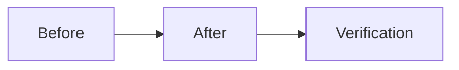

## Change

- **Change ID**: `leaf-aptos-warm-path`
- **Issue**: #90
- **Lane**: M
- **Base**: `master` · **Head**: `1b93ade016824dea51f20ada8ef88292006bb2b4`

## Decision Card (≤ 5 min)

| Field | Value |
|---|---|
| What ships | Wire Aptos leaf into warm-path reflection: 900s cadence, MemPalace wing `leaf_aptos`, signed PolicyEnvelope (`APT-USDC`, `THL-APT`). |
| Why | Issue #90 dimension 3. |
| Blast radius | backend/agents/orchestrator.py, backend/core/hierarchy.py, tests. |
| Risk | Low |
| Rollback | Revert commit. |

## Stage verdicts

| Stage | Round | Reviewer | Verdict | Reviewed SHA |
|---|---|---|---|---|
| spec | — | — | skipped | — |
| plan | — | — | skipped | — |
| dev | 1 | — | pending | 1b93ade016824dea51f20ada8ef88292006bb2b4 |

## Diff

- Files: 3 · +72 / -2
- Areas: backend warm path
- New dependencies: none

## Verification

| Command | Result | Evidence |
|---|---|---|
| `cd engine-rs && cargo test` | pass | cargo test ok |
| `PYTHONPATH=. python3 -m unittest discover -s backend/tests -v` | pass (baseline 17 env failures unchanged) | new aptos test ok |
| `cd frontend && npm run build` | not run (no node_modules) | — |

## Residual risk and follow-ups

- none

## Checklist

- [x] Only approved scope in the diff.
- [x] Every claimed behavior has a test.
- [x] No secrets, keys, or production data.
- [x] Invariants preserved.
- [x] Rollback documented.

---

🤖 Generated with [Claude Code](https://claude.com/claude-code)
