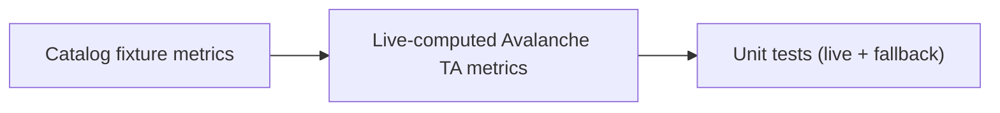

## Change

- **Change ID**: `leaf-avalanche-ingestion`
- **Issue**: #76
- **Lane**: M
- **Base**: `master` · **Head**: `b045b1105e494a13aecddf407c6cae75ae7cd217`

## Decision Card (≤ 5 min)

| Field | Value |
|---|---|
| What ships | Avalanche leaf TA metrics computation, market snapshot ingestion, and unit tests. |
| Why | Replace static CATALOG_FIXTURE entries with live-computed telemetry for the Avalanche leaf. |
| Blast radius | `backend/tools/ta_tools.py`, `backend/tests/test_hierarchy_v3.py` only. |
| Risk | Low. |
| Rollback | Revert the commit. |

## Stage verdicts

| Stage | Round | Reviewer | Verdict | Reviewed SHA |
|---|---|---|---|---|
| spec | — | — | skipped (lane M) | — |
| plan | — | — | skipped (lane M) | — |
| dev | 1 | — | pending | b045b1105e494a13aecddf407c6cae75ae7cd217 |

## Diff

- Files: 2 · +175 / -0
- Areas: backend tools/tests
- New dependencies: none

## Verification

| Command | Result | Evidence |
|---|---|---|
| `cd engine-rs && cargo test` | pass (all suites) | .sdlc/leaf-avalanche-ingestion/evidence/cargo-test.log |
| `PYTHONPATH=. python3 -m unittest discover -s backend/tests -v` | hierarchy suite pass (33 tests incl. new) | .sdlc/leaf-avalanche-ingestion/evidence/python-hierarchy.log |
| `cd frontend && npm run build` | not run (no frontend changes; npm deps absent locally) | — |
| `docker compose up --build -d` | not run (backend-only change, no service surface) | — |

## Residual risk and follow-ups

- none

## Checklist

- [x] Only approved scope in the diff.
- [x] Every claimed behavior has a test.
- [x] No secrets, keys, or production data.
- [x] Invariants preserved (hot path, risk gate, PolicyEnvelope, capital, vault, chain isolation).
- [x] Rollback documented.

---

🤖 Generated with [Claude Code](https://claude.com/claude-code)
