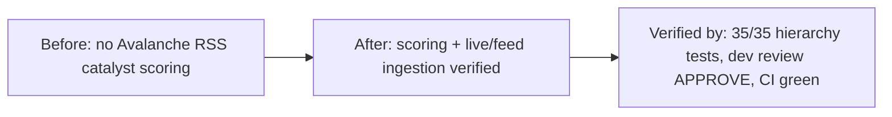

# Merge Dossier — leaf-avalanche-rss-catalysts

## Decision Card (≤ 5 min)

| Field | Value |
|---|---|
| What ships | Avalanche (`leaf-avalanche`) RSS/Atom catalyst scoring and feed ingestion plus a parser regression test. |
| Why | Align leaf-avalanche with the established ecosystem RSS catalyst pattern already used by sibling leaves. |
| Blast radius | `backend/tools/rss_tools.py` (+178), `backend/tests/test_hierarchy_v3.py` (+77). |
| Worst failure | Wrong catalyst category/asset classification or a feed branch serving a stale fixture instead of live RSS; detected by the Avalanche regression tests and `source_kind`/`feed_mode` inspection. |
| Rollback | Revert the squash commit (or run `git revert 154193b`) on master. |
| Risk | Low |
| Recommendation | Merge |

## Evidence

| Gate | Result | Evidence |
|---|---|---|
| SPEC | N/A (lane M, no spec artifacts) | `state.json` → `stages.spec.status = skipped` |
| PLAN | N/A (lane M) | `state.json` → `stages.plan.status = skipped` |
| DEV | APPROVE (round 1) | `.sdlc/leaf-avalanche-rss-catalysts/reviews/dev-r1.md` @ `56f3539640afa445e561faa4f933dbbdb15dd935` |
| OpenSpec | N/A (no openspec change for lane M) | `openspec validate` → "Unknown item" (expected) |
| SDLC check | PASS | `scripts/sdlc/sdlc.sh check leaf-avalanche-rss-catalysts` → PASS |
| CI | green (rust/python/frontend/helm) | `gh pr checks 219` → all PASS |
| Tests | pass (35/35 hierarchy) | `PYTHONPATH=. python3 -m unittest backend.tests.test_hierarchy_v3` → OK; 246 full-suite = 10 fail + 7 err, all reproduced on base `fa44f97` |
| Rust | pass | `cd engine-rs && cargo test` → all crates ok |
| Lints | pass | `git diff --check` → no whitespace errors |
| SHA match | reviewed = head | dev reviewed_sha `56f3539…` == PR head `56f3539…` == `git rev-parse HEAD` |
| Secrets/data | none | grep of changed files; no `.env` or key material in diff |

## Diff

- Files: 2 · +255 / -0
- Areas: `backend/tools/rss_tools.py`, `backend/tests/test_hierarchy_v3.py`
- New dependencies: none

## Residual risk and follow-ups

- Network reachability of the upstream Avalanche feed (`https://www.avax.network/blog/rss.xml`) is not exercised in CI; only parser/strategy logic is tested.
- Cosmetic: the PR body's "Stage verdicts" table still references the stale feature SHA `154193bd…`; the authoritative reviewed SHA is `56f35396…` (per `dev-r1.md`). Non-blocking.

## Human decision

- [ ] Merge
- [ ] Merge with follow-up
- [ ] Request changes
- [ ] Abandon
