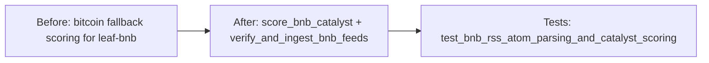

# Merge Dossier — leaf-bnb-rss-catalysts

## Decision Card (≤ 5 min)

| Field | Value |
|---|---|
| What ships | BNB Chain RSS/Atom catalyst scoring and live feed ingestion in `backend/tools/rss_tools.py` (+ regression test). |
| Why | Deliverable of issue #53 (Dimension 2): BNB Chain ecosystem catalyst intelligence for `leaf-bnb`. |
| Blast radius | Warm-path Python only; 2 files; no contract, hot path, or schema change. |
| Worst failure | Misclassified/missed BNB catalyst; detected by `test_bnb_rss_atom_parsing_and_catalyst_scoring`. |
| Rollback | Revert commit `472f821`. |
| Risk | Low (code); merge blocked by a branch conflict (gate failure). |
| Recommendation | Do not merge — rebase branch on `master` first, then re-verify. |

## Evidence

| Gate | Result | Evidence |
|---|---|---|
| SPEC | N/A (lane M, skipped) | state.json `stages.spec.status = skipped` |
| PLAN | N/A (lane M, skipped) | state.json `stages.plan.status = skipped` |
| DEV | APPROVE (round 1) | `.sdlc/leaf-bnb-rss-catalysts/reviews/dev-r1.md` @ `472f82157ce614de3dd8ca99405efd790d284060` |
| DEV SHA | matches PR head | `gh pr view 205` headRefOid = `472f82157ce614de3dd8ca99405efd790d284060`; `git rev-parse HEAD` = `472f82157ce614de3dd8ca99405efd790d284060` |
| CI (rust/python/frontend/helm) | green | `gh pr checks 205` (all 4 pass) |
| SDLC check | pass | `scripts/sdlc/sdlc.sh check leaf-bnb-rss-catalysts` → PASS |
| Open blocker/major | 0 open | dev-r1 findings: F01 minor, F02 nit |
| PR mergeability | **FAILING — CONFLICTING** | `gh pr view 205 --json mergeable` → `CONFLICTING`; `git merge-tree` shows both changed files (`backend/tools/rss_tools.py`, `backend/tests/test_hierarchy_v3.py`) |
| Tests | pass | `PYTHONPATH=. python3 -m unittest backend.tests.test_hierarchy_v3.TestHierarchicalArchitectureV3.test_bnb_rss_atom_parsing_and_catalyst_scoring` → OK (0.007s); dev-r1: 297 tests OK |
| Lint (secrets/CI) | pass | no secret/key/token patterns in diff; CI SDLC check PASS |
| OpenSpec validate | N/A (lane M, no change dir) | `openspec validate leaf-bnb-rss-catalysts --strict` → "Unknown item" (expected for lane M) |

## Diff

- Files: 2 · +262 / -0
- Areas: `backend/tools/rss_tools.py`, `backend/tests/test_hierarchy_v3.py`
- New dependencies: none

## Residual risk and follow-ups

- Open findings from DEV-R1 (non-blocking): `DEV-R1-F01` minor (duplicate `if __name__ == "__main__"` guard, `backend/tests/test_hierarchy_v3.py:1729`); `DEV-R1-F02` nit (empty-bytes feed treated as missing, same as sibling SUI/XRP).
- **Failing gate: merge conflict.** `origin/master` is 6 commits ahead of the branch base (`393654c`); both `backend/tools/rss_tools.py` and `backend/tests/test_hierarchy_v3.py` changed on both sides. Rebase/merge resolution required before merge-ready can be re-asserted.
- PR body stage-verdict table still lists dev reviewer as "pending"; update after rebase if desired (cosmetic).
- `docker compose up --build -d` runtime blocked by a pre-existing port-6379 conflict (not caused by this change); images built OK.

## Human decision

- [ ] Merge
- [ ] Merge with follow-up
- [ ] Request changes
- [ ] Abandon