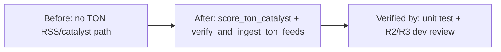

# Merge Dossier — leaf-ton-rss-catalysts

## Decision Card (≤ 5 min)

| Field | Value |
|---|---|
| What ships | TON (`leaf-ton`) RSS/Atom parsing, feed ingestion via `EcosystemRSSAggregator`, and catalyst scoring (`score_ton_catalyst`). |
| Why | Issue #65: dimension-2 ecosystem RSS and catalyst intelligence for `leaf-ton`. |
| Blast radius | `backend/tools/rss_tools.py`, `backend/tests/test_hierarchy_v3.py` only. No contract, risk, vault, or money-path change. |
| Worst failure | TON catalysts mis-categorized by venue (e.g. DeDust reported as STON.fi); detection: `test_ton_rss_atom_parsing_and_catalyst_scoring` and venue-priority assertions. |
| Rollback | `git revert` of the PR commit (or close/revert PR #203). |
| Risk | Low code risk; process gate open (see Failing gates). |
| Recommendation | Do not merge until the open gate is cleared. |

## Evidence

| Gate | Result | Evidence |
|---|---|---|
| SPEC | N/A (lane M, skipped) | state.json `stages.spec.status = skipped` |
| PLAN | N/A (lane M, skipped) | state.json `stages.plan.status = skipped` |
| DEV | APPROVE (round 3) | `.sdlc/leaf-ton-rss-catalysts/reviews/dev-r3.md` @ `f0a698152245ecd846a79de69eadb218db66fbb2` |
| DEV reviewed SHA vs PR head | FAIL | reviewed `f0a698152245ecd846a79de69eadb218db66fbb2`; PR #203 head `309a14acf956b82519e1d1ff1309731491f2ba9d` |
| CI | green | `gh pr checks 203` (rust, python, frontend, helm all pass) |
| Tests | pass | `PYTHONPATH=. python3 -m unittest backend.tests.test_hierarchy_v3.TestHierarchicalArchitectureV3.test_ton_rss_atom_parsing_and_catalyst_scoring` → OK (1 test, 0.008s) |
| Lints / SDLC | pass | `scripts/sdlc/sdlc.sh check leaf-ton-rss-catalysts` → PASS |
| OpenSpec validate | N/A (lane M; no openspec change) | `openspec validate leaf-ton-rss-catalysts --strict` → unknown item (expected for micro lane) |

## Diff

- Files: 2 code files · +260 / -0 (`rss_tools.py` +183, `test_hierarchy_v3.py` +77). Plus SDLC ledger artifacts (11 files) under `.sdlc/`.
- Areas: `backend/tools`, `backend/tests`.
- New dependencies: none.

## Failing gates

- DEV `reviewed_sha` (`f0a698…`) does not equal the PR head SHA (`309a14…`). The verdict text covers the identical TON code (functions `score_ton_catalyst` and `verify_and_ingest_ton_feeds` are byte-identical between the reviewed tree and HEAD; only mechanical rebase/ledger commits differ), but the persisted verdict never names the current PR head. Per gate rule this is not merge-ready. Remediation: run a reviewer pass that records `reviewed_sha = 309a14…` (or update the verdict record after re-confirming equivalence), not a silent ledger edit.
- Note: `state.json` was hand-aligned to `309a14…` and therefore reports `merge-ready`, which masks the above. The verdict JSON is the authoritative reviewed SHA.

## Reviewer findings summary

- DEV-R1-F01 (`major`) — DeDust catalysts miscategorized as STON.fi: closed at R2 (`3ba55c8`), confirmed closed at R3.
- No open `blocker` or `major` in DEV R2/R3 verdicts.
- Minor/nit follow-up: substring matching could false-positive on short fragments in richer prose (not introduced by this change); PR body still shows stale head SHA `e8112f2…` and +259 count.

## Residual risk and follow-ups

- Configured live feed URL `https://blog.ton.org/rss/` returns HTML in practice; parser falls back to curated fixture when network injection fails (documented in PR body).
- Align ledger/PR-body metadata with the current head SHA (see Failing gates).
- No secret, key, `.env`, or production data detected in the change or evidence.

## Human decision

- [ ] Merge
- [ ] Merge with follow-up
- [ ] Request changes
- [ ] Abandon