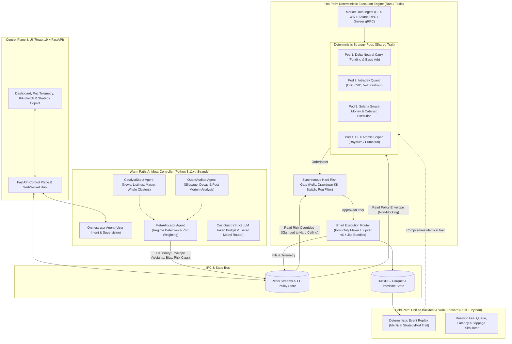

# ADR 0001: Hybrid Rust/Python Event-Driven Quant & Agentic Meta-Controller Architecture

- **Status**: Accepted
- **Date**: 2026-10-16
- **Deciders**: Hoani Cross (Architect), Antigravity (Technical Sparring Partner)

---

## 1. Context and Problem Statement

The initial Robotrader prototype was designed around a pure Python threaded agent swarm (`BaseAgent` subclasses running `while self.running: time.sleep(0.1)`) where LLMs (via OpenRouter/LiteLLM and `strands-agents`) were placed directly in the trading loop (`ChartistAgent`, `TrendScoutAgent`, `SniperAgent`, `PortfolioManagerAgent`).

While suitable as a conceptual demo, this architecture has **four fatal flaws** for generating real-world trading profits:

1. **Execution Latency Mismatch**: A Solana slot is ~400ms and CEX orderbook imbalances decay in <50ms. Routing execution decisions through Python threads and HTTP LLM API calls (500ms–5,000ms latency) guarantees adverse selection and makes DEX sniping impossible (becoming exit liquidity for Rust MEV bots).
2. **Non-Backtestability & Look-Ahead Bias**: LLM completions are non-deterministic, slow, expensive at scale, and contaminated by training-data cutoff bias. A strategy that cannot be replayed over millions of historical ticks with realistic fee and slippage models cannot be statistically validated (Sharpe, Sortino, Walk-Forward efficiency, Max Drawdown).
3. **Weak Quantitative Signal Processing**: LLMs excel at unstructured semantic synthesis (news, listings, governance, narrative shifts) but perform poorly on raw numerical time-series calculation compared to deterministic statistical models.
4. **Absence of a Synchronous Risk Firewall**: Risk management (`PortfolioManagerAgent`) was modeled as an asynchronous message-passing peer rather than an inviolable, synchronous pre-trade circuit breaker. Additionally, `LLMMonitorAgent` included an unbounded auto-refill mechanism via Solana wallet transfers without hard daily spending caps.

We need an architecture that delivers **institutional-grade execution performance**, **provable statistical edge**, and **rapid time-to-profit** while leveraging AI agents where they genuinely provide asymmetric value.

---

## 2. Decision Drivers

- **Profitability & Time-to-Market**: Prioritize strategy families by Sharpe ratio and infrastructure cost (Delta-Neutral Carry & Intraday Quant first, Solana Smart-Money second, low-latency DEX Sniping third).
- **Zero LLM in the Hot Path**: Sub-millisecond to low-millisecond deterministic execution and risk checks.
- **Zero Code Drift (Backtest == Paper == Live)**: The exact same strategy and risk code must run against historical Parquet/DuckDB streams, live paper-trading, and real capital execution.
- **Fail-Safe Decoupling**: If the AI/LLM layer experiences high latency, rate limits, or hallucinations, the execution engine must continue operating safely within strict deterministic bounds or gracefully flatten exposure.
- **Multi-Strategy Modularity**: Support four distinct alpha pods (Swing/Intraday Directional, Delta-Neutral Carry, Solana Smart-Money/Micro-Caps, and DEX Sniping/MEV).

---

## 3. Considered Options

### Option A: Pure Python Threaded LLM Swarm (Legacy Architecture)
- **Pros**: Quick to prototype toy agents.
- **Cons**: Unbacktestable, >1s latency, high API burn rate, vulnerable to MEV and hallucinations, no hard risk isolation. **Rejected.**

### Option B: Unified Python Asyncio Quant Engine + AI Meta-Controller
- **Pros**: Single language (`asyncio`, `ccxt.pro`, `polars`), fast iteration for >1s horizon strategies.
- **Cons**: Python GIL, garbage collection pauses, and slower binary serialization limit competitiveness on Solana Geyser streams, Jito bundle construction, and high-frequency orderbook maintenance.

### Option C (Selected): Hybrid Rust (Hot Path & Replay Engine) + Python (Warm Path AI Meta-Controller & Research)
- **Pros**:
  - **Rust (`engine-rs`)** handles multiplexed WebSockets/gRPC, L2 orderbooks, deterministic alpha pods, synchronous pre-trade `HardRiskGate`, Jito/Jupiter transaction signing, and high-speed historical backtesting.
  - **Python (`agents-py`)** handles unstructured catalyst ingestion, LLM agentic reasoning (`strands-agents`), regime classification, dynamic capital allocation across pods, and the FastAPI/WebSocket control plane.
  - **Redis Streams + Pub/Sub** provides a sub-millisecond, schema-validated (MessagePack/JSON) IPC boundary with TTL-enforced policy envelopes.
- **Cons**: Two-language repository requiring clear Protobuf/JSON-Schema contracts across the Redis boundary.

---

## 4. Architecture Specification (Option C)

### 4.1. Tri-Plane Separation (Hot / Warm / Cold Paths)



### 4.2. The Contract Between AI (Warm Path) and Execution (Hot Path)

The AI layer **never** sends raw market orders directly to an exchange. Instead, `MetaAllocator` publishes a signed, TTL-bounded **`PolicyEnvelope`** to Redis:

```json
{
  "envelope_id": "env_20261016_234500",
  "issued_at_ms": 1792187100000,
  "ttl_seconds": 900,
  "global_regime": "RISK_ON_HIGH_VOL",
  "pod_allocations": {
    "pod_carry": { "enabled": true, "capital_weight": 0.40, "min_funding_apr": 0.15 },
    "pod_momentum": { "enabled": true, "capital_weight": 0.35, "directional_bias": "LONG_BIAS" },
    "pod_solana_alpha": { "enabled": true, "capital_weight": 0.15, "max_slippage_bps": 100 },
    "pod_sniper": { "enabled": false, "capital_weight": 0.00 }
  },
  "asset_overrides": {
    "SOL-USDT": { "catalyst_score": 0.82, "bias": "BULLISH", "max_leverage": 2.0 },
    "JUP-USDT": { "catalyst_score": 0.65, "bias": "NEUTRAL", "max_leverage": 1.0 }
  }
}
```

**Fail-Safe Invariant**:
- If `now() > issued_at_ms + ttl_seconds * 1000`, the Rust engine automatically reverts to a **Safe Baseline Envelope** (`pod_sniper: disabled`, `directional_bias: NEUTRAL`, reduced position sizing, carry-only or reduce-only mode).
- The Rust `HardRiskGate` clamps any AI-requested parameters against immutable compile-time/config-time ceilings (e.g., AI cannot request `max_leverage: 20.0` if the hard ceiling is `3.0`).

### 4.3. Synchronous Hard Risk Gate (`risk-gate`)

Every `OrderIntent` emitted by a strategy pod must pass through `HardRiskGate::validate(&self, intent: &OrderIntent, portfolio: &PortfolioState) -> Result<ApprovedOrder, RiskRejection>` in `<50µs`:

1. **Global Drawdown Circuit Breaker**: Halts all new risk-taking and optionally flattens positions if rolling 24h drawdown exceeds `MAX_DAILY_DRAWDOWN_PCT` (e.g., 3.0%).
2. **Position Sizing & Concentration**: Enforces Volatility-Targeted Fractional Kelly sizing and caps single-asset exposure (e.g., max 15% of equity per directional trade).
3. **Execution Cost & Slippage Guard**: Rejects trades where estimated round-trip fee + spread + price impact exceeds expected alpha edge.
4. **On-Chain Solana Safety Gate (Pods 3 & 4)**:
   - Verifies Mint Authority is revoked (`None`) and Freeze Authority is revoked (`None`).
   - Checks top-10 holder concentration and LP lock/burn status.
   - Simulates transaction via RPC `simulateTransaction` before submitting a Jito bundle.

### 4.4. Phased Delivery for Fast Time-to-Profit

Rather than building all four pods imperfectly at once, execution follows a strict **Time-to-Profit hierarchy**:

| Phase | Scope | Expected Edge & Risk Profile | Infrastructure Required |
| :--- | :--- | :--- | :--- |
| **Phase 1: Core Spine** | Rust workspace (`engine-rs`), `HardRiskGate`, Redis IPC, Unified Backtest/Paper Engine, FastAPI + React Live Telemetry | Foundation (0% capital at risk, full paper-trading & historical validation) | Local Docker / Standard VPS |
| **Phase 2: Cashflow Engine (Pods 1 & 2)** | **Pod 1 (Funding/Basis Carry)** + **Pod 2 (Intraday Momentum/Orderflow)** on CEX/Perps (Binance / Hyperliquid) | Consistent Sharpe (1.8–3.0+), market-neutral base yield + liquid breakout capture | Standard VPS + CEX WebSocket APIs |
| **Phase 3: AI Meta-Control & Solana Alpha (Pod 3)** | Python Warm-Path Agents (`CatalystScout`, `MetaAllocator`, `QuantAuditor`) + **Pod 3 (Solana Smart-Money & Jupiter/Jito)** | Asymmetric upside on narrative catalysts & whale flow with anti-MEV Jito bundles | Helius/Triton RPC + OpenRouter API |
| **Phase 4: Low-Latency DEX Sniper (Pod 4)** | **Pod 4 (Raydium/Pump.fun Atomic Sniper)** with Geyser gRPC & Jito ShredStream | High-risk / high-reward micro-cap sniping with sub-second automated exit | Dedicated Solana Geyser gRPC node + Co-located VPS |

---

## 5. Consequences

### Positive
- **Real Profit Potential**: Eliminates LLM latency from order execution, introduces maker-fee optimization and Jito MEV protection, and grounds every strategy in deterministic backtesting.
- **Bounded Blast Radius**: A bug or hallucination in the Python AI layer cannot drain the wallet; the Rust `HardRiskGate` and Solana keypair stay isolated inside `engine-rs`.
- **Clean Namespace**: Resolves the `backend/strands` vs `strands-agents` collision by moving local orchestration to `backend/core/` and `backend/agents/`.

### Negative / Trade-offs
- **Dual-Stack Build Pipeline**: Requires Cargo (Rust) alongside Poetry (Python) and Node (React) in Docker Compose and CI.
- **Strict Schema Discipline**: Changes to `MarketEvent`, `OrderIntent`, or `PolicyEnvelope` must stay synchronized between Rust (`serde`) and Python (`pydantic`).
