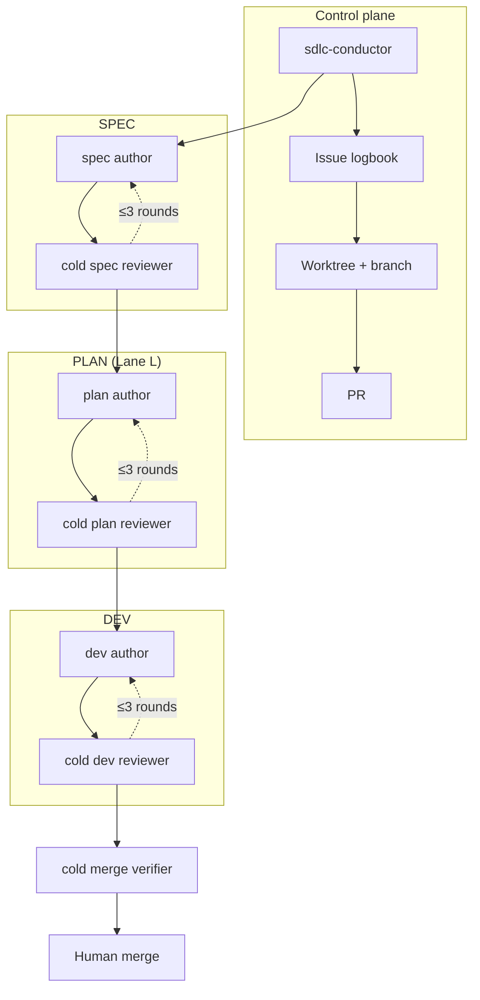

# ADR 0004: Right-Sized Agentic SDLC with Cold-Start Reviews

- **Status**: Accepted
- **Date**: 2026-10-25
- **Deciders**: Hoani Cross (Architect), Claude Code (Technical Sparring Partner)

---

## 1. Context and Problem Statement

Robotrader is now large enough that a single agent session can produce a
plausible change that is wrong in a way its author cannot see: a hot-path
allocation, a Rust/Python contract drift, a weakened capital guard, or a
specification that hides a scope change. The repository already carries strong
domain invariants (`AGENTS.md`, ADR-0001/0002/0003, `docs/CRYPTO_VAULT_AND_KEY_MANAGEMENT.md`),
but no delivery process that enforces them before a merge.

The failure modes we need to prevent:

1. **Self-review.** The author approves its own work, or the orchestrator
   nudges the reviewer toward the desired verdict.
2. **Unbounded loops.** Agent review cycles that add a new finding every round
   and never converge.
3. **Spec theater.** A specification for a typo, and no specification for a
   money-path change; the process is applied uniformly instead of by risk.
4. **Human bottleneck.** Specs written as prose walls that cost thirty minutes
   to validate, so the human rubber-stamps or disengages.
5. **Context leakage.** A reviewer that "resumes" by reading the author's
   chain-of-thought, inheriting its blind spots.
6. **Tool lock-in.** Agent profiles that work in one CLI (Claude Code) and
   break in the other (Antigravity CLI).

We need a process that is autonomous by default, keeps the human in control of
the one irreversible action (merge), and is cheap for small changes.

---

## 2. Decision Drivers

- **Safety before velocity on money paths.** Risk-gate, vault, and capital
  changes get architecture review; a typo does not.
- **Structural independence.** Review quality must not depend on an agent's
  good behaviour.
- **Bounded cost and time.** Three review rounds, then a human decision.
- **Five-minute human attention.** The decision surface is a Review Card, not
  the full delta spec.
- **Artifact-based memory.** Resume must work across CLIs and sessions.
- **OpenSpec compatibility.** Specs should be machine-validated and archivable.
- **Dual-CLI support.** Claude Code and Antigravity CLI are both first-class.
- **No auto-merge.** The human owns the irreversible step.

---

## 3. Considered Options

### Option A: Adopt OpenSpec's default workflow unchanged

- **Pros**: Minimal custom code; one tool; good spec validation.
- **Cons**: No cold reviewers, no lanes, no three-round cap, no issue/worktree/PR
  contract, no robotrader invariants. **Rejected as the whole process.**
- **Retained**: OpenSpec is the spec store and validator.

### Option B: One agent, self-review, human reviews only the final PR

- **Pros**: Cheapest; one context.
- **Cons**: No independent review; the author's blind spots survive to the merge;
  the human becomes the only reviewer, which is the bottleneck we are trying to
  remove. **Rejected.**

### Option C: Human review at every stage

- **Pros**: Maximum control.
- **Cons**: Defeats autonomy; the human spends their time on specs instead of
  decisions. **Rejected as the default**, retained as an optional gate policy.

### Option D (selected): Right-sized lanes + cold-start reviewer agents + bounded loop

- **Pros**:
  - Lane M stays fast; Lane L gets spec, plan, and dev review.
  - Reviewers are fresh instances; independence is structural.
  - The ledger makes resume artifact-based and CLI-agnostic.
  - R1-exhaustive / R2–R3-closure makes three rounds sufficient.
  - OpenSpec provides strict spec validation and archival.
  - The Review Card bounds human attention to five minutes.
  - Agents never merge; the human decision is the only irreversible step.
- **Cons**:
  - More moving parts than a single agent.
  - Requires discipline to keep the Review Card short and the delta specs exact.
  - A cold reviewer can be slower than an in-context one.

---

## 4. Architecture

### 4.1 Artifact model

| Layer | Location | Role |
|---|---|---|
| Definitions | `sdlc/` | protocol, agents, checklists, schemas, templates |
| Spec truth | `openspec/` | proposal, delta specs, design, tasks |
| Runtime ledger | `.sdlc/<change-id>/` | state, verdicts, revisions, evidence, dossier |
| CLI adapters | `.claude/agents/`, `.agent/agents/` | generated from `sdlc/agents/` |

### 4.2 Review contract

- Each verdict is a Markdown file with a fenced JSON block, validated by
  `verdict-lint.py`.
- Findings have a stable ID, severity, origin, status, location, evidence, and
  required fix.
- R1 is exhaustive; R2/R3 may only add `regression`, `security`, or `critical`
  findings.
- Round 3 must `APPROVE` or `ESCALATE`; a fourth round is rejected.

### 4.3 State machine

`TRIAGE → SPEC → SPEC_REVIEW → PLAN → PLAN_REVIEW → DEV → DEV_REVIEW → MERGE_READY → HUMAN_MERGE`.
Lane S skips PLAN; Lane M skips SPEC and PLAN.

### 4.4 Human surface

- Review Card: ≤ 400 words, ≥ 1 diagram, ≤ 5.0 minutes.
- Merge dossier: same budget, with evidence table and rollback.
- Gates use the `user-validate` skill, never a bare prose question.

---

## 5. Consequences

### Positive

- Money/risk/vault changes cannot reach `master` without an independent plan
  and dev review.
- Small changes stay small: no spec for a typo.
- Review loops converge: the tooling rejects moving goalposts and a fourth round.
- The human reviews a decision card, not a document.
- Agent definitions are CLI-neutral with generated adapters; drift is caught in CI.
- Every change has a durable audit trail: issue, ledger, verdicts, PR, dossier.

### Negative

- A cold reviewer costs more tokens than an in-context reviewer.
- The Review Card discipline is unnatural for agents trained to write prose.
- Two CLIs mean two adapter surfaces, kept in sync by a script and CI.
- The process adds latency to Lane L (three stages).

### Mitigations

- Lane M and S exist precisely to avoid over-processing.
- `spec-lint.py` enforces the Review Card budget mechanically.
- `install-agents.sh --check` prevents adapter drift.
- The three-round cap bounds the worst case; escalation converts deadlock into
  a human decision instead of more iterations.

---

## 6. Risks

| Risk | Mitigation |
|---|---|
| Reviewers rubber-stamp | Evidence standard; `verdict-lint` rejects empty evidence; merge verifier is separate |
| Authors game the lane | Rubric is explicit; downgrade requires a human; conductor records the reason |
| Cold reviewer lacks context | Mandatory reading order; revision notes; spec/plan are self-contained |
| Human becomes a bottleneck at merge | Merge dossier is ≤ 5 min; only irreversible decisions reach the human |
| Adapter drift | Generated files + CI `--check` |
| A secret leaks into evidence | Dev checklist blocker; evidence is gitignored; review checks |
| Process entropy | Monthly metrics: rounds, escalations, read time, lead time |

---

## 7. Compliance with existing invariants

- **Zero LLM in the hot path**: the dev checklist and dev reviewer make it a
  blocker.
- **PolicyEnvelope parity**: checked in plan and dev reviews.
- **Capital protection**: money-path changes are Lane L by definition.
- **Vault/key handling**: Lane L, with an explicit zeroization/whitelist check.
- **Backtest == paper == live**: plan test strategy and dev checklist.
- **Chain isolation**: spec impact and dev review.

---

## 8. Alternatives explicitly rejected

- A single heavyweight RFC for every change: too slow for daily work.
- Human approval at every stage: defeats autonomy.
- Fully automated merge: unacceptable risk on a trading system.
- A bespoke spec format: loses OpenSpec validation and tooling.
- Claude-only agent profiles: breaks the Antigravity workflow.

---

## 9. References

- `sdlc/PROTOCOL.md` — normative workflow.
- `docs/sdlc/README.md` — human overview.
- `docs/sdlc/spec-format.md` — spec format and five-minute rule.
- `docs/sdlc/agent-profiles.md` — roles, cold start, CLI mapping.
- `docs/sdlc/operations.md` — issue, worktree, PR, CI, merge.
- OpenSpec: https://github.com/Fission-AI/OpenSpec
- ADR-0001, ADR-0002, ADR-0003 — platform architecture.
