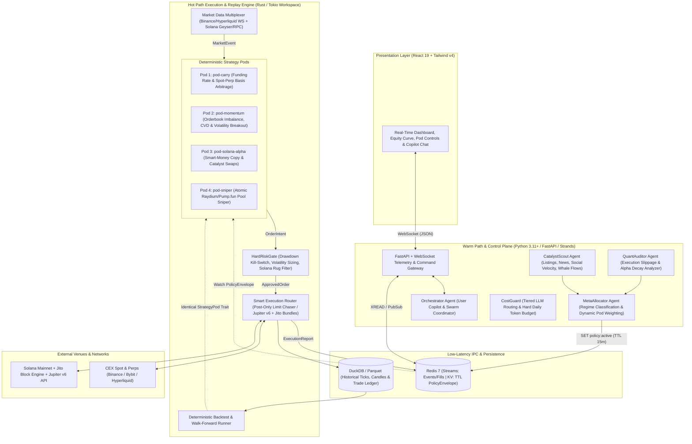

# Robotrader v2 Architecture: Hybrid Quant + Agentic Meta-Controller

> **Reference Decision**: [ADR-0001: Hybrid Rust/Python Event-Driven Quant & Agentic Meta-Controller Architecture](adr/0001-hybrid-quant-agentic-architecture.md)

## 1. Architectural Philosophy

Robotrader v2 separates **deterministic low-latency execution** from **asynchronous AI reasoning**:

1. **Zero LLM in the Hot Path**: Market data ingestion, orderbook state, quantitative signal calculation, pre-trade risk enforcement, and order routing execute deterministically in **Rust (`engine-rs`)** in `<1ms`.
2. **AI as Warm-Path Meta-Controller**: Python AI agents (`backend/`) ingest unstructured real-time catalysts (listings, macro events, governance, whale clusters), classify market regimes, and publish TTL-bounded **`PolicyEnvelope`** states to Redis.
3. **Zero Code Drift (`Backtest == Paper == Live`)**: Strategy pods implement a unified Rust trait (`StrategyPod`) that processes identical `MarketEvent` streams whether replaying historical Parquet/DuckDB ticks, paper-trading live WebSockets, or executing with real capital.
4. **Synchronous Hard Risk Firewall**: No order reaches an exchange or Solana RPC without passing through `HardRiskGate`, which enforces fractional Kelly sizing, daily drawdown kill-switches, fee/slippage bounds, and on-chain token safety checks.

---

## 2. System Topology



---

## 3. Repository Layout (Target Structure)

```text
.
├── engine-rs/                  # Rust Hot-Path & Backtest Workspace (Cargo)
│   ├── Cargo.toml
│   ├── crates/
│   │   ├── common/             # Shared types: MarketEvent, OrderIntent, PolicyEnvelope, Venue
│   │   ├── ingest/             # CEX WebSockets (Binance/Hyperliquid) & Solana RPC/Geyser streams
│   │   ├── risk-gate/          # Synchronous HardRiskGate, Kelly sizer, Drawdown kill-switch, Rug filter
│   │   ├── strategies/         # StrategyPod trait + Pod 1 (Carry), Pod 2 (Momentum), Pod 3 (Solana), Pod 4 (Sniper)
│   │   ├── exec-router/        # Post-only CEX router, Jupiter v6 client, Jito bundle signer, Paper simulator
│   │   ├── backtest/           # Historical Parquet/DuckDB replay engine & performance metrics (Sharpe/Sortino/DD)
│   │   └── node/               # Main hot-path binary connecting Ingest -> Pods -> Risk -> Exec <-> Redis
├── backend/                    # Python Warm-Path AI Meta-Controller & Control Plane (Poetry)
│   ├── core/                   # Redis IPC client, Pydantic schemas (matching engine-rs/common), LLM router
│   ├── agents/                 # Strands-based Warm-Path Agents (Orchestrator, CatalystScout, MetaAllocator, QuantAuditor, CostGuard)
│   ├── api/                    # FastAPI REST + WebSocket hub for UI telemetry, backtest triggers & manual kill-switch
│   ├── server.py               # FastAPI + Warm-Path Agent lifecycle entrypoint
│   └── tests/                  # Pytest suite for IPC contracts, agent policies & API endpoints
├── frontend/                   # React 19 + Vite + Tailwind v4 Command Center
│   └── src/
│       ├── components/         # Live PnL Dashboard, Pod Allocation Matrix, Risk Kill-Switch, Orchestrator Chat
│       └── hooks/              # Real-time WebSocket state synchronization hook
├── docs/
│   ├── adr/                    # Architecture Decision Records
│   ├── architecture.md         # System topology & component contracts
│   └── agents.md               # Warm-Path AI Agents & Hot-Path Strategy Pods specification
└── docker-compose.yml          # Orchestrates redis, engine-rs, backend, and frontend
```

---

## 4. Core Component Specifications

### 4.1. Rust Hot-Path Engine (`engine-rs`)

1. **`crates/common`**:
   - Defines canonical types serialized via `serde` (JSON/MessagePack): `MarketEvent` (`L2BookUpdate`, `TradeTick`, `FundingRateUpdate`, `SolanaPoolCreated`, `WhaleSwapDetected`), `OrderIntent`, `ApprovedOrder`, `ExecutionReport`, and `PolicyEnvelope`.
2. **`crates/strategies` (`StrategyPod` Trait)**:
   ```rust
   pub trait StrategyPod: Send + Sync {
       fn id(&self) -> &'static str;
       fn on_market_event(&mut self, event: &MarketEvent, policy: &PolicyEnvelope) -> Vec<OrderIntent>;
       fn on_execution_report(&mut self, report: &ExecutionReport);
   }
   ```
3. **`crates/risk-gate` (`HardRiskGate`)**:
   - Stateful, in-memory pre-trade validator.
   - Tracks real-time equity, unrealized PnL, daily high-water mark, per-pod exposure, and order rate limits.
   - Rejects any `OrderIntent` if `daily_drawdown >= max_daily_drawdown_pct` or if `PolicyEnvelope` TTL has expired without safe-mode fallback.
4. **`crates/exec-router`**:
   - Supports three execution modes switchable via config: `Backtest`, `Paper` (live market data with simulated fills/fees/slippage), and `Live`.
   - **CEX Optimization**: Uses `Post-Only` limit orders at best bid/ask with micro-repricing to capture maker rebates or low maker fees instead of paying 5–10 bps taker fees.
   - **Solana Optimization**: Quotes via Jupiter v6 and submits transactions wrapped in **Jito bundles** (`sendBundle`) so failed or front-run transactions cost zero base gas if they revert.

### 4.2. Python Warm-Path AI Layer (`backend/`)

- Uses `strands-agents` (isolated cleanly from `backend/core/` to prevent module shadowing).
- Operates asynchronously off the critical path:
  - Aggregates external signals (RSS/news feeds, exchange announcements, funding rate extremes, on-chain whale alerts).
  - Synthesizes a `PolicyEnvelope` every $N$ minutes (or immediately upon a high-priority catalyst event) and writes it to Redis key `robotrader:policy:active` with a 15-minute TTL.
  - Streams live telemetry (`robotrader:stream:telemetry` and `robotrader:stream:fills`) to the React frontend over WebSocket `/ws/telemetry` and `/ws/chat`.

---

## 5. Security & Capital Protection Invariants

1. **Private Key Isolation**: Exchange trade API keys and Solana signing keypairs are injected exclusively into `engine-rs`. The Python LLM container (`backend`) has **zero access** to signing keys or withdrawal permissions.
2. **No Withdrawal Permission**: CEX API keys must be restricted to `Spot & Margin/Futures Trading` only, with IP whitelisting and withdrawals disabled.
3. **Dedicated Solana Sub-Wallet**: `engine-rs` operates with a hot trading sub-wallet holding only the active risk allocation, never a master cold treasury.
4. **Hard Kill-Switch**: A Redis + in-memory atomic kill-switch (`POST /api/v1/risk/kill` or automatic drawdown trigger) immediately cancels all open orders and flattens directional exposure.
