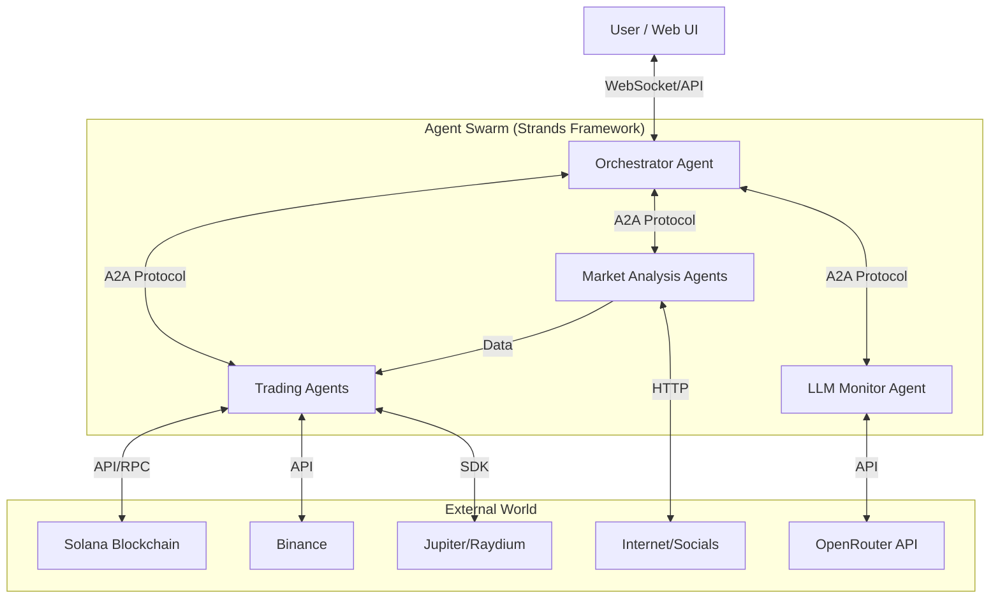

# Robotrader Architecture

## High-Level Overview

Robotrader is designed as a distributed system of autonomous agents. The core philosophy is **decentralized intelligence with centralized orchestration**.

## Core Components

### 1. The Agent Framework (Strands)
We use **Strands** to define agents. Each agent is an independent process or thread that:
-   Maintains its own state.
-   Exposes a set of **Tools**.
-   Communicates via the **A2A Protocol**.

### 2. Communication Layer (A2A)
Agents communicate using a standardized protocol (A2A). This allows for:
-   **Task Delegation**: Orchestrator sends "Goal" messages to workers.
-   **Information Sharing**: Analysis agents broadcast "Insight" messages.
-   **Negotiation**: Trading agents can request funds from the Portfolio Manager.

### 3. The Orchestrator
The central brain. It does not trade directly. Its job is to:
-   Understand User Intent (e.g., "Accumulate SOL with low risk").
-   Spawn or activate appropriate sub-agents.
-   Monitor overall system health.

### 4. Data & State
-   **Hot State**: In-memory agent context.
-   **Cold State**: Database (PostgreSQL/Redis) for trade history, performance metrics, and user settings.

## Security Architecture

-   **Secrets Management**: API Keys and Private Keys are injected via environment variables or a secure vault. Agents never log these keys.
-   **Sandboxing**: Agents run in isolated environments (Docker containers) where possible to limit blast radius.
-   **Spending Limits**: The `LLMMonitor` and `Trading` agents have strict, hard-coded limits on how much they can spend/trade per day.
