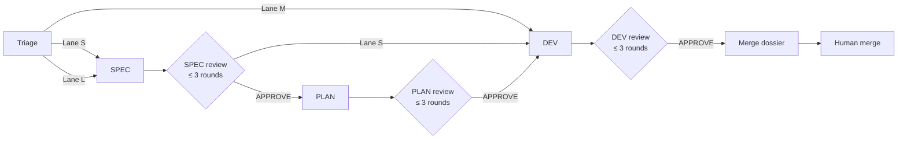
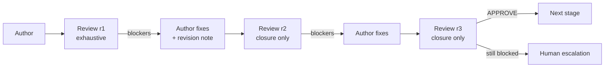

# Robotrader SDLC — SPEC → PLAN → DEV with cold reviews

> Normative contract: [`sdlc/PROTOCOL.md`](../../sdlc/PROTOCOL.md).
> This page is the human map. If they disagree, the protocol wins.

## 1. What this is

A right-sized delivery workflow for this repository:

- every change has an **issue logbook**, a **branch in a worktree**, and a **PR**;
- SPEC, PLAN, and DEV are separate stages, each reviewed by a **cold-start** agent;
- a stage gets **at most three review rounds**; after that, a human decides;
- specs use an **OpenSpec-compatible** structure;
- the human decision surface is a **five-minute Review Card**, not a wall of prose;
- no agent merges. The final merge is a human decision.

## 2. Three lanes, not one ceremony

| Lane | When | Artifacts | Cold reviews | Typical lead time |
|---|---|---|---|---|
| **M** — Micro | ≤ 2 files, one module, no contract/money/risk/vault change, existing tests cover it | issue + PR only | dev | minutes |
| **S** — Standard | new behavior, 3–10 files, one service/crate, additive contract | `proposal` + delta `specs` + `tasks` | spec, dev | hours |
| **L** — Large | breaking contract, money/risk/vault path, > 10 files, cross-stack, migration, ADR | `proposal` + `specs` + `design` + `tasks` | spec, plan, dev | days |

Tie or uncertainty → higher lane. Downgrading a lane removes safeguards and
requires a human decision.



## 3. The five-minute rule

The human reads the **Review Card**, not the whole spec.

| Surface | Audience | Budget |
|---|---|---|
| Review Card (top of `proposal.md`) | human decision | ≤ 400 words, ≥ 1 diagram, ≤ 5.0 min |
| Delta specs (`specs/**`) | machine contract and tests | as precise as needed |
| `design.md` | engineers and plan reviewer | as precise as needed |
| `tasks.md` | implementation tracking | one session per task |
| Merge dossier | human merge decision | ≤ 5.0 min |

The linter rejects a Review Card over budget. The delta spec is where rigor
lives; the card is where decisions happen.

## 4. The review loop



- **R1 is exhaustive**: every substantiated blocker/major at once.
- **R2 and R3 are closure-only**: verify open findings; new findings only for
  regressions, security, or critical safety.
- **Three rounds per stage**, three DEV rounds per PR.
- **A fourth round is rejected by the tooling**, not by convention.
- The reviewer resumes from its **persisted ledger** (`reviews/*.md`), never
  from the author's chat. See [`agent-profiles.md`](agent-profiles.md).

## 5. Quickstart

```bash
# 0. Verify prerequisites, auth, config, and adapter sync
scripts/sdlc/sdlc.sh doctor

# 1. Choose a lane and start the change (creates issue + worktree + branch + state)
scripts/sdlc/sdlc.sh start add-health-endpoint \
  --title "Add health endpoint" \
  --lane S \
  --reason "Additive API, one service, no money path"

# 2. From the worktree, ask what to do next
scripts/sdlc/sdlc.sh next add-health-endpoint
# -> writes a brief for the next cold agent

# 3. Launch the cold author in the worktree printed by `start`
SDLC_AGENT_CWD=.worktrees/42-add-health-endpoint \
  scripts/sdlc/run-agent.sh sdlc-spec-author \
  .sdlc/add-health-endpoint/briefs/spec-r1-sdlc-spec-author.md

# 4. Mark the stage in review, then launch the cold reviewer
scripts/sdlc/sdlc.sh stage add-health-endpoint spec in_review
scripts/sdlc/sdlc.sh next add-health-endpoint
scripts/sdlc/run-agent.sh sdlc-spec-reviewer .sdlc/add-health-endpoint/briefs/spec-r1-sdlc-spec-reviewer.md

# 5. Record the verdict
scripts/sdlc/sdlc.sh verdict add-health-endpoint spec 1 .sdlc/add-health-endpoint/reviews/spec-r1.md

# 6. Repeat for each stage, then verify the merge gate
scripts/sdlc/sdlc.sh merge-ready add-health-endpoint
```

For an interactive session, run the conductor as the primary agent:

```bash
claude --agent sdlc-conductor        # Claude Code
agy --agent sdlc-conductor           # Antigravity CLI
```

## 6. File map

```
openspec/                    # OpenSpec truth store
  config.yaml                # project context + per-artifact rules
  specs/                     # current truth
  changes/<id>/              # proposal, specs, design, tasks
sdlc/                        # definitions (no dot)
  PROTOCOL.md                # normative workflow
  agents/*.md                # canonical agent profiles
  checklists/*.md            # reviewer checklists
  schemas/*.json             # verdict and state schemas
  templates/                 # issue, PR, dossier, change templates
.sdlc/<id>/                  # runtime ledger (dot)
  state.json                 # machine state
  reviews/                   # cold verdicts
  revisions/                 # author responses
  evidence/                  # test logs, screenshots (gitignored)
  briefs/                    # exact briefs given to agents
  merge-dossier.md           # five-minute human decision
.claude/agents/              # Claude Code adapters (generated)
.agent/agents/               # Antigravity adapters (generated)
```

`sdlc/` defines. `.sdlc/` records. Do not confuse them.

## 7. Guarantees

- No author reviews its own artifact.
- Every reviewer is a fresh instance; resumption is artifact-based.
- Every finding cites a location and evidence.
- Every approval cites the reviewed SHA.
- Every change has an issue, a worktree branch, and a PR.
- No agent merges.
- A failed review cannot loop forever: three rounds and a human.

## 8. Non-goals

- Ceremony for its own sake. Lane M exists so a typo never waits for a spec.
- Replacing human judgment on money/risk/security. The workflow surfaces it,
  it does not decide it.
- Auto-merge. Ever, without explicit written delegation.

## 9. Read next

- [`spec-format.md`](spec-format.md) — how to write a five-minute spec.
- [`agent-profiles.md`](agent-profiles.md) — roles, cold start, CLI mapping.
- [`operations.md`](operations.md) — worktrees, labels, CI, troubleshooting.
- [`../../sdlc/PROTOCOL.md`](../../sdlc/PROTOCOL.md) — normative contract.
