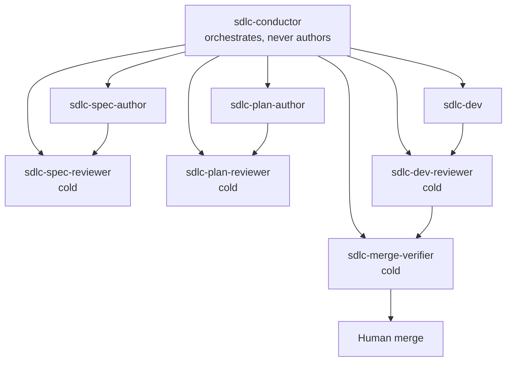
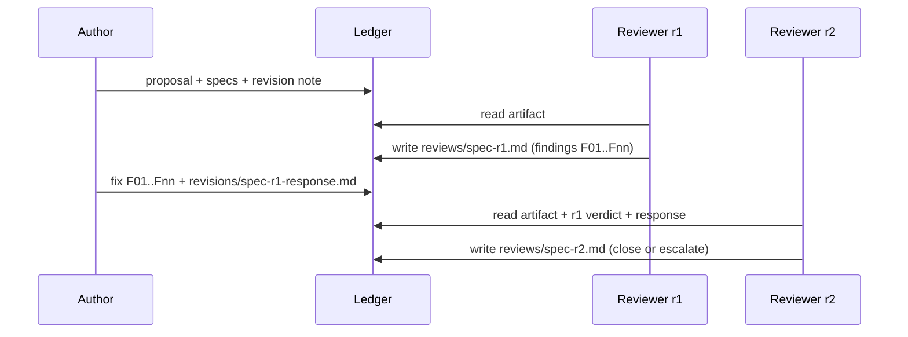

# Agent profiles — separate minds, cold starts, bounded loops

> Canonical prompts: `sdlc/agents/*.md`.
> Normative rules: `sdlc/PROTOCOL.md` §4, §6, §7.
> Adapters: `.claude/agents/` (Claude Code) and `.agent/agents/` (Antigravity).

## 1. The cast



| Agent | Owns | Never does |
|---|---|---|
| `sdlc-conductor` | triage, issue, worktree, dispatch, state, escalation | author, review, merge |
| `sdlc-spec-author` | `proposal.md`, `specs/**`, `tasks.md` (Lane S) | code, `design.md`, self-review |
| `sdlc-spec-reviewer` | one verdict file per round | edit the spec, read author chat |
| `sdlc-plan-author` | `design.md`, `tasks.md` (Lane L) | change specs, code |
| `sdlc-plan-reviewer` | one verdict file per round | edit the plan |
| `sdlc-dev` | code, tests, task checkboxes, evidence, PR | change spec/design, self-approve |
| `sdlc-dev-reviewer` | one verdict file per round | edit code, trust author logs |
| `sdlc-merge-verifier` | merge dossier | merge, override a reviewer |
| Human | final merge decision | — |

## 2. Independence invariants

1. **Author ≠ reviewer** for the same stage.
2. **A fresh instance per round.** No shared session, no shared context.
3. **The conductor never authors or reviews.** It moves state.
4. **The reviewer writes only its verdict file.** Any other write is a protocol
   violation and the conductor must stop.
5. **The reviewer reads artifacts, not reasoning.** Prior verdicts and revision
   notes are data; the author's chat is off-limits.
6. **Approval names the SHA.** A verdict without `reviewed_sha` is invalid.
7. **The merge verifier is not the dev reviewer.** Last check is a separate mind.

## 3. Cold start and resume

A reviewer "resumes" without a conversation. The ledger is its memory.



Rules for round > 1:

- Read all prior verdicts for the stage.
- Read the author's revision note.
- Verify each open finding at the new SHA.
- Mark `closed`, `open`, or `regressed`.
- New findings only for `regression`, `security`, or `critical`.
- Do not reopen a closed finding without new evidence.

This is what "resume" means across Claude Code and Antigravity: the same role,
a new instance, the same persisted ledger.

## 4. The finding ledger

Every verdict ends with a machine-readable block:

```json
{
  "schema": "sdlc.verdict/v1",
  "change_id": "add-health-endpoint",
  "stage": "spec",
  "round": 1,
  "reviewer": "sdlc-spec-reviewer",
  "reviewed_sha": "abc1234",
  "verdict": "CHANGES_REQUESTED",
  "summary": "One sentence.",
  "findings": [
    {
      "id": "SPEC-R1-F01",
      "severity": "blocker",
      "origin": "initial",
      "status": "open",
      "location": "specs/health-status/spec.md#L12",
      "evidence": "Requirement has no failure scenario.",
      "required_fix": "Add a WHEN/THEN scenario for a degraded dependency."
    }
  ],
  "closed": []
}
```

Validated by `scripts/sdlc/verdict-lint.py`. It enforces:

- stage, round, and reviewer match the filename;
- round ≤ 3;
- every finding has location, evidence, and required fix;
- `APPROVE` has no open blocker/major;
- R2/R3 only add regression/security/critical findings;
- every prior open finding is re-evaluated or closed.

## 5. The three-round cap

| Round | Reviewer behaviour |
|---|---|
| R1 | exhaustive: all blockers/majors at once |
| R2 | closure: verify fixes, check regressions |
| R3 | closure or escalate; never request changes |
| R4 | rejected by the tooling |

At R3 with an open blocker/major, the reviewer must `ESCALATE`. The conductor
opens a human decision, not a fourth round.

## 6. CLI mapping

| Action | Claude Code | Antigravity CLI |
|---|---|---|
| Run the conductor | `claude --agent sdlc-conductor` | `agy --agent sdlc-conductor` |
| Run a cold agent | Agent tool `subagent_type: sdlc-spec-reviewer` | `agy -p --agent sdlc-spec-reviewer` |
| Adapter directory | `.claude/agents/` | `.agent/agents/` |
| Manifest | — | `.agent/agents.json` |
| Headless wrapper | `scripts/sdlc/run-agent.sh` | `scripts/sdlc/run-agent.sh` |

`scripts/sdlc/run-agent.sh` selects the CLI from `SDLC_CLI` (`auto`, `claude`,
`agy`) and never passes `--continue`/`-c`: cold start is structural.

Note: `agy agents` lists user-level agents only. Project agents in
`.agent/agents/` are still selectable with `agy --agent <name>` and appear in
the `/agents` panel. Use `--agent`, not the listing, to confirm availability.

Headless Antigravity runs need an explicit model and permission mode:

```bash
SDLC_CLI=agy \
SDLC_AGY_MODEL=gemini-3.8-flash-medium \
SDLC_AGY_DANGEROUSLY_SKIP_PERMISSIONS=true \
  scripts/sdlc/run-agent.sh sdlc-dev <brief>
```

`SDLC_AGY_MODEL` accepts an id from `agy models`. `--mode auto` is not
available on every account; leave `SDLC_AGY_MODE=` empty and use the explicit
permission bypass in a trusted worktree. Without it, headless `read_file`
calls are auto-denied and the agent cannot work.

In this headless setup, **project custom agents are read-only**: they expose
`view_file`, search, and MCP tools, but no write or shell tools. That is fine
for reviewers. For a write role such as `sdlc-dev`, run the default Antigravity
agent with the profile injected:

```bash
SDLC_CLI=agy \
SDLC_AGY_MODEL=gemini-3.8-flash-medium \
SDLC_AGY_DANGEROUSLY_SKIP_PERMISSIONS=true \
SDLC_AGY_USE_DEFAULT_AGENT=true \
  scripts/sdlc/run-agent.sh sdlc-dev <brief>
```

The wrapper prepends "You are the `sdlc-dev` agent. Read
`sdlc/agents/sdlc-dev.md`..." and omits `--agent`.

```bash
# Claude Code
SDLC_CLI=claude scripts/sdlc/run-agent.sh sdlc-dev-reviewer <brief>

# Antigravity
SDLC_CLI=agy scripts/sdlc/run-agent.sh sdlc-dev-reviewer <brief>

# Run inside a worktree
SDLC_AGENT_CWD=.worktrees/42-add-health-endpoint \
  scripts/sdlc/run-agent.sh sdlc-dev <brief>
```

## 7. Installing the adapters

Canonical prompts live in `sdlc/agents/`. Adapters are generated, never edited.

```bash
scripts/sdlc/install-agents.sh            # write project adapters
scripts/sdlc/install-agents.sh --check    # CI: fail on drift
scripts/sdlc/install-agents.sh --global   # also install to ~/.claude and ~/.gemini
```

The generated files carry a header pointing to their source. CI runs `--check`
so a stale adapter cannot silently review with an old protocol.

## 8. Model diversity

Cold start removes conversational bias. Model diversity removes correlated
blind spots. Recommended:

| Stage | Author | Reviewer |
|---|---|---|
| SPEC | strong reasoning model | a different model family |
| PLAN | strong architectural model | a different model family |
| DEV | strong coding model | a different coding model |

The protocol does not pin models; configure them in each CLI. What matters is
that the reviewer is not the same instance and, where possible, not the same
model family.

## 9. Handoff contract

Every brief names:

- role and change id;
- stage and round (max 3);
- worktree path;
- issue number;
- exact artifact paths and SHA;
- mandatory reading order;
- the one output file allowed;
- stop condition.

The conductor must not include its own verdict, its hoped-for outcome, or the
author's chat. A reviewer that receives those is no longer independent.

## 10. Failure modes

| Symptom | Cause | Response |
|---|---|---|
| Reviewer edits code | role drift | reject the run, restore the file, restart cold |
| Reviewer needs the author's chat | artifacts are underspecified | fail the spec, not the reviewer |
| New findings every round | moving goalposts | `verdict-lint` rejects non-regression findings after R1 |
| Reviewer rubber-stamps | no evidence | reject a verdict with empty evidence |
| Author self-approves | conductor bug | independence check; never accept |
| Round 4 attempted | cap bypass | `sdlc.sh verdict` rejects it |
| Agent not found in Antigravity | adapter not installed | `scripts/sdlc/install-agents.sh` |
| Nested Claude refused | `CLAUDECODE` set | set `SDLC_CLI=agy` or `SDLC_ALLOW_NESTED_CLAUDE=1` |
