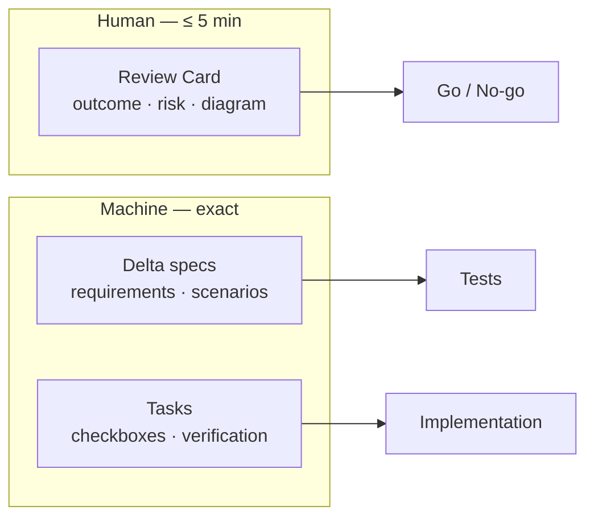
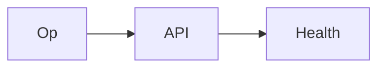

# SPEC format — five-minute human review, machine-testable contract

> Normative rules: `openspec/config.yaml` and `sdlc/PROTOCOL.md` §6–§7.
> Validate with `scripts/sdlc/spec-lint.py --change <id>`.

## 1. Two surfaces, two audiences



- The **Review Card** is for the human decision. Short, visual, no prose walls.
- The **delta specs** are the contract. Exact, normative, testable.
- Never make the human read the delta specs to decide. Never make the machine
  infer behavior from the Review Card.

## 2. Artifacts by lane

| File | Lane S | Lane L | Purpose |
|---|---|---|---|
| `proposal.md` | required | required | Review Card + why + what + capabilities + non-goals + impact |
| `specs/<capability>/spec.md` | required | required | ADDED/MODIFIED/REMOVED/RENAMED requirements and scenarios |
| `design.md` | — | required | decisions, risks, rollback |
| `tasks.md` | required | required | checkbox tasks + verification |

OpenSpec creates the scaffold:

```bash
openspec new change <change-id>
openspec instructions proposal --change <change-id> --json
openspec instructions specs    --change <change-id> --json
openspec instructions design   --change <change-id> --json
openspec instructions tasks    --change <change-id> --json
openspec validate <change-id> --strict
```

## 3. The Review Card

### 3.1 Template

````markdown
## Review Card (≤ 5 min)

| Field | Value |
|---|---|
| Outcome | One line a non-author understands. |
| Why now | The observed problem or opportunity. |
| Blast radius | Services, crates, contracts, chains. |
| Risk | Low / Medium / High + the worst failure. |
| Effort | S / M / L. |
| Decision needed | None / one question. |


### Non-goals

- <Explicitly out of scope.>
````

### 3.2 Rules

- ≤ 400 words.
- At least one Mermaid or ASCII diagram.
- Bullets and tables; no paragraph longer than two sentences.
- One decision at most. If the reader needs two decisions, split the change.
- No implementation detail. No file list longer than three lines.
- Non-goals are mandatory and must be real exclusions.

### 3.3 Read-time budget

```
read_minutes = visible_words / 200 + 0.5 * diagram_count
```

`spec-lint.py` fails above 5.0 minutes or 400 words. Code fences are excluded
from the word count; diagrams are counted separately.

### 3.4 Diagram grammar (make it pleasant)

- One idea per box; ≤ 7 boxes.
- Label edges with a verb (`validates`, `publishes`, `falls back to`).
- Prefer left-to-right for a flow, top-down for layers.
- Show the before/after in the same diagram when the delta is structural.
- Use a second diagram for a failure path or a sequence when the change is
  non-linear.
- Never use a diagram as decoration; every box must carry a fact.

## 4. Delta specs

### 4.1 Rules

- One file per capability: `specs/<capability>/spec.md`.
- Use exactly these section headers:
  `## ADDED Requirements`, `## MODIFIED Requirements`,
  `## REMOVED Requirements`, `## RENAMED Requirements`.
- `### Requirement: <name>` uses **SHALL** or **MUST**.
- Every ADDED/MODIFIED requirement has at least one scenario.
- Scenario headers use **exactly four hashes**: `#### Scenario: <name>`.
- Every scenario has `- **WHEN** ...` and `- **THEN** ...`.
- MODIFIED copies the entire existing requirement block, not a fragment.
- REMOVED includes `**Reason**` and `**Migration**`.
- No `TBD`, no open question, no unmeasurable adjective.

### 4.2 Example

```markdown
## ADDED Requirements

### Requirement: Health status endpoint

The system SHALL expose a read-only health endpoint.

#### Scenario: Healthy service

- **WHEN** the operator calls `GET /api/v1/health`
- **THEN** the system returns HTTP 200 with status `ok`

#### Scenario: Degraded dependency

- **WHEN** a dependency is unavailable
- **THEN** the system returns HTTP 503 naming the failing dependency

## REMOVED Requirements

### Requirement: Legacy ping endpoint

**Reason**: Replaced by the health endpoint.

**Migration**: Clients move to `GET /api/v1/health`; the old route returns 410
for one release.
```

## 5. Design (Lane L)

Required sections: Context, Goals / Non-Goals, Decisions, Risks / Trade-offs,
Migration Plan, Open Questions (empty before approval).

A decision row is a table, not a paragraph:

| Decision | Alternatives | Rationale | Rejected because |
|---|---|---|---|
| Keep `PolicyEnvelope` additive | New IPC message | No consumer migration | Breaks Rust/Python parity and replay |

Add one Mermaid diagram of the runtime or data flow. Include a concrete
rollback: a command or a sequence, not "revert the PR".

## 6. Tasks

```markdown
## 1. Implementation

- [ ] 1.1 Add the endpoint (covers: Healthy service)
- [ ] 1.2 Add failure handling (covers: Degraded dependency)

## Verification

- `PYTHONPATH=. python3 -m unittest discover -s backend/tests -v` → expected: pass
- `docker compose up --build -d` → expected: `/api/v1/health` returns 200
```

- Every task is a checkbox `- [ ] X.Y`.
- One task fits one session.
- Each task names the scenario, invariant, or verification it satisfies.
- `## Verification` lists exact commands and expected evidence.

## 7. Worked example — Lane S

````markdown
## Review Card (≤ 5 min)

| Field | Value |
|---|---|
| Outcome | Operators can read service health. |
| Why now | Incident triage is blind. |
| Blast radius | One API endpoint. |
| Risk | Low; a stale status could mislead. |
| Effort | S |
| Decision needed | None |



### Non-goals

- Metrics, alerting, dashboards.

## Why

Operators cannot see health. This adds a read-only endpoint.

## What Changes

- Add `GET /api/v1/health`.

## Capabilities

### New Capabilities

- `health-status`: read-only health reporting.

### Modified Capabilities

## Non-goals

- Metrics, alerting, dashboards.

## Impact

- `backend/server.py`, tests.
````

That card is ~35 words and one diagram: under one minute. The delta spec and
tasks carry the rigor.

## 8. Common rejections

| Finding | Fix |
|---|---|
| Review Card over 400 words | Move detail into the delta spec or `design.md` |
| No diagram | Add a three-box Mermaid flow |
| Requirement without scenario | Add a WHEN/THEN, including the failure path |
| Vague "fast" | Define the budget, e.g. "p99 < 50µs" |
| MODIFIED fragment | Copy the whole existing requirement block |
| Open question in `design.md` | Decide it or escalate `scope-change` |
| Task without verification | Add the command and expected evidence |

## 9. Spec checklist

- [ ] Review Card ≤ 400 words, ≥ 1 diagram, ≤ 5.0 min.
- [ ] Non-goals are real.
- [ ] Every capability has a delta file.
- [ ] Every requirement uses SHALL/MUST and has a scenario.
- [ ] Every scenario has WHEN and THEN.
- [ ] No TBD, no open question.
- [ ] `openspec validate --strict` passes.
- [ ] `spec-lint.py` passes.
- [ ] Tasks map to scenarios and end with `## Verification`.
