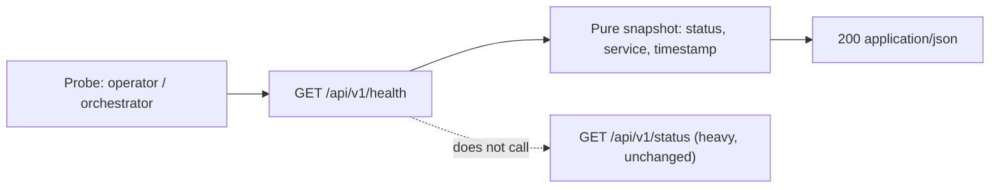

## Review Card (≤ 5 min)

| Field | Value |
|---|---|
| Outcome | A lightweight `GET /api/v1/health` returns a three-field liveness snapshot that operators and container orchestrators can probe safely. |
| Why now | `/api/v1/status` aggregates the whole control plane and is too heavy for a liveness or readiness probe. No minimal probe exists today. |
| Blast radius | One additive REST route in `backend`, one pure snapshot module, one unit test. No IPC, schema, engine, chain, dashboard, or `/api/v1/status` change. |
| Risk | Low. Worst failure: the snapshot module imports `backend/server.py`, so the contract test starts background workers. |
| Effort | S — one SPEC round, one DEV round. |
| Decision needed | None. |

### Non-goals

- Metrics, alerting, dependency probing, and readiness degradation.
- Dashboard, CLI, IPC, `PolicyEnvelope`, or `/api/v1/status` changes.

## Why

`/api/v1/status` runs the Rust backtest, builds the full hierarchy snapshot, reads cost-guard state, and serializes engine telemetry. A container orchestrator or operator cannot use that payload as a cheap liveness probe.

The platform has no minimal read-only health surface. Adding one gives probes a stable, bounded contract without changing the existing status payload.

## What Changes

- Add `GET /api/v1/health`, returning HTTP 200 and a JSON object whose only top-level fields are `status`, `service`, and `timestamp`.
- Add a pure snapshot function that builds the response without importing `backend.server`, starting workers, or touching Redis or the state store.
- Add a unit test that exercises the snapshot and route contract in isolation from the heavy server module.

## Capabilities

### New Capabilities

- `health`: read-only liveness probe endpoint and its pure response snapshot.

### Modified Capabilities

- None.

## Non-goals

- Metrics, alerting, dashboards, and any UI change.
- Dependency probing or readiness degradation: the endpoint reports process liveness, not subsystem health.
- Authentication or authorization changes.
- Any change to `/api/v1/status`, `PolicyEnvelope`, Redis IPC, database schema, or CLI.
- Backtest, paper, and live strategy behavior: none of these paths are touched.

## Impact

- Code: new pure snapshot module under `backend/core/`, route registration in `backend/server.py`, new `backend/tests/test_health.py`.
- Contracts: additive REST endpoint only. No `PolicyEnvelope`, IPC, database, or CLI change.
- Chains/venues: none.
- Tests: one unit test module, run by the existing `unittest` discovery.
- Ops: no new configuration, dependency, container probe, metric, or LLM cost.
