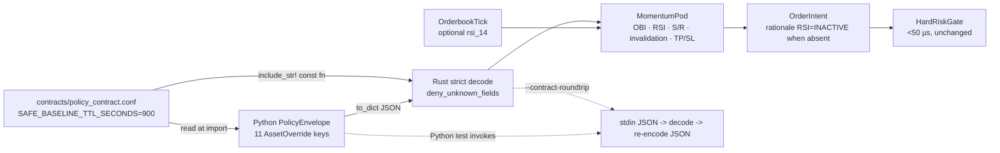

## Context

The approved SPEC (`proposal.md`, `specs/contract/spec.md`) repairs a live
contract drift: Python publishes eleven `AssetOverride` keys, Rust declares
three, and `serde_json` currently drops the other eight without an error. The
hot path therefore trades on display-only rules. This design decides how the
Rust and Python runtimes converge without weakening the hot-path invariants in
`openspec/config.yaml`.

Forces that constrain the design:

- `HardRiskGate::validate` stays under 50 µs, with no allocation or logging on
  that path; `safe_baseline()` is reached from `effective()` inside that path.
- `PolicyEnvelope` must stay byte-for-byte compatible between
  `engine-rs/crates/common/src/lib.rs` and `backend/core/schemas.py`.
- Backtest, paper, and live share one deterministic pod path.
- Strict policy decoding is a breaking change; the current producer and consumer
  ship from the same monorepo image.
- Hand-repair is the chosen approach; schema codegen is out of scope (issue #10
  triage comment, `proposal.md` Non-goals).
- `rsi_14` has no warm-path producer today; only the Rust backtest fixtures emit
  `MarketEvent::OrderbookTick`.
- TP/SL enforcement belongs to issue #4; this change only populates the intent.

The runtime and data flow being changed:



## Impact

Files and contracts this plan touches, including the shared contract location
required by the R2 follow-up:

| Surface | Path | Change |
|---|---|---|
| Shared contract | `contracts/policy_contract.conf` | Sole declaration of `SAFE_BASELINE_TTL_SECONDS=900`. |
| Repository check | `scripts/check_contract_single_source.py` | Fails, naming the duplicate file, when the key is declared elsewhere. |
| Rust types | `engine-rs/crates/common/src/lib.rs` | `AssetOverride` parity, strict policy structs, `rsi_14`, TTL constant. |
| Rust pod | `engine-rs/crates/strategies/src/lib.rs` | Momentum rule consumption and `RSI=INACTIVE`. |
| Rust CLI | `engine-rs/crates/node/src/main.rs` | Fail-loud `--policy-json`, `--contract-roundtrip`. |
| Rust fixtures | `engine-rs/crates/backtest/src/lib.rs` | `AssetOverride` and `OrderbookTick` constructors; optional values stay absent. |
| Python contract | `backend/core/schemas.py` | Resolve the TTL from the contract file; safe-baseline constructor uses it. |
| Python paper model | `backend/core/state_store.py` | Short RSI threshold uses `min_rsi_short`. |
| Tests | `engine-rs/crates/common/tests/`, `engine-rs/crates/strategies/tests/`, `backend/tests/` | Rust contract and pod tests, Python round-trip, ingestion, TTL check, no-codegen guard. |
| CI | `.github/workflows/ci.yml` | Include `contracts/**`, install Rust, prebuild `robotrader-node`, run the single-source check. |
| Docker | `Dockerfile.backend` | Copy `contracts/` into the builder (`/build/contracts`) and the runtime (`/app/contracts`). |
| Docs | `AGENTS.md`, `README.md` | List all eleven keys, optional `rsi_14`, strict decode. |

No Redis key, REST/WS payload, database schema, vault path, or dependency
changes.

## Goals / Non-Goals

**Goals:**

- Make all eleven Python `AssetOverride` keys survive a Rust decode and
  re-encode, with absent optionals preserved as JSON `null`.
- Reject unknown policy keys and missing required keys loudly at CLI ingestion.
- Keep `MarketEvent` and `OnChainTokenSafety` forward-compatible.
- Carry an optional `rsi_14` and report `RSI=INACTIVE` when an override exists
  but the input is absent.
- Apply the override OBI, RSI, support, resistance, invalidation, and TP/SL
  values in `MomentumPod` with the exact directional and boundary semantics.
- Detect cross-language drift with an executable, offline test.
- Declare the safe-baseline TTL once and have both runtimes resolve it at
  compile or import time.

**Non-Goals:**

- Schema codegen, JSON Schema generation, or a build script that generates
  contract source.
- Risk-gate enforcement of TP/SL levels, position monitoring, or exit orders
  driven by `invalidation_price_usd` (issue #4).
- A Python warm-path producer or transport for `OrderbookTick.rsi_14`.
- Canonicalising `pod_solana_alpha` to `pod_onchain_alpha` across Python maps
  and Rust `HashMap` keys (follow-up issue/ADR).
- Changing vault, signing, chain isolation, Kelly sizing, dry powder, kill
  switch, `CostGuard`, or LLM sanitisation ranges.
- Adding a version field to `PolicyEnvelope` or a dual decoder.

## Decisions

| ID | Decision | Alternatives considered | Rationale | Rejected because |
|---|---|---|---|---|
| D1 | Hand-repair the Rust mirror; no codegen. | Generated JSON Schema; serde-to-pydantic codegen; a shared IDL. | The triage decision records hand-repair for this change; the SPEC forbids generated schema artifacts and codegen build steps. | Codegen is a larger, separate architectural bet and needs its own ADR; it would also add build-time dependencies. |
| D2 | The eight missing keys are `Option<T>` with `#[serde(default)]`; no `skip_serializing_if`. | Required fields with defaults; a flattened `HashMap<String, f64>`; plain `f64` with serde defaults. | Absence must be distinguishable from an explicit default, and re-encoding must emit all eleven keys with `null` for absent values. | Required fields reject older producers; a map loses typing and field names; plain `f64` cannot represent absence or re-encode `null`. |
| D3 | `catalyst_score`, `bias`, and `max_leverage` remain required non-`Option`. | Give them defaults too; make every field optional. | The SPEC pins these three as required; an override without a catalyst score or leverage cap is incomplete. | Defaulting them would hide partial overrides and silently invent a leverage cap. |
| D4 | Apply `#[serde(deny_unknown_fields)]` to `PolicyEnvelope`, `PodAllocation`, and `AssetOverride` only. | Strict decode on every serde type; a runtime strictness flag; warn on unknown keys. | Policy is a closed, versioned contract where a mismatch must halt; events are an open ingestion surface where forward compatibility matters. | Strict events break forward-compatible ingestion; a flag or warning reintroduces the silent-drift failure mode the change removes. |
| D5 | Add `rsi_14: Option<f64>` with `#[serde(default)]` to `OrderbookTick`; no producer. | Required `rsi_14`; a separate `IndicatorSnapshot` event; an RSI map on the envelope. | The SPEC chooses an optional tick field and makes the absent case observable as `RSI=INACTIVE`; no warm-path transport exists today. | A required field breaks existing fixtures and producers; a new event type expands scope beyond the approved SPEC. |
| D6 | Directional OBI gate: long `OBI >= t`, short `OBI <= -t`; `t` resolves from the override or `0.08`. | Literal `|OBI| >= t` with no sign rule; one shared threshold for both branches; keep the pod threshold under an override. | Direction is selected by the branch; `|OBI| >= t` alone is necessary but not sufficient and can be misread as permitting a long with strongly negative OBI. | A sign-free magnitude gate is ambiguous; keeping the pod threshold defeats the override; a single branch-independent threshold cannot express long versus short flow. |
| D7 | With an override, RSI gates apply only when `rsi_14` is present; zones, resistance, and invalidation gates apply only when their field is `Some`. | Apply missing rules as pass-through silently; block when an input is absent; treat absent rules as the Python defaults everywhere. | The SPEC defines the exact conditional gates and requires an observable rationale marker for the absent RSI case. | Silent pass-through is the drift being fixed; blocking on absent data would halt trades with no signal; applying defaults to absent zones would invent price levels. |
| D8 | With an override, `take_profit_pct = take_profit_bps/100` and `stop_loss_pct = stop_loss_bps/100`, defaulting to `45.0` and `30.0`; no override keeps ATR-derived values. | Keep ATR-derived distances under an override; enforce TP/SL in the risk gate now. | The SPEC requires the envelope values on the intent and defers enforcement to issue #4. | Keeping ATR values ignores the contract; enforcement is a separate risk-path change (#4). |
| D9 | Safe-baseline TTL is declared once in `contracts/policy_contract.conf`; Rust resolves it through `include_str!` plus a `const fn` key scan, and Python reads it at import. | Runtime `serde_json` parse; a `build.rs` generated constant; a duplicated Rust `const` guarded by a check. | A `const fn` keeps `safe_baseline()` allocation-free on the hot path, adds no dependency, and makes the contract file the sole source. | Runtime parsing allocates on the `HardRiskGate` fallback path; `build.rs` is a codegen build step the SPEC excludes; a duplicated literal violates the "declared exactly once" predicate. |
| D10 | `from_dict`'s generic decode default and `default_active()` keep `900` as explicit check exemptions; they do not reference the named key. | Force every `900` to resolve from the contract file; ban all `900` literals. | The SPEC explicitly exempts these two generic envelope defaults; only the safe-baseline declaration is in scope. | Rewriting unrelated defaults expands the change and would make the check unable to distinguish safe-baseline from generic defaults. |
| D11 | Cross-language round-trip transport is a `robotrader-node --contract-roundtrip` mode: stdin JSON, strict decode, pretty canonical JSON to stdout, exit 2 and stderr on error; a Python test invokes it. | A checked-in Python-produced JSON fixture read by a Rust test; a Python-only fixture comparison; a new dedicated binary. | It exercises the live Python serializer and the live Rust decoder in one deterministic offline test, with no fixture to go stale. | A committed fixture can drift from the Python source and only tests one side at a time; a Python-only comparison is not cross-language; a new binary adds a second surface to keep in sync. |
| D12 | `--policy-json` validates before event generation, exits `2` on decode failure, names the offending key on stderr, and writes no stdout. | Keep the silent fallback to the default envelope; warn and continue; reuse exit `1`. | The SPEC requires fail-loud ingestion; failing before event generation guarantees no summary can leak to stdout. | Silent fallback is the defect; warn-and-continue defeats strict decoding; exit `1` is already used by vault-signing rejection, so `2` distinguishes policy decode errors. |
| D13 | No `schema_version` field; simultaneous deployment from the monorepo image. | Add a version discriminator; run a tolerant and a strict decoder side by side. | The wire shape for the in-repo producer is unchanged: Python already emits all eleven keys. The SPEC pins exactly six top-level keys, so a version key would contradict it. | A version field forces a producer migration and a seventh top-level key; dual decoders reintroduce a silent fallback path. |
| D14 | Tests are split: Rust integration tests for the Rust half and pod rules; Python tests for the cross-language round-trip, CLI ingestion, and single-source check. | Rust-only tests; Python-only tests; a shell-only contract check. | Each standard suite stays runnable without Redis or network, and the cross-language assertion runs where the Python producer lives. | Rust-only tests cannot exercise the Python serializer; Python-only tests cannot exercise the Rust decoder; a shell-only check is not run by the standard suites. |

### Exact field mapping and serde attributes

`AssetOverride` carries `#[derive(Debug, Clone, Serialize, Deserialize)]` and
`#[serde(deny_unknown_fields)]`. Field names need no `rename`: Python emits
snake_case.

| Python key | Rust field | Rust type | Attribute |
|---|---|---|---|
| `catalyst_score` | `catalyst_score` | `f64` | none (required) |
| `bias` | `bias` | `DirectionalBias` | none (required) |
| `max_leverage` | `max_leverage` | `f64` | none (required) |
| `support_zone_usd` | `support_zone_usd` | `Option<f64>` | `#[serde(default)]` |
| `resistance_zone_usd` | `resistance_zone_usd` | `Option<f64>` | `#[serde(default)]` |
| `invalidation_price_usd` | `invalidation_price_usd` | `Option<f64>` | `#[serde(default)]` |
| `entry_obi_threshold` | `entry_obi_threshold` | `Option<f64>` | `#[serde(default)]` |
| `max_rsi_long` | `max_rsi_long` | `Option<f64>` | `#[serde(default)]` |
| `min_rsi_short` | `min_rsi_short` | `Option<f64>` | `#[serde(default)]` |
| `take_profit_bps` | `take_profit_bps` | `Option<f64>` | `#[serde(default)]` |
| `stop_loss_bps` | `stop_loss_bps` | `Option<f64>` | `#[serde(default)]` |

`PolicyEnvelope` and `PodAllocation` also carry
`#[serde(deny_unknown_fields)]`. `MarketEvent` and `OnChainTokenSafety` keep
their current derives with no strictness attribute. `OrderbookTick` gains
`#[serde(default)] rsi_14: Option<f64>` at the end of its field list. No
`skip_serializing_if` is allowed on any of the eight optionals, because serde's
default `Option` serialisation emits `null` and the SPEC requires all eleven
keys to be emitted.

Rust struct literals do not support omitted fields, so every existing
`AssetOverride` constructor (four in `engine-rs/crates/backtest/src/lib.rs`) and
every `OrderbookTick` constructor gains explicit `None` values. No `Default`
implementation is added; explicit `None` keeps fixture intent visible.

### Momentum gate semantics

When `envelope.asset_overrides.get(symbol)` is `Some`, the pod resolves effective
values and applies the following table. When it is `None`, the pod keeps its
configured `obi_threshold` and ATR-derived TP/SL, and applies none of the RSI,
support, resistance, or invalidation gates.

| Rule | Long branch | Short branch | Override source | Absent-input behaviour |
|---|---|---|---|---|
| OBI | `OBI >= t` | `OBI <= -t` | `entry_obi_threshold.unwrap_or(0.08)` | default `0.08` when the override exists |
| RSI | `rsi_14 <= max_rsi_long` | `rsi_14 >= min_rsi_short` | `max_rsi_long.unwrap_or(70.0)` / `min_rsi_short.unwrap_or(30.0)` | no gate; `RSI=INACTIVE` in rationale |
| Support | `mid_price >= support_zone_usd` | not applied | `support_zone_usd` | no gate |
| Resistance | not applied | `mid_price <= resistance_zone_usd` | `resistance_zone_usd` | no gate |
| Invalidation | `mid_price > invalidation_price_usd` | `mid_price < invalidation_price_usd` | `invalidation_price_usd` | no gate |
| Take profit | `take_profit_pct = take_profit_bps/100` | same | `take_profit_bps.unwrap_or(45.0)` | default `0.45` when the override exists |
| Stop loss | `stop_loss_pct = stop_loss_bps/100` | same | `stop_loss_bps.unwrap_or(30.0)` | default `0.30` when the override exists |

Evaluation order is: structural conditions (book size, OBI direction, CVD sign,
breakout z-score, pod bias) → override OBI threshold replaces the pod value →
RSI → support or resistance → invalidation → emit with TP/SL. Any failed gate
returns no intent for that direction. Long and short conditions remain mutually
exclusive, so at most one intent is emitted per event.

`|OBI| >= t` remains necessary in both branches: `OBI >= t` for a long and
`OBI <= -t` for a short each imply the magnitude condition, while the branch
sign prevents a long from passing on strongly negative OBI (or a short on
strongly positive OBI). The directional form therefore strengthens, and does
not contradict, the SPEC magnitude wording. Task 6.2 pins the sign asymmetry
explicitly: a long with `OBI == -t` and a short with `OBI == +t` must emit no
intent. No spec clarification is escalated, because every approved scenario
remains satisfied and the directional rule is the implementation of the
magnitude condition.

The rationale keeps its current prefix and appends `RSI=INACTIVE` when an
override exists and `rsi_14` is absent, or `RSI={:.1}` when the value is present.
Only the `RSI=INACTIVE` marker is contractual; the present-value marker is for
observability and may change without a contract change.

### Safe-baseline TTL single source

`contracts/policy_contract.conf` is a key=value file with one declaration:

```text
SAFE_BASELINE_TTL_SECONDS=900
```

- Rust: `pub const SAFE_BASELINE_TTL_SECONDS: u64` is computed at compile time by
  a `const fn` that scans `include_str!("../../../../contracts/policy_contract.conf")`
  for the key and parses its decimal value. `PolicyEnvelope::safe_baseline` uses
  that constant; no runtime parsing and no allocation on the fallback path.
- Python: `backend/core/schemas.py` resolves a module-level
  `SAFE_BASELINE_TTL_SECONDS` from the same file at import. `safe_baseline()`
  uses it. `from_dict`'s `900` default and `default_active()`'s `900` remain
  explicit exemptions listed by the check.
- `scripts/check_contract_single_source.py --root <path>` walks the root,
  skipping `.git/`, `target/`, `node_modules/`, `.worktrees/`, `openspec/`,
  `docs/`, and `.sdlc/`, and scans code and config files only (`.conf`, `.cfg`,
  `.toml`, `.yaml`, `.yml`, `.json`, `.env`, `.rs`, `.py`, `.sh`); Markdown is
  excluded so plan and documentation examples are not declarations. It excludes
  itself, strips `#` and `//` line comments and Python triple-quoted docstrings
  before matching, and treats a declaration as an occurrence of the identifier
  followed by `=` or `:` and a numeric literal. It requires exactly one such
  declaration, in `<root>/contracts/policy_contract.conf`, and exits non-zero
  naming the duplicate file otherwise. References such as the Rust constant
  binding and the Python resolution call are not numeric declarations and are
  not flagged. The contract comment names both runtimes but never repeats the
  assignment.
- Exemptions are explicit, not implicit: the check carries
  `EXEMPT_DEFAULTS = {("backend/core/schemas.py", "from_dict", 900),
  ("backend/core/schemas.py", "default_active", 900)}` and reports that list,
  and `backend/tests/test_contract_single_source.py` asserts both exemptions
  still equal the contract value. The identifier-only predicate would not flag a
  bare `900`, so the test is what keeps the exemption honest.
- `backend/tests/test_contract_single_source.py` runs the check against the real
  root and against a temporary root containing a copy of the contract plus a
  second declaration, asserting exit 0 and named failure respectively.
- `.github/workflows/ci.yml` adds `contracts/**` to its path filters and runs the
  check in the Python job.

### Cross-language round-trip transport

`robotrader-node --contract-roundtrip` is a side-effect-free CLI mode added
before the vault and backtest branches:

1. Read all of stdin.
2. Strictly decode `PolicyEnvelope`.
3. On success, write `serde_json::to_string_pretty` plus a newline to stdout and
   exit 0.
4. On failure, write the decoder error to stderr and exit 2 with empty stdout.

`backend/tests/test_contract_roundtrip.py` builds a `PolicyEnvelope` from the
Python implementation with all eleven override fields set to distinct
non-default values, invokes the binary (preferring
`engine-rs/target/debug/robotrader-node`, falling back to
`cargo run --quiet --bin robotrader-node -- --contract-roundtrip` in
`engine-rs`), then asserts identical envelope and pod key sets, exactly eleven
override keys, and numerically equal values. Two negative cases feed a missing
`catalyst_score` and an unknown `trailing_stop_bps`, asserting a non-zero exit
and a stderr naming the offending key. The test needs no Redis, network, or
exchange.

The Rust side is covered independently by
`engine-rs/crates/common/tests/asset_override_contract.rs`, which executes under
`cargo test`: decode and re-encode of all eleven keys, rejection of missing and
unknown keys, tolerance of unknown `MarketEvent` and `OnChainTokenSafety` keys,
and `rsi_14` presence and absence.

## Risks / Trade-offs

| Risk -> Mitigation |
|---|
| **Strict policy decoding halts the hot path on an unknown key.** An envelope from a future or non-Python producer now fails instead of silently trading without rules. -> Decode before event generation, exit 2 with the offending key on stderr, and keep stdout empty. The in-repo Python producer emits exactly the declared keys, and the cross-language round-trip test runs before merge. Roll back the merge commit and rebuild if a production producer is found to emit an undeclared key. |
| **A missing required key also halts, not only an unknown key.** An older or partial envelope omitting `catalyst_score`, `bias`, or `max_leverage` is rejected. -> The decoder error names the missing field; the negative CLI test pins it. The spec's "Missing required field is rejected" scenario is the contract, and the rollback restores permissive decoding. |
| **The OBI gate loosens for override-bearing symbols.** `entry_obi_threshold` defaults to `0.08` while the pod uses `0.22` (or `0.18` for ecosystem pods), so momentum entries can increase. -> The override is per symbol and comes from the warm path; the hard risk gate, Kelly sizing, dry powder, kill switch, and drawdown breaker are unchanged. Fixtures keep the optional fields absent, and the backtest counts are asserted explicitly. Operators can raise the threshold per override without a code change. |
| **The RSI guard is inactive until a warm-path producer exists.** Overbought or oversold entries can pass when `rsi_14` is absent. -> `OrderIntent.rationale` carries `RSI=INACTIVE`, making the bypass observable; the producer is a documented follow-up. The guard activates automatically once a producer supplies the field. |
| **TP/SL defaults become much tighter for override-bearing symbols.** `0.45%` and `0.30%` replace the ATR-derived values; no current code enforces them, so the backtest PnL is unchanged. -> The values are pinned by tests and documented as intent-only until issue #4. Issue #4 must revisit whether the bps defaults are appropriate once enforcement lands. |
| **The compile-time contract scan is fragile if the file format changes.** A malformed or moved `contracts/policy_contract.conf` fails the build or the check. -> A unit test asserts the parsed constant equals `900`, the check names the contract file, and `contracts/**` is in the CI path filter. |
| **The Python round-trip test depends on a Rust build.** A cold CI job compiles `robotrader-node` inside the Python suite. -> Task 1.4 installs the stable Rust toolchain with `Swatinem/rust-cache` and prebuilds `cargo build --bin robotrader-node` before the Python tests, so `engine-rs/target/debug/robotrader-node` exists. Task 6.4 uses that path first and sets a 300 s timeout for the `cargo run` fallback, covering a cold build instead of the 30 s bridge timeout. |
| **Backtest bridge counts drift because new gates change momentum entries.** The Python bridge test asserts `total_trades == 6`, `rejected_orders == 1`, and `total_trades == 4`. -> The two paths differ but agree in effect: the four Rust fixtures set all optional override fields to `None`, while the Python bridge (`PolicyEnvelope.default_active()`) emits explicit defaults through `to_dict()` (`entry_obi_threshold=0.08`, `max_rsi_long=70.0`, `min_rsi_short=30.0`, `take_profit_bps=45.0`, `stop_loss_bps=30.0`, and `None` USD zones). In both paths the effective OBI threshold is 0.08, the existing OBI values still pass, RSI is inactive because `rsi_14` is absent, no zone or invalidation gate applies, and the router computes PnL from `expected_edge_bps`. Counts and profit are preserved. Task 6.3 pins the Python defaults; re-baseline only with the Rust backtest output attached as evidence. |
| **A persisted Redis policy blob contains an unknown key.** Python `from_dict` constructs `AssetOverride(**v)` and raises on unknown keys. -> The in-repo producer emits only declared keys; the warm path republishes a fresh envelope on startup and falls back to the safe baseline on expiry. No Redis key or TTL shape changes, so rollback needs no data repair. |
| **Documentation keeps advertising the old seven-rule contract.** `AGENTS.md` and `README.md` omit `min_rsi_short` today. -> Both are explicit DEV deliverables and list all eleven keys, strict decoding, and the optional `rsi_14`. |

Worst failure: a production envelope carries a key that neither runtime declares,
the Rust node exits before trading, and the leaf stops. This is fail-closed by
design, not a silent trade with discarded rules; the cross-language test and the
simultaneous deploy catch it before the hot path, and the rollback restores the
previous binary.

## Migration Plan

The wire shape for the in-repo producer is unchanged: Python already emits all
eleven keys. Strict decoding only rejects undeclared keys from other producers.

| Producer -> consumer | Behaviour |
|---|---|
| New Python -> new Rust | Strict decode succeeds; all eleven keys survive. |
| New Python -> old Rust | Old Rust ignores the eight extra keys; no crash, reduced rules. Safe during a rolling deploy. |
| Old Python -> new Rust | Old Python already emits all eleven keys; strict decode succeeds. Safe. |
| Non-Python/older JSON with an unknown key -> new Rust | Exit 2, stderr names the key, stdout empty. Intended fail-loud behaviour. |

Deployment order:

1. Pre-merge: build `robotrader-node`; run `cargo test --all-targets`, the Python
   suite, and the single-source check. The cross-language round-trip test must
   pass at the PR head.
2. Merge, then rebuild both runtimes together with `docker compose up --build -d`
   (single monorepo image; Rust binary and Python backend ship from the same
   commit). `Dockerfile.backend` must copy `contracts/` to `/build/contracts`
   before `cargo build` (the `include_str!` path) and to `/app/contracts` in the
   runtime stage (the Python import path). The compose bind mount
   `./backend:/app/backend` does not shadow `/app/contracts`, so the baked
   contract file stays visible under uvicorn.
3. No Redis migration: no key, TTL, or payload-shape change. The warm path
   republishes the active envelope on startup; expiry still falls back to the
   safe baseline.
4. No feature flag and no dual decoder. A rolling deploy is safe in either
   direction for the in-repo producer, as the compatibility table shows.

Rollback (concrete):

1. `git revert <merge-commit-sha>` on `master`; this restores the three-field
   Rust type, permissive decoding, the ATR-derived TP/SL path, and the two
   independent TTL literals.
2. `docker compose up --build -d` to rebuild the Rust binary and Python backend
   from the reverted commit.
3. No data repair: Redis holds no new key or shape, and no migration ran.
4. Verify the reverted binary and image still resolve the contract file:
   `engine-rs/target/debug/robotrader-node --policy-json "$(python3 -c '...')"`
   exits 0, and `docker compose run --rm --no-deps backend python -c
   "from backend.core.schemas import SAFE_BASELINE_TTL_SECONDS"` exits 0. Old
   Rust ignores the eight extra keys; the reverted Python ignores the new
   contract file.
5. Restore service by re-running the backtest bridge test and
   `curl -fsS http://localhost:8000/api/v1/status`.

Observability and cost: the only new user-visible signal is the `RSI=INACTIVE`
rationale marker and the CLI stderr on decode failure. There is no new metric,
no logging on the hot path, no LLM call, no new dependency, and no infrastructure
cost.

## Open Questions
<!-- None. -->
