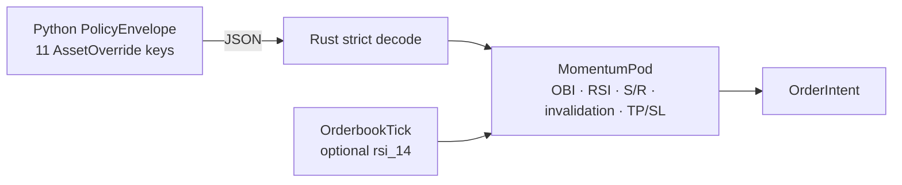

## Review Card (≤ 5 min)

| Field | Value |
|---|---|
| Outcome | The eight mechanical-rule fields the LLM writes into `AssetOverride` survive the Rust decode, gate momentum entries, and populate TP/SL distances. |
| Why now | Issue #10: Rust silently drops eight of eleven fields, so the advertised "compiled mechanical rules" are display-only. |
| Blast radius | `engine-rs` (`common`, `strategies`, `node`, `backtest`), `backend/core/schemas.py`, `backend/core/state_store.py`; IPC `PolicyEnvelope` and `MarketEvent` JSON. |
| Risk | Medium. For override-bearing symbols the OBI gate loosens from 0.22/0.18 to 0.08, while RSI, zone, and invalidation gates tighten when their inputs exist. Strict policy decoding is breaking: an older envelope with an unknown key halts the hot path. |
| Effort | Medium — one SPEC round, one PLAN round, one DEV round. |
| Decision needed | None. Hand-repair over codegen; safe-baseline TTL fixed at 900 s; `rsi_14` is optional and the RSI guard is explicitly INACTIVE until a warm-path producer exists. |

## Why

Issue #10 records an observed fact: the Rust `AssetOverride` declares three of the eleven fields Python publishes. `serde_json` drops the other eight without an error, so the LLM's OBI threshold, RSI guards, support/resistance zones, invalidation level, and TP/SL distances never reach an order.

The product claim in `README.md` and `AGENTS.md` — "compiled mechanical rules enforced by Rust pods" — is currently false. Repairing the contract is a prerequisite for any warm-path effectiveness measurement (issue #1, §2.4).

## What Changes

- **Parity**: Rust `AssetOverride` carries all eleven Python keys; the eight missing mechanical-rule fields become optional with defaults and are never silently dropped.
- **Strict decode**: an unknown key in `PolicyEnvelope`, `PodAllocation`, or `AssetOverride` becomes a hard error; `robotrader-node --policy-json` exits non-zero instead of silently running the default envelope. **BREAKING**.
- **RSI input**: `MarketEvent::OrderbookTick` carries an optional `rsi_14` supplied by the tick producer; when absent, the intent rationale reports `RSI=INACTIVE` instead of silently passing the guard.
- **Rule consumption**: `MomentumPod` applies the override's OBI threshold, RSI bounds, support/resistance gates, invalidation gate, and TP/SL distances.
- **Warm-path alignment**: the paper execution model uses `min_rsi_short` as its short RSI threshold, replacing the divergent `100.0 - max_rsi_long` derivation.
- **Drift detection**: a cross-language round-trip test becomes the executable contract.
- **Single source**: the safe-baseline TTL is declared once as the named key `SAFE_BASELINE_TTL_SECONDS`, and both runtimes resolve 900 s from it; Rust's current 86,400 s is removed.
- Hand-repair is the chosen approach for this change; generated schema/codegen is deferred to a follow-up ADR.

## Capabilities

### New Capabilities

- `contract`: cross-language `PolicyEnvelope`/`AssetOverride` parity, strict decoding, hot-path rule consumption, and executable drift detection.

### Modified Capabilities

- None.

## Non-goals

- Generated JSON Schema or serde-to-pydantic codegen (follow-up ADR).
- Risk-gate enforcement of TP/SL levels (issue #4).
- Transfer signing, vault, or key management (issue #8).
- Position monitoring or exit orders driven by `invalidation_price_usd`; it gates entries only in this change.
- Wiring a Python warm-path producer or transport for `MarketEvent::OrderbookTick` and `rsi_14` (follow-up issue); this change only makes the field available and marks the guard INACTIVE when absent.
- Canonicalising `pod_solana_alpha` to `pod_onchain_alpha` across Python maps and Rust `HashMap` keys (follow-up issue/ADR).
- New chains, venues, or leaf-isolation changes.
- Changing the Python producer's LLM sanitisation ranges.

## Impact

- Rust: `engine-rs/crates/common/src/lib.rs` (types, strict decoding, TTL), `crates/strategies/src/lib.rs` (momentum rules and `RSI=INACTIVE` rationale), `crates/node/src/main.rs` (fail-loud ingestion), `crates/backtest/src/lib.rs` (fixtures and override constructors; `rsi_14` stays optional).
- Python: `backend/core/schemas.py` (TTL single source), `backend/core/state_store.py` (short RSI threshold uses `min_rsi_short`), `backend/tests/` (round-trip test).
- Contracts: `PolicyEnvelope` JSON over Redis and `--policy-json`; `MarketEvent` JSON; no REST/WS or DB schema change.
- Risk/money: for override-bearing symbols the OBI gate loosens from 0.22/0.18 to 0.08, while RSI, support/resistance, and invalidation gates tighten when their inputs exist. Strict policy decoding is breaking. Risk-gate, Kelly sizing, dry powder, and kill-switch are unchanged.
- Backtest/paper/live: one pod path; fixtures may optionally supply `rsi_14`. `backend/tests/test_architecture.py::test_python_to_rust_backtest_bridge_and_regime_switching` asserts `total_trades == 6`, `rejected_orders == 1`, and `total_trades == 4`; the DEV stage MUST preserve those values by deliberate fixture choice or re-baseline them with the Rust backtest output attached as evidence.
- Documentation: `AGENTS.md` and `README.md` MUST list all eleven `AssetOverride` keys, including `min_rsi_short`, and state that `rsi_14` is optional until a warm-path producer exists.
- Multi-chain/venue: rules are per-symbol overrides; leaf isolation is unchanged.
