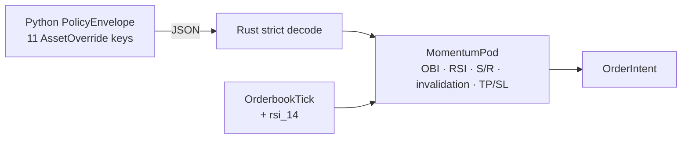

## Review Card (≤ 5 min)

| Field | Value |
|---|---|
| Outcome | The seven mechanical rules the LLM writes into `AssetOverride` survive the Rust decode and gate momentum entries. |
| Why now | Issue #10: Rust silently drops seven of eleven fields, so the advertised "compiled mechanical rules" are display-only. |
| Blast radius | `engine-rs` (`common`, `strategies`, `node`, `backtest`) and `backend/core/schemas.py`; IPC `PolicyEnvelope` and `MarketEvent` JSON. |
| Risk | Medium. Worst failure: strict decoding rejects an envelope from an older producer and halts the hot path instead of trading on stale rules. |
| Effort | M — one SPEC round, one PLAN round, one DEV round. |
| Decision needed | None. Hand-repair is chosen over codegen; the safe-baseline TTL is fixed at 900 s; `rsi_14` becomes a required `OrderbookTick` field. |

## Why

Issue #10 records an observed fact: the Rust `AssetOverride` declares three of the eleven fields Python publishes. `serde_json` drops the other seven without an error, so the LLM's OBI threshold, RSI guards, support/resistance zones, invalidation level, and TP/SL distances never reach an order.

The product claim in `README.md` and `AGENTS.md` — "compiled mechanical rules enforced by Rust pods" — is currently false. Repairing the contract is a prerequisite for any warm-path effectiveness measurement (issue #1, §2.4).

## What Changes

- **Parity**: Rust `AssetOverride` carries all eleven Python keys; the seven missing mechanical-rule fields become optional with defaults and are never silently dropped.
- **Strict decode**: an unknown key in `PolicyEnvelope`, `PodAllocation`, or `AssetOverride` becomes a hard error; `robotrader-node --policy-json` exits non-zero instead of silently running the default envelope. **BREAKING**.
- **RSI input**: `MarketEvent::OrderbookTick` carries a required `rsi_14` value computed by the warm path.
- **Rule consumption**: `MomentumPod` applies the override's OBI threshold, RSI bounds, support/resistance gates, invalidation gate, and TP/SL distances.
- **Drift detection**: a cross-language round-trip test becomes the executable contract.
- **Single source**: the safe-baseline TTL resolves to 900 s in both runtimes from one authoritative definition; Rust's current 86,400 s is removed.
- Hand-repair is the chosen approach for this change; generated schema/codegen is deferred to a follow-up ADR.

## Capabilities

### New Capabilities

- `contract`: cross-language `PolicyEnvelope`/`AssetOverride` parity, strict decoding, hot-path rule consumption, and executable drift detection.

### Modified Capabilities

- None.

## Non-goals

- Generated JSON Schema or serde-to-pydantic codegen (follow-up ADR).
- Risk-gate enforcement of TP/SL levels (issue #4).
- Transfer signing, vault, or key management (issue #8).
- Position monitoring or exit orders driven by `invalidation_price_usd`; it gates entries only in this change.
- New chains, venues, or leaf-isolation changes.
- Changing the Python producer's LLM sanitisation ranges.

## Impact

- Rust: `engine-rs/crates/common/src/lib.rs` (types, strict decoding, TTL), `crates/strategies/src/lib.rs` (momentum rules), `crates/node/src/main.rs` (fail-loud ingestion), `crates/backtest/src/lib.rs` (RSI-bearing fixtures and override constructors).
- Python: `backend/core/schemas.py` (TTL single source), `backend/tests/` (round-trip test).
- Contracts: `PolicyEnvelope` JSON over Redis and `--policy-json`; `MarketEvent` JSON; no REST/WS or DB schema change.
- Risk/money: momentum entries become more restrictive; risk-gate, Kelly sizing, dry powder, and kill-switch are unchanged.
- Backtest/paper/live: one pod path; fixtures must supply `rsi_14`; fixture-backed trade counts may change because momentum now honours the envelope.
- Multi-chain/venue: rules are per-symbol overrides; leaf isolation is unchanged.
