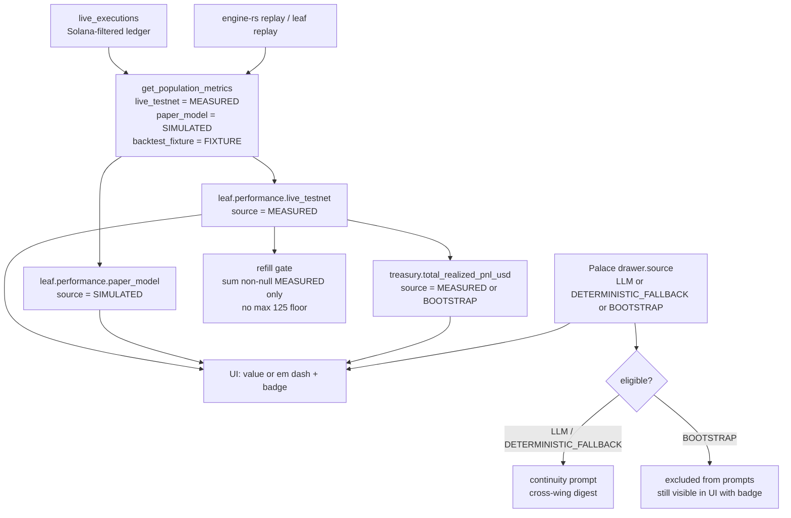

# Design — fix-fabricated-metrics

> Why: [`proposal.md`](proposal.md). What: [`specs/integrity/spec.md`](specs/integrity/spec.md) (approved at `a17d3a2`). This document decides **how**.

## Context

Robotrader's warm path builds the whole operator view in one place: `backend/server.py#get_system_status` assembles `/api/v1/status` from three metric populations (`engine_metrics`), the hierarchical fleet snapshot (`hierarchy`), the cognitive engine (`cognitive_engine`), and the testnet telemetry. The React UI is the only consumer of that payload and ships from the same repository.

Four state surfaces carry the defect:

| Surface | Mechanism today | Failure |
|---|---|---|
| `HierarchicalFleetManager._init_leaves` | Per-leaf constants scaled by `allocated_capital_usd` | A leaf that has never executed reports Sharpe `2.45`, win rate `64.5%`, and PnL at `1.8%` of allocation |
| `HierarchicalFleetManager._load_persisted` / `persist` | Redis key `robotrader:v3:hierarchy` copies the same five fields both ways | Legacy constants survive upgrades and restarts |
| `StrategyMemoryPalace` | Seeded drawers carry a model name, token count, cost, and `CONFIRMED` continuity | The Master prompt consumes theses it never wrote; the JSONL log cannot distinguish seeded from generated rows |
| Refill callers (`backend/server.py`, `backend/agents/orchestrator.py`) | `float(lf.get("realized_pnl_usd", 0.0))` plus `live_pnl_usd`, then `max(125.0, …)` | A null raises; a paper-model value enters a realized-profit gate; zero profit is presented as `$125` |

Constraints that shape the design:

- **Warm path only.** No Rust, `PolicyEnvelope`, `HardRiskGate`, vault, Kelly sizing, dry-powder floor, or `CostGuard` limit changes. The 50µs hot path is untouched.
- **One UI consumer, deployed in lockstep.** A breaking payload change is acceptable because backend, frontend, and docs land in one PR; there is no external client to keep compatible.
- **Redis is a cache, not a ledger.** `robotrader:v3:hierarchy` is disposable and can be recomputed. `backend/data/strategy_palace.jsonl` is append-only and is the Palace audit trail; `robotrader:v2:palace` mirrors its last 100 drawers.
- **No frontend test runner.** `frontend/package.json` exposes only `dev`, `build`, `lint`, `preview`. The design must not add a test framework.
- **Python test style is fixed.** `unittest` discovery from the repository root with `PYTHONPATH=.`; no pytest.
- **ADR-0002 promises continuity injection.** Its Pillar 2 says every LLM prompt injects the latest `strategy_ledger` drawers, and its depth profiles assume `5` / `2` drawers exist. The design must reconcile that promise with provenance-gated injection.

### Runtime data flow after the change



## Goals / Non-Goals

**Goals:**

- One provenance vocabulary shared by backend, API, UI, and audit document.
- Every performance number is either derived from an attributed population or absent; absent renders `—`, never a plausible value.
- A single derivation rule for a leaf block that mixes populations, and a single rendering rule for `BOOTSTRAP` telemetry.
- Cached state cannot resurrect a removed constant.
- Memory continuity is built only from drawers that actually recorded a reasoning call.
- The refill gate sees the measured realized profit, including `0.0`, and nothing else.
- The audit document states which figures are fixtures, simulations, and measurements.

**Non-Goals:**

- The vault-manifest fallback (#2), the fill simulator (#3), fleet execution (#6), and the remaining `CostGuard` defects in #5, exactly as bounded by the proposal.
- A new `/api/v2` surface, a feature flag, or a dual-shape payload.
- Rewriting legacy Palace JSONL or reconstructing pre-change LLM theses. Legacy drawers are normalised **in memory only**.
- Historical backfill of performance data. A leaf with no attributed rows stays `null`.
- Non-performance operational defaults in the UI (for example an allocated-capital placeholder). Only the surfaces enumerated in the spec are governed.
- A frontend test framework. Pure formatting logic is verified with a `node` assertion command.

## Decisions

| # | Decision | Alternatives considered | Rationale | Rejected because |
|---|---|---|---|---|
| D1 | Introduce `backend/core/provenance.py` with the two enums, the `executions_source` mapping, and source normalisation helpers | Duplicate string literals per module; a `str, Enum` class per module | One contract for six warm-path modules and one test surface; no new third-party dependency | Duplication drifts silently; per-module enums would reintroduce parallel vocabularies |
| D2 | Leaf performance is a nested `performance` object with `live_testnet` and `paper_model` sub-blocks; flat performance keys (`realized_pnl_usd`, `paper_pnl_usd`, `sharpe_ratio`, `win_rate_pct`) are removed, not mirrored | Keep a flat mirror with an inherited source; attach a per-field `source` map | A flat mirror has two write paths and invites divergence; per-field provenance makes the block unreadable | The spec permits a mirror but does not require one; removing it makes the mixed-population bug structurally impossible |
| D3 | Mixed populations are never described by a block-level source: the split happens at the derivation boundary, and each sub-block keeps its population source even when all values are `null` | Infer the source from the values present; use `BOOTSTRAP` for empty sub-blocks | Population identity is knowledge, not an observation about the values; an empty measured population is still measured | Value-based inference would flip provenance on the first row and make the badge unstable |
| D4 | `executions_source` is a **population** identifier only: `backtest_fixture \| paper_model \| live_testnet`. The leaf replay producer value `rust_leaf_backtest` is remapped to `backtest_fixture`, and the producer description moves to `source_detail` | Keep `rust_leaf_backtest` as a fourth token; add a second alias field | The leaf replay *is* the deterministic fixture population, run for one leaf; a fourth token breaks the 1:1 source mapping the spec fixes | A fourth vocabulary makes the enum open-ended and forces every consumer to special-case a producer name |
| D5 | `source` is always the enum; the current free-text description moves to `source_detail` on every payload that had one | Drop the description; keep free text in a different field name | Operators keep the human explanation; automation gets a stable enum; the break is explicit | Dropping the text loses the context the audit already relies on |
| D6 | `treasury.total_realized_pnl_usd` sums non-null `MEASURED` leaf values and is `null` when none exists; `treasury.source` is `MEASURED` when non-null and `BOOTSTRAP` when null. The provenance block is scoped to the PnL value, not to the capital fields | Label the whole treasury `BOOTSTRAP` when PnL is null; derive the aggregate from allocation weights | Capital, deployed, and dry powder are operational values, not performance populations; mislabelling them would blank real numbers | A whole-treasury `BOOTSTRAP` block would hide the real capital state; weight-derived PnL is the defect being removed |
| D7 | Legacy Redis performance keys are ignored at load, excluded from the persisted payload through one shared `_persisted_payload()`, and compacted once at read time when detected | Leave stale keys in Redis until the next scheduled persist; write a migration script | Ignore-on-read is sufficient for correctness; the one-time rewrite keeps the cache from holding dead keys; a script adds an operational step for a disposable cache | A migration script is another artifact to run, version, and roll back; a lazy rewrite is atomic with the boot that observes the legacy shape |
| D8 | `PalaceDrawer.source` defaults to `BOOTSTRAP` and is normalised in `from_dict` and `add_drawer` | Default to `LLM`; require the caller to set it and trust it | Fail-closed: a forgotten label degrades a drawer to visible-but-non-injectable rather than promoting it to LLM | Defaulting to `LLM` would let a new unlabelled drawer claim continuity; trusting callers repeats the current defect |
| D9 | Prompt builders (`format_continuity_prompt`, `format_cross_wing_digest`) scan the **full** drawer list by wing and source, then apply the per-wing limit; `recall_recent` keeps returning every drawer | Filter inside `recall_recent`; filter after the top-N slice | The UI must still show `BOOTSTRAP` drawers with a badge; the ADR depth-profile counts are maxima filled by eligible drawers, so an older eligible drawer must not be hidden by newer bootstrap ones | Filtering at recall would hide bootstrap drawers from the operator; filtering after the slice breaks the "maxima filled only by eligible drawers" rule |
| D10 | `DETERMINISTIC_FALLBACK` continuity is `INITIAL` unless the same wing already holds an `LLM` drawer, in which case it copies that continuity and never escalates. Telemetry is empty/`0`/`0` unless a call was actually billed | Keep the current `CONFIRMED if drawers else INITIAL`; hardcode `CONFIRMED` for leaves | Seeded `BOOTSTRAP` drawers are not evidence of a prior thesis; a billed call's usage is real and should be reported | The current rule treats a seed as confirmation; the leaf rule confirms unconditionally |
| D11 | Both refill callers call one `HybridStateStore.measured_realized_pnl_usd()` helper that sums non-null attributed live rows and returns `0.0` when none exist; the paper PnL term and the `max(125.0, …)` floor are deleted | Fix each call site independently; keep the floor and clamp the amount | One helper is testable in isolation and keeps the two callers in parity; `0.0` lets the existing gate reject with `rejected_no_realized_profit` | Two independent sums drift; a floor is a fabricated profit value by definition. The rest of #5 stays out of scope |
| D12 | **Follow-up 2 rendering rule:** for performance values, the source gate precedes the value formatter. A value whose source is `BOOTSTRAP` or `null` renders `—` regardless of the stored value, including `tokens_used = 0` and `cost_usd = 0`. Operational values (capital, deployed, dry powder, ratio, active-leaf count, OpenRouter balance, allocation, weight) are not provenance-bearing and use a separate null-aware formatter with no badge | Render stored zeros as `0`/`$0.000000`; suppress the telemetry line entirely; force operational values through the provenance formatter | One observable satisfies both the API rule (bootstrap telemetry is `0`) and the UI scenario (every value renders `—`); operational values have no population and would otherwise be blanked by a missing source | Rendering `0` would make a bootstrap drawer look like a measured zero-cost call; a second "hide the line" rule would be a second observable; blanking real capital because it has no source is worse than the original defect |
| D13 | On a failed poll after a success, `App` swaps the render payload to the cold skeleton and passes `offlineSince`; leaf views ignore their cached detail and cached replay result | Mark individual tiles stale; keep cached data behind a badge | A single substitution point guarantees no retained performance value can leak through any component | Per-tile marking is easy to miss and cannot be asserted as a whole-screen rule |
| D14 | The breaking change is versioned with an additive `contract_version: 2` on `/api/v1/status` and communicated through the PR body's `BREAKING CHANGE:` footer, the issue logbook, and the audit document | Bump the URL to `/api/v2`; dual-serve old and new shapes; feature-flag the new shape | The only consumer ships in the same commit; a version marker lets a future client detect the shape without a parallel surface | `/api/v2` doubles maintenance for one client; dual shapes keep unattributed numbers reachable; a flag leaves the defect one toggle away |
| D15 | Testing uses the existing `unittest` suite plus a pure frontend helper verified by a `node` assertion command, `npm run lint`, and `npm run build` | Add Vitest/Jest; rely on manual inspection only | The repository has no frontend runner and the change is presentation logic; a pure module makes the rule executable without a framework | Adding a framework is a new dependency and CI surface for one helper; manual inspection is not evidence |
| D16 | The audit document gets a provenance legend and a `[FIXTURE]` / `[SIMULATED]` / `[MEASURED]` label on every **trading-performance** figure block (§1 claims and §3). The §2/§4 inference-cost tables are operational cost measurements outside the three trading populations, labelled as such and not forced into the trading enums. New text is English; the pre-existing French body is left untranslated as a recorded legacy exception | Rewrite the document as a narrative; delete fixture figures; label every numeric table with a trading source | The performance numbers are useful as engineering fixtures once labelled; the cost tables measure something else entirely; the English convention governs new repository text | A narrative is not scannable; deletion removes the only record of the replay scenario; labelling token cost as `MEASURED` trading performance would misattribute a different population |
| D17 | `testnet_telemetry` carries one population only: measured testnet wallet and order telemetry. The simulated paper accumulator (`simulated_model_pnl_usd`) and the never-measured `solana_onchain_pnl_sol` are removed | Keep both fields and label the block `MEASURED`; split them into a `SIMULATED` sub-block and an unattributed field | The paper PnL is already `engine_metrics.paper_model.cumulative_pnl_usd`; a block-level `MEASURED` label over mixed values repeats the exact defect | A simulated sub-block duplicates a population the API already exposes; an unattributed hardcoded zero has no measurement worth keeping |

### D2/D3 — Leaf payload contract

```json
{
  "performance": {
    "live_testnet": {
      "source": "MEASURED",
      "source_detail": "realized_pnl_usd (testnet/devnet orders), Solana-filtered ledger, recent 200-row window",
      "realized_pnl_usd": 12.34,
      "win_rate_pct": 54.2,
      "sharpe_ratio": 0.41
    },
    "paper_model": {
      "source": "SIMULATED",
      "source_detail": "simulated_pnl_usd (L2 slippage + adverse-selection paper model)",
      "paper_pnl_usd": 1155.52,
      "win_rate_pct": 56.3,
      "sharpe_ratio": null
    }
  },
  "active_positions_count": null
}
```

Derivation, with `ATTRIBUTED_LIVE_LEAF_IDS = ("leaf-solana",)` as the single attribution constant:

| Field | Derivation | Absent when |
|---|---|---|
| `live_testnet.realized_pnl_usd` | Sum of `realized_pnl_usd` over attributed live rows (`live_testnet.recent.pnl_usd`) | The leaf has no attributed rows, or is not attributed |
| `live_testnet.win_rate_pct` | `100 * wins / trades` over the same rows | No rows |
| `live_testnet.sharpe_ratio` | Mean divided by sample standard deviation of per-row `realized_pnl_usd`, not annualised | Fewer than two rows, or zero variance |
| `paper_model.paper_pnl_usd` | `paper_model.cumulative_pnl_usd` | The leaf is not attributed |
| `paper_model.win_rate_pct` | `paper_model.lifetime.win_rate_pct` | The leaf is not attributed, or no paper trades |
| `paper_model.sharpe_ratio` | Always `null`; the paper population records no Sharpe | Always |
| `active_positions_count` | Always `null`; no position ledger exists | Always |

`_sample_stats` gains `sharpe_ratio` so the live window and the paper recent window share one computation. The leaf reads the live value from that window; it never recomputes statistics in `hierarchy.py`.

**Window basis (disclosed).** Today `get_leaf_detail` copies the lifetime accumulator `live_testnet.cumulative_cex_pnl_usd` into the leaf. The approved spec anchors the leaf value to "the sum of those rows", so this design uses the retained **200-row window** (`live_testnet.recent`). After eviction the leaf and `treasury.total_realized_pnl_usd` therefore describe the retained window, while `engine_metrics.live_testnet.cumulative_cex_pnl_usd` remains the lifetime figure. The basis is stated in `source_detail` (`recent 200-row window`) and in the audit legend; an eviction test records the divergence explicitly. The treasury field name is spec-mandated and is not renamed. The alternative (lifetime value) would contradict the approved scenario and require a `spec-gap` escalation, so it is not taken.

**Every call path.** `get_leaf_detail` is called by the hierarchy snapshot, by `GET /api/v1/leaf/{leaf_id}`, and by `update_leaf_mandate`. The direct endpoint and the mandate path must pass `state_store.get_population_metrics()`; the snapshot already receives `solana_populations`. With no populations available, the defensive path returns the two sub-blocks with their population sources and all values `null`; it never falls back to a flat key or a constant.

### D4 — Population mapping

| `executions_source` | Row `source` | Producer |
|---|---|---|
| `backtest_fixture` | `FIXTURE` | `engine-rs` deterministic replay, global or per leaf |
| `paper_model` | `SIMULATED` | L2 + adverse-selection paper simulation |
| `live_testnet` | `MEASURED` | Binance Spot Testnet / Solana Devnet orders |

`rust_leaf_backtest` disappears. Both branches are labelled: `run_rust_backtest` sets `source = "FIXTURE"` and the generic replay detail, so the `leaf-solana` early return in `run_rust_backtest_for_leaf` is already labelled; the non-Solana branch adds the leaf-replay detail `"engine-rs deterministic leaf replay (robotrader-node --leaf-id)"`. `last_rust_backtest` stores `source = "FIXTURE"` and that detail. A test asserts the producer token is absent from production modules (`backend/core`, `backend/agents`, `backend/server.py`), while the rejection test under `backend/tests/` deliberately contains it.

### D7 — Redis compaction payload

The one-time read-time rewrite writes the **complete** hierarchy payload, not only the leaves object:

```json
{
  "total_capital_usd": 25000.0,
  "long_term_strategy_thesis": "…",
  "leaves": {"<leaf_id>": {"allocated_capital_usd": 0.0, "capital_weight": 0.0, "risk_posture": "…", "enabled": false, "objective_summary": "…"}},
  "deposit_history": [],
  "checkout_history": []
}
```

`_persisted_payload()` is the single builder used by `persist()` and by the compaction, so top-level capital, thesis, and both histories cannot be dropped. The five performance keys are absent from every leaf object.

### D5/D17 — `testnet_telemetry` contract

The payload keeps only the measured testnet population and declares it once:

```json
{
  "enabled": true,
  "source": "MEASURED",
  "source_detail": "binance spot testnet + solana devnet wallet and order telemetry, refreshed by the live worker",
  "solana_cluster": "devnet",
  "solana_balance_sol": 5.0,
  "solana_tx_count": 0,
  "solana_gas_spent_sol": 0.0,
  "binance_free_usdt": 10000.0,
  "binance_total_usdt": 10000.0,
  "binance_open_positions": {},
  "binance_realized_pnl_usd": 0.0
}
```

`simulated_model_pnl_usd` is removed (its population is `engine_metrics.paper_model.cumulative_pnl_usd`) and `solana_onchain_pnl_sol` is removed (it was never measured). The wallet balances and counts are refreshed by the testnet worker; they are telemetry, not trading performance. The `enabled: False` branch returns `source = "MEASURED"`, `source_detail`, and no numeric performance field.

### D8/D9/D10 — Drawer provenance contract

| `source` | `model_used` | `tokens_used` / `cost_usd` | `thesis_continuity` | Prompt and digest |
|---|---|---|---|---|
| `LLM` | Model that answered | Recorded call usage | As returned by the model | Eligible |
| `DETERMINISTIC_FALLBACK` | Answering model if a call was billed, otherwise `""` | Recorded usage if billed, otherwise `0` / `0.0` | Same-wing `LLM` drawer's state, otherwise `INITIAL`; never escalated | Eligible |
| `BOOTSTRAP` | `""` | `0` / `0.0` | `INITIAL` | Excluded |

Normalisation is applied in `PalaceDrawer.from_dict` (missing, unknown, or `BOOTSTRAP` with telemetry is coerced to the bootstrap row) and in `add_drawer` (a newly constructed drawer is normalised before it is appended or mirrored). Legacy drawers are never written back to `strategy_palace.jsonl`; the JSONL remains the raw audit trail. The Redis mirror may hold a normalised copy after the next `add_drawer`, which the migration plan covers.

**Eligibility selection happens before the limit.** Both prompt builders scan the full `self.drawers` list filtered by wing and source, then slice to the requested limit. They never call `recall_recent(limit=N, …)` and filter afterwards, because newer `BOOTSTRAP` drawers would hide an older eligible thesis.

**All four real-call construction sites are labelled:** the `strategy_ledger` thesis in `run_strategic_reflection`, the `leaf_solana` mirror in the same method, the `master_orchestrator` drawer in `run_master_orchestrator_reflection`, and the per-leaf drawer in `run_leaf_agent_reflection`. Each uses `source = LLM` when a parsed model response was billed (`parsed_from_llm`), otherwise `source = DETERMINISTIC_FALLBACK`; the mirror inherits the parent's source and continuity. The two seed sites in `hierarchy.py` are `BOOTSTRAP`.

### D11 — Refill contract

`HybridStateStore.measured_realized_pnl_usd()` returns the sum of `realized_pnl_usd` over the attributed live rows, skipping any `None`, and returns `0.0` when there is no row. Both callers pass that value directly to `trigger_openrouter_refill`; neither adds `live_pnl_usd`, neither applies a floor. A parity test asserts the helper equals the sum of non-null `performance.live_testnet.realized_pnl_usd` values from the status snapshot.

### D12/D13 — Rendering contract

`frontend/src/lib/provenance.js` exports two pure decision functions and the badge helper:

```text
formatMetric(value, source, kind):
  source is null/undefined  -> em dash, badge UNATTRIBUTED
  source is BOOTSTRAP       -> em dash, badge BOOTSTRAP
  value is null/undefined   -> em dash, badge source
  otherwise                 -> formatted value, badge source

formatOperational(value, kind):
  value is null/undefined   -> em dash, no badge
  otherwise                 -> formatted value, no badge  (0 -> 0.00, not a dash)
```

A **performance metric block** is the smallest set of values sharing one source. For the treasury, the block is `total_realized_pnl_usd` alone, so a `BOOTSTRAP` PnL line renders `—` while capital, deployed, and dry-powder values remain numeric and badge-free. Operational values are not in the spec's provenance table, so the "display its source label" clause is read as applying to performance metric blocks; this is the only reading consistent with the table itself. `BOOTSTRAP` and `UNATTRIBUTED` badges differ in both text and styling.

Because there is no frontend runner, the static wiring is asserted by `frontend/scripts/check-provenance.mjs`: it imports the helper, asserts both rules, reads the three component sources, requires the provenance import, and rejects the forbidden coercions and defaults. Behavioural evidence is the enumerated null-state screenshots.

Offline treatment has two states:

- **Cold offline** (no successful poll): the skeleton carries `null` performance and treasury values; every governed figure renders `—`; no timestamp exists.
- **Degraded** (success then failure): the header badge reads `OFFLINE — last success HH:MM:SS`; `App` renders the cold skeleton instead of the retained payload and passes `offlineSince`; `LeafAgentView` ignores its cached `leafDetail` and `rustBacktestResult`.

### D14 — Breaking-change communication

`GET /api/v1/status` gains the additive `contract_version: 2` marker. The removed flat leaf keys and the enum `source` are documented in the PR body under a `BREAKING CHANGE:` footer and in the issue logbook. No deprecation window is needed because `frontend/` is updated in the same commit. `architecture` and `hierarchy_version` stay unchanged so existing string checks in the UI keep working.

### Traceability

| Spec requirement or concern | Decisions | Tasks |
|---|---|---|
| Leaf live performance requires execution evidence | D2, D3 | 2.2, 2.3, 2.7, 2.11 |
| Leaf paper performance and position count derive only from declared evidence | D2, D3 | 2.2, 2.3, 2.8 |
| Leaf performance blocks are split by population | D2, D3 | 2.2, 2.3, 2.8 |
| Every performance payload declares its provenance | D1, D4, D5, D17 | 1.1–1.10 |
| Master aggregate derives only from declared evidence | D6 | 2.4, 2.9 |
| Persisted leaf performance is not rehydrated | D7 | 3.1–3.3 |
| Palace drawers declare provenance | D8, D9 | 4.1–4.8 |
| Bootstrap drawers carry no LLM telemetry and no prior-thesis claim | D8, D9 | 4.2, 4.3, 4.7 |
| Deterministic fallback drawers claim no unfounded continuity | D10 | 4.4, 4.8 |
| Refill gating consumes null-safe measured PnL only | D11 | 5.1–5.4 |
| UI renders absent metrics as an em dash with provenance | D12, D13 | 6.1–6.9 |
| Offline UI state invents no portfolio and replaces stale values | D13 | 6.3, 6.5, 6.6, 6.9 |
| API substitutes no plausible default | D6, D13 | 2.4, 2.9 |
| Audit document separates fixture from measured | D16 | 7.1–7.3 |
| Breaking API communication and version marker | D14 | 2.4, 8.7 |
| Test strategy without a frontend runner | D15 | 6.7, 6.8, 8.1–8.5 |

## Risks / Trade-offs

- **A consumer assumes a number and crashes on `null`** -> Sweep every backend consumer (`server.py`, `orchestrator.py`, `analysis.py`, `hierarchy.py`, `state_store.py`) in group 2/5, keep one null-safe refill helper, and add a recursive payload test that rejects an unattributed numeric performance field.
- **A genuine pre-change LLM thesis becomes invisible to the Master prompt** -> Accepted by the approved spec. The drawer stays visible in the UI as `BOOTSTRAP`; ADR-0002 is amended to state the eligibility rule. The JSONL keeps the original bytes for later reconstruction.
- **Normalising legacy drawers degrades the Redis mirror on the first new write** -> The append-only `strategy_palace.jsonl` is never rewritten; the rollback procedure deletes `robotrader:v2:palace` to rebuild the mirror from the untouched log.
- **The one-time Redis compaction fails during boot or drops top-level state** -> `_persisted_payload()` is the complete payload (capital, thesis, leaves with only allowed keys, deposit and checkout histories), shared with `persist()`, and the compaction test asserts every top-level field survives; the rewrite is best-effort inside `try/except`, and correctness does not depend on it because load already ignores the legacy keys.
- **`testnet_telemetry` mixes a simulated accumulator or a hardcoded on-chain PnL into a `MEASURED` block** -> D17 removes both fields; the paper value stays only at `engine_metrics.paper_model`; a test asserts no `simulated_model_pnl_usd` or `solana_onchain_pnl_sol` remains and every numeric field in the payload is testnet telemetry refreshed by the worker.
- **The window-vs-lifetime PnL switch is read as a regression** -> The basis is named in `source_detail` (`recent 200-row window`) and in the audit legend; an eviction test records the divergence from `cumulative_cex_pnl_usd`; the lifetime alternative would contradict the approved scenario and require a `spec-gap` escalation.
- **`treasury.source = BOOTSTRAP` is misread as "the treasury is empty"** -> Block scoping: the badge attaches only to `total_realized_pnl_usd`; capital, deployed, and dry-powder tiles stay numeric and unbadged through the operational formatter.
- **Operational values are blanked by the provenance gate** -> Two formatters: `formatMetric` for performance values and `formatOperational` for capital, credit, allocation, and counts. The split is recorded as the D6/D12 interpretation, and node assertions cover `0.0 -> $0.00` and `null -> —`.
- **`BOOTSTRAP` zeros hidden as `—` surprise an operator reading telemetry** -> Intended and testable: a bootstrap drawer never cost anything, so a rendered `$0.000000` would itself be a fabricated measurement. The badge explains the dash.
- **The per-trade live Sharpe is not comparable to the annualised fixture Sharpe** -> `source_detail` and the audit legend state the basis; the two never share a tile or a badge. The number exists to satisfy "computed from rows, not `2.45`", not to be compared with the fixture.
- **No frontend test runner means UI regressions can slip** -> Every decision lives in the pure `provenance.js` helper; `frontend/scripts/check-provenance.mjs` asserts both rules and statically rejects the forbidden coercions and defaults in the three components; null-state screenshots for the leaf view, Master table, and Dashboard are attached as behavioural evidence. The residual gap (JSX event wiring) is explicitly scoped to the Docker smoke and screenshots.
- **The breaking payload shape escapes to an unrecognised client** -> `contract_version: 2` plus the PR `BREAKING CHANGE:` footer; a repository-wide grep confirms the only consumer is `frontend/`.
- **The refill helper and the snapshot attribution drift** -> A parity test asserts the helper equals the snapshot sum; `ATTRIBUTED_LIVE_LEAF_IDS` is the single attribution constant.
- **Worst failure: a fabricated number is still served, or a real LLM drawer is mislabelled `BOOTSTRAP`** -> Fail-closed defaults, a recursive provenance test over the full status payload, the grep gates in group 8, and a `BOOTSTRAP` badge that makes the degradation visible rather than silent.

## Migration Plan

**Deployment order (one PR, one deploy):**

1. Backend provenance contract, leaf API shape, persisted-state handling, drawers, and refill callers (groups 1–5).
2. Frontend rendering against the new shape (group 6) in the same commit series, so no deployment serves the old UI against the new payload.
3. Docs and ADR-0002 (group 7).
4. `docker compose up --build -d`. On first boot the hierarchy loader ignores legacy performance keys and compacts the Redis cache with the complete `_persisted_payload()`; the Palace normalises legacy drawers in memory.
5. Verify with the commands in `tasks.md` → `## Verification`; attach the enumerated null-state screenshots.

**No data migration step is required.** The hierarchy key is a disposable cache, the Palace JSONL is read-only, and the Redis Palace mirror is rebuilt lazily.

**Rollback:**

1. `git revert <dev-merge-sha>` on the branch (or revert the squashed commit on `master`).
2. `docker compose up --build -d`. Pre-change `_init_leaves` regenerates the constants, so the old shape returns without a data step.
3. If full drawer fidelity is required after rollback, rebuild the mirror from the untouched log: `redis-cli -u "$REDIS_URL" DEL robotrader:v2:palace` and restart the backend.
4. Optionally delete the compacted hierarchy cache so pre-change code regenerates it immediately: `redis-cli -u "$REDIS_URL" DEL robotrader:v3:hierarchy`.
5. Confirm the old shape: `curl -s http://localhost:8000/api/v1/status | python3 -c 'import json,sys; d=json.load(sys.stdin); print(d["engine_metrics"]["backtest_fixture"]["source"])'` prints the descriptive string again.

## Open Questions

<!-- None: every decision needed for DEV is resolved above. -->
