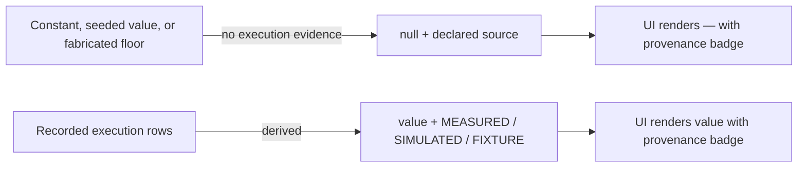

## Review Card (≤ 5 min)

| Field | Value |
|---|---|
| Outcome | Every performance number declares its population and source, or renders as `—`; no constant, seeded thesis, or fabricated profit floor can pass as measured. |
| Why now | The dashboard, the Master prompt, and the refill gate present constants, seeded theses, and a `max(125.0, …)` profit floor as measured facts. An operator cannot separate a real result from an invented one without reading Python. |
| Blast radius | Warm path (`backend/core`, `backend/agents`, `backend/server.py`) including both OpenRouter refill call sites; dashboard (`App`, `LeafAgentView`, `MasterOverview`, `Dashboard`); ADR-0002 amendment; audit document. No Rust, `PolicyEnvelope`, vault, or chain routing. |
| Risk | Medium. Worst failure: a consumer that assumed a number crashes on `null` — both refill call sites do this today; null-safe behavior is specified. Accepted trade-off: pre-change Palace drawers have no `source`, so genuine LLM theses become invisible to the continuity prompt after upgrade. |
| Effort | L — one SPEC round, one PLAN round, one DEV round. |
| Decision needed | None. |

### Non-goals

- Vault-manifest fallback (#2), the real fill simulator (#3), and fleet execution (#6).
- The wider `CostGuard` defects tracked in #5 beyond the two caller inputs corrected here.

## Why

The platform synthesises performance, identity, and history values with no provenance marker and renders them beside genuinely measured values with the same formatting. Leaf Sharpe, win rate, realized PnL, and position count are constants scaled by allocation; seeded Palace drawers carry a model name, token count, and cost; the offline UI shows a plausible $25k treasury; the refill callers report a losing strategy as $125 of realized profit.

This is an epistemic-integrity defect. An operator cannot trust the dashboard, the memory system cannot be trusted for continuity, and any external reader will over-trust the numbers.

## What Changes

- **BREAKING** — Leaf performance is split into `performance.live_testnet` (`MEASURED`) and `performance.paper_model` (`SIMULATED`) sub-blocks, each with its own `source`. Live fields are `null` unless the leaf has attributed execution rows; `leaf-solana` is the only attributed leaf in this change, because the ledger is Solana-filtered at load.
- **BREAKING** — Every enumerated performance payload carries a mandatory `source` from `MEASURED`, `SIMULATED`, `FIXTURE`, or `BOOTSTRAP`; the former free-text `engine_metrics.*.source` moves to `source_detail`.
- Master treasury aggregate `total_realized_pnl_usd` sums only measured leaf PnL and is `null` when none exists; `source` is `MEASURED` when populated and `BOOTSTRAP` when empty; the invented defaults for OpenRouter balance (`24.5`) and active-leaf count (`11`) are removed.
- Persisted Redis hierarchy performance keys are ignored at load and no longer written, so legacy constants cannot reappear after restart.
- Palace drawers gain a mandatory `source` from `LLM`, `DETERMINISTIC_FALLBACK`, or `BOOTSTRAP`. Seeded drawers are `BOOTSTRAP` with no model, token, or cost, and are excluded from the continuity prompt and cross-wing digest. Deterministic fallbacks claim `INITIAL` continuity unless a real `LLM` drawer exists and carry no fabricated telemetry.
- ADR-0002 is amended: only `LLM` and `DETERMINISTIC_FALLBACK` drawers are injected, and depth-profile drawer counts are maxima.
- The two OpenRouter refill callers consume only non-null measured PnL and no longer apply the `max(125.0, …)` floor or add simulated paper PnL.
- The UI renders `—` plus a provenance badge for null or unattributed metrics across `App`, `LeafAgentView`, `MasterOverview`, and `Dashboard`; the offline state replaces retained values and shows an `OFFLINE` badge with the last-success timestamp.
- The offline UI skeleton contains zeros or `null`, not an invented model portfolio.
- The performance audit document labels each population and separates fixture arithmetic from measured live-testnet results.

## Capabilities

### New Capabilities

- `integrity`: provenance and null semantics for performance metrics, Palace drawers, the refill gate, UI rendering, and the audit document.

### Modified Capabilities

- None.

## Non-goals

- Removing the Python vault-manifest fallback: that is issue #2.
- Replacing the circular executor with a real fill simulator: that is issue #3.
- Fleet execution across all leaves: that is issue #6.
- The remaining `CostGuard` defects tracked in issue #5: the automatic refill path bypassing the gate, the unused Rust `validate_inference_refill`, the non-authoritative balance, missing daily rollover, and divergent low-watermark constants. This change corrects only the two caller inputs (null handling, simulated-PnL mixing, `max(125.0, …)` floor).
- Historical repair of pre-change Palace drawers. They are conservatively read as `BOOTSTRAP`, lose their model telemetry, and are excluded from the continuity prompt; genuine LLM theses written before this change therefore become invisible to the Master prompt. This is an accepted trade-off, not a reconstruction task.
- A per-leaf position ledger. `active_positions_count` is `null` until such a ledger exists.
- Any change to Rust strategy pods, `HardRiskGate`, `PolicyEnvelope`, Kelly sizing, dry-powder protection, or `CostGuard` limits.
- Backtest, paper, and live strategy behavior: the code paths are unchanged; only provenance and null semantics of reported metrics change.

## Impact

- Backend: `backend/core/hierarchy.py` (leaf snapshot and per-population sub-blocks, treasury aggregate, bootstrap seeding, Redis load/persist), `backend/core/memory_palace.py` (`PalaceDrawer`, persistence, prompt builders), `backend/core/state_store.py` (population provenance, `source_detail`, execution attribution), `backend/agents/orchestrator.py` (null-safe Master prompt and refill caller, deterministic-fallback drawer), `backend/agents/analysis.py` (QuantAuditor output provenance), `backend/server.py` (status payloads, `/api/v1/openrouter/refill`, leaf backtest response).
- Frontend: `frontend/src/App.jsx` (offline fallback and stale treatment), `frontend/src/components/LeafAgentView.jsx`, `frontend/src/components/MasterOverview.jsx`, `frontend/src/components/Dashboard.jsx`.
- Contracts: `GET /api/v1/status` changes **BREAKING** — `engine_metrics.*.source` changes type from free text to enum, leaf performance fields become nullable and move under per-population sub-blocks, and new `source` fields appear on `last_rust_backtest`, `testnet_telemetry`, `executions`, and the QuantAuditor output. `POST /api/v1/leaf/{leaf_id}/backtest` and `POST /api/v1/openrouter/refill` change semantically. Redis hierarchy keys drop performance fields; Redis Palace JSON gains one additive field. No `PolicyEnvelope` or IPC schema change.
- Docs: `docs/PERFORMANCE_AND_COST_AUDIT.md`; `docs/adr/0002-autonomous-cognitive-warm-path-and-ta-memory.md` (injection rule and drawer-count wording).
- Tests: `backend/tests/` gains integration and architecture tests for null semantics, per-population provenance, persisted-state migration, drawer provenance, fallback continuity, refill null-safety, and prompt exclusion.
- Chains/venues: none. Each leaf remains isolated to its own chain and MemPalace wing; the Solana-only ledger attribution is stated explicitly.
- Backtest/paper/live: populations keep their existing deterministic code path and isolation; only labelling, attribution, and null semantics change.
