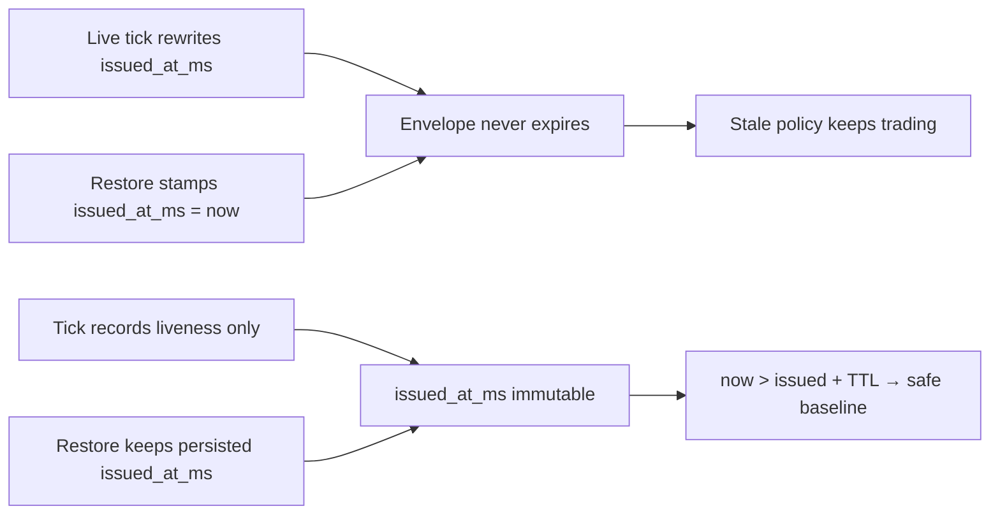

## Review Card (≤ 5 min)

| Field | Value |
|---|---|
| Outcome | A `PolicyEnvelope` now expires after its own TTL; neither a live-worker tick nor a process restart can keep it alive. |
| Why now | `ADR-0001` §4.2 promises "stale policy → safe baseline". The live worker rewrites `issued_at_ms` every 10 s and restore stamps the current time, so the fail-safe cannot trigger (issue #8.1–8.2). |
| Blast radius | Warm path only: `backend/core/state_store.py` and its tests. No Rust, `HardRiskGate`, execution routing, `PolicyEnvelope` wire shape, Redis key or payload shape, REST/WS shape, vault, or chain routing. `GET /api/v1/status` may now report the safe baseline where it previously reported a renewed envelope. |
| Risk | Medium. Worst failure: an operator-selected regime expires 900 s after issuance unless a cognitive cycle issues a new envelope. That is the intended fail-safe, but it is a visible behaviour change. |
| Effort | S — one SPEC round, one DEV round. |
| Decision needed | None. |

## Why

`ADR-0001` §4.2 defines a fail-safe: when an envelope is older than its TTL, the engine reverts to the safe baseline. The implemented warm path defeats it in two places.

- `run_live_testnet_tick()` rewrites `issued_at_ms` on every 10-second tick, unconditionally and before it checks authentication or pod activity (`backend/core/state_store.py:528-531`).
- `_load_persisted_state()` rewrites `issued_at_ms` to the restore instant, so a container restart resurrects a days-old policy as fresh (`backend/core/state_store.py:194-195`).

The `is_expired` and effective-policy logic is already correct. The defect is that two callers keep resetting its only input.

## What Changes

- **BREAKING (behavioural, not a wire or schema break)** — an operator-selected regime is no longer kept alive by the live worker; it expires at `issued_at_ms + ttl_seconds * 1000` unless a cognitive cycle issues a new envelope.
- The live testnet tick no longer writes `issued_at_ms` or `ttl_seconds`. Any liveness signal is stored outside `PolicyEnvelope` and is not an expiry input.
- Restore keeps the persisted `issued_at_ms`. A restored envelope past its TTL starts from `safe_baseline`; a fresh one keeps its original issue time.
- A persisted policy object without `issued_at_ms` no longer inherits the restore clock; it starts from `safe_baseline`.
- Tests cover tick non-renewal, liveness non-influence, the expiry boundary, fresh restore, stale restore, missing issue time, and kill-switch precedence.
- No `PolicyEnvelope` field is added or removed.

## Capabilities

### New Capabilities

- `policy-ttl`: policy issue-time immutability across live ticks, separation of liveness from policy authority, and restore-time expiry semantics.

### Modified Capabilities

- None.

## Non-goals

- Signed or authenticated envelopes (#8.3).
- Redis TTL, streams, or pub/sub contract (#8.4).
- Control-plane authentication and CORS (#8.5).
- Wiring the kill-switch into the Rust executor (#8.6).
- Changing when a cognitive cycle re-issues an envelope, including whether a deterministic fallback may stamp a new `issued_at_ms`. This change only removes the live-worker renewal and the restore-time reset.
- Any Rust or hot-path change; `PolicyEnvelope` wire shape and Rust `is_expired` semantics.
- Kill-switch semantics beyond proving they are unchanged.
- Backtest, paper, or live strategy logic. All three keep consuming `get_effective_policy()`; after TTL they receive the safe baseline instead of a renewed envelope.

## Impact

- `backend/core/state_store.py`: remove the renewal in `run_live_testnet_tick`; preserve `issued_at_ms` in `_load_persisted_state`; start from `safe_baseline` when the restored envelope is stale or has no issue time. `get_effective_policy` and `is_expired` keep their current semantics.
- `backend/core/schemas.py`: no field or wire change. `safe_baseline` and `default_active` are unchanged.
- `backend/tests/`: a new `test_policy_ttl_heartbeat.py`; `test_architecture.py` and `test_contract_roundtrip.py` remain green.
- Contracts: `PolicyEnvelope` keys unchanged; Redis key `robotrader:v2:state` and its payload shape unchanged; REST/WS shape unchanged. Effective-policy values change after TTL.
- Backtest/paper/live: strategy code unchanged; the effective policy after TTL is the safe baseline.
- Chains/venues: none.
