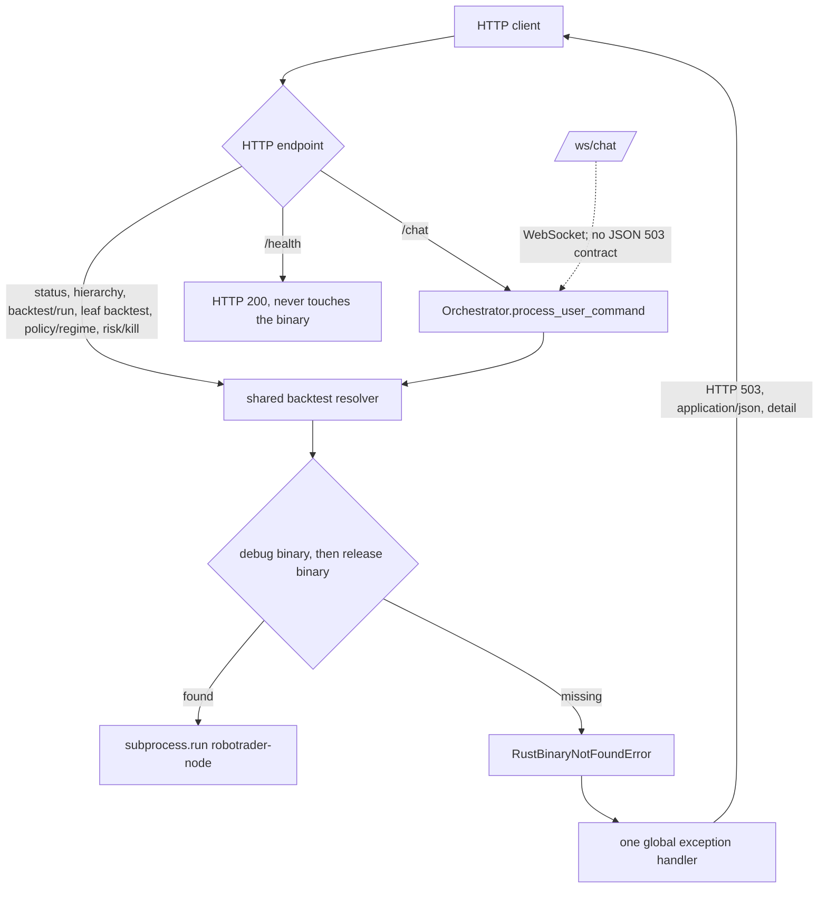
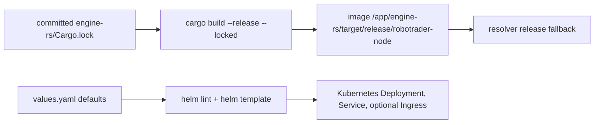

# Design — harden-build-packaging

## Context

The build, packaging, and test chain is broken along four independent seams. The
proposal explains why they matter; the delta spec states the required behaviour.
This document decides how to close them without touching trading logic.

- **Helm.** `charts/robotrader/templates/` contains only `deployment.yaml`, which
  includes three helpers that do not exist. `values.yaml` advertises a Service
  and an Ingress with no templates, and the Deployment has no `REDIS_URL` or
  `MAX_DAILY_LLM_BUDGET_USD` environment.
- **Docker.** `.dockerignore` excludes `engine-rs/Cargo.lock`, the builder copies
  only `Cargo.toml` and `crates/`, and the release binary is copied into
  `target/debug`. Dependency resolution is unpinned and the container's build
  profile is indistinguishable from a local debug build.
- **Binary discovery.** `run_rust_backtest` checks only `target/debug` and falls
  back to `cargo run`; `run_rust_backtest_for_leaf` checks debug then release and
  also falls back to `cargo run`. On a fresh checkout the first `/api/v1/status`
  poll compiles the workspace inside a 30-second HTTP request.
- **CI and dependencies.** `ci.yml` has Rust, Python, and frontend jobs but no
  Helm gate and no Rust binary for the Python suite; `charts/**` is not a
  trigger. `litellm` and `backend/config.py` are dead.

Forces that constrain the implementation:

- `PolicyEnvelope`, Redis IPC keys, the 50µs `HardRiskGate` budget, the vault,
  and the strategy pods are untouched.
- The backend locates the engine through `Path(__file__).resolve().parents[2]`,
  so the container layout must keep the binary under `/app/engine-rs/`.
- The spec fixes debug-first precedence: a fresh local debug build must never be
  shadowed by a stale release build.
- The Python suite is an integration suite: three modules invoke the real Rust
  binary, so the test procedure must provision it rather than stub it.
- CI pins Python 3.11; `backend/pyproject.toml` supports 3.10+.
- Helm v4.2.3 is the pinned verification tool; the chart stays on
  `apiVersion: v2` and rendering is client-side, so a Helm 3-only cluster is
  unaffected by the CI pin. No Helm 3.x render is claimed.

### Runtime flow being changed

### Build and packaging flow

## Goals / Non-Goals

**Goals**

- Make `helm lint` and `helm template` pass with the default values, and make the
  Service, Ingress, and runtime environment driven by `values.yaml`.
- Build the image from the committed lockfile and install the binary at the
  release path only.
- Give both backtest methods one debug-first resolver with no compiler fallback,
  and map the typed error to one uniform HTTP 503 on every affected endpoint.
- Make `unittest discover` work and document a build-then-test procedure that is
  runnable from the repository root.
- Gate chart changes in CI, provision the Rust binary in the Python job, and
  remove the dead `litellm` dependency and `backend/config.py`.

**Non-Goals**

- The performance redesign in issue #9.6 (`/status` caching and the 26-leaf
  aggregate).
- A Redis Helm subchart or sidecar; only the `REDIS_URL` value contract.
- Removing or wiring `strands-agents`.
- Unifying `backend/core/hierarchy.py`'s release-first vault-manifest resolver
  with the backtest resolver.
- Anything in `.github/workflows/sdlc-checks.yml`.
- Bit-for-bit image reproducibility across base-image changes.

## Decisions

| # | Decision | Alternatives considered | Rationale | Rejected because | Reversibility |
|---|---|---|---|---|---|
| D1 | Debug-first, release-fallback precedence, no compiler fallback | Release-first; env-var override; keep `cargo run` | Matches the spec and issue #9.3; a fresh local debug build wins; the container has only release, so the fallback covers it | Release-first shadows a fresh debug build; an env var adds a second path and config surface; `cargo run` blocks the request thread for minutes and is the original defect | Reversible |
| D2 | One module-level resolver `resolve_robotrader_binary(engine_dir)` called by both methods | Two inline lookups; one method per class | One code path, testable against a temporary engine directory; the original bug was exactly two divergent lookups | Two lookups drift again; per-method helpers still duplicate the candidate list | Reversible |
| D3 | Typed `RustBinaryNotFoundError` mapped by one global FastAPI exception handler to HTTP 503 JSON `detail` | Per-endpoint `try/except`; raise `HTTPException` in the resolver; return a sentinel | One handler covers direct and transitive callers; the core stays web-free; the contract is defined once | Per-endpoint handling duplicates the contract and misses transitive `/chat`; `HTTPException` imports FastAPI into the state store and erases the typed boundary; a sentinel changes every caller's return shape | Reversible |
| D4 | The exception lives in a dependency-light `backend/core/errors.py`; the handler lazy-imports `JSONResponse` inside the function | Inline in `server.py`; in `state_store.py`; in `core/health.py`; module-level FastAPI import in `errors.py` | Importable by tests without constructing the app; the lazy import keeps the resolver path free of a module-level web dependency; mirrors the `core/health.py` boundary; `server.py` import starts background threads | Testing `server.py` in-process starts the live worker and cognitive scheduler for the whole suite; `state_store.py` gains a web dependency; a module-level import in `errors.py` makes FastAPI transitive into `state_store.py`; health is the wrong domain | Reversible |
| D5 | `MetaAllocatorAgent.apply_regime_preset(preset, commit: bool = True)` in `backend/agents/trading.py` builds the envelope; `/api/v1/policy/regime` passes `commit=False` and commits after a successful backtest, while `SET_REGIME`/chat keeps the default eager commit | Revert-on-error; pre-check the binary before applying; keep eager commit | The default preserves the existing `SET_REGIME` contract; the explicit `commit=False` gives the route a pure builder; `set_policy` runs only after the backtest returns | Revert-on-error exposes a transient policy to concurrent readers; a pre-check duplicates the resolver and leaves a TOCTOU window; eager commit violates the spec | Reversible |
| D6 | `/api/v1/risk/kill` and `/chat` regime changes keep their eager mutation | Move every mutation after the backtest | The kill switch must apply even when the engine is unavailable (fail-safe); the spec says a chat-applied regime remains applied | Post-backtest mutation would silently drop an operator kill switch on a missing binary — a capital-protection regression | One-way (safety) |
| D7 | `/ws/chat` is outside the JSON 503 contract | Catch the typed error and send a JSON frame; close with a specific code | WebSocket is not an HTTP request and FastAPI's HTTP exception handlers do not apply; the spec scopes the contract to HTTP | A frame contract is a spec change; swallowing the error hides the missing binary | Reversible |
| D8 | A dedicated `robotrader.maxDailyLlmBudgetUsd` helper: absent/empty renders `5.0`; otherwise `float64` plus a `le 0` guard calls `fail` with an actionable message; valid values render through `printf "%.1f"` | Inline includes; Sprig `default 5.0`; quoted default; no validation | The empty case satisfies the spec at `5.0`; non-numeric strings coerce to `0` in Sprig and therefore hit the `fail` guard; negative and zero values fail closed instead of rendering an error marker | Sprig `default 5.0` renders `5` (float formatting) and fails the exact `5.0` assertion; no fallback crashes `CostGuard` at startup on an empty string; an unvalidated `printf` emits `%!f(...)` markers and exits 0 | Reversible |
| D9 | Service uses `.Values.service.type`/`.port`, numeric `targetPort: 8000`, and `selectorLabels`; Ingress uses `networking.k8s.io/v1` with a host/path | Named `targetPort: http`; `extensions/v1beta1`; no Service | The numeric port is directly assertable; `networking.k8s.io/v1` is the supported API; one label set drives both selector and pods | A named port hides the 8000 contract from the render assertion; `v1beta1` is removed in modern clusters; no Service makes the chart undeployable | Reversible |
| D10 | `values.yaml` documents `env.redisUrl: ""` and `env.maxDailyLlmBudgetUsd: 5.0`; the non-render clause is asserted through `helm show values` in CI | Grep the source YAML; add PyYAML and parse; skip the documentation clause | `helm show values` is the chart's public values surface and preserves comments; `helm template` asserts the rendered behaviour | Source grep is an internal-structure assertion; PyYAML adds a dependency; skipping the clause leaves the scenario unverified | Reversible |
| D11 | Builder copies `Cargo.toml` and `Cargo.lock` before `crates/`, then runs `cargo build --release --locked` | Unlocked build; `cargo fetch --locked` then build; vendoring | `--locked` fails when the lock is stale, which is the required fail-closed behaviour; one build layer | Unlocked is the current defect; a separate fetch adds a layer with no benefit; vendoring balloons the build context | One-way (contract) |
| D12 | Install the binary at `/app/engine-rs/target/release/robotrader-node` only | Keep the release-to-debug copy; symlink; install both | The debug-first resolver falls back to release in the container; the absent debug path makes the profile unambiguous | The release-to-debug copy is the original defect; a symlink still exposes a debug path; installing both doubles size and hides the profile | Reversible |
| D13 | A separate Helm job with pinned Helm `v4.2.3`; `charts/**` triggers; the Python job builds a debug binary with the Rust toolchain from the repository root and keeps its existing `working-directory: backend` discovery form (`PYTHONPATH=.. poetry run python -m unittest discover -s tests -v`) | Fold Helm into the Python job; unpinned Helm; build release for tests; no Rust cache; root-level `poetry -C backend` discovery | Isolates failure domains; the pin matches local verification; debug matches debug-first and is faster; reuses `rust-cache`; the existing discovery form already resolves the start directory and `backend.*` imports | Folding couples unrelated failures; unpinned drifts silently; a release build costs time and does not exercise debug-first; no cache repeats compilation; `poetry -C backend` changes cwd, so `-s backend/tests` and `PYTHONPATH=.` resolve incorrectly | Reversible |
| D14 | In-process unit tests for the resolver and handler, plus a subprocess integration test that imports `backend.server` only in the child; the child resets `kill_switch_active`/policy between cases and runs `/risk/kill` last; the parent asserts `backend.server` is not in `sys.modules` | Import `server` in-process; live `uvicorn` subprocess; add `httpx` explicitly | Keeps the suite free of the live worker; daemon workers in the child are tolerated because the child exits after its assertions; reset/order makes the persistent mutations deterministic; `TestClient` is already used by `test_health.py`; `httpx` remains in the lock through `solana` and `mcp` | In-process import starts the live worker and scheduler for every test run; a live server is slow and flaky; declaring `httpx` is unnecessary; shared singleton state without reset makes the regime assertions order-dependent | Reversible |
| D15 | Remove `litellm` and `backend/config.py`, regenerate the lock, keep `strands-agents` with a recorded follow-up | Keep `litellm`; remove `strands-agents`; wire `litellm` in | Both removed items are unused; `strands-agents` is still claimed by the docs and ADR-0001, so dropping it needs a docs change outside this scope | Keeping `litellm` keeps dead attack surface; dropping `strands-agents` silently contradicts the documentation; wiring `litellm` is feature work | Reversible |
| D16 | Add `backend/__init__.py` and `backend/tests/__init__.py` | Change the documented command to per-module invocation | Markers make discovery importable and preserve `backend.*` imports; discovery is the documented contract | Per-module docs leave discovery broken and do not satisfy the requirement | Reversible |

Implementation footprint note: the design adds two files beyond the proposal's
enumerated list — `backend/core/errors.py` (D4) and
`backend/tests/test_missing_binary.py` (D14) — and modifies
`backend/agents/trading.py` (D5, the `commit` parameter), which the proposal's
production-file list does not name. None changes the API contract; all are inside
the `backend/` blast radius already declared.

### 503 endpoint and side-effect matrix

The handler is registered once on the FastAPI app, so every route that lets the
typed error escape returns the same 503 body. `/api/v1/status` calls the resolver
first, so the 503 short-circuits the hierarchy, RSS, and cognitive snapshot work.

| Endpoint | Resolver invocation | State side effect when the binary is missing |
|---|---|---|
| `GET /api/v1/status` | `run_rust_backtest` | HTTP 503; no state change |
| `GET /api/v1/hierarchy` | `run_rust_backtest` | HTTP 503; no state change |
| `POST /api/v1/backtest/run` | `run_rust_backtest` | HTTP 503; no summary, no state change |
| `POST /api/v1/leaf/{leaf_id}/backtest` | `run_rust_backtest_for_leaf` | HTTP 503; no leaf summary |
| `POST /api/v1/policy/regime` | `run_rust_backtest` | HTTP 503; the preset is not committed (D5) |
| `POST /api/v1/risk/kill` | `run_rust_backtest` | HTTP 503; the kill switch is committed before the call (D6) |
| `POST /api/v1/chat` | transitive via `process_user_command` | HTTP 503; a mutation already applied by the command remains (D6) |
| `GET /api/v1/health` | none | HTTP 200; independent of the binary |
| `/ws/chat` | transitive via `process_user_command` | WebSocket close; FastAPI's HTTP handler does not apply (D7) |

## Risks / Trade-offs

- **R1 — Worst failure: every backtest-dependent endpoint returns 503 when the
  binary is absent.** -> CI builds the binary before the Python suite; the
  documented procedure builds it first; the 503 detail names both candidates and
  the root-runnable build command; `/api/v1/health` stays 200 and independent.
- **R2 — Old resolver code paired with a release-only image would fall back to
  `cargo run` and fail.** -> Ship the resolver and the image in the same merge;
  the merged resolver is backward compatible with the old debug-layout image, so
  rollback targets the previous image digest and keeps the new resolver. Never
  deploy old code against the new image layout.
- **R3 — Debug-first selects a stale local debug build over a valid release
  build.** -> Documented precedence; `cargo build` refreshes the debug artifact;
  deleting `engine-rs/target/debug` forces the release fallback; the container is
  unaffected because it has no debug path.
- **R4 — An empty or invalid `MAX_DAILY_LLM_BUDGET_USD` crashes `CostGuard` at
  startup.** -> The Helm helper renders `5.0` for an absent or empty value and
  calls `fail` for a non-numeric, zero, or negative explicit value (Sprig coerces
  a non-numeric string to `0`, which the `le 0` guard catches); the render
  assertions cover the default, the empty override, and both invalid cases; the
  backend's own default remains `5.0`.
- **R5 — The `values.yaml` documentation assertion is sensitive to comment
  wording.** -> CI asserts the exact keys/values plus a comment line naming each
  key through `helm show values`; the comment text is part of the chart contract
  and is changed deliberately.
- **R6 — A global handler could mask unrelated errors.** -> Only the typed
  `RustBinaryNotFoundError` is registered; every other exception keeps the
  existing behaviour.
- **R7 — The Python suite depends on a real binary.** -> Build-then-test in CI and
  docs; the three integration modules keep their assertions; a missing binary
  fails explicitly with the typed error rather than silently compiling.
- **R8 — Removing `litellm` changes the resolved dependency graph.** ->
  `poetry -C backend lock` regenerates the lock; `poetry check --lock` and a clean
  install gate it; the suite still runs under the build-then-test procedure. A
  regenerated lock may still carry `strands-agents`'s optional `litellm` extras
  label; that is package metadata copied from the package, not a resolved
  dependency. The gate is the absence of a `litellm` package block (plus no
  `litellm` in `pyproject.toml` and a clean `poetry check --lock`), and the
  verification evidence states the residual extras explicitly. A literal reading
  of "neither file declares" as "the string never appears" would be unsatisfiable
  while the approved spec retains `strands-agents`, so no `spec-gap` escalation is
  raised.
- **R9 — `/ws/chat` closes without an actionable JSON error when the binary is
  missing.** -> Documented as outside the HTTP contract; HTTP clients get the full
  detail. A WebSocket-specific message would be a separate contract change.
- **R10 — `/status` still spawns a process per 4-second poll (issue #9.6).** ->
  Out of scope and unchanged; this change removes the compiler fallback but does
  not add caching.
- **R11 — A `--locked` build fails when `Cargo.toml` and `Cargo.lock` drift.** ->
  Intended fail-closed behaviour; the developer regenerates the lock; the Docker
  build and the Rust CI job surface the drift.

### Observability and cost

- A missing binary surfaces as an HTTP 503 in the access log, with the actionable
  paths and build command in the JSON `detail`; no new metric, alert, or
  dashboard is added. `/api/v1/health` remains the liveness signal.
- CI gains one Helm job and a cached debug Rust build in the Python job; the
  existing jobs keep their caches.
- Removing `litellm` shrinks the resolved dependency graph and the image install
  step. There is no runtime LLM-spend change: the warm path already calls
  OpenRouter through `urllib.request`.

## Migration Plan

Deployment order:

1. Merge the change through the normal PR flow; CI runs the Rust, Python, Helm,
   and frontend jobs. The Python job builds the debug binary from the repository
   root before discovery and keeps its existing `working-directory: backend`
   discovery form. The local documented procedure stays root-runnable
   (`PYTHONPATH=. python3 -m unittest discover -s backend/tests -v`).
2. Build and publish the image from the merged SHA. Verify that
   `/app/engine-rs/target/release/robotrader-node` exists and the debug path does
   not.
3. Deploy the new image. The new resolver finds the release binary through the
   debug-first fallback; no runtime flag is involved.
4. Upgrade the chart: `helm upgrade --install robotrader charts/robotrader --set
   image.tag=<sha>`. Add `--set env.redisUrl=...` only when an external Redis is
   used; the default empty string preserves the backend's in-memory fallback.
   The default budget `5.0` matches the backend default.
5. No schema, data, or Redis-key migration is required.
6. Local developers run `cargo build --manifest-path engine-rs/Cargo.toml --bin
   robotrader-node` before the documented discovery command.

Rollback:

1. **Image and chart:** `helm rollback robotrader <previous-revision>` restores
   the prior image tag and values. The prior image has the debug layout, which
   the merged resolver still selects first, so the rollback is safe without a
   code revert.
2. **Code:** if a full revert is required, `git revert <merge-sha>` and rebuild
   the image from the reverted tree. Never pair the old resolver with a
   release-only image: the old `run_rust_backtest` checks only `target/debug` and
   would fall back to a compiler that is absent from the image.
3. **Dependencies:** restore `litellm` in `backend/pyproject.toml` and
   `backend/config.py` from git, then run `poetry -C backend lock` and
   `poetry -C backend install --no-root`.
4. **CI:** revert `.github/workflows/ci.yml`; it has no runtime effect.
5. Keep the previous image digest available for the rollback window.

## Open Questions

<!-- None: every decision above is closed and testable. -->
