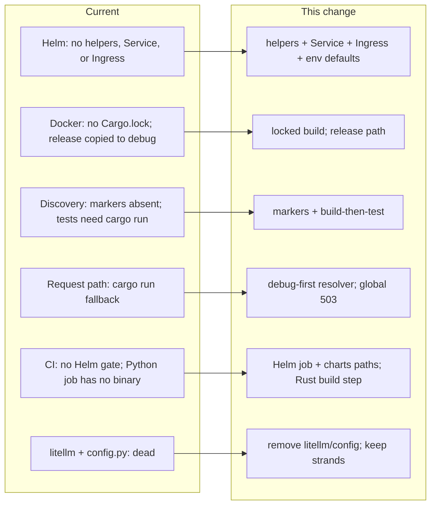

## Review Card (≤ 5 min)

| Field | Value |
|---|---|
| Outcome | The documented build, packaging, and test workflow works end to end: the Helm chart renders and lints, the image builds from the committed lockfile with the binary at `target/release`, the Python suite has a provisioned binary, and CI gates chart changes. |
| Why now | Issue #9 found every documented packaging path broken; developers and operators hit failures before they can run the platform. |
| Blast radius | `charts/robotrader`, `.dockerignore`/`Dockerfile.backend`, `backend/core/state_store.py` and `backend/server.py` (debug-first resolver + global 503 handler), two package markers, `.github/workflows/ci.yml` (Helm job + Python Rust build step), `backend/pyproject.toml`/`poetry.lock` and removal of `backend/config.py`, plus `README.md`/`AGENTS.md`. No hot-path, risk-gate, vault, `PolicyEnvelope`, IPC, or strategy change. |
| Risk | Medium. Worst failure: every backtest-dependent endpoint returns 503 when the binary is absent; `/policy/regime` fails without applying its preset, while `/risk/kill` still applies the kill switch. |
| Effort | L — SPEC, PLAN, and DEV stages with cold reviews. |
| Decision needed | None. Follow-up: wire or remove `strands-agents`. |

## Why

Issue #9 documents six packaging defects that make the repository's own instructions wrong.

- `helm template` and `helm lint` fail: the chart has no helper templates, no Service template, and no Ingress template.
- The Docker image excludes `engine-rs/Cargo.lock` from its context and copies the release binary into `target/debug`, so dependency resolution is uncontrolled and the container hides whether a binary is a debug or release build.
- The documented `unittest discover` command depends on namespace-package behaviour because the package markers are absent.
- `run_rust_backtest` checks only `target/debug` and falls back to `cargo run`, so a fresh checkout can compile synchronously inside a 30-second HTTP request.
- The test suite calls the Rust binary directly, and CI never builds it; once the `cargo run` fallback is removed, the documented test command cannot pass in a clean checkout or in CI without a build step.
- CI tests Rust, Python, and the frontend but never renders or lints the chart.
- `litellm` and `backend/config.py` are declared but never imported.

These are independent, deterministic fixes to the build and packaging chain. None of them changes trading logic, capital protection, the hot path, or a chain/venue boundary.

## What Changes

- **Helm**: add the missing helper definitions plus Service and Ingress templates; make `values.yaml` drive the Service, the Ingress, and the `REDIS_URL` / `MAX_DAILY_LLM_BUDGET_USD` environment with valid documented defaults, while preserving the existing OpenRouter and Solana environment.
- **Docker**: stop excluding `engine-rs/Cargo.lock`; copy it into the image build and require a locked Cargo build; install `robotrader-node` at `/app/engine-rs/target/release/`.
- **Python package markers and tests**: add `backend/__init__.py` and `backend/tests/__init__.py`; build `robotrader-node` before the suite; document the build-then-test procedure in `README.md` and `AGENTS.md`; make the Python CI job install the Rust toolchain and build the binary before running the suite.
- **Request path**: replace the two divergent lookup paths with one shared debug-first resolver for the two backtest methods (debug build first, release fallback), never invoke `cargo`, and map the typed missing-binary error through one global handler to HTTP 503 with a uniform JSON `detail` on every affected endpoint.
- **CI**: add a Helm job that runs `helm lint` and `helm template`, include `charts/**` in the pull-request and push path filters, and keep the existing Rust, Python, and frontend jobs.
- **Dependencies**: remove `litellm` and `backend/config.py`, regenerate `backend/poetry.lock`, and keep `strands-agents` with an explicit follow-up because the documentation and ADR still claim it.

The 503 failure-path contract on the backtest-dependent HTTP endpoints (instead of a generic 500 or a `cargo run` timeout) is intentional. Its endpoints and state side effects are enumerated in the delta.

## Capabilities

### New Capabilities

- `build-packaging`: a renderable and lintable Helm chart with Service, Ingress, valid runtime-environment defaults; a Docker image built from the committed lockfile with the binary at the release path; Python package markers plus a provisioned, documented build-then-test procedure; one shared debug-first resolver for the two backtest methods with no compiler fallback and a uniform actionable missing-binary error; a CI Helm gate and a Python Rust build step; and removal of the unused `litellm` dependency and `backend/config.py`.

### Modified Capabilities

- None.

## Non-goals

- #9.6 `/status` caching, the 26-leaf aggregate, RSS/drawer caching, and any performance redesign.
- Provisioning Redis as a Helm subchart or sidecar; only the `REDIS_URL` environment contract is in scope.
- Removing `strands-agents`; it stays declared with a follow-up to wire or remove it.
- Unifying the vault-manifest/sign-transfer resolver in `backend/core/hierarchy.py` with the backtest resolver; that separate candidate list stays unchanged.
- Changes to the SDLC workflow in `.github/workflows/sdlc-checks.yml`; this change touches `ci.yml` only.
- Bit-for-bit reproducibility of the container image across base-image changes; the lockfile guarantee covers Cargo dependency resolution, not the whole toolchain.
- Secret management changes such as moving `OPENROUTER_API_KEY` into a Kubernetes Secret.
- Any change to `/api/v1/health`, `PolicyEnvelope`, Redis IPC, risk-gate, vault, strategy pods, or backtest/paper/live logic.
- Frontend changes.

## Impact

- **Code and config**: `charts/robotrader/templates/_helpers.tpl` (new), `deployment.yaml`, `service.yaml` (new), `ingress.yaml` (new), `values.yaml`; `.dockerignore`; `Dockerfile.backend`; `backend/__init__.py` (new); `backend/tests/__init__.py` (new); `backend/core/state_store.py`; `backend/server.py`; `.github/workflows/ci.yml`; `backend/pyproject.toml`; `backend/poetry.lock`; `README.md`; `AGENTS.md`; delete `backend/config.py`.
- **Affected tests**: `backend/tests/test_architecture.py`, `backend/tests/test_hierarchy_v3.py`, and `backend/tests/test_metrics_populations.py` call the resolver and depend on the provisioned binary. They keep their assertions under the build-then-test procedure.
- **Contracts**: every HTTP endpoint that invokes the Rust backtest returns HTTP 503 with an `application/json` `detail` when the binary is missing. Direct callers are `/api/v1/status`, `/api/v1/hierarchy`, `/api/v1/leaf/{leaf_id}/backtest`, `/api/v1/backtest/run`, `/api/v1/policy/regime`, and `/api/v1/risk/kill`; `/api/v1/chat` invokes the resolver transitively. `/api/v1/policy/regime` fails without applying the preset; `/api/v1/risk/kill` still applies the kill switch; chat regime changes remain applied. Success paths are unchanged. `/api/v1/health` is unchanged and always independent of the binary. The Helm values contract gains Service, Ingress, `env.redisUrl` (default empty), and `env.maxDailyLlmBudgetUsd` (default `5.0`). The container layout moves the binary from `target/debug` to `target/release`.
- **Dependencies**: `litellm` is removed; `strands-agents` is retained with a follow-up; `backend/poetry.lock` is regenerated and consistent with `backend/pyproject.toml`.
- **Ops**: the chart becomes deployable; CI gains a Helm render/lint job, `charts/**` path triggers, and a Rust build step in the Python job; the documented local test procedure gains a build step.
- **Safety**: no money, risk, vault, key, hot-path, chain/venue isolation, or backtest/paper/live logic impact.
- **Footprint**: 17 files modified, added, or deleted, plus three affected test modules; consistent with the Lane L upgrade.
