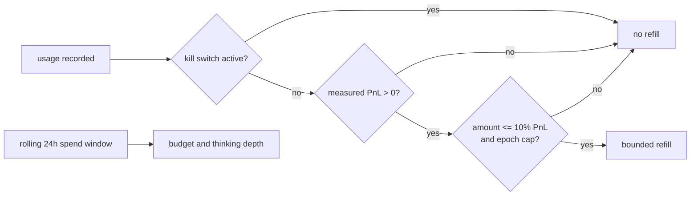

## Review Card (≤ 5 min)

| Field | Value |
|---|---|
| Outcome | The Python `CostGuard` cannot refill inference credit without measured realized profit or while the kill switch is active; its daily budget rolls over every 24 h without Redis; the UI shows the backend's real low watermark. |
| Why now | Issue #5 reproduces an automatic top-up with no profit, a spend counter that never rolls over, a non-injectable ledger read at construction, and a UI threshold that disagrees with the backend. ADR-0003 also disagrees with the code on that threshold. |
| Blast radius | `backend/agents/monitor.py`, `backend/agents/orchestrator.py`, `backend/server.py`, `frontend/src/components/MasterOverview.jsx`, `docs/adr/0003-hierarchical-multi-ecosystem-architecture.md`, backend tests. `backend/core/state_store.py` is consumed read-only. No Rust, no `PolicyEnvelope`, no Redis schema. |
| Risk | Medium. Worst failure: a legitimate refill is refused because the injected measured source is missing or the ledger path is misconfigured. |
| Effort | L in review-round terms (SPEC + PLAN + DEV). |
| Decision needed | Approve the ADR-0003 amendment: low watermark `$5.00` → `$2.00`, and the ADR's kill-switch condition enforced by the Python gate. |

## Why

- The automatic refill path omits both the realized PnL and the ADR's kill-switch condition, so the documented gate is not the gate that runs.
- `LLMMonitorAgent` holds no state store, so the automatic path cannot reach the measured PnL; a module-global read would evaluate the wrong instance in tests.
- Spend is cumulative and hydrated only when Redis is configured, from a fixed dev ledger read synchronously at construction.
- The UI advertises a `$5.00` watermark while the backend uses `$2.00`, and the status claims auto-refill is disabled while it runs.

## What Changes

- Inject the orchestrator's own state store into `CostGuard`; fail closed (no refill) when no measured source exists.
- Require a measured realized PnL on every refill path and reject zero or negative profit with no state mutation.
- Enforce the kill-switch condition, the `force`/watermark distinction, the 10% profit-share cap, the fixed `(0, $25.00]` single-refill bound, and the configured epoch cap on every path.
- Replace cumulative spend with a rolling 24 h window, keep `total_cost_usd` as its derived total, and make ledger hydration injectable, lazy, bounded, and independent of Redis.
- Amend ADR-0003: watermark `$2.00` with rationale, and the kill-switch condition stated for the Python gate. The amendment is a deliverable of this change.
- Expose one backend-owned watermark; the frontend renders it and shows an em dash when absent.
- **BREAKING (status value)**: `auto_wallet_refill` changes from `DISABLED_BY_SECURITY_POLICY` to `ENABLED_PROFIT_GATED` or `DISABLED`. `auto_refill_policy` already exists and now follows the same state.
- Add automatic-path tests for negative and zero PnL and isolate the ledger path in tests.

## Capabilities

### New Capabilities

- `costguard`: profit- and kill-switch-gated refills, store injection, rolling 24 h spend accounting, injectable hydration, and the operator-facing status and watermark.

### Modified Capabilities

- `integrity`: the requirement "Refill gating consumes null-safe measured PnL only" keeps its caller rules but no longer declares the CostGuard defects out of scope; they are specified by `costguard`.

## Non-goals

- Routing the gate through the Rust `HardRiskGate::validate_inference_refill`; that remains a follow-up on issue #5.
- Querying the real OpenRouter `/credits` balance or making refill an out-of-band operator action.
- Removing the dead Rust validator.
- Aligning the UI's fixed `$15.00` refill button with `OPENROUTER_REFILL_AMOUNT_USD` (`$10.00`); tracked as a follow-up on issue #5.
- Ledger segments older than the most recent rotated file (`<name>.1`).
- Changing the dry-powder floor, Kelly sizing, kill-switch semantics, or `PolicyEnvelope`.

## Impact

- **Backend**: `backend/agents/monitor.py` (store injection, gate, rolling window, lazy hydration, status), `backend/agents/orchestrator.py` (inject its store), `backend/server.py` (operator path uses the injected source).
- **Frontend**: `frontend/src/components/MasterOverview.jsx` renders `openrouter_credit.low_watermark_usd` and the truthful status.
- **ADR**: `docs/adr/0003-hierarchical-multi-ecosystem-architecture.md` is amended from `$5.00` to `$2.00` and records the kill-switch condition.
- **Contract**: `/api/v1/status` keeps its shape. The `auto_wallet_refill` enum value changes, which is a **BREAKING** semantic change for external consumers; migration is to accept `ENABLED_PROFIT_GATED` and `DISABLED` and to read `auto_refill_policy` for the policy state. `openrouter_credit.low_watermark_usd` becomes the only threshold source.
- **Tests**: `backend/tests/test_architecture.py`, `backend/tests/test_hierarchy_v3.py`, plus new automatic-path and isolated-hydration tests.
- **Backtest/paper/live**: unaffected; this is warm-path treasury accounting only.
