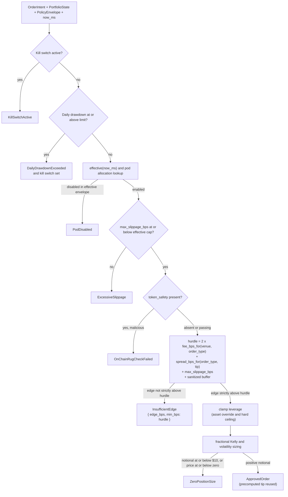

## Context

`HardRiskGate::validate` is the synchronous pre-trade firewall between every strategy pod and `SmartExecutionRouter`. Today its edge check is a fixed `intent.expected_edge_bps < 12.0` comparison (`engine-rs/crates/risk-gate/src/lib.rs:253-259`); it reads neither `intent.venue`, `intent.order_type`, nor `intent.max_slippage_bps`. The same 12 bps edge therefore passes on a 1.8 bps CEX maker order and on an on-chain bundle that pays a 24 bps round-trip fee before spread or impact.

The canonical execution costs already exist in `SmartExecutionRouter`: `fee_bps_for(venue, order_type)` and `slippage_bps_for(&ApprovedOrder)` (`engine-rs/crates/exec-router/src/lib.rs:21-40`). They are post-trade-shaped: the spread helper needs an `ApprovedOrder`, and the MEV-bundle spread depends on `mev_priority_tip_bps`, which the gate computes only after sizing.

The gate order also matters: the current edge check runs before the slippage ceiling and the token-safety check. Making the hurdle stricter without reordering it would turn the deterministic SCAM-SOL rejection from `OnChainRugCheckFailed` into `InsufficientEdge`, deleting the repository's anti-rug proof. The approved delta spec fixes the order (kill switch, drawdown, envelope/pod, slippage, token safety, hurdle, leverage, Kelly/zero-position) and the 4-trade / 3-rejection / 2-pod Solana baseline. See `proposal.md` for motivation and `specs/risk-hurdle/spec.md` for the normative requirements.

Constraints and forces:

- The `<50µs` `HardRiskGate::validate` budget and the no-allocation/no-logging/no-I/O hot-path invariant (`openspec/config.yaml`).
- `PolicyEnvelope` must stay byte-for-byte identical between Rust and Python; this change does not add a policy key.
- Backtest, paper, and live share one `validate` path; the hurdle must be a pure function of the intent and `RiskLimits`.
- Every leaf stays isolated: the hurdle reads no portfolio, chain, or sibling-leaf state.
- The deterministic fixture inputs are frozen; the published `[FIXTURE]` figures and the 26-leaf assertions are stale under the new hurdle and must be regenerated from a real run.
- `RiskLimits` is a Rust-only struct: no in-repo JSON, YAML, Redis, or API payload constructs or deserializes it, so removing a field needs no data migration.
- The repository has no benchmark; the `<50µs` claim is unmeasured in `README.md`, `AGENTS.md`, `docs/architecture.md`, and `docs/PERFORMANCE_AND_COST_AUDIT.md`.

The change builds on merged work: `SimulatedVault` (#2), the `CostGuard` refill gate (#5), fabricated-metric provenance (#7), policy TTL fallback (#8), hardened build/packaging (#9), and the eleven-key `AssetOverride` contract (#10). None of those contracts changes here.

## Goals / Non-Goals

**Goals:**

- Replace the fixed edge floor with the per-intent hurdle `2 x fee_bps_for(venue, order_type) + spread_bps_for(order_type, tip) + max_slippage_bps + effective_min_edge_buffer_bps`.
- Take fee and spread values from one canonical cost model shared with `SmartExecutionRouter`, without a second table and without allocating or building a throwaway `ApprovedOrder` inside the gate.
- Enforce the safety-first gate order so the anti-rug and slippage rejections keep their existing variants.
- Make the buffer configurable, defaulted to `2.0` bps, and fail-safe against negative or non-finite values.
- Preserve the strict boundary: approve only when `expected_edge_bps > hurdle_bps`.
- Regenerate the deterministic fixture baseline and every published `[FIXTURE]` figure from real command output; keep the SCAM-SOL `OnChainRugCheckFailed` assertion.
- Measure `HardRiskGate::validate` with a `criterion` benchmark and publish the measured mean and command wherever the `<50µs` claim lives.
- Leave every other gate, the hot-path purity, and the Rust/Python contract untouched.

**Non-Goals:**

- Aggregate exposure caps (`asset_exposures_usd`, `pod_exposures_usd`, `max_asset_exposure_pct`, `max_pod_exposure_pct`, `max_gross_exposure_pct`) and the 15% gross-vs-margin semantics.
- The kill-switch cancel/flatten contract for the executor.
- The order-rate limiter keyed by `(pod_id, symbol)`.
- Removing the pre-existing effective-envelope or `ApprovedOrder` intent clones.
- Inverting the MEV priority-tip incentive; the tip formula remains a function of declared edge.
- Any `PolicyEnvelope`, Redis IPC, REST/WS, DB, vault, Python, or frontend change.
- Restoring the old fixture counts by tuning fixture edges or `max_slippage_bps`.
- Closing issue #4, which remains open for the items above.

## Decisions

| # | Decision | Alternatives considered | Rationale | Rejected because | Type |
|---|---|---|---|---|---|
| D1 | Put the canonical fee and spread formulas in `engine-rs/crates/common` as pure helpers (`fee_bps_for`, `spread_bps_for`); `SmartExecutionRouter::fee_bps_for` and `slippage_bps_for` delegate to them; `risk-gate` calls the common helpers. | (a) Add `robotrader-exec-router` as a `risk-gate` dependency and call the router helper. (b) Keep a second fee/spread table in `risk-gate`. (c) Build a throwaway `ApprovedOrder` and call `slippage_bps_for`. | One implementation, two consumers, no allocation, no new crate edge, and the delta spec explicitly permits a shared helper. `common` is already a dependency of both crates, so the values are preserved by delegation. | (a) inverts the layering (`risk-gate` would depend on the execution layer) and forces the gate to instantiate an `ExecutionMode`-typed router. (b) violates the single-source requirement. (c) allocates and copies the intent on every order. | Reversible |
| D2 | Fix the gate order as kill switch -> drawdown -> effective envelope/pod -> slippage ceiling -> token safety -> hurdle -> leverage -> Kelly/zero-position. | (a) Keep the edge check where it is. (b) Split the hurdle into a pre-slippage advisory check and a post-token final check. | The delta spec fixes the order. Token safety and slippage are safety gates; their rejection variants must win over an economic rejection. The SCAM-SOL fixture keeps `OnChainRugCheckFailed` at edge `81.0` against hurdle `87.8`. | (a) preempts two safety gates and destroys the deterministic anti-rug proof. (b) evaluates the same cost twice and adds a second rejection path with no contract benefit. | Contract-visible |
| D3 | Implement strict exceedance as `if !(expected_edge_bps > hurdle_bps) { reject }`, not `if edge <= hurdle`. | (a) `if edge < hurdle` (current style). (b) `if edge <= hurdle`. | The delta spec approves only on strict `>`. The negated form also rejects `NaN` edges, which the two comparison forms silently approve. | (a) lets equality through. (b) is correct for finite values but fails open on `NaN`. | Reversible |
| D4 | Compute `effective_buffer_bps` inline in the hurdle: non-finite -> `0.0`; otherwise `configured.max(0.0)`. Remove `RiskLimits::min_edge_over_cost_bps`; add `min_edge_buffer_bps: f64` with default `2.0` and a documenting Rustdoc. | (a) Sanitize once in `HardRiskGate::new`. (b) Keep the buffer as `Option<f64>` with `None` meaning zero. (c) Keep the old field as an alias. | The delta spec requires the field, the default, and fail-safe semantics at the computation point. A struct literal can bypass `new`; an inline sanitization cannot. Removing the old field prevents a stale fixed floor from being re-used. | (a) bypassable by `RiskLimits { .. }` construction. (b) adds a branch and an unstated default for a value that must always be explicit. (c) leaves two competing floors and a misleading configuration surface. | Reversible |
| D5 | Compute `mev_priority_tip_bps` once, before the hurdle, with the unchanged `((edge * 0.10) as u32).clamp(2, 25)` formula; pass it to `spread_bps_for` and reuse it in `ApprovedOrder`. | (a) Recompute the tip after leverage. (b) Move the tip formula into `common` and let the router apply it. | The MEV-bundle spread needs the tip; one arithmetic evaluation is cheaper than two and keeps approved-order behavior bit-identical. Inverting or relocating the tip formula is explicitly out of scope. | (a) duplicates the formula and risks divergence between the hurdle and the approved order. (b) widens the change into the MEV incentive question that issue #4 keeps open. | Reversible |
| D6 | Regenerate the Solana baseline and all 26 leaf assertions from a real `cargo test` / `robotrader-node` run; do not hand-edit counts and do not tune fixture edges or slippage. | (a) Update the three Solana assertions by hand to 4/3/2. (b) Relax the 26-leaf test to ranges. (c) Tune fixture edges to keep 6/1/4. | The delta spec makes regeneration normative and pins 4/3/2. A real run is the only evidence that the hurdle and the unchanged fixture produce the documented split. Exact per-leaf values keep the 26-leaf test meaningful after the fabricated-metrics change (#7). | (a) has no evidence trail and can mask an arithmetic error. (b) silently drops a regression signal. (c) violates the frozen-fixture requirement and hides the economic effect of the change. | One-way (published baseline) |
| D7 | Add `criterion = "0.8"` as a `robotrader-risk-gate` dev-dependency with a `benches/validate.rs` target (`harness = false`), measuring one approved and one hurdle-rejected intent. | (a) A `std::time::Instant` micro-harness. (b) No benchmark; keep the claim qualitative. | The delta spec names `criterion` and requires `cargo bench -p robotrader-risk-gate` to report a mean. Criterion gives statistically defensible output and a standard CI invocation. | (a) is not statistically robust and would need custom harness code. (b) leaves the published budget unmeasured. | Reversible |
| D8 | Publish the measured mean and the exact benchmark command at every `<50µs` occurrence across `README.md`, `AGENTS.md`, `docs/architecture.md`, and `docs/PERFORMANCE_AND_COST_AUDIT.md`; for `README.md:42` (a read-latency arrow, not `validate`) remove the bare numeric claim. Correct the audit's `AntiRugRejected` label to `OnChainRugCheckFailed`. | (a) Annotate only the four README lines named in the spec parenthetical. (b) Leave `AGENTS.md` out. (c) Keep the bare read-latency claim. | The R2 review's follow-ups require the full inventory, and the delta spec's scenario forbids any bare claim in the named files. The audit label is factually wrong and sits in the regenerated fixture block. | (a) leaves `README.md:147` bare, which the R2 review explicitly flagged. (b) leaves a shipped agent guide asserting an unmeasured budget. (c) leaves an unmeasured numeric claim in a file the scenario scans. | Reversible |
| D9 | Do not edit `proposal.md` or `specs/**`; the approved Review Card's stale "one SPEC round" Effort cell is recorded for the conductor to annotate in the PR body or issue. | (a) Edit the proposal's Effort cell to say "two SPEC rounds". (b) Ignore it silently. | The PLAN author role forbids modifying the approved spec. The wording is bookkeeping, not a requirement; the conductor owns the status surface. | (a) violates the author boundary and changes an approved artifact after its verdict. (b) leaves a known inconsistency without an owner. | One-way (artifact immutability) |
| D10 | Make no `PolicyEnvelope`, Redis, REST/WS, DB, vault, Python, or frontend change. | (a) Add the hurdle or buffer to `PolicyEnvelope` so the warm path can tune it per leaf. (b) Mirror `RiskLimits` into Python. | The delta spec scopes the tunable to Rust `RiskLimits`; `PolicyEnvelope` parity is a hard invariant and the change does not need a policy key. | (a) changes a cross-language serialized contract for a value that is a risk-gate constant. (b) creates a second source of truth and Python custody of a risk limit. | Reversible |

## Risks / Trade-offs

- **Published fixture figures and 26-leaf assertions go stale** -> Regenerate every figure from `cargo test -p robotrader-backtest` and `robotrader-node --leaf-id <leaf>`; attach the JSON; grep out the pre-change fixture values; never tune fixture inputs.
- **The stricter hurdle rejects strategies that previously traded, shrinking published PnL and Sharpe** -> Expected and accepted by the approved spec. Pin 4/3/2, regenerate the per-pod attribution, and explain the rejected intents (alpha and sniper cost hurdle) in the audit's `[FIXTURE]` block.
- **The anti-rug proof disappears if the hurdle runs first** -> Fixed gate order; an explicit test asserts the SCAM-SOL fixture intent returns `OnChainRugCheckFailed` while its edge (`81.0`) is below the computed hurdle (`87.8`).
- **Relocating the fee/spread formulas changes execution behavior** -> The refactor is delegation-only; parity tests cover every `(Venue, OrderType)` pair and all four spread order types at tip 10, and `execute` arithmetic is unchanged.
- **A new allocation, log, or blocking call enters `validate`** -> Helpers are pure `f64` functions over `Copy` enums; no `String`, `Vec`, map insert, log, I/O, sleep, or unbounded loop. The dev reviewer checks the diff hunk by hunk; the benchmark confirms the timing budget.
- **`NaN` edge silently passes** -> The negated strict comparison rejects it; a dedicated test pins the fail-closed behavior.
- **Criterion adds compile time and supply-chain surface** -> Dev-dependency only, pinned `0.8`, Apache-2.0 OR MIT, not linked into release binaries. `cargo test --all-targets` still compiles the bench target; the lockfile records the exact graph.
- **Documentation drift leaves a bare `<50µs` claim or a stale figure** -> Explicit line inventory plus grep-based verification; the audit label is corrected in the same pass.
- **Gate reordering changes rejection precedence for an intent that would have failed a later gate** -> Non-regression scenarios cover active kill switch, drawdown, disabled pod, TTL fallback, leverage clamp, zero Kelly, and both refill verdicts; the existing gate tests stay green.
- **Worst failure: a venue-specific cost table error approves a negative-EV order on a real venue** -> Single canonical source, parity tests against the executor for every venue/order-type pair, strict boundary, buffer floor, and a measured hot path. If parity or the benchmark fails, the change does not ship.
- **Rollback re-introduces the fixed 12 bps floor and the old fixtures** -> Concrete revert sequence in the Migration Plan; no schema, IPC, or persisted state to repair.

## Migration Plan

Deployment order (one PR, no runtime migration):

1. `common`: add the pure cost helpers; no serialized type changes.
2. `exec-router`: delegate `fee_bps_for` and `slippage_bps_for`; keep `execute` unchanged.
3. `risk-gate`: remove the fixed field, add the buffer, reorder `validate`, compute the hurdle.
4. Tests: parity, hurdle, boundary, precedence, non-regression, NaN.
5. `criterion` benchmark and measured figure.
6. Fixture assertions (Solana and 26 leaves) regenerated from real output.
7. Documentation: `[FIXTURE]` figures, `<50µs` inventory, audit label, stale README figure.

No feature flag, no database migration, no Redis key change, no Python deploy, no frontend deploy. `min_edge_buffer_bps` is the only new operational knob; its default is fail-safe.

Rollback (concrete, no data repair required):

1. Revert the merge commit with `git revert -m 1 <merge-sha>` (or revert the DEV commits in reverse order on the branch before merge).
2. Re-run `cargo test --manifest-path engine-rs/Cargo.toml --workspace --all-targets`; the pre-change Solana assertions (6 trades / 1 rejection / 4 pods) and the fixed 12 bps floor are restored.
3. Revert the documentation commit with the code so the published figures and `<50µs` annotations return to their pre-change state.
4. Regenerate `engine-rs/Cargo.lock` if the criterion dev-dependency is removed; no other artifact depends on it.
5. No state repair: the change introduces no persisted schema, no Redis payload, no policy key, and no vault material.

Integration with merged changes:

- **#2 SimulatedVault**: untouched; the backtest still runs `ExecutionMode::Backtest`; no key or signing surface enters the gate.
- **#5 CostGuard**: `validate_inference_refill` is unchanged and its two verdict scenarios stay green.
- **#7 fabricated metrics**: the regeneration requirement is the direct follow-through; every `[FIXTURE]` figure is sourced from a command output rather than hand-edited.
- **#8 policy TTL**: `PolicyEnvelope::effective(now_ms)` and the `safe_baseline_fallback` path are unchanged; the pod lookup and TTL fallback still precede the hurdle.
- **#9 build/packaging**: the only build change is a dev-dependency and a bench target; the lockfile is committed and `cargo test --all-targets` stays the CI entry point.
- **#10 AssetOverride contract**: no field is added, removed, or renamed; `scripts/check_contract_single_source.py` remains green.

Observability: no new hot-path logging. `RiskRejection::InsufficientEdge { edge_bps, min_bps }` now reports the computed hurdle, and the backtest's `rejected_orders` count exposes the economic effect. The benchmark command and measured mean are the performance evidence.

## Open Questions

