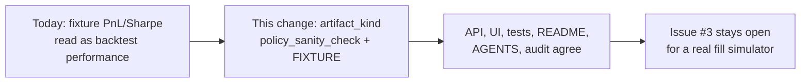

## Review Card (≤ 5 min)

| Field | Value |
|---|---|
| Outcome | The deterministic executor artefact is labelled `policy_sanity_check` with source `FIXTURE` on every surface; its PnL and Sharpe are no longer presented as backtest performance. |
| Why now | Issue #3 shows every published PnL and Sharpe is derived from the strategy's own `expected_edge_bps`, yet the dashboard, README, and audit still publish it as a backtest. |
| Blast radius | Rust `backtest`/`node` summary fields; backend status, leaf, and auditor payloads; UI labels; tests; README, `AGENTS.md`, `docs/architecture.md`, and `docs/PERFORMANCE_AND_COST_AUDIT.md`. No `PolicyEnvelope`, Redis schema, risk gate, strategy arithmetic, or chain isolation. |
| Risk | Low. The change is labels and test acceptance only; the worst failure is one surface left claiming measured performance, which the consistency grep and tests catch. |
| Effort | S — one SPEC round and one DEV round. |
| Decision needed | None. Legacy wire keys and `/backtest` route paths stay unchanged; the kind label is additive and non-breaking. |

### Non-goals

- A real event-driven fill simulator, or deriving PnL from a later exit price.
- Strategy requalification or any measured-performance claim. Issue #3 stays open.

## Why

- The executor computes `realized_pnl_usd = approved_notional_usd × (expected_edge_bps − round-trip fee − modelled spread)`. No later `MarketEvent`, price path, queue position, latency, fill probability, partial fill, or adverse selection enters the number.
- The same output is published as `+$24.73`, Sharpe `128.52`, and a 100% win rate in the audit, the README, and the dashboard tile labelled "Fixture Backtest Rust".
- `#7` added provenance (`FIXTURE`) but not an artefact kind. A correctly attributed number is still read as a backtest result.
- The current fixture is a deterministic rule and plumbing check. It is useful evidence that pods, the risk gate, and the anti-rug path are wired correctly, and useless as evidence of market edge.
- Issue #3 remains open for the real simulator; this change is its honesty slice only.

## What Changes

- Add a machine-readable artefact kind to every deterministic summary: `artifact_kind: "policy_sanity_check"`, `source: "FIXTURE"`, and `fill_simulation: false`.
- Propagate that kind through the node JSON, `/api/v1/status`, `/api/v1/backtest/run`, `/api/v1/leaf/{leaf_id}/backtest`, `/api/v1/policy/regime`, `/api/v1/risk/kill`, `leaf.last_rust_backtest`, and the QuantAuditor output.
- Replace every performance-flavoured fixture label in the API, UI, README, `AGENTS.md`, `docs/architecture.md`, and the audit with the same `policy sanity check` / `FIXTURE` wording.
- State the fixture's limits explicitly: deterministic declared-edge arithmetic, no fill simulation, no claim of market-derived PnL.
- Change fixture test acceptance from "profitable" to rule and plumbing invariants: exact baselines, determinism, rejection counts, anti-rug, edge hurdle, `<= 4` pods per chain, and accounting identity.
- Preserve the `#7` provenance enum and population split, and the `#4a` anti-rug and cost-hurdle assertions.
- Keep every wire key, route path, and numeric baseline unchanged. The contract change is additive only; nothing is **BREAKING**.

## Capabilities

### New Capabilities

- `backtest-honesty`: the artefact-kind contract, the no-performance-claim rule across API, UI, and documentation, the explicit non-fill-simulation statement, the rule/plumbing test acceptance, label consistency, the no-silent-re-baseline rule, and the preserved `#7`/`#4a` invariants.

### Modified Capabilities

- None. The existing `integrity` requirements remain in force unchanged; this capability adds the artefact-kind distinction they do not cover.

## Non-goals

- Building an event-driven fill simulator: historical/L2 ingest, order-book replay, queue position, latency, fill probability, partial fills, adverse selection, or exit modelling.
- Deriving PnL from `(exit_price − entry_price) × qty`, or otherwise changing the fixture's PnL arithmetic.
- Fixing Sharpe annualization or removing the `10.0` zero-variance sentinel. Both stay in issue #3's remaining scope.
- Requalifying any strategy pod, validating an edge, or publishing any measured backtest performance.
- Changing fixture event inputs, pod edge formulas, `max_slippage_bps` values, trade counts, rejection counts, or published numeric figures.
- Renaming or removing the legacy wire keys (`backtest_fixture`, `last_rust_backtest`, `/backtest`) or changing `contract_version`.
- Changing `PolicyEnvelope`, the Redis schema, `HardRiskGate`, the strategy pods, Kelly sizing, the dry-powder floor, the kill switch, the vault, or chain/venue isolation.
- Closing issue #3.

## Impact

- **Rust**: `engine-rs/crates/backtest/src/lib.rs` (add the kind fields to `BacktestSummary`; tests converted to rule/plumbing acceptance), `engine-rs/crates/node/src/main.rs` (serialise the kind), `engine-rs/crates/exec-router/src/lib.rs` (doc comment only; the declared-edge arithmetic is unchanged), `engine-rs/crates/risk-gate/src/lib.rs` (comments only; behaviour unchanged).
- **Backend**: `backend/core/state_store.py` (propagate `artifact_kind`/`fill_simulation`, rewrite `source_detail`), `backend/core/provenance.py` (canonical label constant), `backend/server.py` (status, hierarchy, backtest, regime, kill-switch payloads and docstrings), `backend/agents/analysis.py` (auditor kind and plumbing verdict), and the affected tests (`test_integrity_provenance.py`, `test_metrics_populations.py`, `test_hierarchy_v3.py`, `test_architecture.py`).
- **Frontend**: `frontend/src/components/Dashboard.jsx` (fixture tile and execution-ledger caption), `frontend/src/components/LeafAgentView.jsx` (replay result and per-pod attribution), `frontend/src/lib/provenance.js` (shared label), with the existing `FIXTURE` badge retained.
- **Documentation**: `README.md` (crate description and audit summary), `AGENTS.md` (project overview and test heading), `docs/architecture.md` (remove the implemented Parquet/DuckDB replay claim), `docs/PERFORMANCE_AND_COST_AUDIT.md` (§1 and §3.1 fixture labelling; live-testnet remains the only measured population).
- **API contract**: additive fields `artifact_kind`, `fill_simulation`, and a `source` on the node JSON. Legacy keys, route paths, `contract_version`, and every numeric value are unchanged. No **BREAKING** change.
- **Backtest / paper / live**: the fixture arithmetic and the shared `StrategyPod` + `HardRiskGate` code path are unchanged. Paper and live are untouched. The three-population separation is preserved.
- **Money, risk, vault, hot path, chains**: N/A. No behaviour change on any of these surfaces; the hot path gains no allocation, logging, or I/O.
