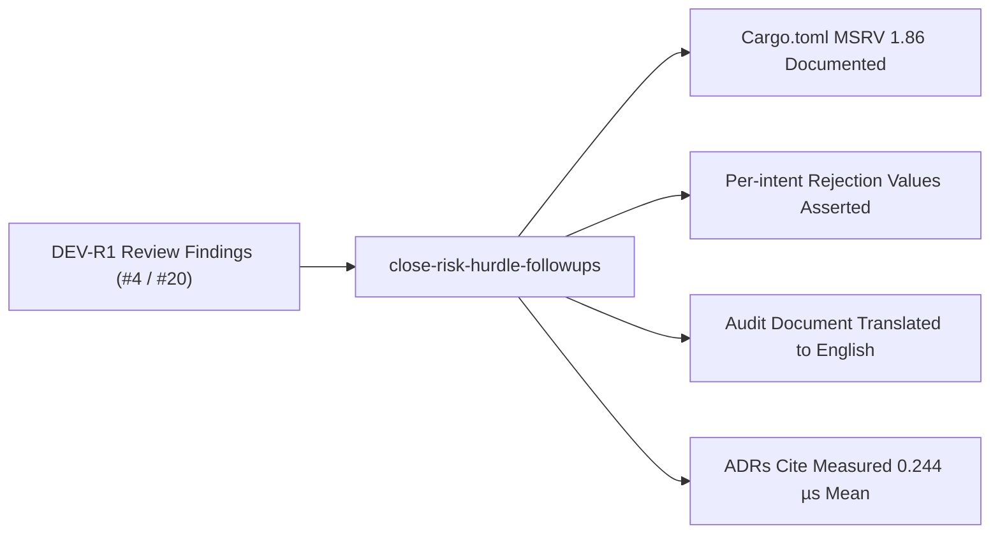

# Proposal: Close Risk Hurdle Follow-ups

## Review Card (≤ 5 min)

| Field | Value |
|---|---|
| Outcome | Resolve the four DEV-R1 follow-up findings from the risk-hurdle change across Cargo MSRV docs, rejection unit tests, English audit translation, and ADR latency citations. |
| Why now | Non-blocking review findings DEV-R1-F01..F04 from PR #20 remain open on issue #4. Resolving them now maintains documentation accuracy, test provenance, and language policy compliance. |
| Blast radius | `engine-rs/crates/risk-gate`, `engine-rs/crates/backtest`, `docs/PERFORMANCE_AND_COST_AUDIT.md`, and `docs/adr/0001..0003`. |
| Risk | Low. Purely additive unit test assertions, documentation translation, MSRV annotations, and citation updates with zero changes to hot-path execution logic. |
| Effort | S (1 review round). |
| Decision needed | None. Resolves previously cataloged and agreed DEV-R1 review findings. |

## Why

During the implementation of change `fix-risk-gate-cost-hurdle` (PR #20), the DEV review approved the core cost-aware hurdle logic but identified four non-blocking follow-up items recorded as DEV-R1-F01 through DEV-R1-F04.

Resolving these items ensures that Criterion's MSRV requirement is preserved in the codebase, the exact per-intent hurdle rejections cited in the audit have automated regression tests, the performance audit conforms to the repository's English-only documentation standard, and all ADRs accurately reflect the measured hot-path benchmark evidence.

## What Changes

- Document Criterion's MSRV (`1.86`) and benchmark toolchain requirements in `engine-rs/crates/risk-gate/Cargo.toml` (`DEV-R1-F01`).
- Add targeted unit test assertions for exact per-intent hurdle rejection values documented in the performance audit: JUP smart-money (`70.2` bps vs `87.2` bps hurdle), AIX-SOL sniper (`95.0` bps vs `151.4` bps hurdle), and `leaf-bitcoin` fixture rejection breakdown (`DEV-R1-F02`).
- Translate all remaining French section headers, table labels, and prose paragraphs in `docs/PERFORMANCE_AND_COST_AUDIT.md` to English, preserving all numeric figures, table structures, and benchmark values verbatim (`DEV-R1-F03`).
- Sweep residual bare `<50µs` and `<50 µs` claims across `docs/adr/0001-hybrid-quant-agentic-architecture.md`, `docs/adr/0002-autonomous-cognitive-warm-path-and-ta-memory.md`, and `docs/adr/0003-hierarchical-multi-ecosystem-architecture.md` so each occurrence cites the measured mean (`0.244 µs`) and the benchmark command `cargo bench --manifest-path engine-rs/Cargo.toml -p robotrader-risk-gate` (`DEV-R1-F04`).

## Capabilities

### New Capabilities
None.

### Modified Capabilities
- `risk-hurdle`: Adds requirements for dev-dependency MSRV documentation, per-intent hurdle rejection test coverage, English-only performance audit documentation, and ADR hot-path benchmark citations.

## Non-goals

- Implementing aggregate exposure caps (`asset_exposures_usd` / `pod_exposures_usd`), which remain deferred on issue #4 pending an architectural decision.
- Implementing order-rate limiting or venue cancellation / flatten on kill-switch, which are out of scope for this slice.
- Modifying `HardRiskGate::validate` logic, hurdle thresholds, or canonical fee schedules.
- Changing backend or frontend code outside the specified documentation and test files.

## Impact

- `engine-rs/crates/risk-gate/Cargo.toml`: Dev-dependency comments and MSRV metadata.
- `engine-rs/crates/backtest/src/lib.rs` (or `risk-gate/src/lib.rs`): New unit tests asserting per-intent rejection values.
- `docs/PERFORMANCE_AND_COST_AUDIT.md`: Translation from French to English.
- `docs/adr/0001-hybrid-quant-agentic-architecture.md`: Hot-path latency citation update.
- `docs/adr/0002-autonomous-cognitive-warm-path-and-ta-memory.md`: Hot-path latency citation update.
- `docs/adr/0003-hierarchical-multi-ecosystem-architecture.md`: Hot-path latency citation update.
