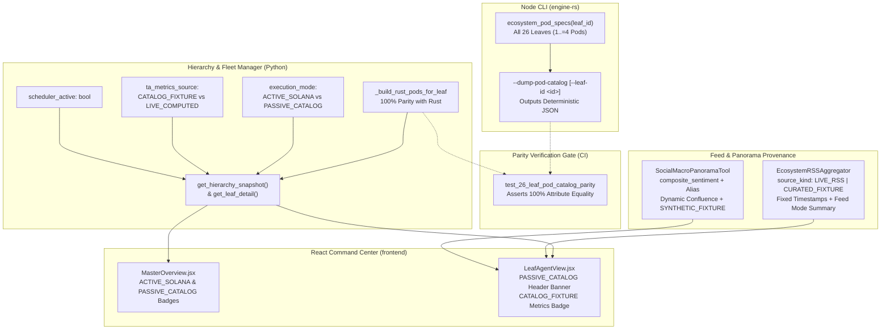

# Design Document: Fix Leaf Fleet Parity & Execution Honesty

## Context

The architecture audit in issue #6 and [ADR-0003](docs/adr/0003-hierarchical-multi-ecosystem-architecture.md) identified that while Robotrader v3 specifies 26 isolated blockchain and venue leaf robots, the running implementation exhibits four severe discrepancies:
1. **Pod Catalog Divergence**: Python (`HierarchicalFleetManager._build_rust_pods_for_leaf`) and Rust (`ecosystem_pod_specs`) diverge on 7 leaves (`leaf-bnb`, `leaf-xrp`, `leaf-ton`, `leaf-tron`, `leaf-avalanche`, `leaf-cosmos`, `leaf-binance-cex`) and across the generic fallback generator, leading to conflicting strategy definitions between UI/API and the engine.
2. **Execution Honesty Gap**: Only `leaf-solana` runs an autonomous warm-path loop (`run_strategic_reflection`) and compiles `PolicyEnvelope` hot-path overrides. The remaining 25 leaves are unscheduled catalog rows with static metrics (`ta_specific_metrics`), yet were presented identically to live leaves without machine-readable execution modes or telemetry classifications.
3. **Sentiment Casing Defect & Broken Confluence**: `SocialMacroPanoramaTool.build_panorama` returned `"Composite_sentiment"` with capital `C`, while `OrchestratorAgent._build_reflection_prompts` looked up `"composite_sentiment"` (lowercase), resulting in `null` sentiment on every reflection cycle. Confluence was computed by dividing by `3.0` over absent `BTC/USDT` and `ETH/USDT` snapshots. Static macro narratives were emitted without provenance.
4. **RSS Freshness Fabrication**: `EcosystemRSSAggregator.get_feed_for_agent` served static curated items with artificially recalculated timestamps (`now_ms - idx * 420_000`) without stamping items or feeds with machine-readable provenance metadata.

See `openspec/changes/fix-leaf-fleet-parity-honesty/proposal.md` for why this change is necessary and the capability specifications under `specs/` for normative requirements.

## Goals / Non-Goals

### Goals
- Achieve 100% attribute parity across all 26 leaf Strategy Pod catalogs between `engine-rs` and `backend/core/hierarchy.py`.
- Expose a deterministic CLI pod catalog exporter (`robotrader-node --dump-pod-catalog [--leaf-id <id>]`) with non-zero exit codes on unrecognized leaf IDs.
- Lock catalog parity with an automated CI test suite covering all 26 leaves and all pod fields (`slot_id`, `pod_code`, `name`, `archetype`, `native_venue`, `default_weight`, `description`).
- Classify leaf execution truthfulness across the API and UI via `execution_mode` (`"ACTIVE_SOLANA"` vs `"PASSIVE_CATALOG"`), `scheduler_active` (`bool`), and `ta_metrics_source` (`"CATALOG_FIXTURE"` vs `"LIVE_COMPUTED"`).
- Surface execution and telemetry honesty badges in `MasterOverview.jsx` and `LeafAgentView.jsx`.
- Resolve the sentiment casing mismatch by returning `"composite_sentiment"` (lowercase) along with `"Composite_sentiment"` as an alias, dynamically averaging confluence over present symbols, and stamping static narratives with `source_kind: "SYNTHETIC_FIXTURE"`.
- Eliminate fabricated RSS timestamps, stamping all items with `source_kind: "LIVE_RSS" | "CURATED_FIXTURE"` and `curated: bool`, and providing feed summaries (`feed_mode`, `live_count`, `curated_count`).
- Update platform documentation (`AGENTS.md`, `README.md`, `ADR-0003`) to reflect single-active-leaf implementation status.

### Non-Goals
- Building live market streaming, candle builders, or WebSocket feeds for the 25 non-Solana ecosystems (tracked in issue #6 follow-ups).
- Compiling `PolicyEnvelope` hot-path overrides for non-Solana pods in `engine-rs`.
- Running background scheduling for non-Solana leaves (they remain manual on-demand reflection only).
- Adding paid external RSS or social news subscriptions.
- Altering `HardRiskGate` validation logic, the 50µs execution budget, or `SimulatedVault` invariants.

## Decisions

| Decision | Alternatives Considered | Rationale | Rejected Because |
|---|---|---|---|
| **D1: Code-level dual definition with automated CI parity gate** | 1. Rust binary call via subprocess during backend startup. 2. Shared YAML/JSON catalog file loaded by both Rust and Python. 3. Dual definition in Rust and Python with CI parity assertion. | Alternative 3 keeps `engine-rs` and `backend` self-contained without filesystem coupling or runtime subprocess overhead on startup, while the CI test guarantees 100% attribute equality. | Alt 1 adds unnecessary subprocess latency and failure modes to FastAPI startup. Alt 2 adds build-time codegen or runtime file-reading overhead to Rust hot path crates. |
| **D2: Explicit `execution_mode` enum on leaf status** | 1. Rely on `enabled: bool` or `allocated_capital_usd > 0`. 2. Infer execution mode from leaf ID in frontend (`leaf_id === 'leaf-solana'`). 3. Explicit `execution_mode: ACTIVE_SOLANA \| PASSIVE_CATALOG` in backend payload. | Explicit backend contract communicates architectural capability unambiguously to all API consumers and frontend components, preventing UI guesswork. | Alt 1 conflates capital allocation with autonomous execution capability. Alt 2 hardcodes architectural state in the frontend, preventing future leaf activations without frontend code changes. |
| **D3: `ta_metrics_source: "CATALOG_FIXTURE"` telemetry tagging** | 1. Drop `ta_metrics` entirely for non-Solana leaves. 2. Rename `ta_metrics` to `static_ta_metrics`. 3. Keep `ta_metrics` and add `ta_metrics_source: "CATALOG_FIXTURE"`. | Preserves backward compatibility of the JSON schema for dashboards while clearly flagging data provenance. | Alt 1 breaks existing UI components and LLM prompts that expect metric dictionaries. Alt 2 is a breaking schema change across API endpoints. |
| **D4: Lowercase `"composite_sentiment"` with uppercase alias** | 1. Change only orchestrator prompt reader to uppercase. 2. Change `build_panorama` to return lowercase only. 3. Return lowercase key and duplicate uppercase key as an alias. | Returning both keys fixes the bug immediately for the orchestrator while guaranteeing zero regression for any external or legacy consumer. | Alt 1 leaves non-standard casing in the dictionary. Alt 2 breaks any external caller relying on `"Composite_sentiment"`. |
| **D5: Dynamic confluence over present symbols with 0.0 neutral fallback** | 1. Keep fixed denominator 3.0. 2. Require BTC/ETH snapshots to be synthesized. 3. Average present symbols dynamically; return 0.0 if empty. | Accurately calculates confluence across available assets without skewing denominators or inventing missing symbols. | Alt 1 artificially divides single-symbol scores by 3. Alt 2 invents fake data when only Solana symbols are subscribed. |
| **D6: RSS fixed fixture timestamp and provenance summary** | 1. Retain `now_ms - idx * 420_000` fake timestamps. 2. Remove timestamps from curated items. 3. Use fixed fixture timestamp, stamp `source_kind` and `curated: true`, and summarize feed mode. | Provides full provenance clarity: consumers know whether items are live or curated fallback, without fake breaking-news timestamps. | Alt 1 actively misleads users and LLMs. Alt 2 breaks consumers expecting numeric timestamps in feed items. |

## Risks / Trade-offs

- **Risk: Operator confusion regarding 25 passive leaves** -> *Mitigation*: Prominently display `PASSIVE_CATALOG` badges on `MasterOverview` and `LeafAgentView`, and display `CATALOG_FIXTURE` badges on the technical analysis section with explanatory captions stating that streaming data pipelines are pending.
- **Risk: CI parity test drift if Rust pods are updated without updating Python** -> *Mitigation*: The automated test `test_26_leaf_pod_catalog_parity` runs in both `cargo test` and `python3 -m unittest`, asserting exact string and numeric equality across all 26 leaves, failing the build on any mismatch.
- **Risk: Worst-case failure: Stale CLI binary causes parity test failure in CI** -> *Mitigation*: The CI build sequence builds the `robotrader-node` binary prior to executing Python unit and architecture integration tests (`cargo build --manifest-path engine-rs/Cargo.toml --bin robotrader-node`).
- **Risk: Legacy external clients expecting uppercase `"Composite_sentiment"`** -> *Mitigation*: `build_panorama` emits both `"composite_sentiment"` and `"Composite_sentiment"`.

## Migration Plan

1. **Step 1: Rust Engine Update**:
   - Update `engine-rs/crates/strategies/src/lib.rs` to ensure all 26 leaf ecosystems return valid, tailored pod specifications.
   - Update `engine-rs/crates/node/src/main.rs` to implement `--dump-pod-catalog` (with alias `--export-pod-catalog`) supporting full fleet JSON export or single-leaf export with strict non-zero exit on unknown leaf IDs.
   - Run `cargo test` and `cargo build --bin robotrader-node`.
2. **Step 2: Backend Parity & Provenance Implementation**:
   - Update `backend/core/hierarchy.py`: update `_build_rust_pods_for_leaf` for all 26 leaves to match Rust exactly; add `execution_mode`, `scheduler_active`, and `ta_metrics_source` to `_init_leaves`, `get_leaf_detail`, and `get_hierarchy_snapshot`.
   - Update `backend/server.py`: add `@app.get("/api/v1/hierarchy/overview")` alias.
   - Update `backend/tools/ta_tools.py`: fix `composite_sentiment` casing, dynamic confluence calculation, and `source_kind: "SYNTHETIC_FIXTURE"` on social narratives.
   - Update `backend/tools/rss_tools.py`: remove fake dynamic timestamps on curated items, add `source_kind`, `curated`, and feed summaries (`feed_mode`, `live_count`, `curated_count`).
   - Run `PYTHONPATH=. python3 -m unittest discover -s backend/tests -v`.
3. **Step 3: Frontend Transparency Updates**:
   - Update `frontend/src/components/MasterOverview.jsx`: render `ACTIVE_SOLANA` vs `PASSIVE_CATALOG` badges in the fleet table and clarify execution status in summary text.
   - Update `frontend/src/components/LeafAgentView.jsx`: render `PASSIVE_CATALOG` header badges for non-Solana leaves, and render `CATALOG_FIXTURE` badge on technical analysis metrics.
   - Run `npm run build` in `frontend/`.
4. **Step 4: Documentation Synchronization**:
   - Update `AGENTS.md`, `README.md`, and `docs/adr/0003-hierarchical-multi-ecosystem-architecture.md` with explicit notes explaining single-active-leaf status.

### Rollback Plan
- The changes are backward compatible with all API contracts and database/state stores (purely additive fields and bug fixes).
- If an unexpected regression occurs, rollback consists of checking out the previous commit on master (`git revert <commit-sha>`), rebuilding the node binary (`cargo build --bin robotrader-node`), and redeploying via Docker Compose (`docker compose up --build -d`).

## Open Questions

<!-- None. -->

