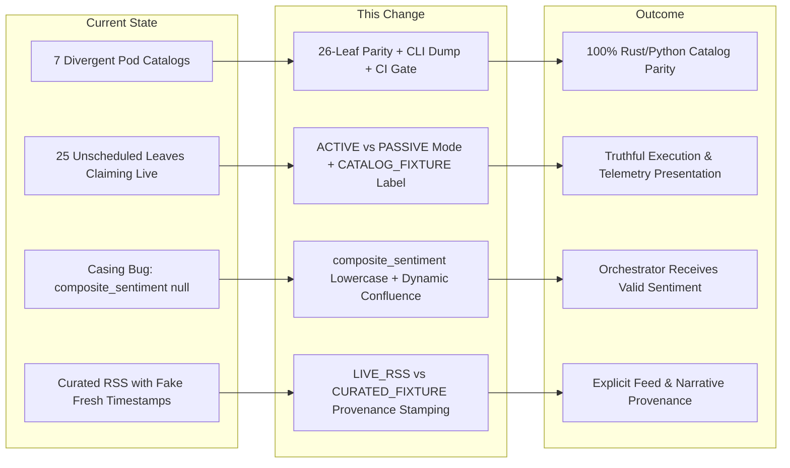

## Review Card (≤ 5 min)

| Field | Value |
|---|---|
| Outcome | Align Rust/Python pod catalogs across all 26 leaves and explicitly label unscheduled leaves, curated RSS feeds, and synthetic macro narratives with machine-readable provenance. |
| Why now | Issue #6 audit revealed that 7 leaves diverge between Rust and Python, 25 leaves are presented as autonomous despite being unscheduled catalog rows with static metrics, RSS timestamps are synthesized, and a casing mismatch causes Orchestrator to receive null sentiment. |
| Blast radius | `engine-rs` (`strategies`, `node`), `backend` (`hierarchy`, `ta_tools`, `rss_tools`, `orchestrator`, `server`), `frontend` (`MasterOverview`, `LeafAgentView`), and platform documentation. |
| Risk | Low. Additive provenance metadata and catalog alignment; hot-path execution and simulated vault safety invariants are preserved. |
| Effort | L (cross-stack alignment across Rust, Python, React, and documentation). |
| Decision needed | None. |

### Non-goals
- Implementing autonomous background scheduling or live ingestion for the 25 non-Solana leaves (remains open in issue #6).
- Compiling `PolicyEnvelope` hot-path overrides for non-Solana ecosystems.
- Adding paid external RSS or social media API integrations.

---

## Why

An architectural audit of the multi-ecosystem fleet (issue #6) revealed four critical integrity and consistency gaps:
1. Python (`HierarchicalFleetManager._build_rust_pods_for_leaf`) and Rust (`ecosystem_pod_specs`) diverge on 7 of the 26 leaf pod catalogs, meaning the UI displays one set of strategies while the engine evaluates another.
2. The UI and documentation present 26 autonomous trading leaves, but 25 leaves are unscheduled, do not compile execution policies, and display constant baseline metrics (`ta_specific_metrics`) as live telemetry.
3. `SocialMacroPanoramaTool.build_panorama` returns `"Composite_sentiment"` (capital `C`), causing `OrchestratorAgent` to read `null` on every cycle, while calculating confluence by dividing by 3 over missing hardcoded BTC/ETH snapshots.
4. `EcosystemRSSAggregator` serves static French headlines (`CURATED_ECOSYSTEM_ITEMS`) with freshly synthesized timestamps, masquerading static fixture copy as live news without provenance.

Fixing these discrepancies restores cross-stack honesty, eliminates the sentiment casing defect, and aligns Rust and Python definitions across the entire 26-leaf fleet.

## What Changes

- **26-Leaf Strategy Pod Catalog Parity**: Synchronize Python `_build_rust_pods_for_leaf` with Rust `ecosystem_pod_specs` across all 26 leaf ecosystems, adding a CLI catalog export flag (`--dump-pod-catalog`) to `robotrader-node` and an automated parity test.
- **Leaf Execution & Telemetry Honesty**: Classify `leaf-solana` as `ACTIVE_SOLANA` (or `AUTONOMOUS_WARM_PATH`) and the remaining 25 leaves as `PASSIVE_CATALOG` (or `MANUAL_REFLECT_ONLY`) across the API and UI, marking static leaf metrics as `CATALOG_FIXTURE`.
- **Social/Macro Panorama Fix & Provenance**: Return lowercase `"composite_sentiment"` (retaining `"Composite_sentiment"` as an alias), calculate multi-symbol confluence dynamically over present snapshots, and tag static narratives with `source_kind: "SYNTHETIC_FIXTURE"`.
- **Ecosystem RSS Feed Provenance**: Tag all feed items with `source_kind: "LIVE_RSS"` or `source_kind: "CURATED_FIXTURE"`, record `curated: true` on fixture items, stop generating misleading timestamps, and include feed-level summary metrics (`feed_mode`, `live_count`, `curated_count`).
- **Honest UI & Documentation**: Update `LeafAgentView`, `MasterOverview`, `AGENTS.md`, `README.md`, and `ADR-0003` to reflect that only Solana currently runs an autonomous warm-path loop.

## Capabilities

### New Capabilities
- `pod-catalog-parity`: 26-leaf Strategy Pod catalog synchronization between Rust and Python, CLI export in `robotrader-node`, and automated CI parity locking.
- `fleet-execution-honesty`: Explicit execution mode (`ACTIVE_SOLANA` vs `PASSIVE_CATALOG`) and telemetry classification (`CATALOG_FIXTURE` vs `LIVE_COMPUTED`) across API, UI, and docs.
- `feed-panorama-provenance`: Social/macro panorama casing fix, dynamic confluence computation, narrative synthetic provenance, and RSS feed item/summary provenance stamping.

### Modified Capabilities

None. Existing specifications in `openspec/specs/` (`integrity`, `backtest-honesty`, `vault-simulation`, `contract`, `costguard`) remain unaltered.

## Non-goals

- Implementing live market data ingestion, WebSocket order book streams, or candle builders for non-Solana chains (deferred to subsequent issue #6 slices).
- Compiling `PolicyEnvelope` asset overrides for non-Solana pods in `engine-rs`.
- Background scheduling for the 25 non-Solana leaf agents (they remain on-demand manual reflection only).
- Procuring commercial or authenticated social/news API subscriptions.
- Changing `HardRiskGate` validation logic, the 50µs execution budget, or `SimulatedVault` safety invariants.

## Impact

- `engine-rs/crates/strategies/src/lib.rs`: Canonical definition for 26-leaf pod specs.
- `engine-rs/crates/node/src/main.rs`: Adds `--dump-pod-catalog` CLI export.
- `backend/core/hierarchy.py`: Updates `_build_rust_pods_for_leaf`, leaf status dictionaries, and execution mode tags.
- `backend/tools/ta_tools.py`: Fixes `composite_sentiment` key casing, dynamic confluence averaging, and synthetic narrative markers.
- `backend/tools/rss_tools.py`: Adds item and feed-level provenance metadata to `EcosystemRSSAggregator`.
- `backend/agents/orchestrator.py`: Consumes valid lowercase `composite_sentiment`.
- `backend/server.py`: Surfaces execution mode and telemetry source in leaf and hierarchy endpoints.
- `frontend/src/components/MasterOverview.jsx`: Renders execution status badges distinguishing active from passive leaves.
- `frontend/src/components/LeafAgentView.jsx`: Renders `PASSIVE_CATALOG` badges and `CATALOG_FIXTURE` telemetry tags.
- `docs/` and root documentation (`AGENTS.md`, `README.md`, `docs/adr/0003-hierarchical-multi-ecosystem-architecture.md`): Clarifies the single-active-leaf implementation status.
