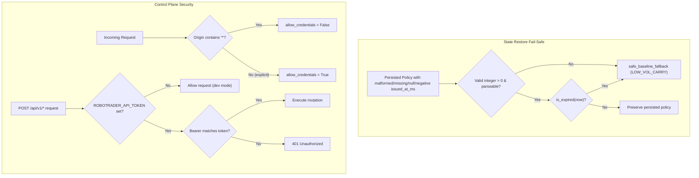

## Review Card (≤ 5 min)

| Field | Value |
|---|---|
| Outcome | Persisted policy restore fails closed to `safe_baseline_fallback` on malformed state, control-plane CORS adheres to the Fetch specification, mutating control-plane endpoints support optional Bearer token authentication, and documentation honestly describes Redis single-key snapshot persistence. |
| Why now | Issues #8, DEV-R1-F01, and DEV-R1-F02: malformed persisted policy timestamps fall through to active swarm, wildcard CORS with credentials violates Fetch specs, control-plane endpoints lack authentication, and docs claim unimplemented Redis Streams. |
| Blast radius | Backend control plane only (`backend/core/state_store.py`, `backend/server.py`), documentation (`README.md`, `docs/adr/0001-hybrid-quant-agentic-architecture.md`), and unit tests. No Rust, `HardRiskGate`, execution routing, or wire schemas touched. |
| Risk | Low. Safe baseline fallback protects against corrupted state, CORS fix resolves browser credential rejections, and Bearer authentication is opt-in (disabled when `ROBOTRADER_API_TOKEN` is unset, keeping local dev unauthenticated). |
| Effort | S — one SPEC round, one DEV round. |
| Decision needed | None. |

### Non-goals
- Cryptographic signing of `PolicyEnvelope` (#8.3).
- Live venue order cancellation and position flattening on kill switch (#8.6).
- Migrating single-key Redis state snapshot to Redis Streams or per-key `EX` keys (#8.4 implementation roadmap).
- Modifying Rust `engine-rs` hot-path execution, risk gates, or strategy pods.
- Enforcing mandatory token authentication when `ROBOTRADER_API_TOKEN` is unset.
- Adding authentication to read-only endpoints `GET /api/v1/health` and `GET /api/v1/status`.

## Why

During the implementation review of `fix-policy-ttl-heartbeat` (issue #8), two follow-up findings were recorded regarding state restore resilience (DEV-R1-F01 and DEV-R1-F02).
When `StateStore._load_persisted_state` encounters a persisted policy with a non-numeric or malformed `issued_at_ms`, `PolicyEnvelope.from_dict` raises an unhandled exception that gets caught by a broad handler, leaving `self._policy` initialized to `PolicyEnvelope.default_active()` (`full_swarm_v2`) rather than falling closed to `safe_baseline_fallback`.

Additionally, the control plane in `backend/server.py` presents two security and compliance deficiencies (#8.5).
First, `CORSMiddleware` is configured with `allow_origins=["*"]` and `allow_credentials=True`, a combination explicitly forbidden by the W3C/WHATWG Fetch specification that modern browsers reject.
Second, all mutating control-plane routes (`POST /api/v1/*`) are unauthenticated, allowing arbitrary clients to trigger deposits, checkouts, reflections, and kill-switch toggles.
Finally, `docs/adr/0001-hybrid-quant-agentic-architecture.md` and `README.md` claim Redis Streams and native per-key `EX` expiration are active, whereas the actual system implements a single-key JSON snapshot with in-memory fallback and application-level TTL evaluation (#8.4).

## What Changes

- **Malformed Policy Restore Fail-Safe**: `StateStore._load_persisted_state` validates that `issued_at_ms` is an integer strictly greater than 0 (rejecting `None`, booleans, non-numeric strings, and non-positive numbers). Any malformed `issued_at_ms` or unparseable policy dictionary immediately sets `self._policy = PolicyEnvelope.safe_baseline(restore_now_ms)`.
- **CORS Specification Compliance**: `CORSMiddleware` parses `CORS_ALLOWED_ORIGINS` (comma-separated, defaulting to `"*"`). When `allow_origins` contains `"*"`, `allow_credentials` is set to `False`; when explicit origins without `"*"` are provided, `allow_credentials` is set to `True`.
- **Optional Bearer Token Authentication**: When `ROBOTRADER_API_TOKEN` is configured as a non-empty string in the environment, all mutating `POST` endpoints under `/api/v1/` require an `Authorization: Bearer <token>` header verified with constant-time comparison (`hmac.compare_digest`), returning `401 Unauthorized` (`{"detail": "Invalid or missing API token"}`) upon failure. When unset or empty, requests proceed unauthenticated for local development.
- **Unauthenticated Read-Only Routes**: `GET /api/v1/health` and `GET /api/v1/status` remain unauthenticated regardless of whether `ROBOTRADER_API_TOKEN` is configured.
- **Redis Contract Documentation Honesty**: `docs/adr/0001` and `README.md` are updated to document the current single-key JSON state snapshot (`robotrader:v2:state`) with in-memory fallback, explicitly distinguishing Redis Streams and native per-key `EX` expiration as roadmap architecture.

## Capabilities

### New Capabilities
- `control-plane-security`: CORS Fetch-specification compliance, optional Bearer token authentication on mutating control plane endpoints, and honest documentation of the single-key Redis snapshot persistence contract.

### Modified Capabilities
- `policy-ttl`: Fail-closed safe baseline fallback on malformed, missing, null, boolean, non-numeric, or non-positive persisted policy issue times during state restore.

## Non-goals

- Cryptographic signing of `PolicyEnvelope` (#8.3) and wire schema changes.
- Live venue order cancellation and position flattening on kill-switch (#8.6).
- Replacing single-key Redis snapshot persistence with Redis Streams or native per-key `EX` keys (#8.4 implementation roadmap).
- Modifying Rust `engine-rs` hot-path execution, risk gates, or strategy pods.
- Enforcing mandatory authentication when `ROBOTRADER_API_TOKEN` is unset in local development environments.
- Adding authentication to read-only endpoints `GET /api/v1/health` and `GET /api/v1/status`.

## Impact

- `backend/core/state_store.py`: `_load_persisted_state` validates `issued_at_ms` as a positive integer and catches all policy parsing exceptions, failing closed to `safe_baseline_fallback`.
- `backend/server.py`: `CORSMiddleware` configured with dynamic `allow_credentials` based on `CORS_ALLOWED_ORIGINS`; optional Bearer token authentication dependency added to mutating `POST` routes under `/api/v1/`.
- `backend/tests/`: New tests added to `backend/tests/test_policy_ttl_heartbeat.py` for null, non-numeric, boolean, non-positive, and unparseable policy payloads; new test module `backend/tests/test_control_plane_security.py` verifying CORS headers and Bearer token enforcement.
- `docs/adr/0001-hybrid-quant-agentic-architecture.md` and `README.md`: Updated to describe single-key Redis snapshot persistence and mark Streams as roadmap.
- Contract impact: No breaking changes to `PolicyEnvelope` or Redis payload structures. Additive optional authorization header requirement on mutating HTTP POST endpoints when `ROBOTRADER_API_TOKEN` is configured.
- Money, risk, vault, and hot-path impact: N/A. No changes to execution, sizing, or risk-gate code.
