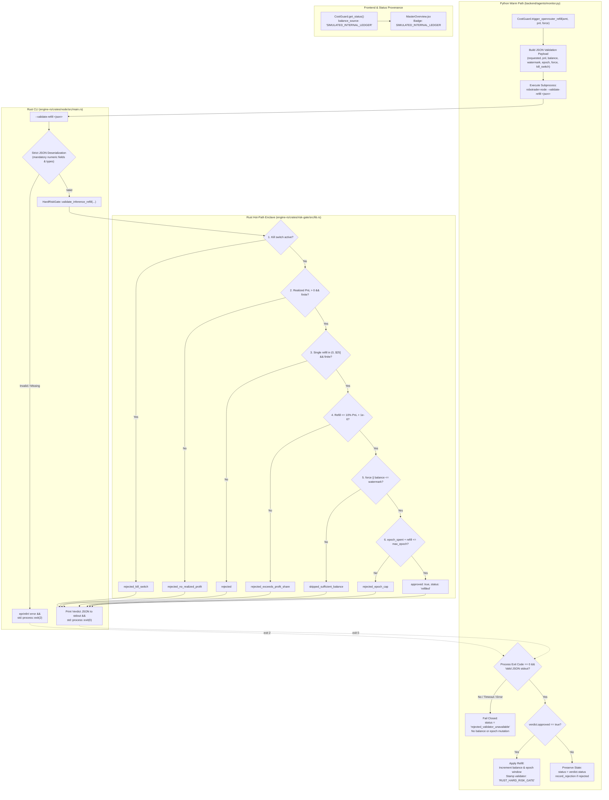

# Design Document: Wire Rust Refill Validator, Harden Ledger Scanning & Expose Honest Balance Provenance

## Context

Issue #5 and [ADR-0003](docs/adr/0003-hierarchical-multi-ecosystem-architecture.md) establish that OpenRouter credit refills must be strictly gated by `HardRiskGate::validate_inference_refill` in Rust (`realized_trading_pnl_usd > 0`, `refill <= 10%` of realized PnL, `<= $25/24h` epoch cap, kill switch inactive). However, an architectural audit uncovered four critical flaws:
1. **Dead-Code Rust Validator**: `HardRiskGate::validate_inference_refill` in `engine-rs/crates/risk-gate/src/lib.rs` was never called from the running Python system. Moreover, its Rust implementation lacked arguments for realized PnL and the `force` override, checking only bounds, low watermark, and epoch cap.
2. **Profit Gate Bypass & Inversion**: In Python, automatic refills omitted `realized_trading_pnl_usd` entirely, bypassing the profit gate, while other callers passed `max(125.0, total_pnl)`—authorizing credit refills even when the trading strategy was in drawdown.
3. **Fragile Ledger Scanning**: `LLMMonitorAgent._scan_ledger` in `backend/agents/monitor.py` assumed every decoded JSON line was a dictionary containing numeric tokens and costs. A single non-dict line (e.g. integer or list) raised an unhandled `AttributeError`, and non-numeric token/cost strings or non-finite floats (`NaN`, `+Inf`) raised `ValueError`, crashing `/api/v1/status` hydration.
4. **Credit Balance Provenance Gap**: In-memory credit balance was initialized from an arbitrary seed and tracked locally without contacting OpenRouter APIs, yet was rendered in `MasterOverview.jsx` without provenance, masquerading as a live OpenRouter billing query.

See `openspec/changes/wire-rust-refill-validator/proposal.md` for why this change is necessary and `openspec/changes/wire-rust-refill-validator/specs/costguard/spec.md` for normative requirements.

## Goals / Non-Goals

### Goals
- Implement the canonical 6-step refill evaluation in `HardRiskGate::validate_inference_refill` in `engine-rs/crates/risk-gate/src/lib.rs` (kill switch, realized PnL > 0, bounds `(0, $25.00]`, 10% profit-share cap, low watermark threshold with `force` override, and rolling epoch cap).
- Return a structured `InferenceRefillVerdict` (`approved`, `status`, `reason`, `approved_usd`) from `HardRiskGate`.
- Expose the `--validate-refill <json>` CLI command on `robotrader-node`, emitting deterministic JSON verdicts on stdout with exit code 0 and exiting with code 2 on malformed or missing arguments.
- Route `CostGuard.trigger_openrouter_refill` in `backend/agents/monitor.py` through `robotrader-node --validate-refill`, failing closed (`rejected_validator_unavailable`) on missing binary or invocation failure.
- Stamp recorded refill events with `validator: "RUST_HARD_RISK_GATE"`.
- Harden `LLMMonitorAgent._scan_ledger` against non-dict JSON lines and non-numeric or non-finite token and cost values without raising exceptions.
- Add `balance_source: "SIMULATED_INTERNAL_LEDGER"` to `openrouter_credit` in `LLMMonitorAgent.get_status()` and render a prominent provenance badge on `frontend/src/components/MasterOverview.jsx`.

### Non-Goals
- Real-time billing balance queries against live OpenRouter `/api/v1/credits` endpoints.
- Real out-of-band payment card or crypto execution for purchasing OpenRouter API credits.
- Altering the 50µs execution budget or hot-path market event processing in `HardRiskGate::validate`.
- Modifying `SimulatedVault` key management or transfer signing invariants.

## Decisions

| Decision | Alternatives Considered | Rationale | Rejected Because |
|---|---|---|---|
| **D1: CLI Subprocess for Rust Refill Validation** | 1. PyO3 / C-FFI direct bindings. 2. Redis IPC request/response bus. 3. CLI flag `--validate-refill <json>` on `robotrader-node`. | `robotrader-node` already provides deterministic CLI invocation for `--sign-transfer`, `--contract-roundtrip`, and `--dump-pod-catalog`. Refill validation runs on a slow warm-path cadence (15m to 1h), so a sub-10ms CLI subprocess is robust, isolated, and introduces zero cross-language compilation dependencies or Redis broker coupling. | Alt 1 adds build complexity, binary wheel compatibility issues, and risk of GIL segmentation faults. Alt 2 adds asynchronous coordination complexity, broker timeouts, and failure modes when Redis is offline. |
| **D2: Dedicated `InferenceRefillVerdict` Struct** | 1. `Result<f64, RiskRejection>`. 2. Simple boolean or tuple `(bool, String)`. 3. Dedicated struct `InferenceRefillVerdict { approved: bool, status: String, reason: String, approved_usd: f64 }`. | Models all 4 required contract fields explicitly, serializes directly to stdout JSON for the CLI, cleanly separates rejections from skips (`skipped_sufficient_balance`), and avoids overloading hot-path trade rejection enums. | Alt 1 conflates benign skips with fatal risk rejections and makes CLI serialization awkward. Alt 2 lacks machine-readable status strings and structured dollar amounts. |
| **D3: Strict 6-Step Canonical Ordering** | 1. Check watermark before profit or kill switch. 2. Evaluate profit check only for automated refills. 3. Canonical order: Kill switch -> Realized PnL -> Single refill bounds -> 10% Profit share -> Watermark (unless force) -> Epoch cap. | Enforces capital protection fail-early semantics: safety invariants (kill switch, non-positive PnL) take precedence over operational checks (watermark). Evaluates identical logic for both automated and operator-triggered refills. | Alt 1 allows a killed or losing trading engine to report "balance sufficient" instead of flagging the safety violation. Alt 2 re-creates the vulnerability where automated refills bypassed profit checks. |
| **D4: Fail-Closed on Rust Invocation Failure** | 1. Fall back to Python-only gate checks if binary is missing or fails. 2. Raise unhandled `RuntimeError` crashing the caller. 3. Fail closed returning `rejected_validator_unavailable` without mutating state. | ADR-0003 mandates authoritative Rust gating. In an autonomous trading platform, inability to invoke the gate must halt credit expansion, never bypass it or crash the background service. | Alt 1 re-introduces the unverified Python path. Alt 2 crashes the monitor agent loop and FastAPI service. |
| **D5: Defensive Ledger Scanning with Silent Skip** | 1. Stop reading ledger on first corrupt line. 2. Raise `ValueError` and fail hydration completely. 3. Validate `isinstance(entry, dict)` and finite numeric fields (`prompt_tokens`, `completion_tokens`, `cost_usd`); skip corrupt lines and process remaining entries. | Transcript ledgers are append-only files that may contain truncated lines from abnormal shutdowns. Skipping corrupt lines preserves valid spend calculations and prevents denial-of-service on status endpoints. | Alt 1 ignores all valid lines following a corrupt line, undercounting spend. Alt 2 crashes `/api/v1/status` and halts the platform. |
| **D6: Simulated Provenance Tag `SIMULATED_INTERNAL_LEDGER`** | 1. Remove credit card from UI entirely. 2. Leave balance without provenance label. 3. Add `balance_source: "SIMULATED_INTERNAL_LEDGER"` to API and render a clear badge in UI. | Preserves operator observability into local inference throttling while honestly declaring data provenance, aligning with platform-wide honesty invariants. | Alt 1 removes operator visibility into inference cost controls. Alt 2 misleads operators into assuming live OpenRouter billing synchronization. |

## Risks / Trade-offs

- **Risk: Subprocess invocation latency on warm path** -> *Mitigation*: Credit refill validation occurs at most once per 15-minute or 1-hour cycle. A local binary execution takes < 10ms on modern hardware, and has zero impact on the hot path (`HardRiskGate::validate` remains 100% in-memory Rust < 50µs).
- **Risk: `robotrader-node` binary not compiled in local development** -> *Mitigation*: `resolve_robotrader_binary` looks in `engine-rs/target/debug` and `engine-rs/target/release`. If missing, `LLMMonitorAgent` fails closed with status `rejected_validator_unavailable` and clear error diagnostic, without crashing.
- **Risk: Malformed JSON arguments passed to `--validate-refill`** -> *Mitigation*: Node CLI strictly parses JSON via `serde_json`, verifies mandatory numeric fields, and exits with code 2 on malformed input, preventing undefined behavior.
- **Risk: Worst-case failure: Node binary segfaults or hangs during refill validation** -> *Mitigation*: Python invocation uses `subprocess.run` with a strict 5-second timeout, catches all `SubprocessError` and `OSError`, records a diagnostic rejection, and preserves all financial state.
- **Risk: Spend window desynchronization between ledger and memory** -> *Mitigation*: Rolling 24h spend pruning occurs prior to evaluation, and Rust validator checks `epoch_refilled_usd + requested_usd <= max_epoch_refill_usd`.

## Migration Plan

1. **Step 1: Rust Engine Update**:
   - Update `engine-rs/crates/risk-gate/src/lib.rs` to implement `InferenceRefillVerdict` and the 6-step canonical evaluation order in `HardRiskGate::validate_inference_refill`.
   - Update `engine-rs/crates/node/src/main.rs` to add `--validate-refill <json>` with strict argument validation and exit codes (0 for verdict, 2 for invalid arguments).
   - Verify with `cd engine-rs && cargo test` and `cargo build --bin robotrader-node`.
2. **Step 2: Python Backend Hardening & Delegation**:
   - Update `backend/agents/monitor.py` to route `trigger_openrouter_refill` through `robotrader-node --validate-refill`, implement fail-closed error handling (`rejected_validator_unavailable`), and stamp `validator: "RUST_HARD_RISK_GATE"` on refill history events.
   - Harden `LLMMonitorAgent._scan_ledger` in `backend/agents/monitor.py` against non-dict entries and non-numeric or non-finite token and cost values.
   - Add `balance_source: "SIMULATED_INTERNAL_LEDGER"` to `openrouter_credit` in `LLMMonitorAgent.get_status()`.
   - Verify with `PYTHONPATH=. python3 -m unittest discover -s backend/tests -v`.
3. **Step 3: Frontend UI Provenance Badge**:
   - Update `frontend/src/components/MasterOverview.jsx` to render a visible `SIMULATED_INTERNAL_LEDGER` provenance badge on the OpenRouter credit card.
   - Verify with `cd frontend && npm run build`.
4. **Step 4: End-to-End Verification & Docker Verification**:
   - Run complete test suite and execute `docker compose up --build -d` to verify deployment.

### Rollback Plan
- The changes are backward compatible: no database migration, no state file format breaks, and no breaking changes to public trading APIs.
- If an unexpected regression occurs in production:
  1. Revert Git commits: `git revert <commit-sha>`.
  2. Rebuild the engine binary: `cargo build --release --manifest-path engine-rs/Cargo.toml --bin robotrader-node`.
  3. Rebuild and restart the container fleet: `docker compose up --build -d`.
  4. The append-only `transcript_ledger.jsonl` file remains compatible with both older and newer monitor implementations.

## Open Questions

<!-- None. -->
