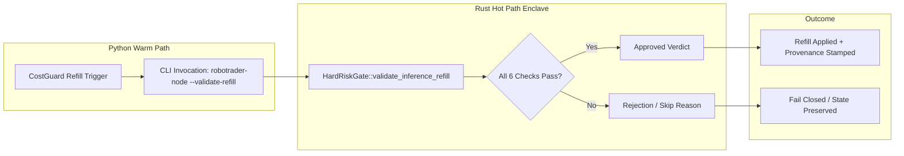

## Review Card (≤ 5 min)

| Field | Value |
|---|---|
| Outcome | Route CostGuard auto-refill through authoritative Rust HardRiskGate, harden ledger scanning against malformed lines, and display honest simulated balance provenance. |
| Why now | ADR-0003 mandates that inference credit refills are strictly validated by Rust `HardRiskGate`, but the Rust validator is currently dead code, malformed ledger lines crash status hydration, and the credit balance is rendered without simulated provenance. |
| Blast radius | `engine-rs` (`risk-gate`, `node`), `backend` (`agents/monitor.py`), and `frontend` (`MasterOverview.jsx`). |
| Risk | Low. Preserves the 50µs risk gate budget and fails closed if the Rust validator binary is unavailable. |
| Effort | L (Lane L slice touching Rust risk gate, CLI binary, Python warm-path monitor, and React frontend). |
| Decision needed | None. |

### Non-goals
- Live credit purchase execution against OpenRouter payment APIs (remains open in issue #5).
- Real-time billing balance synchronization via external OpenRouter HTTP requests.
- Modifying trading order execution, position sizing, or vault signing logic.

---

## Why

An architectural audit of inference cost control (issue #5) revealed that `HardRiskGate::validate_inference_refill` in Rust is dead code. ADR-0003 specifies that AI inference credit refills must be guarded by deterministic Rust validation, but Python currently enforces its own checks or skips them when called without the Rust engine.

Furthermore, malformed lines or non-numeric token and cost values in `transcript_ledger.jsonl` cause unhandled `AttributeError` or `ValueError` exceptions during hydration. Finally, the OpenRouter credit balance is tracked solely in memory from an arbitrary seed but rendered in the UI without provenance, masquerading as a live OpenRouter billing query.

## What Changes

- **Authoritative Rust Refill Validator**: Extend `HardRiskGate::validate_inference_refill` in `engine-rs/crates/risk-gate/src/lib.rs` to enforce the full 6-step refill contract in canonical order: kill switch, positive finite realized PnL, single-refill bound `(0, $25.00]`, 10% profit-share cap, low-watermark check (honoring `force`), and rolling 24h epoch cap.
- **Node CLI Refill Validation Command**: Add `--validate-refill <json>` to `robotrader-node` in `engine-rs/crates/node/src/main.rs`, returning deterministic JSON verdicts (`approved`, `status`, `reason`, `approved_usd`) on stdout and exiting non-zero on malformed input.
- **CostGuard Runtime Delegation**: Update `LLMMonitorAgent.trigger_openrouter_refill` in `backend/agents/monitor.py` to delegate validation to `robotrader-node --validate-refill`, fail closed (`rejected_validator_unavailable`) on invocation failures, and stamp `validator: "RUST_HARD_RISK_GATE"` on refill history events.
- **Malformed Ledger Line Hardening**: Harden `LLMMonitorAgent._scan_ledger` in `backend/agents/monitor.py` to skip non-dict JSON lines and non-numeric or non-finite `prompt_tokens`, `completion_tokens`, and `cost_usd` values cleanly without raising exceptions.
- **Honest Internal Balance Provenance**: Expose `balance_source: "SIMULATED_INTERNAL_LEDGER"` in `openrouter_credit` status payloads and render a prominent provenance badge on the OpenRouter credit card in `frontend/src/components/MasterOverview.jsx`.

## Capabilities

### New Capabilities

None.

### Modified Capabilities

- `costguard`: Delegate refill decisions to authoritative Rust `HardRiskGate`, expose `--validate-refill` CLI, harden ledger scanning against malformed JSON, and display simulated ledger provenance.

## Non-goals

- Out-of-band real OpenRouter credit purchase execution or payment processing (deferred to subsequent issue #5 work).
- Live query of external OpenRouter `/api/v1/credits` endpoints.
- Altering the 50µs execution budget or hot-path market event processing in `HardRiskGate::validate`.
- Modifying `SimulatedVault` key isolation or multi-chain transfer signing invariants.

## Impact

- `engine-rs/crates/risk-gate/src/lib.rs`: Updates `HardRiskGate::validate_inference_refill` with canonical 6-step ordering, profit share, and force parameter.
- `engine-rs/crates/node/src/main.rs`: Adds `--validate-refill <json>` command and stdout JSON formatting.
- `backend/agents/monitor.py`: Updates `trigger_openrouter_refill` to delegate to `robotrader-node`, hardens `_scan_ledger`, and adds `balance_source` to `get_status()`.
- `frontend/src/components/MasterOverview.jsx`: Adds `SIMULATED_INTERNAL_LEDGER` badge to OpenRouter credit card.
- `backend/tests/`: Adds unit and integration tests covering the Rust validator, CLI flag, fail-closed delegation, malformed ledger lines, and provenance tags.
