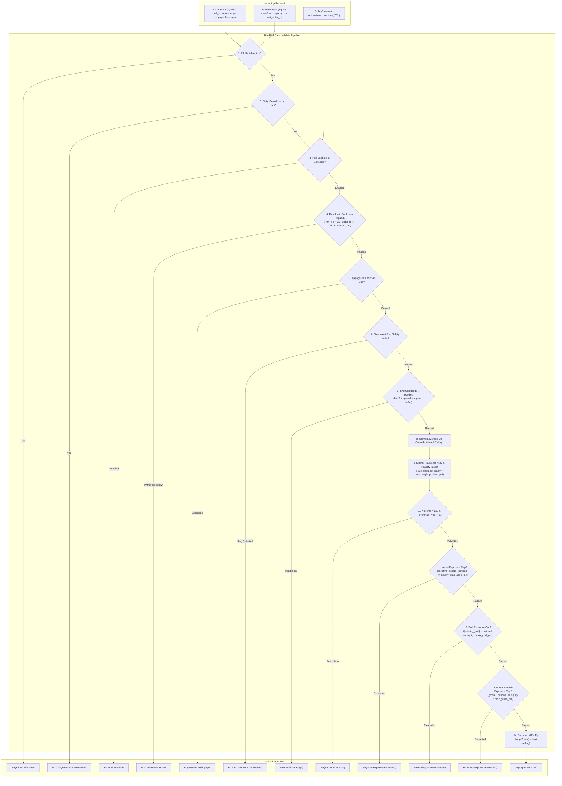

# Design: Enforce Risk Exposure Caps, Order Rate Limiting, and Bounded MEV Tips

## Context

Issue #4 identified that `HardRiskGate::validate` only enforced a subset of the safety rules documented in ADR-0001 §4.3. While execution-cost hurdle evaluation and hot-path benchmark tooling were established in prior changes, critical concentration limits and order flow throttles remained unenforced:
1. `PortfolioState` declared `asset_exposures_usd` and `pod_exposures_usd` maps, but neither was consulted during validation. Orders could accumulate unbounded exposure across individual assets or pods.
2. The single-position notional ceiling in `compute_kelly_notional` was multiplied by `clamped_leverage`, allowing 3x leveraged trades to consume up to 45% of portfolio equity instead of the intended 15% concentration ceiling.
3. No per-pod/symbol order rate-limit cooldown was enforced, leaving the system vulnerable to rapid order loops if a strategy pod fired repeatedly on market events.
4. The priority tip for MEV bundles was calculated directly from `expected_edge_bps` without an upper bound or slippage ceiling check, creating an incentive inversion and exposing the hot path to runtime panics in Rust std (`u32::clamp` panicking when `min > max`).

The primary constraints are:
- **Zero hot-path allocation and 50 µs budget**: `HardRiskGate::validate` runs synchronously in `engine-rs` with a measured mean latency baseline of 0.244 µs. All newly introduced checks must execute without heap allocations, locks, unbounded iterations, logging, or blocking I/O on the approved path.
- **Cross-language schema compatibility**: `PortfolioState` and `RiskLimits` contracts cross between Rust (`engine-rs/crates/common`, `engine-rs/crates/risk-gate`) and Python (`backend/core/schemas.py`). Existing serialized payloads omitting new fields must decode without errors using backward-compatible defaults.
- **Fail-closed risk arithmetic**: Short positions are represented with negative values in `asset_exposures_usd`. Risk checks must compute prospective exposure using absolute values (`|existing| + approved_notional`) to prevent short positions from offsetting or evading exposure ceilings.

For the motivation and business rationale, see `proposal.md`. For formal normative requirements and scenario definitions, see `specs/risk-exposure-caps/spec.md` and `specs/risk-hurdle/spec.md`.

## Goals / Non-Goals

### Goals
- Enforce an asset exposure ceiling (`max_asset_exposure_pct = 0.15`) using absolute-value prospective calculation.
- Enforce a pod exposure ceiling (`max_pod_exposure_pct = 0.40`) using absolute-value prospective calculation.
- Enforce an aggregate gross exposure ceiling (`max_gross_exposure_pct = 1.50`) across the entire portfolio.
- Decouple the single-position notional ceiling in fractional-Kelly sizing from leverage multiplication (`equity_usd * max_single_position_pct`).
- Enforce a per-`(pod_id, symbol)` order rate-limiting cooldown (`min_order_cooldown_ms`) using a zero-allocation stack lookup.
- Bound `mev_priority_tip_bps` by `max_mev_tip_bps` and effective slippage caps with panic-free clamping boundaries (`tip_floor = 2u32.min(tip_ceiling)`).
- Synchronize `PortfolioState` across Rust and Python with backward-compatible defaults (`#[serde(default)]`).
- Preserve synchronous hot-path execution under the 50 µs latency budget with zero heap allocations on the approved path.

### Non-Goals
- Live exchange WebSocket connectivity or live venue order cancellation/flattening on kill-switch (deferred to future live venue execution integration).
- Full tick-by-tick order book matching or execution queue simulation (tracked independently in Issue #3).
- Dynamic warm-path LLM adjustment of hard risk gate limits.
- Altering the Criterion benchmark configuration or host measurement environment.

## Architecture & Data Flow



## Decisions

| Decision | Alternatives Considered | Rationale | Rejected Because |
|---|---|---|---|
| **D1: `PortfolioState` Schema Extension and Cross-Language Parity** | 1. Sidecar state struct.<br>2. Loose function arguments to `validate()`. | Extending `PortfolioState` with `gross_exposure_usd: f64` and `last_order_ts_ms: HashMap<String, u64>` in Rust and Python preserves a unified state contract across Redis IPC and local testbeds. `#[serde(default)]` and default-initialized Python dataclass fields ensure zero-friction backward compatibility. | Sidecar structs cause dual-state synchronization divergence across language boundaries. Adding loose function arguments breaks the `validate()` interface across callers. |
| **D2: Absolute-Value Exposure Calculation for Signed Positions** | 1. Direct scalar addition (`existing + notional`).<br>2. Netting long and short exposures. | Short positions are recorded with negative values in `asset_exposures_usd` (e.g. `-8000.0` USD). Evaluating `existing.abs() + approved_notional` treats concentration as gross capital at risk, preventing short positions from evading asset concentration ceilings. | Scalar addition allows short positions to cancel out prospective long notional or accumulate unbounded negative notional. Netting introduces unhedged directional basis risk during liquidation events. |
| **D3: Leverage Decoupling in Single-Position Hard Cap** | 1. Maintain `equity * max_single_position_pct * clamped_leverage` (status quo).<br>2. Enforce single-position cap as a subsequent rejection error gate. | Clamping desired notional in `compute_kelly_notional` strictly to `equity_usd * max_single_position_pct` ensures that no single trade exceeds 15% of equity regardless of leverage. Clamping within Kelly sizing resizes the trade safely rather than discarding high-conviction signals. | Status quo allowed 3x leverage to consume 45% of equity, violating ADR-0001 §4.3. Rejecting after Kelly sizing breaks sizing continuity and discards trades that could safely execute at the 15% boundary. |
| **D4: Zero-Allocation Stack-Key Lookup for Rate Limiting** | 1. Heap-allocated string via `format!("{}:{}", pod_id, symbol)`.<br>2. Nested map `HashMap<PodId, HashMap<String, u64>>`.<br>3. Gateway rate limiting outside `HardRiskGate`. | Formatting `"{pod_id}:{symbol}"` into a 64-byte stack buffer via stack cursor writing performs zero heap allocations on the hot path. Looking up via `&str` in `portfolio.last_order_ts_ms` is O(1) and sub-microsecond. | Heap allocation in `format!` violates the platform's zero-allocation hot-path invariant. Nested maps increase deserialization overhead and IPC complexity. External gateway checks fail to protect internal pod execution loops. |
| **D5: Panic-Free MEV Priority Tip Clamping** | 1. Hardcoded `.clamp(2, tip_ceiling)`.<br>2. Unbounded alpha-derived tip scaling.<br>3. Zero tip floor without clamping. | Deriving `tip_ceiling = max_mev_tip_bps.min(effective_slippage_cap)` and `tip_floor = 2u32.min(tip_ceiling)` guarantees `tip_floor <= tip_ceiling` under all inputs, preventing runtime panics in Rust std `u32::clamp` when slippage caps are 0 or 1. | Hardcoded `clamp(2, tip_ceiling)` panics with `min > max` when `tip_ceiling < 2`, crashing the trading node. Unbounded tips create an incentive inversion where overstated alpha wastes capital on excessive tips. |
| **D6: Canonical Pipeline Ordering and Precedence** | 1. Exposure caps evaluated before Kelly sizing.<br>2. Hurdle evaluated before rate limiting.<br>3. Exposure caps evaluated post-execution. | Precedence: Rate limiting runs early (Step 4) to reject throttled orders without computing floating-point hurdles or Kelly sizing. Kelly sizing calculates approved notional (Step 9). Aggregate exposure caps (Step 11-13) evaluate prospective notional pre-trade. MEV tip is bounded last (Step 14). | Exposure caps require approved notional from Kelly sizing. Evaluating the hurdle before rate limiting emits misleading `InsufficientEdge` errors for throttled orders. Post-execution checks fail-open to market exposure. |
| **D7: Explicit `RiskLimits` Field Defaults and Serde Deserialization** | 1. Optional `Option<T>` fields.<br>2. Mandatory config migration without defaults. | Explicit non-optional fields (`max_asset_exposure_pct = 0.15`, `max_pod_exposure_pct = 0.40`, `max_gross_exposure_pct = 1.50`, `min_order_cooldown_ms = 0`, `max_mev_tip_bps = 50`) with `#[serde(default = "...")]` guarantee deterministic evaluation on the hot path without `unwrap()` branches. | `Option<T>` introduces conditional branching and unwraps in the hot path. Mandatory config updates without defaults break backward compatibility with existing configuration files. |

## Risks / Trade-offs

- **Risk**: Per-pod/symbol rate limiting could delay execution of critical exit orders or tactical adjustments during fast market selloffs.
  -> **Mitigation**: `min_order_cooldown_ms` defaults to `0` (disabled) and is scoped strictly per `(pod_id, symbol)` pair; activity in one pod or symbol never throttles trades in another.
- **Risk**: Absolute-value asset exposure calculation penalizes market-neutral pairs or hedge positions on the same symbol.
  -> **Mitigation**: Robotrader leaf bots operate directional strategy pods on single instruments; gross concentration limits (15% per asset, 150% aggregate gross) are sized to accommodate multi-strategy allocations while bounding catastrophic counterparty/venue failure.
- **Risk**: Stack key formatting in rate-limit checks might truncate long symbol or pod names.
  -> **Mitigation**: Canonical pod names (`pod_carry`, `pod_momentum`, `pod_onchain_alpha`, `pod_dex_sniper`) and symbols (`SOL-USDT`, `BTC-USDT`) require < 32 bytes; the stack buffer is sized at 64 bytes with bounds verification.
- **Risk**: Performance regression on `HardRiskGate::validate` exceeding the 50 µs platform budget due to added map lookups.
  -> **Mitigation**: `asset_exposures_usd` and `pod_exposures_usd` lookups are O(1) borrow checks; gross exposure reads a single `f64` field (falling back to small catalog iteration); Criterion benchmarks continuously verify sub-microsecond latency (baseline 0.244 µs).
- **Worst Failure**: A panic inside `HardRiskGate::validate` (e.g., from `u32::clamp` or an unwrap) causes the hot-path process to crash during order routing, leaving pending orders unmonitored.
  -> **Mitigation**: MEV tip clamping uses provably safe floor-ceiling logic (`2.min(tip_ceiling)`); map lookups use infallible `.copied().unwrap_or(0.0)`; no unwrap() or expect() calls exist on the validation path.

## Migration Plan

1. **Phase 1: Contract Synchronization (Rust & Python)**
   - Update `robotrader_common::PortfolioState` with `gross_exposure_usd: f64` and `last_order_ts_ms: HashMap<String, u64>` with `#[serde(default)]`.
   - Update `backend.core.schemas.PortfolioState` with default fields matching Rust.
   - Run unit and round-trip tests verifying legacy payloads decode without error.

2. **Phase 2: Gate Engine Implementation**
   - Add new fields and defaults to `RiskLimits` in `robotrader_risk_gate`.
   - Add new `RiskRejection` enum variants (`OrderRateLimited`, `AssetExposureExceeded`, `PodExposureExceeded`, `GrossExposureExceeded`).
   - Implement leverage decoupling in `compute_kelly_notional`, safe MEV tip clamping, rate-limiting cooldown, and aggregate exposure caps in `HardRiskGate::validate`.

3. **Phase 3: Backtest & Benchmark Verification**
   - Verify all tests in `robotrader_backtest` and `robotrader_risk_gate` pass.
   - Execute `cargo bench --manifest-path engine-rs/Cargo.toml -p robotrader-risk-gate` to verify mean latency remains < 50 µs with zero hot-path allocations.

4. **Phase 4: Full Stack Integration Verification**
   - Run Python test suite (`PYTHONPATH=. python3 -m unittest discover -s backend/tests -v`).
   - Verify Docker Compose builds and runs cleanly (`docker compose up --build -d`).

### Rollback Plan
Because all additions to `PortfolioState` and `RiskLimits` utilize `#[serde(default)]` and default-initialized containers:
1. Revert the commit: `git revert <commit-sha>`.
2. Recompile and restart services:
   ```bash
   cargo build --manifest-path engine-rs/Cargo.toml --bin robotrader-node
   docker compose up --build -d
   ```
3. Existing Redis state continues to decode cleanly without migration or state flushing because older binaries safely ignore new JSON fields when serde is configured for loose compatibility.

## Open Questions

