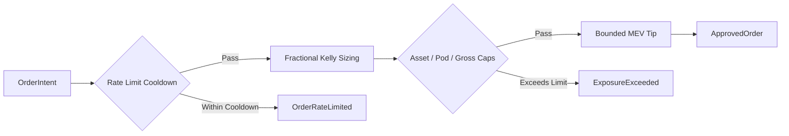

## Review Card (≤ 5 min)

| Field | Value |
|---|---|
| Outcome | Enforce asset, pod, and gross exposure caps, rate-limiting, and MEV tip bounds in HardRiskGate. |
| Why now | Complete closure of Issue #4; un-enforced exposure caps and unbounded rate/MEV risks compromise safety. |
| Blast radius | `robotrader-risk-gate`, `robotrader-common`, `robotrader-backtest`, `backend/core/schemas.py`. |
| Risk | Medium — over-constraining exposure could reject valid trades; under-constraining risks liquidation. |
| Effort | M (Lane L lifecycle due to risk-critical math and contract modifications). |
| Decision needed | None — deterministic enforcement of documented ADR-0001 invariants. |

## Why

Issue #4 identified that `HardRiskGate::validate` only enforced 2 of 6 documented risk protections, leaving asset concentration, pod concentration, gross exposure, order rate limiting, and MEV priority tips unconstrained. While changes #15 and #26 established the execution-cost hurdle and hot-path benchmark, the remaining aggregate exposure caps and order throttle are essential to prevent catastrophic drawdowns and order bursts.

## What Changes

- Add asset exposure cap (`max_asset_exposure_pct = 0.15`), pod exposure cap (`max_pod_exposure_pct = 0.40`), and gross portfolio exposure cap (`max_gross_exposure_pct = 1.50`) to `RiskLimits`.
- Decouple the single-position hard cap notional from leverage clamping, removing the bug where high leverage tripled the permitted equity concentration.
- Extend `PortfolioState` in Rust and Python with `asset_exposures_usd`, `pod_exposures_usd`, `gross_exposure_usd`, and `last_order_ts_ms` using backward-compatible defaults.
- Implement deterministic per-`(pod_id, symbol)` order rate-limiting cooldown (`min_order_cooldown_ms`) rejecting rapid duplicate orders with `RiskRejection::OrderRateLimited`.
- Bound `mev_priority_tip_bps` by `max_mev_tip_bps` and effective slippage ceilings, eliminating the incentive inversion where exaggerated alpha purchased uncapped priority fees.
- Add specific `RiskRejection` variants: `AssetExposureExceeded`, `PodExposureExceeded`, `GrossExposureExceeded`, and `OrderRateLimited`.
- Maintain zero-allocation hot-path execution within the 50 µs budget for `HardRiskGate::validate`.

## Capabilities

### New Capabilities
- `risk-exposure-caps`: Enforces asset, pod, and gross exposure ceilings, single-position cap leverage decoupling, per-pod/symbol rate limiting, bounded MEV tips, and PortfolioState schema extensions.

### Modified Capabilities
- `risk-hurdle`: Updates gate pipeline precedence to evaluate rate limiting before economic gates and exposure caps after sizing.

## Non-goals

- Live exchange socket connection or order cancel/flatten on kill-switch (deferred pending future live venue integration ADR).
- Full tick-by-tick order book matching simulator (tracked independently in Issue #3).
- Dynamic warm-path adjustment of hard risk gate limits by LLM agents.
- Modifications to the Criterion benchmark methodology or measured 0.244 µs baseline.

## Impact

- Rust crates: `engine-rs/crates/risk-gate`, `engine-rs/crates/common`, `engine-rs/crates/backtest`.
- Python backend: `backend/core/schemas.py` (`PortfolioState` dataclass definition and serialization).
- Interfaces: `PortfolioState` contract, `RiskLimits` configuration, and `RiskRejection` error enum.
- Security & Risk: Prevents runaway order spam and over-concentration across single assets, pods, and aggregate portfolio gross leverage.
