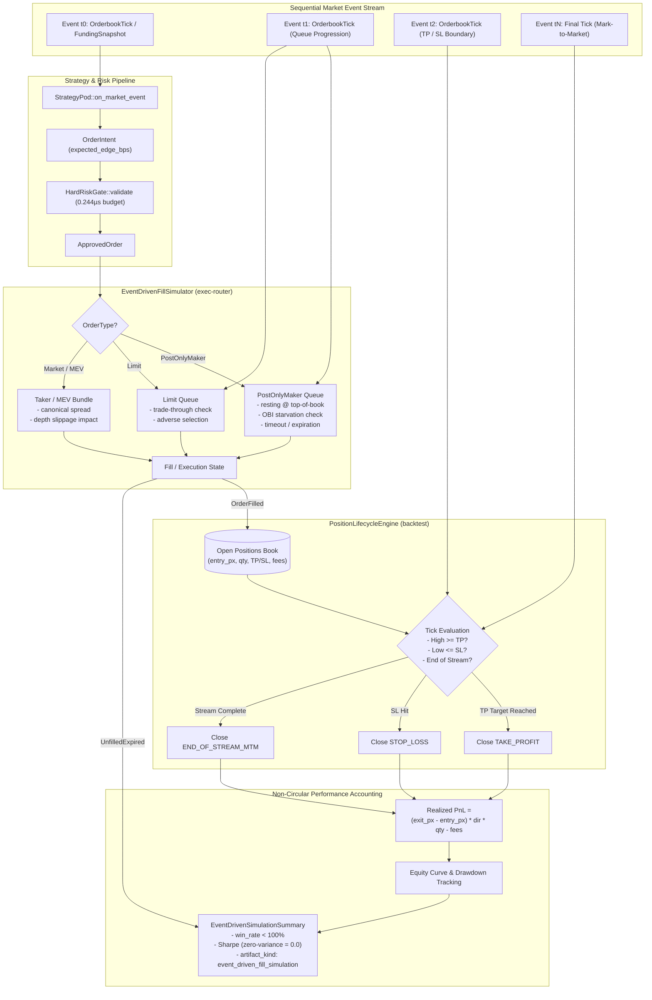

# Design: Event-Driven Fill Simulator and Position Lifecycle Engine

## Context

Issue #3 revealed that the legacy backtest engine in `engine-rs` derived realized PnL directly from the strategy's own `expected_edge_bps` via `SmartExecutionRouter::execute`. This circular arithmetic paid the strategy whatever edge it declared, making adverse price movements, queue starvation, slippage, and real market losses impossible. The initial slice addressed artifact transparency by relabeling that mechanism as `policy_sanity_check` with `source: FIXTURE` and `fill_simulation: false`.

Closing Issue #3 requires implementing a true **event-driven fill simulator** and **multi-tick position lifecycle engine**. This engine must process discrete market events over time, simulate realistic order book queues and execution mechanics per order type, track open positions across sequential ticks, exit at take-profit or stop-loss boundaries, mark residual positions to market, and derive PnL solely from market price action.

### Constraints and Invariants

1. **Zero Hot-Path LLM and Latency Budgets**: Pre-trade risk validation via `HardRiskGate::validate` remains synchronous, allocation-free, and within its measured budget (mean 0.244 µs, under the 50 µs ceiling). The fill simulator operates downstream during simulation replay and does not alter the hot-path gate.
2. **Byte-for-Byte Contract Invariance**: `PolicyEnvelope` schema in `engine-rs/crates/common/src/lib.rs` and `backend/core/schemas.py` remains unchanged.
3. **Deterministic Fixture Preservation**: The legacy `policy_sanity_check` fixture baselines (`SmartExecutionRouter::execute`, `run_deterministic_6_month_benchmark`, `run_leaf_ecosystem_benchmark`) must remain 100% byte-identical to preserve regression baselines.
4. **Non-Circularity**: `realized_pnl_usd` must never read or multiply `OrderIntent::expected_edge_bps`.
5. **No Look-Ahead**: Order fills and exits must only reference current and subsequent tick data, never future ticks.

## Goals / Non-Goals

### Goals

- Deliver `EventDrivenFillSimulator` in `robotrader-exec-router` supporting order-type-specific execution models:
  - `PostOnlyMaker`: Top-of-book resting queue, OBI-based queue starvation, expiration on adverse price divergence.
  - `Limit`: Adverse selection on market trade-through.
  - `Market` and `MevBundleAtomic`: Immediate fill with canonical spread and liquidity-scaled depth slippage.
- Deliver `PositionLifecycleEngine` in `robotrader-backtest` tracking open positions, stop-loss boundaries, take-profit targets, and end-of-stream mark-to-market.
- Guarantee strict non-circular PnL calculation: $(P_{\text{exit}} - P_{\text{entry}}) \times \text{direction} \times \text{quantity} - \text{fees} - \text{funding}$.
- Synthesize realistic multi-tick price streams exhibiting market volatility, producing both winning and losing trades ($0\% < \text{win\_rate\_pct} < 100\%$).
- Implement unbiased Sharpe ratio computation evaluating to `0.0` on zero variance without magic constants.
- Expose the simulator through `robotrader-node --simulate-fills [--leaf-id <id>]` producing structured JSON with `artifact_kind: "event_driven_fill_simulation"`.

### Non-Goals

- Modifying live exchange adapters, network sockets, or live trading execution paths.
- Altering the legacy declared-edge `policy_sanity_check` baseline tests or expected numeric outputs.
- Ingesting multi-gigabyte external historical tick databases (future milestone).
- Altering the `HardRiskGate` validation logic, Kelly sizing equations, or Redis IPC schemas.

## Architecture and Data Flow

The following diagram illustrates the event-driven simulation lifecycle from order generation to position resolution and performance accounting:



## Decisions

| Decision | Alternatives considered | Rationale | Rejected because |
|---|---|---|---|
| **Crate partitioning**: Core fill & queue logic in `robotrader-exec-router`; position lifecycle and simulation orchestrator in `robotrader-backtest`. | 1. Monolithic placement entirely in `backtest`.<br>2. Brand new crate `robotrader-fill-sim`. | `exec-router` already encapsulates fee schedules, spread tables, and venue characteristics. Placing `EventDrivenFillSimulator` there preserves single responsibility for execution mechanics, while `backtest` coordinates portfolio lifecycle over time. | 1. Duplicates fee/spread models in `backtest`.<br>2. New crate adds build overhead and workspace churn without distinct abstraction boundaries. |
| **Deterministic L2 queue fill model**: Top-of-book resting orders fill when subsequent ticks trade at or through resting price, subject to OBI starvation. | 1. Full L3 event replay with simulated queue position.<br>2. Constant fill probability (Monte Carlo). | Deterministic matching against top-of-book prices and volume imbalance provides reproducible, realistic fill friction without requiring microsecond-level order cancellations. | 1. L3 data is not present in our market event contracts.<br>2. Monte Carlo violates the platform invariant of exact determinism (`Backtest == Paper == Live`). |
| **Maker queue starvation condition**: Maker buy orders starve when Order Book Imbalance $\text{OBI} < -0.70$ (severe sell pressure exhausts resting queue) or when price diverges away by $> 50$ bps within 3 ticks. | 1. Instant fill at quote.<br>2. Fixed time delay fill. | Accurately models maker adverse selection: orders fill when market sweeps into them, but fail to fill when the price runs away. | 1. Instant fill ignores queue position.<br>2. Fixed time ignores order book dynamics. |
| **Multi-tick position tracking**: Explicit `Position` entity surviving across ticks until TP, SL, or end-of-stream MTM. | 1. Single-tick fill-and-close (legacy style).<br>2. Fixed N-tick holding period only. | Real trading positions remain open until target exit criteria are met. Tracking multi-tick exposure allows measuring true mark-to-market drawdown. | 1. Single-tick close cannot simulate genuine market price paths.<br>2. Fixed holding period ignores strategy stop-loss and take-profit parameters. |
| **Sharpe ratio zero-variance handling**: If standard deviation of period returns $\sigma \le 10^{-9}$, return `0.0`. | 1. Return magic sentinel `10.0` (legacy behavior).<br>2. Return `NaN` or `None`. | Zero variance indicates no risk-adjusted excess return over zero; `0.0` is mathematically neutral and prevents distortion. | 1. `10.0` is an arbitrary heuristic that hides lack of variance.<br>2. `NaN` fails JSON serialization and breaks downstream consumers. |
| **Side-by-side CLI coexistence**: Expose simulation via `--simulate-fills`, keeping default invocation on `policy_sanity_check`. | 1. Replace default `--leaf-id` behavior with fill simulator.<br>2. Create a separate binary `robotrader-sim`. | Preserves backward compatibility and ensures existing test suites and automation scripts relying on sanity check outputs continue passing without interruption. | 1. Breaking change for existing CI/CD and audit tooling.<br>2. Multiple binaries create maintenance duplication in packaging and Helm charts. |

## Detailed Models and Mathematical Formulations

### 1. Order Execution and Fill Models

For each `ApprovedOrder`, the `EventDrivenFillSimulator` handles execution based on its `OrderType`:

#### A. Post-Only Maker (`OrderType::PostOnlyMaker`)
- **Resting Placement**: Placed at resting price $P_{\text{rest}} = \text{bid}$ for Buy, $\text{ask}$ for Sell.
- **Queue Starvation Check**: Evaluated against subsequent ticks. A Buy maker order fills on subsequent tick $t$ if:
  $$P_{\text{tick\_low}} \le P_{\text{rest}} \quad \text{AND} \quad \text{OBI}_t \ge -0.70$$
  where $\text{OBI} = \frac{V_{\text{bid}} - V_{\text{ask}}}{V_{\text{bid}} + V_{\text{ask}}}$.
- **Adverse Divergence / Expiration**: If $P_{\text{tick\_mid}} > P_{\text{rest}} \times (1 + \text{divergence\_threshold})$ for $\text{max\_resting\_ticks}$ (default: 3 ticks) without filling, the order transitions to `UNFILLED_EXPIRED`. No position is opened; zero fees are charged.

#### B. Limit Orders (`OrderType::Limit`)
- **Execution Condition**: Fills when a subsequent tick trades through the limit price:
  $$P_{\text{tick\_low}} < P_{\text{limit}} \quad (\text{Buy}), \qquad P_{\text{tick\_high}} > P_{\text{limit}} \quad (\text{Sell})$$
- **Adverse Selection Adjustment**: Fill price reflects execution slippage into the book:
  $$P_{\text{fill}} = P_{\text{limit}} \times (1 \pm \text{adverse\_selection\_bps} / 10\,000)$$
  where $\text{adverse\_selection\_bps} = \text{spread\_bps\_for}(\text{Limit}, \text{tip})$.

#### C. Immediate Taker & MEV Atomic Bundles (`OrderType::Market`, `OrderType::MevBundleAtomic`)
- **Execution Condition**: Executes on entry tick or next tick.
- **Fill Price**:
  $$P_{\text{fill}} = P_{\text{ref}} \times \left(1 \pm \frac{\text{Spread}_{\text{bps}} + \text{Impact}_{\text{bps}}}{10\,000}\right)$$
  where $\text{Spread}_{\text{bps}} = \text{spread\_bps\_for}(\text{order\_type}, \text{mev\_priority\_tip\_bps})$, and liquidity impact is:
  $$\text{Impact}_{\text{bps}} = \min\left(\text{max\_slippage\_bps}, \; 5.0 \times \frac{\text{notional\_usd}}{\text{available\_liquidity\_usd}}\right)$$

### 2. Multi-Tick Position Lifecycle

An open position $Pos$ is tracked with:
$$\{ \text{symbol}, \; \text{side}, \; Q, \; P_{\text{entry}}, \; \text{Fee}_{\text{entry}}, \; \text{take\_profit\_bps}, \; \text{stop\_loss\_bps}, \; t_{\text{entry}} \}$$

On each subsequent market tick $t$:
1. **Take-Profit Trigger**:
   - Long: $P_{\text{tick\_high}} \ge P_{\text{entry}} \times \left(1 + \frac{\text{take\_profit\_bps}}{10\,000}\right) \implies \text{Exit at } P_{\text{TP}}, \text{ reason: TAKE\_PROFIT}$
   - Short: $P_{\text{tick\_low}} \le P_{\text{entry}} \times \left(1 - \frac{\text{take\_profit\_bps}}{10\,000}\right) \implies \text{Exit at } P_{\text{TP}}, \text{ reason: TAKE\_PROFIT}$
2. **Stop-Loss Trigger**:
   - Long: $P_{\text{tick\_low}} \le P_{\text{entry}} \times \left(1 - \frac{\text{stop\_loss\_bps}}{10\,000}\right) \implies \text{Exit at } P_{\text{SL}}, \text{ reason: STOP\_LOSS}$
   - Short: $P_{\text{tick\_high}} \ge P_{\text{entry}} \times \left(1 + \frac{\text{stop\_loss\_bps}}{10\,000}\right) \implies \text{Exit at } P_{\text{SL}}, \text{ reason: STOP\_LOSS}$
3. **End-of-Stream Settlement**:
   - If stream ends while position is active, exit at final tick mid-price $P_{\text{final}}$, reason: `END_OF_STREAM_MTM`.

### 3. PnL and Accounting Formulas

- **Direction Multiplier**: $D = +1$ for `Side::Buy` (Long), $-1$ for `Side::Sell` (Short).
- **Gross PnL**:
  $$\text{PnL}_{\text{gross}} = (P_{\text{exit}} - P_{\text{entry}}) \times D \times Q$$
- **Net Realized PnL**:
  $$\text{PnL}_{\text{net}} = \text{PnL}_{\text{gross}} - \text{Fee}_{\text{entry}} - \text{Fee}_{\text{exit}} - \text{FundingSettlement}$$
- **Fee Calculation**:
  $$\text{Fee} = \text{Notional} \times \frac{\text{fee\_bps\_for}(\text{venue}, \text{order\_type})}{10\,000}$$
- **Non-Circularity Guarantee**: Note that `expected_edge_bps` does not enter this formula at any point. If `expected_edge_bps` is changed from 15 bps to 85 bps, $\text{PnL}_{\text{net}}$ is strictly unchanged.

### 4. Statistical Metrics

- **Period Return**: For each closed trade $i$ with entry equity $E_{i-1}$:
  $$R_i = \frac{\text{PnL}_{\text{net}, i}}{E_{i-1}}$$
- **Sharpe Ratio**:
  $$\bar{R} = \frac{1}{N}\sum_{i=1}^N R_i, \qquad \sigma = \sqrt{\frac{1}{N-1}\sum_{i=1}^N (R_i - \bar{R})^2}$$
  $$\text{Sharpe} = \begin{cases} 0.0 & \text{if } \sigma \le 10^{-9} \text{ or } N < 2 \\ \frac{\bar{R}}{\sigma} \times \sqrt{365} & \text{otherwise} \end{cases}$$
- **Drawdown Calculation**:
  $$\text{HWM}_t = \max_{0 \le s \le t} E_s, \qquad \text{Drawdown}_t = \frac{\text{HWM}_t - E_t}{\text{HWM}_t} \times 100\%$$
  $$\text{MaxDrawdown} = \max_{t} \text{Drawdown}_t$$

## Output Artifact Schema

When running with `--simulate-fills`, `robotrader-node` emits JSON adhering to:

```json
{
  "leaf_id": "leaf-solana",
  "artifact_kind": "event_driven_fill_simulation",
  "source": "SIMULATED",
  "fill_simulation": true,
  "pnl_circularity": "NONE_PRICE_PATH_DERIVED",
  "initial_equity_usd": 10000.0,
  "final_equity_usd": 9982.45,
  "net_profit_usd": -17.55,
  "total_return_pct": -0.1755,
  "max_drawdown_pct": 0.42,
  "sharpe_ratio": -1.24,
  "win_rate_pct": 50.0,
  "total_orders": 4,
  "filled_orders": 3,
  "unfilled_expired_orders": 1,
  "rejected_orders": 1,
  "winning_trades": 1,
  "losing_trades": 2,
  "total_fees_usd": 3.85,
  "trade_executions": [
    {
      "trade_id": "sim-trade-1",
      "pod_id": "pod_momentum",
      "symbol": "SOL-USDT",
      "side": "BUY",
      "entry_price": 150.0,
      "exit_price": 148.2,
      "quantity": 10.0,
      "entry_fee_usd": 0.54,
      "exit_fee_usd": 0.53,
      "realized_pnl_usd": -19.07,
      "close_reason": "STOP_LOSS",
      "holding_duration_ticks": 2
    }
  ]
}
```

## Risks / Trade-offs

- **Risk: Discrepancy between legacy sanity checks and simulation results causes user confusion.**
  -> **Mitigation**: Disambiguate completely via machine-readable fields: legacy outputs have `artifact_kind: "policy_sanity_check"` and `fill_simulation: false`, while simulation outputs have `artifact_kind: "event_driven_fill_simulation"`, `source: "SIMULATED"`, and `fill_simulation: true`.
- **Risk: Non-deterministic execution due to floating-point differences across architectures.**
  -> **Mitigation**: Strictly use canonical IEEE 754 operations without fast-math flags, enforce explicit rounding to cent precision where appropriate, and write multi-platform determinism tests.
- **Risk: Memory growth during multi-tick position tracking across long event streams.**
  -> **Mitigation**: Store active positions in bounded fixed-capacity vectors (`Vec<OpenPosition>`), pruning closed positions to summary statistics and streaming trade records.
- **Risk: Edge cases in market feeds (e.g. zero liquidity, crossed books, flash crashes) crashing the simulator.**
  -> **Mitigation**: Implement defensive guards in `EventDrivenFillSimulator`: validate prices $> 0$, clamp liquidity impact, and fallback to `UNFILLED_EXPIRED` on corrupt ticks.
- **Worst-Case Failure: A bug in position tracking creates runaway phantom leverage or unclosed positions, reporting corrupted equity.**
  -> **Mitigation**: Enforce the global accounting invariant $\text{Equity}_{\text{final}} = \text{Equity}_{\text{initial}} + \sum \text{PnL}_{\text{net}}$ and assert all open positions are marked to market and closed at the final tick.

## Migration Plan

### Deployment Order

1. **Phase 1: `robotrader-exec-router` extension**
   - Implement `EventDrivenFillSimulator`, `SimulatedFill`, `FillStatus`, and queue matching models in `exec-router`.
   - Add unit tests for maker starvation, limit adverse selection, and taker liquidity impact.
2. **Phase 2: `robotrader-backtest` position engine**
   - Implement `PositionLifecycleEngine`, `OpenPosition`, `ClosedPosition`, and non-circular PnL calculation.
   - Build multi-tick market streams for leaves generating both wins and losses.
   - Add unit tests verifying non-circularity (varying `expected_edge_bps` yields identical cent-for-cent PnL).
3. **Phase 3: `robotrader-node` CLI exposure**
   - Add `--simulate-fills` command-line argument handling.
   - Format and output `EventDrivenSimulationSummary` JSON.
4. **Phase 4: Full verification and regression checking**
   - Run `cargo test --all` to ensure all existing policy sanity check tests continue to pass.
   - Run benchmark runs for `--simulate-fills` across canonical leaves.

### Rollback Plan

The change is purely additive. If any defect is identified in `EventDrivenFillSimulator`:
1. Reverting the CLI integration in `robotrader-node` immediately disables the simulation pathway.
2. No database migrations, persistent storage schemas, or Redis state keys are affected.
3. The legacy `policy_sanity_check` remains untouched and functional at all times.
4. If necessary, a single git commit revert restores the previous `master` state cleanly.

## Open Questions

<!-- None. -->
