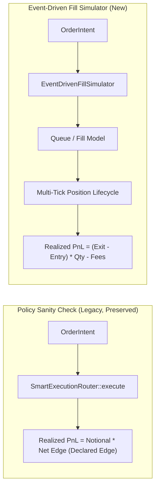

## Review Card (≤ 5 min)

| Field | Value |
|---|---|
| Outcome | Provide a non-circular event-driven fill and position lifecycle simulator where realized PnL derives strictly from market price action. |
| Why now | Completes Issue #3 by replacing synthetic declared-edge arithmetic with genuine market fills, order queues, and realistic trade losses. |
| Blast radius | `engine-rs` (`exec-router`, `backtest`, `node`), node CLI (`--simulate-fills`), and simulation report schemas. |
| Risk | Low. Legacy deterministic sanity check fixtures remain completely untouched and active. |
| Effort | L (Lane L, core simulation engine across hot-path crates and CLI). |
| Decision needed | None. Autonomous implementation of Issue #3 final slice. |

## Why

Issue #3 identified that the backtest engine derived PnL from the strategy's own declared `expected_edge_bps`, creating a circular arithmetic artifact rather than a market simulation. While the first slice established honest artifact labelling (`policy_sanity_check`), closing Issue #3 requires a genuine event-driven simulator where orders encounter realistic queue dynamics and exits are evaluated against subsequent market ticks.

## What Changes

- Introduce `EventDrivenFillSimulator` in `robotrader-exec-router` implementing order-type-specific execution models (maker queue starvation, limit adverse selection, taker spread and liquidity impact).
- Implement multi-tick position lifecycle management in `robotrader-backtest` supporting entry fills, holding intervals, take-profit triggers, stop-loss triggers, and end-of-stream mark-to-market settlement.
- Establish the non-circularity invariant: `realized_pnl_usd` is computed strictly from `(exit_price - entry_price) * direction * quantity - fees - funding` and is completely independent of `intent.expected_edge_bps`.
- Support non-trivial simulation price streams that exhibit both winning and losing trades, and compute per-period equity Sharpe ratios with zero-variance safeguards.
- Expose the `--simulate-fills` command-line flag on `robotrader-node`, outputting `EventDrivenSimulationSummary` with `artifact_kind: "event_driven_fill_simulation"` and `fill_simulation: true`.
- Preserve the legacy `SmartExecutionRouter::execute`, `run_deterministic_6_month_benchmark`, and `run_leaf_ecosystem_benchmark` intact (`artifact_kind: "policy_sanity_check"`).

## Capabilities

### New Capabilities
- `event-driven-fill-simulation`: Introduces an event-driven market fill simulator, realistic order queues, position lifecycle evaluation, price-path-derived PnL, losing trade distribution, and CLI execution.

### Modified Capabilities

## Non-goals

- Replacing live exchange connectivity, live execution routing, or live key handling.
- Modifying the existing `policy_sanity_check` fixture baselines or altering tests asserting them.
- Changing `HardRiskGate::validate` contracts, latency budgets (measured 0.244 µs), or synchronous execution.
- Modifying `PolicyEnvelope` schemas or Redis IPC payload formats.
- Integrating external time-series databases or multi-gigabyte L2 historical datasets.

## Impact

- `engine-rs/crates/exec-router`: Adds `EventDrivenFillSimulator`, fill status enumerations, and execution models.
- `engine-rs/crates/backtest`: Adds multi-tick position tracking, event-driven runner, and simulation summary structures.
- `engine-rs/crates/node`: Adds `--simulate-fills` CLI handler compatible with `--leaf-id`.
- APIs & Systems: Purely additive; existing sanity check endpoints and test suites remain untouched.
