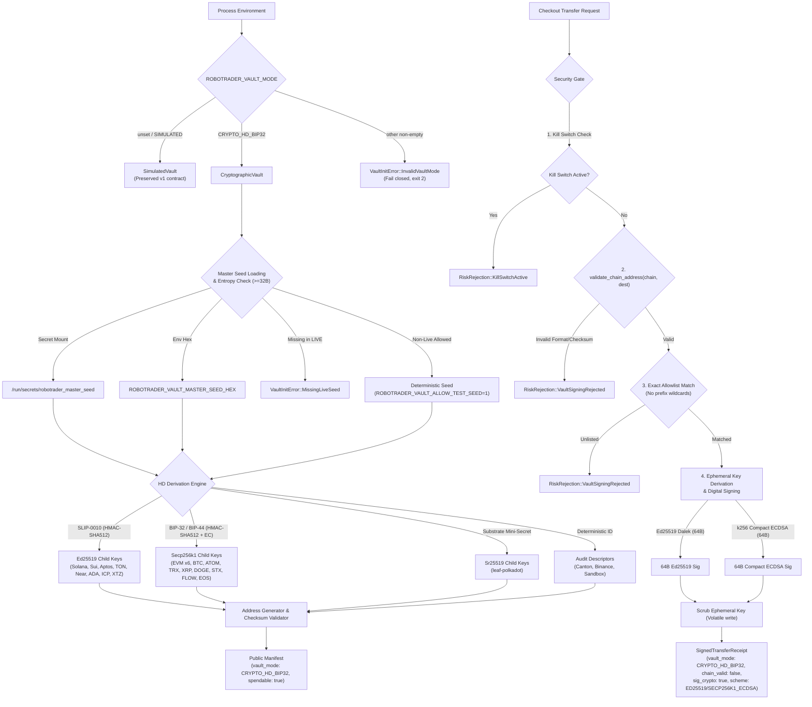
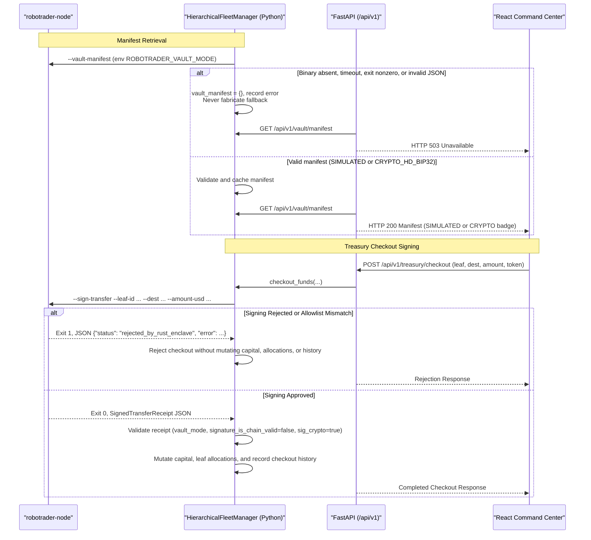

# Design — real-bip32-vault-cryptography

> Why: [`proposal.md`](proposal.md). What: [`specs/bip32-cryptographic-vault/spec.md`](specs/bip32-cryptographic-vault/spec.md) and [`specs/vault-simulation/spec.md`](specs/vault-simulation/spec.md). This document decides **how**; it does not restate the requirements.

## Context

Audit issue #2 and ADR-0005 established that Robotrader v3 previously used non-cryptographic single-round HMAC pseudo-derivation over ASCII strings, synthetic character-mapped addresses, and 32-byte HMAC audit tokens. While change #12 truthfully marked the existing implementation as `SimulatedVault` to prevent false security claims, real capital deployment requires authentic cryptographic derivation, spendable address formatting, strict destination allowlisting, and verifiable digital signatures.

This change delivers genuine cryptographic derivation alongside the existing simulation:
- **Dual-mode runtime**: `ROBOTRADER_VAULT_MODE` defaults to `SIMULATED`, preserving `SimulatedVault` with 100% backward compatibility for tests and paper trading. When set to `CRYPTO_HD_BIP32`, `CryptographicVault` is activated.
- **26-leaf fleet coverage**: 23 cryptographic blockchain leaves (8 Ed25519, 14 Secp256k1, 1 Substrate Sr25519) plus 3 explicit non-BIP32 leaves (Canton mTLS, Binance CEX HMAC, and Paper Sandbox) whose descriptors set `address_is_spendable: false`.
- **Honest receipt contracts**: checkout receipts authorize internal treasury allocations rather than broadcastable mempool transactions. Receipts explicitly declare `signature_is_chain_valid: false`, `signature_is_cryptographic: true`, and `signature_scheme` (`ED25519` or `SECP256K1_ECDSA`).
- **Strict destination allowlisting**: eliminates broad single-character prefix matching (`0x`, `bc1q`, `T`, `r`, `D`), requiring both chain-specific address/checksum validity and exact matching against operator-configured allowlists.
- **Zero Python key custody**: private keys exist exclusively inside Rust ephemeral memory buffers scrubbed with volatile writes upon drop. Python never holds key material and never broadcasts transactions.

### Runtime Architecture and Derivation Flow

### Python Boundary and Control Plane Interaction

## Goals / Non-Goals

**Goals:**
- Provide `CryptographicVault` implementing standards-compliant BIP-32 and SLIP-0010 HD key derivation from a master seed.
- Support SLIP-0010 Ed25519 key derivation for 8 leaves (`leaf-solana`, `leaf-sui`, `leaf-aptos`, `leaf-ton`, `leaf-near`, `leaf-cardano` via CIP-1852, `leaf-icp`, `leaf-tezos`).
- Support BIP-32/BIP-44 Secp256k1 key derivation with curve order scalar addition for 14 leaves (6 EVM leaves: `ethereum`, `hyperliquid`, `bnb`, `avalanche`, `chainlink`, `celo`; plus 8 non-EVM: `bitcoin`, `cosmos`, `tron`, `xrp`, `dogecoin`, `stacks`, `flow`, `eos`).
- Support Substrate mini-secret derivation for `leaf-polkadot` (`SR25519_SUBSTRATE`) and deterministic audit descriptors for the 3 non-BIP32 leaves (`canton`, `binance-cex`, `paper-sandbox`).
- Format spendable public addresses across all 23 cryptographic leaves matching canonical encoding and checksum standards (EIP-55, Base58Check, Bech32, SS58, etc.).
- Provide `validate_chain_address(chain, address)` enforcing structural and checksum validation before any key derivation or signing occurs.
- Enforce strict destination allowlisting (`whitelist_enforcement: "STRICT_FORMAT_AND_ALLOWLIST"`), eliminating broad single-character prefix bypasses and requiring exact matching against operator allowlists.
- Implement genuine digital checkout signing (64-byte Ed25519 signatures and 64-byte compact Secp256k1 ECDSA signatures) and provide public signature verification `verify_checkout_signature`.
- Maintain honest receipt contracts: `signature_is_chain_valid: false`, `signature_is_cryptographic: true`, and accurate `signature_scheme`.
- Guarantee ephemeral child private key zeroization in RAM immediately after signing via volatile writes and compiler fences.
- Maintain dual-mode runtime via `ROBOTRADER_VAULT_MODE` (`SIMULATED` default vs `CRYPTO_HD_BIP32`), preserving 100% of existing simulation tests.
- Synchronize Python schemas and manifest/receipt validation in `backend/core/hierarchy.py` and `backend/core/schemas.py`.

**Non-Goals:**
- Python key custody or transaction broadcast: Python remains zero-custody and never holds private keys.
- Direct mempool broadcasting to public blockchains: transaction serialization and broadcasting belong to downstream node execution tooling, not the vault signing boundary.
- Hardware Enclave / HSM integration (e.g. AWS Nitro Enclaves, Ledger USB): software HD enclave in pure Rust.
- Deprecating `SimulatedVault`: simulated mode remains default and fully supported.

## Decisions

| # | Decision | Alternatives considered | Rationale | Rejected because |
|---|---|---|---|---|
| D1 | Implement `CryptographicVault` alongside `SimulatedVault`, controlled by `ROBOTRADER_VAULT_MODE` (`SIMULATED` default, `CRYPTO_HD_BIP32`). Unset defaults to `SIMULATED`; unknown values fail closed. | Replace `SimulatedVault` completely; compile-time feature flags; runtime trait objects. | Dual-mode allows seamless local development, backtesting, and paper execution without requiring production seeds or allowlists, while making cryptographic mode opt-in and fail-closed. | Complete replacement breaks non-live determinism and existing test fixtures; feature flags require separate binaries; trait objects introduce dynamic dispatch in risk-gate initialization without benefit. |
| D2 | Pure-Rust cryptographic crate stack in `engine-rs/crates/risk-gate`: `k256` (Secp256k1 ECDSA/BIP-32), `ed25519-dalek` (Ed25519/SLIP-0010), `sha2`, `hmac`, `ripemd`, `sha3`, `blake2`, `bs58`, `bech32`. | Bindings to C libraries (`libsecp256k1`, `libsodium`); monolithic `bip32` crate; custom hand-rolled curve math. | Pure-Rust crates from RustCrypto and dalek-cryptography are audited, memory-safe, portable across Darwin/Linux, have zero external C toolchain dependencies, and support `#![no_std]` / zero-allocation operations. | C bindings break cross-compilation and container hermeticity; monolithic bip32 crates lack SLIP-0010 or specific curve support; hand-rolled curve math is unsafe. |
| D3 | SLIP-0010 HMAC-SHA512 for Ed25519 child derivation using hardened paths (`m/44'/501'/0'/0'`), and BIP-32/BIP-44 HMAC-SHA512 with Secp256k1 scalar addition modulo curve order `n` for Secp256k1. | Single HMAC-SHA256 over ASCII path (status quo); unhardened Ed25519 derivation. | Adheres strictly to the official SLIP-0010 and BIP-32 standards, enabling key interoperability with standard hardware wallets and ecosystem tooling. | Status quo HMAC-SHA256 is mathematically non-BIP32; unhardened Ed25519 derivation is cryptographically insecure and unsupported by SLIP-0010. |
| D4 | Substrate mini-secret derivation for `leaf-polkadot` (`SR25519_SUBSTRATE`), and explicit non-BIP32 descriptors for `leaf-canton` (`MTLS_X509_PARTICIPANT`), `leaf-binance-cex` (`HMAC_SHA256_NO_WITHDRAW`), and `leaf-paper-sandbox` (`VIRTUAL_ZERO_KEY`) with `address_is_spendable: false`. | Derive synthetic BIP-32 keys for Canton and Binance; omit non-BIP32 leaves from manifest. | Canton and Binance CEX do not use on-chain private signing keys for trade execution; explicitly handling them preserves fleet completeness while truthfully denying spendability. | Deriving synthetic private keys for an institutional mTLS ledger or CEX API key creates misleading descriptors; omitting leaves breaks 26-leaf fleet invariants. |
| D5 | Spendable address generation formatted with canonical checksums across all 23 cryptographic leaves: EIP-55 mixed-case checksum for EVM, Base58 for Solana, native SegWit Bech32 (`bc1q`) for Bitcoin, Base58Check with double-SHA256 for TRON/Dogecoin/XRP/Tezos, Bech32 for Cosmos/Cardano, Blake2b for Sui, SHA3-256 for Aptos, and SS58 for Polkadot. | Hex-only addresses for all chains; skip checksums; rely on external RPC to format addresses. | Real capital operations require valid, spendable destination addresses that pass node RPC acceptance and block explorers; checksums protect against typographical errors. | Hex-only addresses are invalid on Bitcoin, Solana, and Cosmos; skipping checksums risks irreversible loss of funds; external RPC creates hot-path network dependencies. |
| D6 | Public validation function `validate_chain_address(chain: &str, address: &str) -> Result<(), AddressValidationError>` called before any signing operation. | Validate only in Python; validate destination only via allowlist; validate after key derivation. | Validating syntax and checksums inside Rust before key derivation ensures that malformed destinations fail closed immediately without exposing or loading private key material. | Python validation can be bypassed or desynchronized; allowlist alone does not verify chain syntax correctness; validating after derivation wastes cycles and touches key material unnecessarily. |
| D7 | Destination allowlist enforcement (`whitelist_enforcement: "STRICT_FORMAT_AND_ALLOWLIST"`): requires exact string match against operator allowlist (`ROBOTRADER_VAULT_ALLOWED_DESTINATIONS`, secret file, derived vault addresses, or bridge URIs). Broad single-character prefixes (`0x`, `bc1q`, `T`, `r`, `D`) are explicitly disallowed as wildcards. | Keep broad prefix matching; regex pattern matching; dynamic on-chain address lookup. | Closes Issue #2 finding #3 by preventing arbitrary external addresses from passing the whitelist check. Derived vault addresses are automatically allowed for internal cross-leaf rebalancing. | Broad prefix matching is effectively open; regex patterns invite catastrophic backtracking and injection; on-chain lookups introduce network I/O. |
| D8 | Cryptographic checkout signing: 64-byte Ed25519 signature over SHA-256 payload digest for Ed25519 chains; 64-byte compact Secp256k1 ECDSA signature (`r \|\| s`) for Secp256k1 chains. Public verification function `verify_checkout_signature`. | 32-byte HMAC (status quo); DER-encoded ECDSA signatures; full transaction serialization. | Standard 64-byte signatures provide authentic non-repudiation and cryptographic proof of authorization while maintaining fixed-size receipt payloads; public verification allows independent validation. | 32-byte HMAC is not a digital signature; variable-length DER signatures complicate fixed-size serialization; full transaction serialization is venue-specific and belongs to downstream execution. |
| D9 | Signed transfer receipts declare `signature_is_chain_valid: false`, `signature_is_cryptographic: true`, `vault_mode: "CRYPTO_HD_BIP32"`, and `signature_scheme` (`ED25519` or `SECP256K1_ECDSA`). | Declare `signature_is_chain_valid: true`; omit validity flags. | Truthful qualification: checkout receipts authorize internal checkout transfers across leaves, not raw transactions broadcastable to blockchain mempools. | Declaring chain validity is a false claim because the receipt signs an internal ASCII payload; omitting flags prevents consumers from distinguishing digital signatures from audit tokens. |
| D10 | Ephemeral child private keys are wrapped in `ZeroizingBytes<32>` and wiped via volatile writes and compiler fences immediately after signature generation. `key_zeroized_after_sign` is verified from the scrubbed buffer. | Rely on Rust standard allocator drop; keep hardcoded `key_zeroized_after_sign: true`. | Guarantees that sensitive private key material does not persist in memory heaps or registers after signing, mitigating cold-boot or memory inspection attacks. | Standard drop may leave memory unscrubbed until reused; hardcoded flag repeats the Issue #2 defect. |
| D11 | Master seed loading precedence: `/run/secrets/robotrader_master_seed`, then `ROBOTRADER_VAULT_MASTER_SEED_HEX`. Insufficient entropy (< 32 bytes) fails closed. LIVE mode without a seed fails closed (`MissingLiveSeed`). Non-live modes reject deterministic test seed unless `ROBOTRADER_VAULT_ALLOW_TEST_SEED=1`. | Allow short passwords as seeds; silent fallback to devnet seed in LIVE; allow test seed without explicit opt-in. | Strict entropy and source enforcement ensures that production systems cannot inadvertently boot with weak or public test seeds. | Short passwords lack cryptographic entropy; silent devnet fallback in LIVE creates severe capital risk; unflagged test seeds lead to accidental devnet deployment. |
| D12 | Synchronize receipt schema in `common/src/lib.rs` and `backend/core/schemas.py`, and update `backend/core/hierarchy.py` validation to accept both `SIMULATED` and `CRYPTO_HD_BIP32` valid receipts without holding keys or mutating on rejection. | Python-only receipt representation; relax validation to accept arbitrary JSON. | Preserves strict cross-language contract parity and ensures that the Python control plane fails closed without mutating state on any rejection or unparsable response. | Python-only models desynchronize from the Rust node; relaxing validation weakens the fail-closed security boundary. |
| D13 | CLI `robotrader-node` dispatches `--vault-manifest` and `--sign-transfer` through the active vault backend selected by `ROBOTRADER_VAULT_MODE`, and adds `--vault-allowlist-file` for hermetic testing. | Separate CLI binaries (`robotrader-sim-node` vs `robotrader-crypto-node`); pass seed on command line. | Single binary preserves packaging simplicity while command-line allowlist flags make test suites hermetic without polluting host environments. | Multiple binaries complicate Docker packaging and deployment; passing seeds on command lines leaks secrets in process tables (`ps`). |

## Risks / Trade-offs

- **Risk: Master seed exposure in process memory** -> *Mitigation*: The master seed is stored in `ZeroizingBytes<64>` and child private keys in `ZeroizingBytes<32>`. Ephemeral keys are derived on demand and zeroized immediately post-sign. Key material is never formatted, serialized, or logged.
- **Risk: Unintended destination drain (worst failure)** -> *Mitigation*: Strict two-tier gate: `validate_chain_address` enforces valid syntax/checksum, and `is_destination_allowed` requires an exact match against operator-configured allowlists. Prefix wildcards (`0x`, `bc1q`, etc.) are explicitly blocked. Any failure rejects checkout before capital mutation.
- **Risk: Address formatting desynchronization with blockchain specifications** -> *Mitigation*: Exhaustive unit and integration tests covering canonical test vectors for each of the 23 cryptographic chains (EIP-55 vector tests, BIP-173 Bech32 test vectors, Base58Check vectors).
- **Risk: Inadvertent breaking of paper/CI workflows** -> *Mitigation*: `ROBOTRADER_VAULT_MODE` defaults to `SIMULATED`. Existing CI and paper trading environments continue to run unchanged without requiring seed configuration.
- **Risk: Downstream consumer mistaking checkout receipt for broadcastable transaction** -> *Mitigation*: Receipts explicitly declare `signature_is_chain_valid: false`, and documentation clearly specifies that receipts are internal checkout authorization tokens.
- **Risk: Performance degradation of risk gate** -> *Mitigation*: Vault derivation and signing occur only on the warm path (manifest queries and treasury checkout). The 50µs hot path (`HardRiskGate::validate` and strategy pods) does not invoke vault cryptography.

## Migration Plan

### Deployment Order
1. **Engine Dependencies & Schemas**: Add cryptographic crates to `engine-rs/crates/risk-gate/Cargo.toml`. Update `SignedTransferReceipt` in `common/src/lib.rs` and `backend/core/schemas.py`.
2. **Core Cryptographic Engine**: Implement BIP-32 and SLIP-0010 derivation, address formatting, and checksum validation in `risk-gate`.
3. **Address Validator & Allowlist Engine**: Implement `validate_chain_address` and exact allowlisting in `risk-gate`.
4. **CryptographicVault & Signer**: Implement `CryptographicVault` and digital signing in `risk-gate`.
5. **Node CLI**: Update `robotrader-node` to dispatch based on `ROBOTRADER_VAULT_MODE`.
6. **Python Control Plane**: Update manifest and receipt validation in `backend/core/hierarchy.py`.
7. **Documentation & UI**: Update vault documentation, ADRs, README, and frontend badge rendering.

### Concrete Rollback Procedure
If any regression occurs in cryptographic derivation or signing:
1. **Immediate runtime rollback**: Set `ROBOTRADER_VAULT_MODE=SIMULATED` (or unset it). The node and backend immediately revert to `SimulatedVault`, restoring previous behavior without code changes.
2. **Process restart**: Run `docker compose restart backend engine-rs` (or `systemctl restart robotrader`).
3. **Full git rollback**: If code rollback is required, revert the commit on `master` (`git revert <sha>`), recompile `cargo build --bin robotrader-node`, and redeploy with `docker compose up --build -d`.
4. **Zero state loss**: The vault is completely stateless; no database schema or persistent Redis keys are altered by switching between `SIMULATED` and `CRYPTO_HD_BIP32`.

## Open Questions

<!-- None. -->
