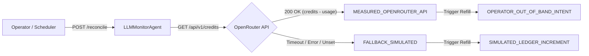

# Proposal: reconcile-openrouter-credits-live

## Review Card (≤ 5 min)

| Field | Value |
|---|---|
| Outcome | Reconcile inference credit balances against live OpenRouter API and record auditable out-of-band settlement receipts on refills. |
| Why now | Completes the final slice of Issue #5 by replacing simulated balance assumptions with live `/api/v1/credits` polling and establishing explicit settlement provenance. |
| Blast radius | `backend/agents/monitor.py` (`LLMMonitorAgent`), `backend/server.py` (`POST /api/v1/openrouter/reconcile`), `openspec/specs/costguard`. |
| Risk | Low. API failures fall back cleanly to internal simulated balance without blocking execution or corrupting accounting state. |
| Effort | S (1 dev round, 1 review round). |
| Decision needed | None. Follows established CostGuard architecture and closes Issue #5. |

## Why

While CostGuard's auto-refill is now profit-gated and validated by Rust HardRiskGate, the reported OpenRouter balance remains an unverified internal simulation. This change implements live credit balance reconciliation via `GET https://openrouter.ai/api/v1/credits` and tags refills with auditable out-of-band settlement metadata to complete Issue #5.

## What Changes

- Modify existing `Requirement: OpenRouter credit status and UI display simulated ledger provenance` to permit transitioning `balance_source` to `"MEASURED_OPENROUTER_API"` on successful live reconciliation, exposing `reconciliation_status` (`"RECONCILED_OK"`, `"SKIPPED_NO_API_KEY"`, `"RECONCILE_FAILED"`, `"UNRECONCILED"`), `last_reconciled_ms`, and `reconciled_balance_usd` in `get_status()`.
- Add `LLMMonitorAgent.reconcile_openrouter_credits(timeout_sec=3.0)` querying the OpenRouter credits API with bearer authentication, updating `openrouter_balance_usd` to `round(max(0.0, total_credits - total_usage), 4)`, and safely handling missing API keys, timeouts, or parse failures without raising unhandled exceptions.
- Add `POST /api/v1/openrouter/reconcile` in `backend/server.py` to allow on-demand credit balance reconciliation by operators and the Master Orchestrator.
- Tag every approved refill event in `LLMMonitorAgent.trigger_openrouter_refill` with `settlement_mode` (`"OPERATOR_OUT_OF_BAND_INTENT"` when measured vs `"SIMULATED_LEDGER_INCREMENT"` when simulated) and a deterministic monotonic `settlement_receipt_id` (`or-refill-<timestamp_ms>-<counter>`).

## Capabilities

### New Capabilities
<!-- None -->

### Modified Capabilities
- `costguard`: Modifies existing `Requirement: OpenRouter credit status and UI display simulated ledger provenance` to support live measured provenance, and adds live credits probe, on-demand REST endpoint, and out-of-band settlement receipt tracking.

## Non-goals

- Direct automated credit purchasing or Coinbase Commerce cryptocurrency payment execution, as OpenRouter requires interactive billing or crypto checkout; settlement remains out-of-band operator intent.
- Modifying Rust `HardRiskGate::validate_inference_refill` or the CLI `--validate-refill` interface, which are already authoritative and tested.
- Frontend UI redesign beyond consuming the existing `balance_source` badge and new reconciliation status fields.
- Background polling daemon for credit reconciliation; reconciliation is performed on demand or during explicit scheduler cycles to avoid excessive external network calls.

## Impact

- Affected code: `backend/agents/monitor.py` (`LLMMonitorAgent`), `backend/server.py` (`/api/v1/openrouter/reconcile`).
- API contracts: Additive `POST /api/v1/openrouter/reconcile` endpoint; additive `settlement_mode` and `settlement_receipt_id` fields in refill history events; additive `last_reconciled_ms`, `reconciled_balance_usd`, and `reconciliation_status` in status payload.
- Dependencies: Standard library `urllib.request` / `urllib.error` (no new external dependencies).
- Real tests: `backend/tests/test_costguard_gate.py`, `backend/tests/test_costguard_refill_gate.py`, `backend/tests/test_hierarchy_v3.py`.
- Invariants: Zero hot-path impact, zero key exposure, non-spendable vault preserved, capital protection and daily LLM caps preserved.
