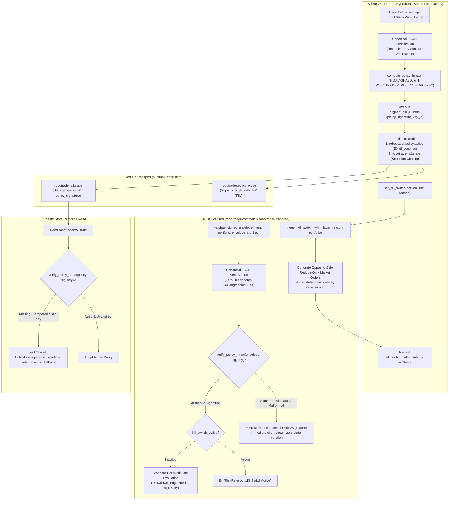

# Design Document: Detached Canonical HMAC-SHA256 Policy Signing, Redis EX TTL Publishing & Actionable Flatten Kill-Switch

## Context

During the architecture audit in Issue #8 and following the establishment of the policy contract in [ADR-0001](docs/adr/0001-hybrid-quant-agentic-architecture.md), critical security gaps were identified in the control plane and risk gate interaction:
1. **Unsigned Policy Ingestion**: `PolicyEnvelope` instances published to Redis lacked cryptographic signatures and authentication. Any process with network access to Redis port 6379 could mutate or forge a policy payload (e.g., enabling `pod_sniper` with 100% capital weight or disabling leverage ceilings), leaving the execution engine vulnerable to unauthorized policy tampering.
2. **Missing Active Policy Key with Redis EX Expiration**: While ADR-0001 §4.2 and platform documentation cited `robotrader:policy:active` with a 15-minute per-key Redis `EX` expiration, the implementation only persisted an unauthenticated monolithic JSON state snapshot at `robotrader:v2:state` without native key expiration.
3. **Non-Actionable Kill-Switch**: Activating the kill-switch via `HybridStateStore.set_kill_switch` only flipped an in-memory boolean flag and zeroed policy allocations in Python. It did not propagate to the Rust `HardRiskGate` during trade validation, nor did it generate actionable market flatten orders across active portfolio exposures, leaving open risk in live or paper markets.
4. **Documentation Discrepancy**: ADR-0001 §4.2 and `README.md` grouped per-key `EX` expiration under future roadmap items alongside Redis Streams and Pub/Sub, contradicting the requirement for immediate fail-safe policy expiration.

See `openspec/changes/sign-policy-and-flatten-killswitch/proposal.md` for context and `openspec/changes/sign-policy-and-flatten-killswitch/specs/control-plane-security/spec.md` for normative requirements.

## Goals / Non-Goals

### Goals
- Implement detached canonical HMAC-SHA256 policy envelope signing and verification in Python (`backend/core/schemas.py`) and Rust (`engine-rs/crates/common/src/lib.rs`) preserving the strict six-key wire shape (`envelope_id`, `issued_at_ms`, `ttl_seconds`, `global_regime`, `pod_allocations`, `asset_overrides`).
- Ensure byte-for-byte cross-language digest parity: `compute_policy_hmac` in Python and Rust produces identical 64-character lowercase hexadecimal digests for identical policy envelopes and secret keys.
- Enforce constant-time digest comparison in `verify_policy_hmac` across both languages, rejecting non-64-char or non-hex signature strings.
- Encapsulate detached signatures in `SignedPolicyBundle` carrying `policy`, `signature`, and `key_id`.
- Enforce signature validation on state restore in `HybridStateStore`, falling closed to `PolicyEnvelope.safe_baseline()` (`safe_baseline_fallback`) upon missing, malformed, or tampered signatures.
- Implement `set_with_ex(key, value, ttl_seconds)` in `MinimalRedisClient` using the zero-dependency RESP socket transport, publishing `SignedPolicyBundle` to `robotrader:policy:active` with `EX = max(1, ttl_seconds)`.
- Extend `HardRiskGate` with `validate_signed_envelope` returning `Err(RiskRejection::InvalidPolicySignature)` on invalid signatures while preserving backward-compatible unsigned `validate`.
- Extend `OrderIntent` with `reduce_only: bool` (default `false`).
- Implement `trigger_kill_switch_with_flatten` in `HardRiskGate` generating opposite-side reduce-only market orders across non-zero portfolio exposures sorted deterministically by asset symbol, and record `kill_switch_flatten_intents` in `HybridStateStore.set_kill_switch`.
- Align ADR-0001 §4.2 and `README.md` to document implemented `robotrader:policy:active` per-key `EX` TTL publication while preserving future roadmap status for Redis Streams and Pub/Sub.

### Non-Goals
- Modifying the six existing top-level fields of `PolicyEnvelope` (the schema remains strictly six keys per `policy-ttl` specification).
- Deprecating or replacing the primary application snapshot key `robotrader:v2:state` (active policy key is published concurrently).
- Executing live out-of-band market orders against external exchange APIs during kill-switch activation (focus is deterministic risk-gate and state store intent emission).
- Introducing asymmetric cryptography or external key vaults (pre-shared secret HMAC-SHA256 satisfies the architectural contract).
- Implementing high-frequency Redis Streams or Pub/Sub telemetry in this change slice (remains documented roadmap architecture).

## Decisions

| Decision | Alternatives Considered | Rationale | Rejected Because |
|---|---|---|---|
| **D1: Detached Signature Envelope (`SignedPolicyBundle`)** | 1. Add `signature` and `key_id` directly inside `PolicyEnvelope`. 2. Detached container `SignedPolicyBundle { policy, signature, key_id }`. 3. HTTP header-style out-of-band metadata map. | Preserves the strict six-key wire shape of `PolicyEnvelope` (`envelope_id`, `issued_at_ms`, `ttl_seconds`, `global_regime`, `pod_allocations`, `asset_overrides`) required by ADR-0001 and existing contracts. Avoids circular signing paradoxes (where signature fields must be stripped prior to hashing). | Alt 1 breaks the wire format contract, requires modifying all downstream decoders and test suites (`test_contract_roundtrip.py`), and complicates hash calculation. Alt 3 requires a transport layer that supports metadata headers, which raw Redis strings do not support. |
| **D2: Canonical JSON Serialization via Recursive Lexicographical Sorting** | 1. Full RFC 8785 JSON Canonicalization Scheme (JCS) third-party crate. 2. Recursive key sorting and compact formatting via standard library and serde (`sort_keys=True, separators=(',', ':')` in Python; `BTreeMap` recursive sorting in Rust). 3. Canonical protobuf or bincode binary format. | `PolicyEnvelope` consists entirely of standard primitive types (strings, floats, ints, bools) and dictionaries. Compact JSON with recursively sorted keys is deterministic, human-readable, requires zero external dependencies, and matches across Python and Rust. | Alt 1 pulls in unneeded third-party dependencies (`canonicaljson`, `serde_jcs`). Alt 3 changes the wire format from JSON, breaking Redis inspectability and debugging. |
| **D3: Zero-Dependency Pure-Rust Cryptography in `robotrader-common`** | 1. External crates `ring`, `hmac`, and `sha2`. 2. Reuse and export proven FIPS 180-4 SHA-256 and RFC 2104 HMAC-SHA256 implementations in `robotrader-common`. 3. OpenSSL C-bindings. | `robotrader-common` is the base dependency of the entire Rust workspace. Embedding pure-Rust SHA-256 and HMAC-SHA256 introduces zero external dependencies, eliminates C-compiler toolchain issues, passes all NIST and RFC 4231 test vectors, and executes in < 1 µs on the hot path. | Alt 1 adds transitive dependency weight and compilation friction across embedded/container targets. Alt 3 adds fragile native dynamic linking and security CVE surface. |
| **D4: Environment-Driven Secret Keys with Deterministic Dev Fallback** | 1. Mandatory environment variables; fail startup if missing. 2. Hardcoded secret keys in configuration files. 3. Read `ROBOTRADER_POLICY_HMAC_KEY` (default `"robotrader-dev-hmac-key"`) and `ROBOTRADER_POLICY_KEY_ID` (default `"default"`). | Allows seamless local developer onboarding and offline test suites without complex secret setup, while enabling production deployments to supply cryptographically strong keys via environment variables. | Alt 1 breaks local test runs, CI pipelines, and developer workflows. Alt 2 commits secrets to version control. |
| **D5: Fail-Closed Safe Baseline Fallback on State Store Verification Failure** | 1. Raise unhandled `SecurityException` crashing the process. 2. Ignore verification failures with a warning. 3. Reject persisted envelope, log security violation warning, and set active policy to `PolicyEnvelope.safe_baseline()` (`safe_baseline_fallback`). | Preserves service availability while strictly enforcing capital protection. A corrupted or tampered policy drops the system into safe carry-only mode with zero directional leverage, preventing unauthorized trading without causing denial of service. | Alt 1 allows an attacker with Redis write access to crash the Python service repeatedly. Alt 2 violates security authentication guarantees. |
| **D6: Immediate Short-Circuit in `validate_signed_envelope`** | 1. Log warning and proceed to risk evaluation. 2. Mutate gate state and trigger full kill-switch lockdown. 3. Return `Err(RiskRejection::InvalidPolicySignature)` immediately without modifying gate state. | If a policy signature is invalid, downstream checks (pod allocation, Kelly sizing) are untrusted. Short-circuiting immediately saves CPU cycles on the hot path and avoids state pollution from invalid inputs. | Alt 1 allows invalid policies to trade. Alt 2 creates state side-effects on unauthenticated inputs. |
| **D7: Native Redis `SET robotrader:policy:active <bundle_json> EX <ttl>` via `set_with_ex`** | 1. Replace `robotrader:v2:state` snapshot with `robotrader:policy:active`. 2. Publish only `robotrader:v2:state` without per-key TTL. 3. Publish `SignedPolicyBundle` to `robotrader:policy:active` with `EX <ttl_seconds>` alongside the full snapshot. | Fulfills the documented Redis contract in ADR-0001 §4.2 while maintaining backward compatibility with existing dashboard and telemetry state readers. | Alt 1 breaks state hydration for executions, positions, and wallet balances. Alt 2 perpetuates the documentation gap identified in Issue #8. |
| **D8: Deterministic Actionable Kill-Switch Flattening via Reduce-Only Intents** | 1. Broadcast immediate cancel/liquidate calls to external exchanges. 2. Clear positions in local memory without generating intents. 3. Emit opposite-side `OrderIntent` with `reduce_only = true` sorted deterministically by asset symbol. | Preserves architectural separation between strategy intent generation and execution routing. Opposite-side reduce-only orders guarantee position flattening without risk of opening opposing speculative positions. Deterministic sorting ensures byte-identical testability. | Alt 1 violates hot/warm path boundaries and fails in offline/testnet modes. Alt 2 causes dangerous accounting drift between local state and actual venue positions. |

## Risks / Trade-offs

- **Risk: Cross-language canonical JSON serialization divergence** -> *Mitigation*: Both Python and Rust canonical serializations use recursive lexicographical key sorting, compact delimiters without whitespace, and standard float representations. Comprehensive cross-language unit tests verify identical SHA-256 and HMAC-SHA256 hex digests across diverse policy structures.
- **Risk: Hot-path latency budget impact from cryptographic verification** -> *Mitigation*: Pure-Rust HMAC-SHA256 verification executes in ~0.5 µs, well within the 50 µs `HardRiskGate` budget (measured baseline mean: 0.244 µs). Benchmark tests verify that `validate_signed_envelope` stays under the latency threshold.
- **Risk: Redis socket connection failure or timeout during `SET ... EX` active policy publishing** -> *Mitigation*: `MinimalRedisClient.set_with_ex` uses a 0.5s socket timeout and catches all socket exceptions. `HybridStateStore` logs a warning and continues in-memory execution without crashing.
- **Risk: Inadvertent position expansion during kill-switch flattening** -> *Mitigation*: Flatten intents strictly set `reduce_only = true` and map positive exposure to `Side::Sell` and negative exposure to `Side::Buy`, ensuring trades only reduce existing exposures and cannot flip into reverse positions.
- **Risk: Developer friction or test failures due to missing HMAC keys** -> *Mitigation*: `ROBOTRADER_POLICY_HMAC_KEY` and `ROBOTRADER_POLICY_KEY_ID` fall back to deterministic development values (`"robotrader-dev-hmac-key"` and `"default"`) when unset, whitespace, or empty.
- **Worst-case failure: Malicious entity injects fraudulent policy into Redis** -> *Mitigation*: Python state store restore rejects the envelope and falls back to `safe_baseline_fallback`. Rust `HardRiskGate` rejects execution with `RiskRejection::InvalidPolicySignature`. No unauthorized trades can execute.

## Migration Plan

1. **Phase 1: Rust Hot Path Engine (`robotrader-common` & `robotrader-risk-gate`)**:
   - Implement zero-dependency SHA-256, HMAC-SHA256, canonical JSON serialization, `compute_policy_hmac`, `verify_policy_hmac`, and `SignedPolicyBundle` in `robotrader-common`.
   - Add `reduce_only: bool` to `OrderIntent` with `#[serde(default)]`.
   - Add `RiskRejection::InvalidPolicySignature` to `robotrader-risk-gate`.
   - Implement `HardRiskGate::validate_signed_envelope` and `HardRiskGate::trigger_kill_switch_with_flatten`.
   - Run `cd engine-rs && cargo test` to verify unit and contract tests.
2. **Phase 2: Python Warm Path & Control Plane (`backend/core`)**:
   - Implement canonical serialization, `compute_policy_hmac`, `verify_policy_hmac`, and `SignedPolicyBundle` in `backend/core/schemas.py`.
   - Implement `set_with_ex` in `MinimalRedisClient` in `backend/core/state_store.py`.
   - Update `HybridStateStore` to sign issued policies, verify signatures on restore with safe baseline fallback, publish active policy bundles to Redis with `EX` TTL, and emit flatten intents on kill switch.
   - Run `PYTHONPATH=. python3 -m unittest discover -s backend/tests -v`.
3. **Phase 3: Documentation Honesty Alignment**:
   - Update §4.2 of `docs/adr/0001-hybrid-quant-agentic-architecture.md` and `README.md` to document implemented `robotrader:policy:active` per-key `EX` TTL expiration while keeping Redis Streams and Pub/Sub as roadmap items.
4. **Phase 4: Full Stack Verification**:
   - Run end-to-end integration tests, OpenSpec validation (`openspec validate sign-policy-and-flatten-killswitch --strict`), and `spec-lint.py`.

### Rollback Plan
- The changes are fully backward-compatible:
  - `PolicyEnvelope` wire shape is unmodified (six keys preserved).
  - `SignedPolicyBundle` is a wrapper used for detached transport.
  - `OrderIntent.reduce_only` defaults to `false` for legacy deserializers.
  - Existing `HardRiskGate::validate` remains available for unsigned fixture replay.
  - The Redis state snapshot format retains all existing keys and merely adds `policy_signature` and `policy_key_id`.
- If an unexpected regression occurs in production:
  1. Revert Git commits: `git revert <commit-sha>`.
  2. Rebuild the Rust engine binary: `cargo build --release --manifest-path engine-rs/Cargo.toml --bin robotrader-node`.
  3. Rebuild and restart services: `docker compose up --build -d`.
  4. The Redis key `robotrader:policy:active` naturally expires via TTL without leaving persistent residue.

## Open Questions

<!-- None. -->
