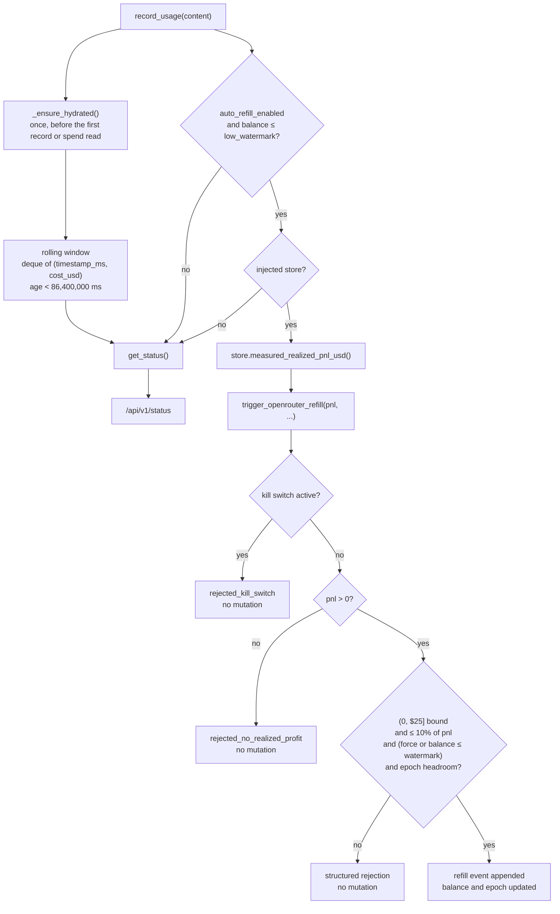
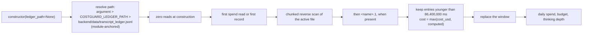

# Design — fix-costguard-python-gate

> Why: [`proposal.md`](proposal.md). What: [`specs/costguard/spec.md`](specs/costguard/spec.md) and [`specs/integrity/spec.md`](specs/integrity/spec.md) (approved at `1ef4c63`). This document decides **how**.

## Context

The Python `CostGuard` (`backend/agents/monitor.py`) is the only runtime guard between an agent loop and a real OpenRouter bill. The running system takes a path that bypasses most of the documented gate:

| Surface | Mechanism today | Failure |
|---|---|---|
| `LLMMonitorAgent.__init__` | Holds no state store; `OrchestratorAgent` builds it with `name="CostGuard"` only (`orchestrator.py#L43`) | The automatic path cannot reach measured PnL; a module-global read would evaluate the wrong instance in tests |
| `record_usage` auto-refill (`monitor.py#L321-331`) | Calls `trigger_openrouter_refill` without `realized_trading_pnl_usd` | The gate's PnL and 10 % checks are skipped because both are guarded by `is not None` |
| `trigger_openrouter_refill` (`monitor.py#L342-415`) | No kill-switch condition; watermark/profit-share order is implicit | A losing strategy can top up; the ADR's fourth condition is not enforced |
| `total_cost_usd` (`monitor.py#L306`) | Cumulative float, incremented forever | A long-lived process locks to `DETERMINISTIC_LOCK` permanently; a restart without Redis resets to zero |
| `hydrate_from_ledger` (`monitor.py#L121-180`) | Runs only when `REDIS_URL` is set; `read_text().splitlines()` at construction | Reads a dev-local file up to 100 MB synchronously; the suite is non-hermetic; the counter never recovers on a next day |
| `get_status` (`monitor.py#L452-453`) | Reports `DISABLED_BY_SECURITY_POLICY` while auto-refill runs; the backend default is `$2.00` | The UI and the status contradict the behaviour |
| `MasterOverview.jsx#L401` | Renders `low_watermark_usd ?? 5.0` | The operator sees a threshold that is neither configured nor tested |
| ADR-0003#L30 | Says `low_watermark_usd = $5.00`, gated by the Rust validator | The accepted ADR contradicts both the code and the approved spec |

Constraints that shape the design:

- **Warm path only.** No Rust, `PolicyEnvelope`, `HardRiskGate`, vault, Kelly sizing, dry-powder floor, or chain-isolation change. The 50 µs hot path is untouched.
- **One UI consumer, deployed in lockstep.** Backend, frontend, ADR, and tests land in one PR; `frontend/` is the only in-repository consumer of the status payload.
- **The transcript ledger is append-only and read-only for this change.** `backend/data/transcript_ledger.jsonl` is written by `TranscriptPalace` and rotated to `<name>.1` at 100 MB (`transcript_palace.py#L95`). The CostGuard only reads it; no migration writes it.
- **`unittest` from the repository root with `PYTHONPATH=.`** is the test harness. No pytest, no new frontend test framework.
- **No new dependency.** Standard library only (`collections`, `threading`, `pathlib`, `json`, `os`, `time`).
- **Merged changes are preserved, not reverted.** #7 (`measured_realized_pnl_usd`, provenance, `contract_version`), #8a (policy TTL / heartbeat separation), #9 (Rust-binary resolver and 503), and #10 (`AssetOverride` parity) stay intact. The one deliberate contract move is a `contract_version` bump, recorded below.
- **ADR-0003 is amended as a deliverable** (`$5.00` → `$2.00`, and the kill-switch condition attributed to the Python gate until the Rust routing follow-up).

### Runtime flow after the change



### Hydration flow after the change



## Goals / Non-Goals

**Goals:**

- The automatic and operator refill paths evaluate the **measured** realized PnL from the orchestrator's own store; no module-global and no fabricated floor.
- A refill is impossible without strictly positive measured profit or while the kill switch is active, on every path and under `force`.
- The 10 % profit-share cap, the fixed `(0, $25.00]` single-refill bound, and the configured epoch cap are the same gate on every path.
- Daily spend is a rolling 24 h window that is correct with or without Redis, rolls over without a restart, and cannot be assigned directly.
- Ledger hydration is injectable, lazy, module-anchored, streaming, bounded to the window, and isolated in the test suite.
- One backend-owned low watermark is exposed by the status and rendered by the frontend; a missing value renders as `—`.
- The status describes the auto-refill policy truthfully, and the no-source state is observable rather than contradictory.
- ADR-0003 matches the code it governs.

**Non-Goals:**

- Routing the gate through `HardRiskGate::validate_inference_refill` or removing the dead Rust validator (follow-up on issue #5).
- Querying the real OpenRouter `/credits` balance or making refill an out-of-band operator action (follow-up on issue #5).
- Aligning the UI's fixed `$15.00` refill button with `OPENROUTER_REFILL_AMOUNT_USD` (`$10.00`); the approved proposal tracks it as a follow-up on issue #5.
- Reading ledger segments older than `<name>.1`, or adding an index/SQLite sidecar.
- Rolling the **epoch refill accumulator** itself over 24 h. The approved spec defines an `epoch_refilled_usd` total; this change keeps it process-scoped and records the gap in the ADR amendment and the issue.
- Changing dry-powder behaviour, Kelly sizing, kill-switch semantics, `PolicyEnvelope`, or any Rust crate.
- Adding a frontend test framework; the existing `check-provenance.mjs` assertions and `npm run build` are the UI evidence.

## Decisions

| # | Decision | Alternatives considered | Rationale | Rejected because |
|---|---|---|---|---|
| D1 | `LLMMonitorAgent(store=None, ledger_path=None)` takes the measured-PnL store by constructor injection; `OrchestratorAgent` passes its own `self.store`, and `monitor.py` never imports `backend.core.state_store` | Module-global `state_store` lookup; a callable accessor; a `Protocol` | The injected instance is the one the orchestrator actually reads and the tests actually construct; a static grep can prove there is no global | A module-global evaluates the wrong instance in per-test stores (the #7 tests inject one); a callable adds indirection without removing that ambiguity; a protocol is overkill for one method and one flag |
| D2 | Fail closed on a missing source: the automatic path exits before the gate, and the REST facade returns `rejected_no_pnl_source`, both without mutation | Treat a missing source as `0.0` and let the gate return `rejected_no_realized_profit`; raise from the endpoint | A missing wiring is not a measured zero; the spec requires a distinct observable; a 5xx on the operator endpoint hides the cause | Conflating the two loses the `rejected_no_pnl_source` contract; raising breaks the endpoint's structured-response rule |
| D3 | The gate entry point `trigger_openrouter_refill(realized_trading_pnl_usd, ...)` keeps a **required** argument (a call omitting it raises `TypeError`); a thin `operator_refill(...)` facade resolves the injected store and maps `None` to `rejected_no_pnl_source` before calling the gate | An optional argument with a store fallback; a sentinel value | The `TypeError` is the spec's observable for an omitted PnL; the facade is the only place that knows how to resolve the operator source | An optional fallback would let a caller silently obtain a different value; a sentinel is a fabricated value and the spec forbids fabrication |
| D4 | Gate order: kill switch → strictly positive PnL → single-refill bound → profit share → watermark (unless `force`) → epoch cap → mutate | Watermark first; caps before PnL; PnL after caps | The kill switch must dominate every other consideration; negative/zero PnL must report `rejected_no_realized_profit` even under `force`; the spec's cap scenarios assume the amount is already in range | Watermark-first would hide an active kill switch; caps-first would return `rejected` for a zero-PnL call and lose the distinct reason |
| D5 | `force` bypasses **only** the balance-versus-watermark comparison | `force` bypasses all checks; `force` ignored | The UI's operator button needs on-demand refill above the watermark, but the money gate must still hold | Bypassing all checks is the defect; ignoring `force` breaks the operator workflow |
| D6 | Daily spend is a `deque[(timestamp_ms, cost_usd)]` pruned on every record and read; an entry contributes iff `now_ms - timestamp_ms < 86_400_000`; a dedicated `threading.RLock` guards mutation and reads | Per-day buckets; hourly buckets; cumulative float with a day marker | A deque expresses the rolling window exactly and makes the exclusive boundary a one-line comparison; the lock prevents `deque mutated during iteration` across the scheduler and API threads | Buckets complicate the exact-boundary scenario and add eviction code; a day marker still cannot recover mid-day spend |
| D7 | `total_cost_usd` becomes a read-only derived property; every reader (`remaining_budget_*`, `budget_exhausted`, `get_thinking_depth`, `get_status`) goes through it; tests migrate to `record_usage` to force a budget state | Keep an assignable cached float updated on each record; keep the attribute and add a separate window | The spec forbids independent assignment; one derivation means the budget and the thinking depth can never disagree with the window | An assignable cache is the defect being removed; a parallel window reintroduces two sources of truth |
| D8 | Hydration is lazy: construction performs zero ledger reads; `_ensure_hydrated()` runs once, before the first record and on the first daily-spend access; an explicit `hydrate_from_ledger()` always runs | Construction-time hydration; an eager background thread; hydration only when Redis is configured | Construction must not block on a potentially large file, and the first caller controls when the cost is paid; the spec forbids construction reads | Construction-time reads make the suite non-hermetic and can block boot; a background thread adds lifecycle and error-handling surface |
| D9 | Hydration-before-record with **replace** semantics: the one-shot lazy hydration rebuilds the window from the ledger, then `record_usage` appends; an explicit re-hydration is a documented reseed and replaces the window | Two windows (ledger + runtime) merged on read; explicit-only hydration; append-only hydration | This is the R2 follow-up's "hydration-before-record" option: a record made after boot is never dropped by the automatic path, and a call cannot be counted twice because hydration runs before the first record and before the orchestrator writes that call to the ledger | A merge risks double counting a call present in both windows; explicit-only hydration makes the first status access ordering-dependent; append-only hydration double counts on a repeated call |
| D10 | Ledger path resolution: constructor argument, then `COSTGUARD_LEDGER_PATH`, then the module-anchored `backend/data/transcript_ledger.jsonl`; `OrchestratorAgent` forwards a `ledger_path` argument used by the tests | Environment-only override; a CWD-relative default; monkeypatching the module constant in tests | The spec requires an injectable path, a module-anchored default, and an isolated test path; explicit forwarding keeps every test's intent visible at its construction site | An environment-only override leaks global state between tests; a CWD default is the bug being fixed; monkeypatching is not a contract |
| D11 | Hydration streams the active file **backwards** in 64 KiB chunks, then `<name>.1`, and stops each scan at the first entry older than the cutoff; per-entry cost is `max(cost_usd, compute_call_cost(...))`; malformed lines are skipped | `read_text().splitlines()`; forward streaming; an index sidecar | The ledger is append-ordered, so reverse scanning reads only the in-window tail; memory is bounded by the window, not the file | Whole-file buffering violates the spec and can read 100 MB; forward streaming must read the whole file to reach the newest entries; an index adds a store and a dependency |
| D12 | Inject `now_ms` (`Callable[[], int]`, default `int(time.time() * 1000)`) for record, prune, and hydration | Patching `backend.agents.monitor.time.time` in tests; real sleeps | Exact boundary tests (`86_399_999` / `86_400_000`) become deterministic and fast | Patching a module-level `time` object leaks into unrelated code under `unittest`; sleeps make the suite slow and flaky |
| D13 | `auto_wallet_refill` is `ENABLED_PROFIT_GATED` iff `auto_refill_enabled` else `DISABLED`; `auto_refill_policy` mirrors it; add `openrouter_credit.measured_pnl_source_available` (the R2 follow-up's clarification); advance `contract_version` from `2` to `3` | Report `DISABLED` when no store is injected; omit the readiness flag; leave `contract_version` at `2` | The spec fixes the enum by configuration, so the no-source state needs a separate observable; a semantic enum change is a breaking contract change, and the SDLC checklist requires versioning | `DISABLED` would violate the enabled scenario; without the flag "truthful" and fail-closed look contradictory; an unversioned breaking enum leaves external consumers without a detectable marker |
| D14 | The UI renders `openrouter_credit.low_watermark_usd` through the existing `formatOperational`; a missing value renders `—`; `?? 5.0` is deleted | Keep a UI default; read an environment variable in the browser | One backend value is the spec's requirement; `formatOperational(undefined)` already produces the exact em dash | A UI default is a second threshold; the browser cannot read the backend environment |
| D15 | The `$15` refill button stays unchanged and is recorded as the proposal's explicit non-goal/follow-up on issue #5 | Render `openrouter_credit.refill_amount_usd` and use it for the label and payload | The approved spec already scoped it out; changing it here would be unspecced behaviour | Rendering it is a behaviour change outside the approved spec; the follow-up belongs to issue #5 |
| D16 | Amend ADR-0003: `low_watermark_usd` `$5.00` → `$2.00`; attribute the four conditions to the Python gate until the Rust routing lands; add a dated amendment section and record the process-scoped epoch | Adopt `$5.00`; leave the ADR untouched | The approved spec mandates `$2.00`; the ADR is the durable record and must not contradict the gate it describes | Adopting `$5.00` contradicts the approved default; leaving it untouched repeats the documentation defect the issue reports |
| D17 | `OrchestratorAgent(..., ledger_path=None)` forwards the path to the `CostGuard`; every test that builds an orchestrator passes an isolated temporary path | A test-package environment variable; a test-only empty default | The suite must be hermetic without changing production defaults; explicit construction sites are reviewable | A hidden environment mutation affects unrelated tests; a test-only default diverges from production |
| D18 | No new dependency; only the standard library is used | `orjson`, `tailer`, `cachetools` | The work is a deque, a lock, a path, and JSON line parsing; nothing needs a package | New packages add maintenance, licence, and supply-chain surface for no functional gain |
| D19 | Do not touch #7's `measured_realized_pnl_usd()` or provenance code, #8a's policy TTL, #9's resolver/503, or #10's `AssetOverride` pair | Refactor the measured helper or the status assembler while here | Those changes are merged, reviewed, and outside this spec; keeping them intact is the integration contract | A refactor would widen the blast radius and risk a non-regression finding |

### D1 / D2 / D3 — Injection and the two entry points

`LLMMonitorAgent` gains a nullable store and a resolved ledger path:

```text
LLMMonitorAgent(name="CostGuard", daily_budget_usd=None, store=None, ledger_path=None)
  self.store: Optional[Any]
  self.ledger_path: Path
  self.measured_pnl_source_available -> bool
  self._measured_pnl() -> Optional[float]        # None when no store
  self._kill_switch_active() -> bool             # injected store only; False when absent
  self.operator_refill(amount_usd=None, force=True, ...) -> dict
  self.trigger_openrouter_refill(realized_trading_pnl_usd, ...) -> dict   # required
```

The operator facade is the only place that maps a missing source to a rejection:

```json
{
  "status": "rejected_no_pnl_source",
  "reason": "No measured PnL source is injected; the refill gate is inoperative",
  "openrouter_balance_usd": 1.8
}
```

`OrchestratorAgent.__init__(name="Orchestrator", store=None, ledger_path=None)` constructs `LLMMonitorAgent(name="CostGuard", store=self.store, ledger_path=ledger_path)`. `backend/server.py` calls `orchestrator.cost_guard.operator_refill(amount_usd=req.amount_usd, force=req.force)`; it no longer reads `state_store` directly for the PnL. The orchestrator's pre-reflection call keeps using `self.store.measured_realized_pnl_usd()` (the same instance).

### D4 / D5 — Gate contract

The gate returns one of: `rejected_kill_switch`, `rejected_no_realized_profit`, `rejected` (single-refill bound), `rejected_exceeds_profit_share`, `skipped_sufficient_balance`, `rejected_epoch_cap`, `refilled`. Every rejection returns before mutating `openrouter_balance_usd`, `epoch_refilled_usd`, or `refill_history`. The reason string reports the measured PnL verbatim (for example `-$10.00`), never a floor.

`force` is consulted only at the watermark comparison. The 10 % comparison uses `amt > pnl * 0.10 + 1e-6` so an amount exactly equal to the share is accepted. The single-refill bound is the fixed `(0, $25.00]`; the epoch cap is `OPENROUTER_MAX_EPOCH_REFILL_USD` (default `$25.00`).

### D6 / D7 — Window contract

| Input | Window contribution |
|---|---|
| `record_usage(cost)` at `now_ms` | Appends `(now_ms, cost)` after the one-shot hydration |
| ledger entry at `timestamp_ms` | Contributes iff `now_ms - timestamp_ms < 86_400_000` |
| exactly `86_400_000` ms old | Excluded (half-open interval) |
| `86_399_999` ms old | Included |

`total_cost_usd` is a `@property` with no setter. `record_usage` and `hydrate_from_ledger` write the deque, never the aggregate. The property prunes and sums under the lock, so a status read after a rollover returns the smaller window without a restart.

### D8 / D9 / D10 / D11 / D12 — Hydration contract

- **Resolution.** `ledger_path` argument > `COSTGUARD_LEDGER_PATH` > `Path(__file__).resolve().parents[1] / "data" / "transcript_ledger.jsonl"`. The default is independent of the process working directory.
- **Zero construction reads.** `__init__` resolves the path and sets `_hydrated = False`; it does not open the file.
- **Lazy, one-shot.** `_ensure_hydrated()` runs `hydrate_from_ledger()` once. `record_usage` calls it before appending; every spend accessor calls it before reading. A successful hydration sets `_hydrated = True`; a raised error leaves it `False`, so the error remains observable on a retry.
- **Reverse streaming.** The active file is read from the end in 64 KiB binary chunks; complete lines are parsed and yielded until the first `timestamp_ms` older than the cutoff. The same scan runs on `<name>.1` when it exists. A missing file is an empty window; a malformed line is skipped; an unreadable file raises from the lazy or explicit call.
- **Cost.** `max(float(entry.get("cost_usd", 0.0)), compute_call_cost(model_used, prompt_tokens, completion_tokens))`. In-window entries are retained even when the token count is zero, so a cost-only row is not lost.
- **Reseed.** `hydrate_from_ledger(storage_path=None)` always runs when called explicitly and replaces the window. It is documented as a seed/reseed operation; production calls it only through the one-shot lazy path, before recording.

### D13 / D14 / D15 — Status and UI contract

```json
{
  "contract_version": 3,
  "cost_guard": {
    "auto_wallet_refill": "ENABLED_PROFIT_GATED",
    "auto_refill_policy": "PROFIT_GATED_CAPPED_BY_ORCHESTRATOR",
    "openrouter_credit": {
      "balance_usd": 1.8,
      "low_watermark_usd": 2.0,
      "refill_amount_usd": 10.0,
      "epoch_refilled_usd": 0.0,
      "max_epoch_refill_usd": 25.0,
      "measured_pnl_source_available": true,
      "auto_refill_enabled": true,
      "refill_history": []
    }
  }
}
```

When `auto_refill_enabled` is false, both `auto_wallet_refill` and `auto_refill_policy` are `DISABLED`, and `measured_pnl_source_available` still reports whether a store is injected. The enum describes the configured **policy**; the readiness flag describes whether the policy can operate. A store-less `CostGuard` therefore reports `ENABLED_PROFIT_GATED` with `measured_pnl_source_available: false`, and the REST facade returns `rejected_no_pnl_source`.

The migration note for external consumers: accept `ENABLED_PROFIT_GATED` and `DISABLED` (never `DISABLED_BY_SECURITY_POLICY`), read `auto_refill_policy` for the policy state, and use `openrouter_credit.low_watermark_usd` as the only threshold. `contract_version` advances from `2` to `3`; the rest of the status shape is unchanged. The frontend renders the watermark through `formatOperational`, so a missing field is `—`.

### D16 — ADR amendment content

The ADR's auto-refill bullet becomes: `low_watermark_usd = $2.00` resolved from `OPENROUTER_LOW_WATERMARK_USD`; the four conditions are enforced by the Python `CostGuard` gate (measured `realized_trading_pnl_usd > 0`, `<= 10 %` of measured PnL, fixed `(0, $25.00]` plus the configured epoch cap, and `kill_switch_active == false`) until the Rust routing follow-up lands; the epoch accumulator is process-scoped. A dated `## Amendment — 2026-10-26 (fix-costguard-python-gate)` section records the change and points at this design.

### Traceability

| Spec requirement | Decisions | Tasks |
|---|---|---|
| The CostGuard receives its measured PnL source by injection | D1, D2, D3, D17 | 1.1–1.6 |
| Every refill path requires a measured realized PnL | D3, D4 | 1.5, 2.1, 2.2 |
| A refill requires strictly positive realized profit | D4 | 2.2, 2.4, 2.9, 2.10 |
| Profit-share and epoch caps apply on every path | D4 | 2.5–2.8, 2.10 |
| No fabricated profit floor | D4 | 2.4, 2.10 |
| Force bypasses only the low-watermark check | D5 | 2.2, 2.7, 2.10 |
| Refills are refused while the kill switch is active | D4 | 2.3, 2.10 |
| Daily spend is a rolling 24-hour window | D6, D7, D12 | 3.1–3.6 |
| Ledger hydration is injectable, lazy, and bounded | D8–D12, D17 | 4.1–4.10 |
| The low watermark has one backend-owned value | D14 | 5.1, 5.5, 6.1, 6.2 |
| Auto-refill status labels are truthful | D13 | 5.2–5.6 |
| Integrity: null-safe measured PnL only (modified) | D19 | 8.3, 8.6 |
| Issue #5 items 1, 2, 5, 6 and the ADR contradiction | D1–D16 | 1.1–7.2 |
| Non-regression with #7 / #8a / #9 / #10 | D19 | 8.6, 9.1 |

## Risks / Trade-offs

- **A legitimate refill is refused because the injected source is missing or the ledger path is wrong** -> Fail-closed is intended; production wires `OrchestratorAgent`'s own store; `measured_pnl_source_available` makes the no-source state visible; tests assert injected-store precedence over a different global store.
- **Lazy hydration raises on `/api/v1/status` when the ledger is unreadable** -> A missing file is not an error; malformed lines are skipped; only an `OSError` from an existing-but-unreadable file propagates, as the spec requires observability. The default path is module-owned and append-only; a 5xx is the correct alarm for a deployment defect.
- **The reverse scan misses entries if the ledger is not append-ordered** -> `TranscriptPalace` appends; the design states the assumption; a test writes an out-of-window entry before an in-window entry and asserts the in-window value. A future non-append writer would need an index, which is out of scope.
- **Explicit re-hydration after recording drops the in-memory entries** -> Documented as a reseed; the automatic path hydrates once, before the first record, so no production flow drops a record. The test asserts that a record made after the one-shot lazy hydration contributes to the window, and separately that an explicit reseed on a fresh instance is a replacement.
- **A call recorded in memory is also present in the ledger and is double counted** -> Hydration runs before the first record and the orchestrator writes the ledger after `record_usage`; a test seeds the ledger, records once, and asserts the sum equals the ledger plus that record, not twice.
- **Making `total_cost_usd` read-only breaks existing callers and tests** -> Tasks 8.1–8.4 migrate every assignment to `record_usage`; a grep gate rejects `total_cost_usd =` in `monitor.py`; the full suite is the regression evidence.
- **Concurrent scheduler and API access mutates the deque during a sum** -> A dedicated `RLock` guards record, hydrate, prune, and sum; the window is small (24 h of calls).
- **The status enum change breaks an external consumer** -> `contract_version: 3`, a `BREAKING CHANGE:` footer in the PR, and the migration note above; the only in-repository consumer is `frontend/`, asserted by a repository grep.
- **The UI still shows a `$15` refill amount that differs from the backend default** -> Explicit non-goal from the approved proposal, tracked on issue #5; the watermark (the threshold the operator acts on) is single-sourced in this change.
- **The ADR amendment under-documents the Rust and epoch gaps** -> The amendment names the Python gate as the current owner, the Rust routing follow-up, and the process-scoped epoch, so documentation, code, and issue #5 agree.
- **The Docker image sees a developer ledger mounted through `./backend`** -> The module-anchored path is the mounted production path; hydration is bounded and read-only; a missing file is zero; the Docker smoke asserts the status contract, while the exact window values are unit-tested with isolated ledgers.
- **Worst failure: a refill executes without measured profit, or a legitimate positive-profit refill is silently refused** -> The gate orders kill switch before PnL and caps, every rejection returns before mutation, the automatic path has no source fallback, and the negative/zero/positive automatic tests plus the Docker smoke are the evidence. There is no path that supplies a floor or a default.

## Migration Plan

**Deployment order (one PR, one deploy):**

1. Backend injection, gate order, rolling window, and lazy hydration (task groups 1–4).
2. REST facade, status contract, `contract_version: 3`, and the frontend watermark (groups 5–6).
3. ADR amendment and the migrated test suite (groups 7–8).
4. `docker compose up --build -d`; the backend starts with zero ledger reads, the first status call hydrates the window, and the frontend renders the backend watermark. Attach the evidence from group 9.

**No data migration.** The transcript ledger is read-only for this change; the spend window is in memory; no Redis key changes shape. A restart before the first read simply re-hydrates.

**Rollback:**

1. `git revert <dev-merge-sha>` on the branch (or revert the squashed commit on `master`).
2. `docker compose up --build -d`.
3. No cache or ledger cleanup is required: the old code ignores the new fields and re-reads the same append-only ledger. The cumulative spend counter returns, and the old label `DISABLED_BY_SECURITY_POLICY` and `$5.00` watermark reappear.
4. Confirm the pre-change state: `curl -s http://localhost:8000/api/v1/status | python3 -c 'import json,sys; d=json.load(sys.stdin)["cost_guard"]; print(d["auto_wallet_refill"], d["openrouter_credit"]["low_watermark_usd"])'` prints `DISABLED_BY_SECURITY_POLICY 5.0`.
5. If the frontend build was cached with the new watermark, rebuild it in the same rollback; no browser storage is involved.

## Open Questions

<!-- None: every decision needed for DEV is resolved above. -->
