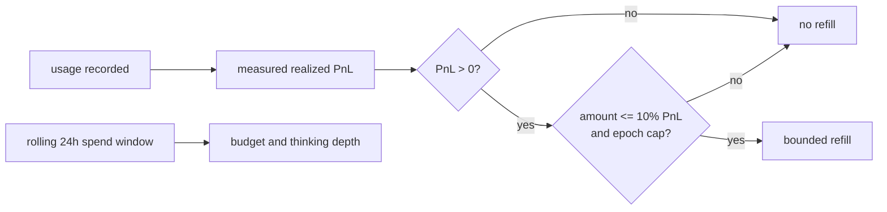

## Review Card (≤ 5 min)

| Field | Value |
|---|---|
| Outcome | The Python `CostGuard` cannot refill inference credit without measured realized trading profit, its daily budget rolls over every 24 hours without Redis, and the UI shows the backend's real low watermark. |
| Why now | Issue #5 reproduces an automatic top-up with no profit, a spend counter that never resets (or resets on restart), and a displayed threshold that disagrees with the code. This is the only guard between an agent loop and a real OpenRouter bill. |
| Blast radius | `backend/agents/monitor.py`, `backend/agents/orchestrator.py`, `backend/server.py`, `frontend/src/components/MasterOverview.jsx`, backend tests. `backend/core/state_store.py` is consumed read-only. No Rust, no `PolicyEnvelope`, no Redis schema change. |
| Risk | Medium. Worst failure: a legitimate refill is refused because the measured PnL is not wired into the automatic path. |
| Effort | S |
| Decision needed | None. Scope is fixed by the partial-change comment on issue #5. |

## Why

- The automatic refill path omits `realized_trading_pnl_usd`, so the profit gate is skipped entirely.
- The spend total is cumulative and resets only on restart when Redis is absent, so the daily cap is not a daily cap.
- The frontend advertises a `$5.00` low watermark while the backend uses `$2.00`, and the status claims auto-refill is disabled while it runs.

## What Changes

- Make a measured realized PnL mandatory on every refill path; the automatic path uses the state store's measured helper.
- Reject refills when realized profit is zero or negative, with no balance, epoch, or history mutation.
- Apply the profit-share cap (10% of PnL), single-refill bound, and epoch cap on the automatic path as well as the operator path.
- Replace the cumulative spend counter with a rolling 24-hour window that works without Redis, and retain ledger hydration, including at startup when the ledger exists.
- Expose one backend-owned low watermark and render it from the status payload; remove the frontend literal.
- Report auto-refill status truthfully and add an automatic-path regression test for negative and zero PnL.

## Capabilities

### New Capabilities

- `costguard`: profit-gated, epoch-capped refill behavior, rolling 24-hour spend accounting, and the operator-facing auto-refill status and low watermark.

### Modified Capabilities

None. No existing spec under `openspec/specs/` defines CostGuard behavior.

## Non-goals

- Routing the gate through the Rust `HardRiskGate::validate_inference_refill`; that remains a follow-up on issue #5.
- Querying the real OpenRouter `/credits` balance or making refill an out-of-band operator action.
- Removing the dead Rust validator.
- Changing the dry-powder floor, Kelly sizing, kill switch, or `PolicyEnvelope`.
- Persisting the spend window outside the existing transcript ledger.

## Impact

- **Backend**: `backend/agents/monitor.py` (gate, window, status), `backend/agents/orchestrator.py` and `backend/server.py` (callers), `backend/core/state_store.py` (measured helper, already present).
- **Frontend**: `frontend/src/components/MasterOverview.jsx` renders `openrouter_credit.low_watermark_usd` and the truthful status.
- **Contract**: the `/api/v1/status` `cost_guard` block keeps its shape; `auto_wallet_refill` changes value, and `openrouter_credit.low_watermark_usd` becomes the only threshold source. No Redis key, `PolicyEnvelope`, or Rust wire change.
- **Tests**: `backend/tests/test_architecture.py`, `backend/tests/test_hierarchy_v3.py`, plus an automatic-path refill regression test.
- **Backtest/paper/live**: unaffected; this is warm-path treasury accounting only.
