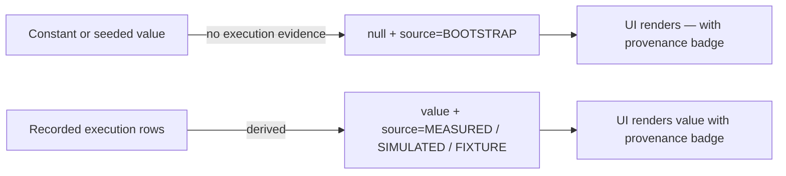

## Review Card (≤ 5 min)

| Field | Value |
|---|---|
| Outcome | Every performance number and every memory entry either declares a provenance label or renders as `—`; nothing without execution evidence can look measured. |
| Why now | The dashboard and the Master prompt present constants and seeded theses as measured facts. An operator cannot separate a real result from an invented one without reading Python. |
| Blast radius | Warm path (`backend/core`, `backend/agents`, `backend/server.py`), dashboard (`App`, `LeafAgentView`, `MasterOverview`), and the performance audit document. No Rust, `PolicyEnvelope`, Redis IPC schema, vault, or chain-routing change. |
| Risk | Medium. Worst failure: a consumer that assumed a number crashes or blanks a panel when a metric becomes `null`. |
| Effort | L — one SPEC round, one PLAN round, one DEV round. |
| Decision needed | None. |

### Non-goals

- Vault-manifest fallback (#2), the real fill simulator (#3), and fleet execution (#6).
- Any Rust engine, `PolicyEnvelope`, risk-gate, capital-protection, or chain-routing change.

## Why

The platform currently synthesises performance, identity, and history values with no provenance marker and renders them beside genuinely measured values with the same formatting. Leaf Sharpe, win rate, realized PnL, and position count are constants scaled by allocation; seeded Palace drawers carry a model name, token count, and cost; the offline UI shows a plausible $25k treasury. The distinction between measured, simulated, and invented is only recoverable by reading the source.

This is an epistemic-integrity defect. An operator cannot trust the dashboard, the memory system cannot be trusted for continuity, and any external reader will over-trust the numbers.

## What Changes

- **BREAKING** — Per-leaf `sharpe_ratio`, `win_rate_pct`, `realized_pnl_usd`, `paper_pnl_usd`, and `active_positions_count` become `null` when the leaf has no execution evidence, and are computed from the leaf's own execution rows otherwise.
- **BREAKING** — Every performance metric block carries a mandatory `source` from `MEASURED`, `SIMULATED`, `FIXTURE`, or `BOOTSTRAP`; consumers must handle `null`.
- Master treasury aggregate `total_realized_pnl_usd` sums only measured leaf PnL and is `null` when none exists; the invented defaults for OpenRouter balance (`24.5`) and active-leaf count (`11`) are removed.
- Palace drawers gain a mandatory `source` from `LLM`, `DETERMINISTIC_FALLBACK`, or `BOOTSTRAP`. Seeded drawers are `BOOTSTRAP`, carry no model name, token count, or cost, and are excluded from the continuity prompt and cross-wing digest.
- The UI renders `—` plus a provenance badge for null or unattributed metrics, including the Master aggregate and the leaf table.
- The offline UI skeleton contains zeros or `null`, not an invented model portfolio.
- The performance audit document labels each population and separates fixture arithmetic from measured live-testnet results.

## Capabilities

### New Capabilities

- `integrity`: provenance and null semantics for performance metrics, Palace drawers, UI rendering, and the audit document.

### Modified Capabilities

- None.

## Non-goals

- Removing the Python vault-manifest fallback: that is issue #2.
- Replacing the circular executor with a real fill simulator: that is issue #3.
- Fleet execution across all leaves: that is issue #6.
- Any change to Rust strategy pods, `HardRiskGate`, `PolicyEnvelope`, Kelly sizing, dry-powder protection, or `CostGuard` limits.
- Backtest, paper, and live strategy behavior: the code paths are unchanged; only the provenance and null semantics of their reported metrics change.
- Historical data repair: legacy untyped Palace drawers are conservatively re-labelled `BOOTSTRAP` on read and are not reconstructed.

## Impact

- Backend: `backend/core/hierarchy.py` (leaf snapshot, treasury aggregate, bootstrap seeding), `backend/core/memory_palace.py` (`PalaceDrawer`, persistence, prompt builders), `backend/core/state_store.py` (population provenance), `backend/agents/orchestrator.py` (null-safe Master prompt), `backend/server.py` (status snapshot defaults).
- Frontend: `frontend/src/App.jsx` (offline fallback), `frontend/src/components/LeafAgentView.jsx`, `frontend/src/components/MasterOverview.jsx`.
- Contracts: `GET /api/v1/status` and the hierarchy snapshot change shape additively (`source` fields) and semantically (nullable performance fields) — **BREAKING** for consumers that assume numbers. Redis Palace JSON gains one additive field; no `PolicyEnvelope` or IPC schema change.
- Docs: `docs/PERFORMANCE_AND_COST_AUDIT.md`.
- Tests: `backend/tests/` gains integration and architecture tests for null semantics, provenance, drawer persistence, and prompt exclusion.
- Chains/venues: none. Each leaf remains isolated to its own chain and MemPalace wing.
- Backtest/paper/live: populations keep their existing deterministic code path and isolation; only labelling and null semantics change.
