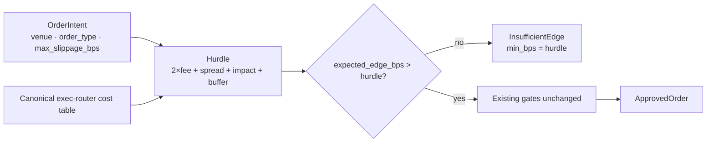

## Review Card (≤ 5 min)

| Field | Value |
|---|---|
| Outcome | Every order must beat its own venue's round-trip fee, spread, declared price impact, and a configurable buffer before `HardRiskGate` approves it. |
| Why now | `validate` compares every intent to a fixed 12 bps floor and never reads venue, order type, spread, or `max_slippage_bps` (`engine-rs/crates/risk-gate/src/lib.rs:254-259`). A 12 bps edge on `OnchainAtomicPool` is approved like a 1.8 bps maker order (issue #4, item 1). |
| Blast radius | `engine-rs` only: `crates/risk-gate`, the canonical cost table shared with `crates/exec-router`, and backtest fixture expectations. No `PolicyEnvelope`, Redis IPC, REST/WS, Python, frontend, vault, or chain-routing change. |
| Risk | Medium. Worst failure: on-chain fixture intents whose edge does not cover their declared slippage are now rejected, so `[FIXTURE]` PnL, win-rate, and rejection counts must be regenerated rather than preserved. |
| Effort | M — one SPEC round, one PLAN round, one DEV round. |
| Decision needed | None. Defaults are explicit: buffer `2.0` bps; impact = `intent.max_slippage_bps`; fee is round-trip, as ADR-0001 §4.3 requires. |

## Why

`ADR-0001` §4.3 requires the gate to reject a trade when estimated round-trip fee + spread + price impact exceeds the expected alpha edge. The implementation only compares against a constant `12.0` bps and reads neither the venue nor the order type.

The highest-cost venue is therefore the least protected: a 12 bps edge on an atomic pool pays 24 bps of round-trip fee before spread or impact, yet passes exactly like a low-cost maker order. The gate is a policy filter today, not the cost firewall its documentation claims.

## What Changes

- Replace the fixed `min_edge_over_cost_bps` comparison with a per-intent hurdle: `round_trip_fee_bps + spread_bps + intent.max_slippage_bps + effective_buffer_bps`.
- Read `intent.venue`, `intent.order_type`, and `intent.max_slippage_bps` inside `validate`; no fixed threshold remains.
- **BREAKING** — remove `RiskLimits::min_edge_over_cost_bps` and add `RiskLimits::min_edge_buffer_bps: f64`, default `2.0`, documented and fail-safe against negative or non-finite values.
- Source fee and spread values from the single canonical cost model already used by `SmartExecutionRouter`; `risk-gate` must not carry a second table.
- Keep the `InsufficientEdge` variant and field names; its `min_bps` now carries the computed hurdle.
- Add unit tests for maker, taker, on-chain, the buffer, and the three boundary points (below cost, at cost, at cost plus buffer).
- Add a `criterion` benchmark for `HardRiskGate::validate` and publish the measured mean against the 50 µs budget.
- Leave the kill-switch, drawdown, pod/TTL, slippage-ceiling, token-safety, leverage, Kelly, and zero-position gates untouched.

## Capabilities

### New Capabilities

- `risk-hurdle`: per-intent execution-cost hurdle differentiated by venue and order type, with a configurable buffer, strict boundary semantics, a single canonical cost source, and a measured hot-path budget.

### Modified Capabilities

- None.

## Non-goals

- 4b aggregate exposure caps: `asset_exposures_usd`, `pod_exposures_usd`, `max_asset_exposure_pct`, `max_pod_exposure_pct`, `max_gross_exposure_pct`.
- The 15% gross-vs-margin semantics of `max_single_position_pct`.
- The kill-switch cancel/flatten contract for the executor.
- An order-rate limiter keyed by `(pod_id, symbol)`.
- Removing the pre-existing effective-envelope or `ApprovedOrder` intent clones on the hot path.
- Inverting the MEV priority-tip incentive; `mev_priority_tip_bps` remains a function of declared edge.
- Any `PolicyEnvelope`, Redis IPC, REST/WS, DB, vault, Python, or frontend change.
- Closing issue #4. It stays open for every item above.

## Impact

- `engine-rs/crates/risk-gate/src/lib.rs`: hurdle computation, `RiskLimits`, `InsufficientEdge` value, and unit tests.
- `engine-rs/crates/exec-router/src/lib.rs`: the canonical fee and spread values exposed for shared use; `execute` semantics unchanged.
- `engine-rs/crates/common/src/lib.rs` and the crate manifests: only if PLAN relocates the canonical table to a shared crate or adds a crate dependency. No `PolicyEnvelope` change.
- `engine-rs/crates/risk-gate/benches/`: new `criterion` benchmark and dev-dependency.
- `engine-rs/crates/backtest/src/lib.rs`: fixture intents keep their declared edges and slippage; rejection counts, PnL, win rate, and Sharpe can change. The `[FIXTURE]` figures in `docs/PERFORMANCE_AND_COST_AUDIT.md` must be regenerated from a real run.
- `README.md`, `docs/architecture.md`: the unmeasured `<50µs` claim gains the measured benchmark figure and command.
- Contracts: no `PolicyEnvelope` key, Redis key/payload, REST/WS, DB, or CLI shape change.
- Backtest/paper/live: one deterministic `validate` path; the hurdle reads only the intent and `RiskLimits`, with no live-only branch.
- Multi-chain/venue: the hurdle is a pure function of the intent's own venue and order type; no cross-leaf or cross-chain state is read.
- Vault/key/security: N/A — no key material, custody, or signing surface is touched.
