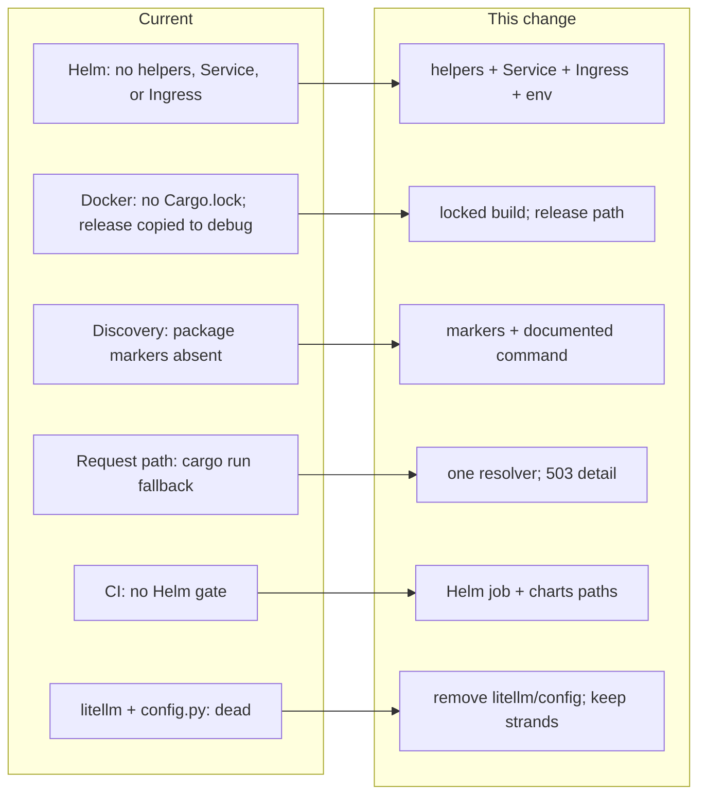

## Review Card (≤ 5 min)

| Field | Value |
|---|---|
| Outcome | The documented build, packaging, and test workflow works end to end: the Helm chart renders and lints, the image builds from the committed lockfile with the binary at `target/release`, the Python suite is discoverable, and CI gates chart changes. |
| Why now | Issue #9 found every documented packaging path broken; developers and operators hit failures before they can run the platform. |
| Blast radius | `charts/robotrader`, `.dockerignore`/`Dockerfile.backend`, `backend/core/state_store.py` and `backend/server.py` (binary resolver + error shape), two package markers, `.github/workflows/ci.yml`, and `backend/pyproject.toml`/`poetry.lock` plus removal of `backend/config.py`. No hot-path, risk-gate, vault, `PolicyEnvelope`, IPC, or strategy change. |
| Risk | Medium. Worst failure: `/api/v1/status` and `/api/v1/hierarchy` answer 503 with an actionable `detail` when the Rust binary is absent, instead of attempting a slow `cargo run`. |
| Effort | L — SPEC, PLAN, and DEV stages with cold reviews. |
| Decision needed | None. Follow-up: wire or remove `strands-agents`. |

### Non-goals

- `/status` caching and the 26-leaf aggregate (#9.6).
- Provisioning Redis as a chart dependency; only the `REDIS_URL` contract is in scope.

## Why

Issue #9 documents six packaging defects that make the repository's own instructions wrong.

- `helm template` and `helm lint` fail: the chart has no helper templates, no Service template, and no Ingress template.
- The Docker image excludes `engine-rs/Cargo.lock` from its context and copies the release binary into `target/debug`, so dependency resolution is uncontrolled and the container hides whether a binary is a debug or release build.
- The documented `unittest discover` command depends on namespace-package behaviour because the package markers are absent.
- `run_rust_backtest` checks only `target/debug` and falls back to `cargo run`, so a fresh checkout can compile synchronously inside a 30-second HTTP request.
- CI tests Rust, Python, and the frontend but never renders or lints the chart.
- `litellm` and `backend/config.py` are declared but never imported.

These are independent, deterministic fixes to the build and packaging chain. None of them changes trading logic, capital protection, the hot path, or a chain/venue boundary.

## What Changes

- **Helm**: add the missing helper definitions plus Service and Ingress templates; make `values.yaml` drive the Service, the Ingress, and the `REDIS_URL` / `MAX_DAILY_LLM_BUDGET_USD` environment while preserving the existing OpenRouter and Solana environment.
- **Docker**: stop excluding `engine-rs/Cargo.lock`; copy it into the image build and require a locked Cargo build; install `robotrader-node` at `/app/engine-rs/target/release/`.
- **Python package markers**: add `backend/__init__.py` and `backend/tests/__init__.py` so the documented discovery command is version-independent.
- **Request path**: replace the two divergent lookup paths with one resolver that prefers the release binary, falls back to a local debug binary, never invokes `cargo`, and raises a typed error that the HTTP layer maps to 503 with a JSON `detail`.
- **CI**: add a Helm job that runs `helm lint` and `helm template`, and include `charts/**` in the pull-request and push path filters.
- **Dependencies**: remove `litellm` and `backend/config.py`, regenerate `backend/poetry.lock`, and keep `strands-agents` with an explicit follow-up because the documentation and ADR still claim it.

The failure-path contract change on the backtest-dependent HTTP endpoints (503 instead of a generic 500 or a `cargo run` timeout) is intentional and is specified in the delta.

## Capabilities

### New Capabilities

- `build-packaging`: a renderable and lintable Helm chart with Service, Ingress, and runtime environment; a Docker image built from the committed lockfile with the binary at the release path; Python package markers and working discovery; one Rust binary resolver with no compiler fallback and an actionable missing-binary error; a CI Helm gate; and removal of the unused `litellm` dependency and `backend/config.py`.

### Modified Capabilities

- None.

## Non-goals

- #9.6 `/status` caching, the 26-leaf aggregate, RSS/drawer caching, and any performance redesign.
- Provisioning Redis as a Helm subchart or sidecar; only the `REDIS_URL` environment contract is in scope.
- Removing `strands-agents`; it stays declared with a follow-up to wire or remove it.
- Bit-for-bit reproducibility of the container image across base-image changes; the lockfile guarantee covers Cargo dependency resolution, not the whole toolchain.
- Secret management changes such as moving `OPENROUTER_API_KEY` into a Kubernetes Secret.
- Any change to `/api/v1/health`, `PolicyEnvelope`, Redis IPC, risk-gate, vault, strategy pods, or backtest/paper/live logic.
- Frontend changes.

## Impact

- **Code and config**: `charts/robotrader/templates/_helpers.tpl` (new), `deployment.yaml`, `service.yaml` (new), `ingress.yaml` (new), `values.yaml`; `.dockerignore`; `Dockerfile.backend`; `backend/__init__.py` (new); `backend/tests/__init__.py` (new); `backend/core/state_store.py`; `backend/server.py`; `.github/workflows/ci.yml`; `backend/pyproject.toml`; `backend/poetry.lock`; delete `backend/config.py`.
- **Contracts**: every HTTP endpoint that invokes the Rust backtest returns HTTP 503 with an `application/json` `detail` when the binary is missing. Success paths are unchanged. `/api/v1/health` is unchanged and always independent of the binary. The Helm values contract gains Service, Ingress, `env.redisUrl`, and `env.maxDailyLlmBudgetUsd` keys. The container layout moves the binary from `target/debug` to `target/release`.
- **Dependencies**: `litellm` is removed; `strands-agents` is retained with a follow-up; `backend/poetry.lock` is regenerated and consistent with `backend/pyproject.toml`.
- **Ops**: the chart becomes deployable; CI gains a Helm render/lint job and chart path triggers.
- **Safety**: no money, risk, vault, key, hot-path, chain/venue isolation, or backtest/paper/live logic impact.
- **Footprint**: 14–15 files, consistent with the Lane L upgrade.
