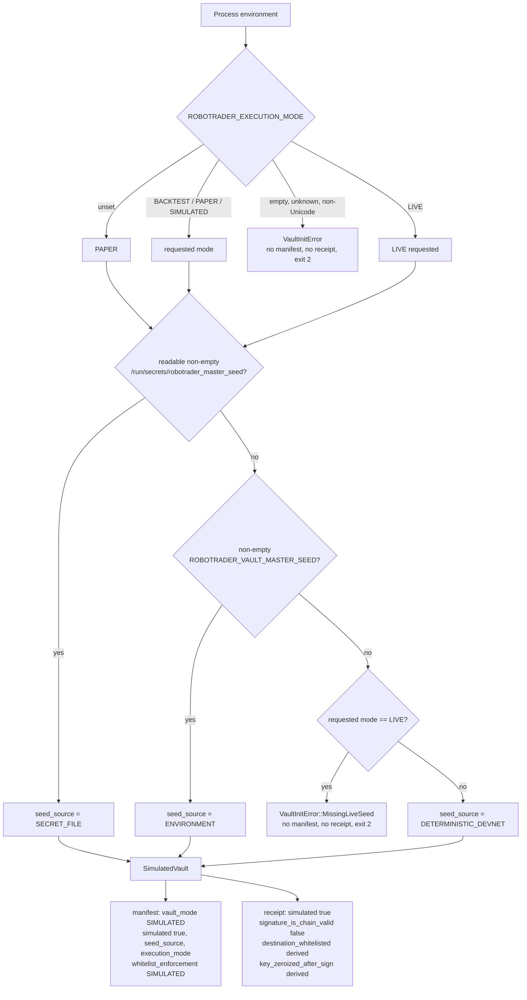
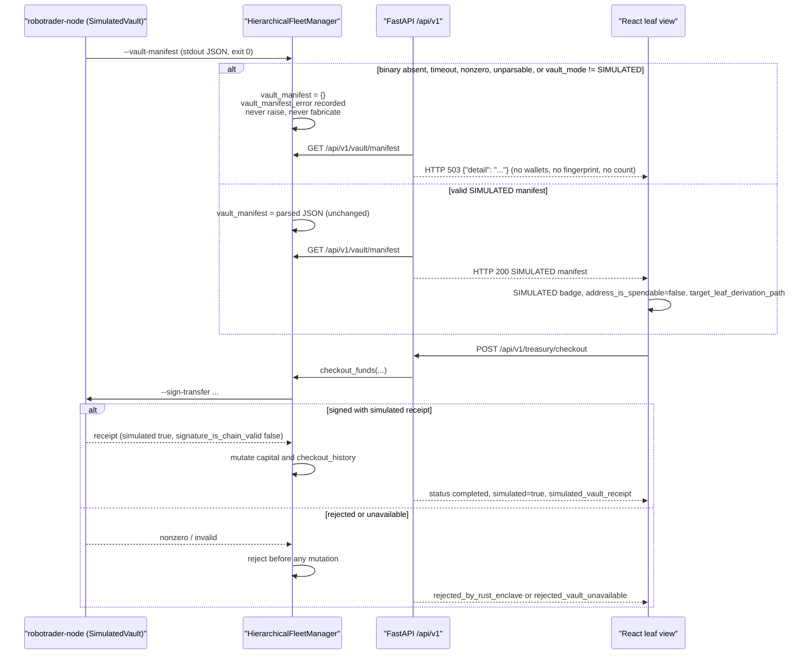

# Design — mark-vault-simulated

> Why: [`proposal.md`](proposal.md). What: [`specs/vault-simulation/spec.md`](specs/vault-simulation/spec.md), approved at `65ae705`. This document decides **how**; it does not restate the requirements.

## Context

The platform exposes a single-seed Rust vault as a production cryptographic enclave. The implementation does not implement the claimed cryptography, and the surrounding Python surfaces amplify the false claim:

| Surface | Mechanism today | Failure |
|---|---|---|
| `engine-rs/crates/risk-gate/src/vault.rs` | HMAC-SHA256 over the ASCII derivation path; addresses formatted by bespoke character mappers; 32-byte HMAC receipt | `SimulatedVault` derivation is not BIP-32/BIP-44/SLIP-0010; addresses are not spendable; signatures are not chain-valid |
| `engine-rs/crates/common/src/lib.rs` | `VaultEnclaveManifest` with `master_derivation_path`, `slip44_coin_type`, `key_isolation_mode`, `withdrawal_whitelist_enforced` | The contract names implemented guarantees that do not exist |
| `vault.rs#L417-L435` | `DEFAULT_WHITELISTED_PREFIXES` includes `0x`, `r`, `T`, `D`, `EQ`, `bc1q` | The prefix matcher is effectively open; the receipt then reports `destination_whitelisted: true` |
| `vault.rs#L455-L484` | Seed precedence falls back to a repo-visible devnet seed in every mode; `vault_mode` encodes the seed source | A mainnet-intended deployment with no secret silently gets the public seed |
| `backend/core/hierarchy.py#L1063-L1116` | Python fallback manifest with hardcoded fingerprint and whitelist count | Fabricated manifest served as if it came from Rust |
| `backend/core/hierarchy.py#L1118-L1181` | Python HMAC fallback signer | A signature that bypasses the Rust whitelist and is not chain-valid |
| `backend/tools/solana_tools.py#L27-L113` | Reads `SOLANA_PRIVATE_KEY`, signs and broadcasts | Python and the LLM process hold key material |
| `backend/core/state_store.py#L588-L653` | `transfer_sol(..., simulate_only=False)` on every Solana tick | Live broadcast from Python |
| `frontend/src/components/LeafAgentView.jsx#L211-L222` | "Enclave Rust", "Zeroize RAM & Clé Privée hors Python", `leaf_derivation_path` | UI repeats the false guarantee and reads the old field |
| `frontend/src/components/Dashboard.jsx#L179-L213` | "Comptabilité Réelle On-Chain", "Transactions signées", "auto-transferts" | UI claims signed/broadcast Solana activity |
| Docs, ADR-0003, README, AGENTS.md, DEV checklist, openspec config | BIP-32/BIP-44/SLIP-0010/HD/zeroize/whitelist-enforced claims | Future reviewers are instructed to assert the removed guarantee |

Constraints that shape this design:

- **Breaking contract, one deploy.** Rust types, manifest, receipt, Python boundary, frontend, docs, and tests ship in one PR. There is no in-repository consumer of the vault contract other than `frontend/src` and the backend.
- **No real cryptography in this change.** BIP-32/BIP-44/SLIP-0010/CIP-1852, secp256k1/ed25519/sr25519, real address encoding, chain signatures, and mainnet custody are explicit non-goals; issue #2 stays open.
- **Fail closed on money/risk paths.** A missing, stale, or invalid Rust vault must never be replaced by Python values; a rejected checkout must not mutate capital.
- **Build-packaging #9 is preserved.** `HierarchicalFleetManager._rust_binary_candidates` remains the separate candidate list. It is not replaced by `resolve_robotrader_binary` (`openspec/specs/build-packaging/spec.md#L131`).
- **Merged changes are preserved.** #5 (CostGuard), #7 (provenance), #8a (policy TTL), #9 (resolver/503), and #10 (AssetOverride parity) are untouched except where this change consumes their contracts.
- **English repository content.** The vault document is rewritten in English, matching `openspec/config.yaml`; operator chat remains French.
- **No new dependency.** Rust standard library and Python standard library only. `solders` is removed from the Solana signing path, not added anywhere.
- **The 50 µs hot path is untouched.** `HardRiskGate::validate` and the strategy pods do not call the vault.

### Runtime flow after the change



### Backend, API, and UI flow after the change



## Goals / Non-Goals

**Goals:**

- The public Rust vault type is `SimulatedVault`; the manifest is `SimulatedVaultManifest`; every manifest and receipt is `SIMULATED` and self-describing.
- Every derivation, curve, SLIP-44, address-format, and whitelist value is exposed only as target or simulated metadata, never as an implemented guarantee.
- Seed provenance is reported exactly (`SECRET_FILE`, `ENVIRONMENT`, `DETERMINISTIC_DEVNET`), and live mode cannot use the deterministic seed.
- `ROBOTRADER_EXECUTION_MODE` makes the effective mode observable; unset is `PAPER`, while empty or unknown fails closed.
- Python never fabricates a manifest or a signature, never holds a Solana private key, and never broadcasts a Solana transaction.
- Vault reads fail closed with HTTP 503; checkout failures reject before mutating capital, leaf allocations, history, or dry powder.
- The UI renders a visible `SIMULATED` badge, renders `address_is_spendable=false`, and never claims real custody, zeroization, or a spendable address.
- Documentation, ADR, README, AGENTS.md, the DEV checklist, the OpenSpec invariant, and the code comments tell the same story.
- The claim sweep is reproducible through a committed allowlist and a `git grep` gate.

**Non-Goals:**

- Implementing real BIP-32/BIP-44/SLIP-0010/CIP-1852, secp256k1, ed25519, or sr25519 derivation.
- Producing real base58check, bech32, SS58, principal-ID, or EVM address encodings.
- Producing chain-valid ECDSA, Schnorr, Ed25519, or sr25519 signatures.
- Moving Solana signing into Rust; the Python signing path is removed, not relocated.
- Replacing the simulated prefix whitelist with exact per-chain allowlists, network allowlists, or per-chain amount caps.
- Changing `PolicyEnvelope`, the 50 µs `HardRiskGate` budget, dry powder, Kelly sizing, the kill switch, `CostGuard`, or any strategy pod.
- Closing issue #2; real cryptography and mainnet custody remain open there.
- Adding a frontend test framework; the existing static check and build are the UI evidence.

## Decisions

| # | Decision | Alternatives considered | Rationale | Rejected because |
|---|---|---|---|---|
| D1 | Rename the public Rust vault type `RustVaultEnclave` → `SimulatedVault`, and the manifest type `VaultEnclaveManifest` → `SimulatedVaultManifest`. Keep `PublicWalletDescriptor`, `CryptographicCurve`, `SignedTransferReceipt`, and `validate_and_sign_transfer` with corrected doc comments. | Keep the names and document the behaviour; add type aliases; rename every vault type. | The spec mandates the vault and manifest names; keeping the old names preserves the false claim. Keeping the receipt/descriptor names limits the breaking surface while the new flags carry the truth. | Docs-only leaves the contract lying; aliases keep the old name public; renaming every type adds churn without a spec requirement. |
| D2 | Manifest fields: `vault_version`, `vault_mode: "SIMULATED"`, `execution_mode`, `simulated: true`, `simulation_notice`, `seed_source`, `master_seed_fingerprint`, `python_private_key_access: false`, `whitelist_enforcement: "SIMULATED"`, `simulated_whitelist_entry_count`, `canonical_bridge_contracts_count`, `wallets`. Remove `enclave_version`, `zeroize_on_drop`, and `operator_whitelist_count`. | Keep `enclave_version`/`zeroize_on_drop`/`operator_whitelist_count`; add the new fields alongside; rename only what the spec names. | One honest contract: no field name implies an enclave, a custody zeroization guarantee, or a production operator whitelist. The actual `ZeroizingBytes` scrubbing remains an implementation hygiene measure, not a manifest guarantee. | Keeping them invites a custody reading and forces every consumer to disambiguate; additive aliases duplicate state; minimal renaming leaves false names in the contract. |
| D3 | Wallet descriptor: `simulated: true`, `address_is_spendable: false`, `target_master_derivation_path`, `target_leaf_derivation_path`, `target_slip44_coin_type`; remove `key_isolation_mode` and `withdrawal_whitelist_enforced`. Keep `curve` as target metadata. | Keep `key_isolation_mode` as `SIMULATED_*`; keep the old path names behind a notice; remove `curve`. | Removal is simpler than a qualified value and cannot be misread; `target_*` makes the metadata unambiguous; `curve` is useful target information explicitly allowed by the spec. | A `SIMULATED_*` isolation mode still invites a guarantee reading; old path names can be consumed as implemented derivation; removing `curve` loses permitted target context. |
| D4 | Receipt: `simulated: true`, `signature_is_chain_valid: false`, `whitelist_enforcement: "SIMULATED"`, `destination_whitelisted` derived from the predicate in the same call, `key_zeroized_after_sign` derived from the buffer check, `signature_hex` remains the HMAC audit token. The `SignedTransferReceipt` type keeps its name. | Literal `true` flags; omit the flags; rename the receipt type to `SimulatedTransferReceipt`; remove `signature_hex`. | The spec requires the flags; the HMAC audit token is useful for traceability but must be labelled non-chain-valid. Keeping the type name limits churn; its doc comment states "simulated audit signature". | Literals are the defect; omission hides the simulation; renaming the type is not required and widens the diff; removing `signature_hex` loses the audit trail without a requirement. |
| D5 | `key_zeroized_after_sign` is computed by `ZeroizingBytes::is_zeroized()` after `zeroize_now()`. | Compare against a zero array inline; keep a compile-time `true`; inject a zeroize strategy. | The check observes the actual buffer and is unit-testable with a non-zero buffer. | The inline comparison is the same logic without a reusable test seam; a literal is the defect; a strategy is overkill for one buffer. |
| D6 | `destination_whitelisted` is assigned from one predicate evaluation; when the predicate is `false`, signing returns `RiskRejection::VaultSigningRejected` and no receipt is constructed. | Evaluate after building the receipt; trust the caller; keep `true`. | The spec requires the receipt field to reflect the same call; no receipt on rejection prevents a downstream consumer from reading a rejected destination as accepted. | Post-hoc evaluation can diverge; caller trust is the vulnerability; a literal is the defect. |
| D7 | Vault construction is fallible: `SimulatedVault::from_env() -> Result<SimulatedVault, VaultInitError>`, backed by a pure `SimulatedVault::load(VaultBootstrap)` input. Remove the `Default` impl. | Panic in `Default`; return `Option`; keep a `Default` that silently uses the devnet seed. | Fail-closed must be explicit at every caller; the injected `VaultBootstrap` lets Rust tests exercise seed and mode combinations without mutating process-global environment variables. | A panic in `Default` is not a typed failure; `Option` loses the reason; a silent default is the defect. |
| D8 | Mode parsing: absent variable → `PAPER`; `BACKTEST`, `PAPER`, `SIMULATED`, `LIVE` accepted exactly (trimmed, uppercase); empty or whitespace-only → fail closed; any other value or a non-Unicode value → fail closed. | Empty → `PAPER`; case-insensitive values; unknown → `PAPER`. | The parent follow-up requires an explicit empty case; fail-closed on ambiguity prevents a typo from being treated as a safe default while still surfacing the configuration defect. Unset is the only documented default. | Empty-as-PAPER hides an empty `.env` line; case-insensitive accepts near-misses; unknown-as-PAPER is the silent fallback being removed. |
| D9 | Seed precedence: readable secret file with non-empty trimmed content → `SECRET_FILE` (environment ignored); otherwise non-empty trimmed `ROBOTRADER_VAULT_MASTER_SEED` → `ENVIRONMENT`; otherwise `LIVE` fails with `MissingLiveSeed`, and `BACKTEST`/`PAPER`/`SIMULATED` use the deterministic devnet seed → `DETERMINISTIC_DEVNET`. An unreadable or empty secret file is absent. | Environment first; fail in `LIVE` even when an environment seed exists; remove the deterministic seed in every mode. | Matches the approved precedence and the four required combinations; the secret mount is the preferred production source; the deterministic seed keeps paper/backtest reproducible. | Environment-first contradicts the spec; failing with a valid environment seed contradicts the live scenario; removing the deterministic seed breaks local determinism. |
| D10 | `LIVE` only gates seed selection and fail-closed construction. It does **not** enable real custody, real address encoding, chain signatures, or broadcasting; the manifest stays `SIMULATED`. | Refuse `LIVE` until real cryptography exists; treat `LIVE` as real custody. | The approved spec requires `LIVE` construction to succeed with a secret or environment seed; the honest label prevents the mode from becoming a custody claim. | Refusing `LIVE` contradicts the spec scenarios; treating it as real repeats the issue #2 defect. |
| D11 | Add `execution_mode` to the manifest. | Omit it; expose only `seed_source`; log the mode. | Makes the silent-`PAPER` residual risk visible to the operator and to incident review; it is additive and true. | Omission leaves the effective mode invisible; a log line is not a stable API and may be missed. |
| D12 | Python validates the binary manifest before serving it: `vault_mode == "SIMULATED"`, `simulated is true`, a non-empty `wallets` list, and every wallet with `simulated is true` and `address_is_spendable is false`. Anything else is treated as unavailable. | Serve any JSON with a `wallets` key; validate only the exit code; accept the old contract and let the frontend cope. | A stale pre-change binary exits 0 with the old contract; without validation the backend would serve the false claim it was supposed to remove. | Shape-only validation accepts the old manifest; exit-code-only trusts a stale binary; frontend coping is not a fail-closed boundary. |
| D13 | `HierarchicalFleetManager._load_rust_vault_manifest` keeps `_rust_binary_candidates` unchanged, returns `{}` on any failure, records a short `vault_manifest_error`, and never raises. | Reuse `resolve_robotrader_binary`; raise `RustBinaryNotFoundError`; cache a fallback. | The build-packaging requirement says the vault candidate list remains unchanged; an empty mapping keeps the backend importable and startable; no fallback value is fabricated. | Reusing the shared resolver changes the out-of-scope candidate list; raising breaks `test_missing_binary.py`; caching a fallback is the defect. |
| D14 | `GET /api/v1/vault/manifest` returns HTTP 503 with a JSON `detail` when `vault_manifest` is empty or not `SIMULATED`. `POST /api/v1/treasury/checkout` keeps its structured JSON rejection with no mutation. | Return 200 with an empty manifest; return 503 from checkout; keep the fallback. | The read endpoint cannot express "absent" as a valid manifest; the mutation endpoint already has an operator-facing rejection contract; neither path mutates. | A 200 empty body is ambiguous and easy to consume as a manifest; a 503 checkout breaks the existing structured rejection contract; the fallback is the defect. |
| D15 | Signer statuses: `signed`, `rejected_by_rust_enclave`, `rejected_vault_unavailable`. Only `signed` carries `signature_hex`; failures carry no `signature_hex`, `destination_whitelisted`, or `key_zeroized_after_sign`. `checkout_funds` returns before mutation for every non-`signed` status. | One generic `rejected` status; keep the Python HMAC fallback; return a fake signature. | Distinguishes an operator error from a missing/invalid binary; the spec forbids a Python signature and requires no state mutation on rejection. | A generic status loses diagnosability; the HMAC fallback is the defect; a fake signature is unsafe. |
| D16 | `SolanaWalletTool` becomes a read-only RPC client: no `SOLANA_PRIVATE_KEY`, no `Keypair`, no `transfer_sol`, no `sendTransaction`; `SOLANA_PUBLIC_KEY` is the only address input. `run_live_testnet_tick` records a simulated Solana action with `tx_signature: None`, `source: SIMULATED`, `is_simulated: True`, no transaction/gas counter increment, and a balance read only from the configured public address. `measured_realized_pnl_usd` and the `live_testnet` population skip simulated rows; the paper population may use their `simulated_pnl_usd`. | Keep a simulate-only path with a Python `Keypair`; move signing into Rust now; keep the key but label the broadcast; keep the simulated row in the measured live population. | The spec forbids Python key custody and broadcasting; moving signing is a non-goal; a labelled live signature still leaves the key in Python; promoting a simulated action to measured performance would regress #7's execution-evidence rule. | Simulate-only still requires the key; moving signing expands scope; labelling does not remove custody; counting a simulated row as measured live PnL is a fabricated execution. |
| D17 | Testnet telemetry stops fabricating a SOL balance: `solana_balance_sol` is `None` without a configured public address; the Dashboard renders the em dash and labels Solana actions as simulated, unsigned, and not broadcast. | Keep the `5.0` default; return `0.0`; hide the Solana telemetry block. | #7 forbids plausible defaults; the spec allows a balance only from a configured public address; the shared `formatOperational` already renders `None` as `—`. | `5.0` is fabrication; `0.0` is still a plausible default; hiding loses the read-only public-address visibility. |
| D18 | Leaf UI: always render a visible `SIMULATED` badge, even when the manifest is unavailable; use `target_leaf_derivation_path`; render `address_is_spendable === false`; remove "Enclave Rust" and "Zeroize RAM & Clé Privée hors Python"; show an explicit "manifest unavailable" line when `wallet_vault` is empty. | Keep the block gated by `leaf_hot_address`; fall back to old field names; hide the vault block. | The spec requires a visible badge and no custody claim; the unavailable case is itself an important state. | Gating hides the simulation; old field names are the removed contract; hiding the block lets an operator assume there is no vault. |
| D19 | Claim sweep: a committed `scripts/vault-claim-allowlist.txt` of ERE patterns with a justification per line, plus a `git grep` gate that filters default qualifiers (`SIMULATED`, `simulated`, `target`, `not implemented`, `no real`, `MUST NOT`, `non-goal`) and then the allowlist. The allowlist holds only legitimate identifiers/spec names (for example the `CryptographicCurve` variant names and the spec-mandated Python method name). | No allowlist; a prose list in this design; skip code comments. | Reproducible, reviewable, and fail-safe: every new unqualified claim fails the gate until it is either qualified or explicitly allowed with a reason. | No allowlist produces false positives; a prose list is not executable; skipping code comments is the R1 defect. |
| D20 | Documentation: rewrite `docs/CRYPTO_VAULT_AND_KEY_MANAGEMENT.md` in English with `SIMULATED` framing; update README, AGENTS.md, `docs/architecture.md`, and ADR-0003; add `docs/adr/0005-vault-is-simulated.md`. | Keep the French vault document; amend only the vault document; skip the ADR. | The repository is English-only; ADR-0003 is the architecture source and must not contradict the decision; ADR-0005 is the durable record of why the vault is simulated and what remains open. | French violates the repository convention; amending only one document leaves ADR-0003 and README false; skipping the ADR loses the rationale. |
| D21 | No new dependency. Rust uses the standard library; Python uses `json`, `subprocess`, `pathlib`, `os`, and existing modules. | Add `tempfile`/`serde` helpers or a crypto crate; add a Python test framework. | Nothing in the change needs a package; the crypto work is explicitly a non-goal. | New packages add licence, supply-chain, and maintenance surface without satisfying the spec. |
| D22 | Do not touch `PolicyEnvelope`, `HardRiskGate`, the backtest resolver, CostGuard, policy TTL, or provenance. Run their suites as non-regression evidence. | Refactor the resolver or the cost gate while here. | Those changes are merged, reviewed, and outside this spec; the vault boundary can consume them unchanged. | A refactor widens the blast radius and risks a non-regression finding. |

### D1 / D2 / D3 / D4 — Contract shape

Manifest (exact field names; the `wallets` array has 26 entries):

```json
{
  "vault_version": "robotrader-simulated-vault/v1",
  "vault_mode": "SIMULATED",
  "execution_mode": "PAPER",
  "simulated": true,
  "simulation_notice": "SIMULATED VAULT: addresses are not spendable on any chain and receipts are not chain-valid. Curves, target derivation paths, and target SLIP-44 values are target metadata only; no mainnet key custody exists.",
  "seed_source": "DETERMINISTIC_DEVNET",
  "master_seed_fingerprint": "vault-fp-...",
  "python_private_key_access": false,
  "whitelist_enforcement": "SIMULATED",
  "simulated_whitelist_entry_count": 17,
  "canonical_bridge_contracts_count": 6,
  "wallets": [
    {
      "leaf_id": "leaf-solana",
      "chain": "Solana",
      "symbol": "SOL",
      "curve": "ED25519_SLIP0010",
      "simulated": true,
      "address_is_spendable": false,
      "target_slip44_coin_type": 501,
      "target_master_derivation_path": "m/44'/501'/0'/0/0",
      "target_leaf_derivation_path": "m/44'/501'/1'/0/0",
      "master_treasury_address": "...",
      "leaf_hot_address": "...",
      "key_fingerprint": "fp-..."
    }
  ]
}
```

Receipt:

```json
{
  "leaf_id": "leaf-solana",
  "chain": "Solana",
  "curve": "ED25519_SLIP0010",
  "simulated": true,
  "signature_is_chain_valid": false,
  "whitelist_enforcement": "SIMULATED",
  "signer_address": "...",
  "destination_address": "FK286wA4ggcyhMrxWnBUW92JVmJPQN6xkmQ9eXgjpgN",
  "amount_usd": 1500.0,
  "token": "SOL",
  "destination_whitelisted": true,
  "signature_hex": "0x...",
  "key_zeroized_after_sign": true
}
```

`destination_whitelisted` is `true` only because the predicate returned `true` in that call; a `false` result returns an error and no receipt. `signature_hex` is a 32-byte HMAC audit token, not a chain signature; no consumer may infer chain validity from its length or encoding.

Checkout wrapper on success:

```json
{
  "status": "completed",
  "simulated": true,
  "simulation_notice": "SIMULATED VAULT: no transaction was signed or broadcast.",
  "receipt": {
    "simulated_receipt_id": "<binary signature_hex>",
    "simulated_vault_receipt": { "...": "the Rust receipt unchanged" }
  }
}
```

`tx_hash` and `enclave_receipt` are removed rather than aliased: they name a chain transaction and an enclave that do not exist. There is no in-repository consumer of either key.

### D7 / D8 / D9 / D10 / D11 — Execution mode and seed

| `ROBOTRADER_EXECUTION_MODE` | Effective mode | Seed when the secret file is empty/absent and the environment seed is empty |
|---|---|---|
| absent | `PAPER` | deterministic devnet seed (`DETERMINISTIC_DEVNET`) |
| `BACKTEST` | `BACKTEST` | deterministic devnet seed |
| `PAPER` | `PAPER` | deterministic devnet seed |
| `SIMULATED` | `SIMULATED` | deterministic devnet seed |
| `LIVE` | `LIVE` | construction fails (`MissingLiveSeed`) |
| empty or whitespace-only | construction fails | no manifest, no receipt, exit 2 |
| any other value | construction fails | no manifest, no receipt, exit 2 |
| non-Unicode value | construction fails | no manifest, no receipt, exit 2 |

When a readable secret file has non-empty trimmed content, it selects `SECRET_FILE` and the environment seed is ignored. When the secret file is readable but empty/whitespace, or unreadable, it is treated as absent and the environment seed is considered. In `LIVE`, any accepted seed source still produces a `SIMULATED` manifest; the mode is not a custody claim.

`VaultInitError` is a typed enum in `robotrader-risk-gate` with `InvalidExecutionMode`, `EmptyExecutionMode`, `NonUnicodeExecutionMode`, `InvalidEnvironmentSeedEncoding`, and `MissingLiveSeed`. `robotrader-node` prints the display text to stderr and exits `2` on any construction error. The manifest path then has empty stdout; the backend treats it as unavailable. The sign path does the same; no receipt is printed.

### D12 / D13 / D14 / D15 — Python fail-closed boundary

`HierarchicalFleetManager` keeps `_rust_binary_candidates` exactly as it is today: `engine-rs/target/release/robotrader-node` then `engine-rs/target/debug/robotrader-node`. The loader tries each existing candidate; a candidate that is absent is skipped. A candidate that returns a valid `SIMULATED` manifest is returned unchanged. Every other outcome yields `{}`:

| Binary outcome | `vault_manifest` | `vault_manifest_error` | `/api/v1/vault/manifest` |
|---|---|---|---|
| no candidate exists | `{}` | `unavailable` | 503 |
| timeout | `{}` | `timeout` | 503 |
| non-zero exit | `{}` | `non_zero_exit` | 503 |
| unparsable/empty stdout | `{}` | `unparsable` | 503 |
| old contract (`vault_mode != SIMULATED`, missing flags) | `{}` | `invalid_contract` | 503 |
| valid `SIMULATED` manifest | parsed JSON | `None` | 200 |

The endpoint returns `HTTPException(status_code=503, detail="SIMULATED Rust vault manifest unavailable; build engine-rs and rebuild the backend image")`. The detail contains no wallet array, seed fingerprint, or whitelist count. `test_missing_binary.py` asserts this while preserving every pre-existing 503/200 contract.

The signer matrix:

| Binary outcome | Returned status | `signature_hex` | Checkout mutation |
|---|---|---|---|
| no candidate exists (kill switch active or not) | `rejected_vault_unavailable` | absent | none |
| timeout / unparsable / invalid receipt | `rejected_vault_unavailable` | absent | none |
| non-zero exit | `rejected_by_rust_enclave` | absent | none |
| valid `SIMULATED` receipt | `signed` | present | proceeds only after `status == signed` |

`checkout_funds` returns the rejection before touching `total_capital_usd`, leaf allocations, `checkout_history`, or the dry-powder reserve. The Rust receipt is returned unchanged except for the wrapper keys; the wrapper adds `simulated: true` and `simulation_notice`.

### D16 / D17 — Solana custody and telemetry

`SolanaWalletTool` keeps only `rpc_url` and `public_address`; `get_balance(address=None)` uses the argument, then `public_address`, then returns `0.0` when neither exists. It exposes `custody = "NONE"` and `simulated = true` for the API. It imports no signing primitive. The `run_live_testnet_tick` Solana branch records:

```json
{
  "venue": "SOLANA_DEVNET_ONCHAIN",
  "tx_signature": null,
  "source": "SIMULATED",
  "is_simulated": true,
  "simulation_notice": "Simulated Solana action; no transaction was signed or broadcast.",
  "pnl_type": "SIMULATED_SELF_TX",
  "is_testnet_devnet": true
}
```

It does not increment `solana_devnet_tx_count` or `solana_devnet_gas_sol`, does not write a transaction signature into the snapshot, and reads `solana_balance_sol` only from `get_balance(public_address)` when `SOLANA_PUBLIC_KEY` is non-empty. The simulated row may contribute to the paper population (`simulated_pnl_usd`), but `measured_realized_pnl_usd` and `get_population_metrics()["live_testnet"]` skip any row with `is_simulated: true`, so a simulated action is never promoted to measured execution evidence. `get_testnet_telemetry` returns `None` for `solana_balance_sol` when no address is configured; the Dashboard renders `—` through `formatOperational`.

### D18 / D19 — UI and claim sweep

`LeafAgentView` always renders the badge block. When `leaf.wallet_vault.leaf_id` is present, it renders the target curve, `target_leaf_derivation_path`, the non-spendable address, and explicit "address not spendable / no Python key / signature not chain-valid" text. When the manifest is absent, it renders the `SIMULATED` badge plus "manifest unavailable; no address displayed". The static `frontend/scripts/check-provenance.mjs` gains assertions for `target_leaf_derivation_path`, `SIMULATED`, `address_is_spendable`, and against `leaf.wallet_vault.leaf_derivation_path`, `Zeroize RAM`, and `Enclave Rust`.

The claim-sweep gate scans the named code and process paths for the target-scheme and legacy-contract tokens. A line passes when it carries a default qualifier or matches a justified allowlist pattern. The allowlist is a committed file, not prose in this design, so the gate can be rerun by any reviewer. The allowlist includes:

- the `CryptographicCurve` enum variant identifiers, with the enum doc comment carrying the target qualification;
- the spec-mandated Python method name `sign_transfer_in_rust_enclave`, retained because the spec names it and it now delegates to the simulated Rust vault;
- the `SimulatedVault`/`SimulatedVaultManifest` names themselves, which are the honest replacements;
- the phrase `ROBOTRADER_VAULT_MASTER_SEED`, which names a supported seed source.

No allowlist entry may permit a statement that an address is spendable, a receipt is broadcastable, or a chain signature is produced.

### Traceability

| Spec requirement | Decisions | Tasks |
|---|---|---|
| The Rust vault identifies itself as simulated | D1, D2, D3, D7 | 1.1–1.5, 2.1–2.6, 3.1–3.2 |
| No vault surface claims an implemented cryptographic guarantee | D2, D3, D4, D19, D20 | 1.5, 2.4, 2.10, 8.1–8.10 |
| Python manifest retrieval fails closed without the Rust vault | D12, D13, D14 | 4.1–4.2, 4.5–4.6, 6.1–6.3 |
| Python signing and checkout fail closed without the Rust vault | D14, D15 | 4.3–4.4, 4.6, 6.1 |
| Python holds no Solana private key and never broadcasts | D16, D17 | 5.1–5.4 |
| Live mode fails closed without seed material | D7, D8, D9, D10, D11 | 2.2–2.3, 3.1, 3.3–3.4, 8.9 |
| Receipt safety flags are derived and the whitelist is labelled simulated | D4, D5, D6 | 2.7–2.9, 3.5–3.6 |
| Documentation, UI, and tests present the simulation truthfully | D18, D19, D20, D21 | 7.1–7.4, 8.1–8.10, 9.1–9.6 |

## Risks / Trade-offs

- **Worst failure: an operator sends real funds to a simulated address, especially when `ROBOTRADER_EXECUTION_MODE=LIVE`.** -> Every manifest, receipt, API response, UI badge, README, and ADR states that addresses are not spendable; the UI renders `address_is_spendable=false`; the simulation notice is non-empty and carried at the manifest level. The residual is operator behaviour: labels deter but cannot prevent a deliberate transfer. No real custody is added, so the platform cannot itself move funds.
- **A live-intended deployment leaves `ROBOTRADER_EXECUTION_MODE` unset and silently runs `PAPER` with the deterministic seed.** -> The default is documented in README and `.env.example`; the manifest exposes `execution_mode: PAPER` and `seed_source: DETERMINISTIC_DEVNET`; every surface stays `SIMULATED`. The residual is a misconfigured operator, not fund loss.
- **An empty `.env` value (`ROBOTRADER_EXECUTION_MODE=`) or a typo makes vault construction fail closed.** -> This is intentional and documented; `.env.example` shows `PAPER`; the failure is visible as an empty manifest and HTTP 503, not a silent fallback.
- **A stale pre-change binary exits 0 and serves the old false contract.** -> The Python loader validates `vault_mode`, `simulated`, and `address_is_spendable` before serving; a stale manifest is treated as unavailable. The Docker image rebuilds the binary from the same commit.
- **Removing the Python fallback breaks backend startup or existing tests.** -> The loader returns `{}` and never raises; `test_missing_binary.py` is extended with the vault assertion; `test_hierarchy_v3` and the new focused suite require the built binary, matching the existing integration-suite contract.
- **Removing the Python signer changes the checkout contract.** -> Failures return a structured status before mutation; the nested receipt carries the simulation flags; the only in-repository consumer is the frontend, which is updated in the same PR.
- **The simulated whitelist is still prefix-based and broad (`0x`, `r`, `T`, `D`, `EQ`, `bc1q`).** -> It is explicitly labelled `SIMULATED`; the addresses it protects are non-spendable; exact allowlists, network allowlists, and amount caps remain on issue #2. The receipt no longer claims production enforcement.
- **A real seed in `ROBOTRADER_VAULT_MASTER_SEED` is visible to the process environment.** -> The secret file is the preferred source and takes precedence; docs state the environment fallback is for controlled deployments; no key material is logged, persisted, or returned; `python_private_key_access` remains `false` because Python never reads the seed.
- **A simulated Solana action is promoted to measured live performance.** -> The report carries `is_simulated: true`; `measured_realized_pnl_usd` and the `live_testnet` population skip simulated rows; the paper population may use the simulated PnL. A test asserts the simulated action does not change the measured live value or trade count.
- **Solana telemetry becomes `None`/`0` and the UI loses a number.** -> `formatOperational` renders `—`; the Dashboard labels actions as simulated and unsigned; a test asserts no fabricated `5.0` balance.
- **The claim sweep produces false positives or misses a new claim.** -> The allowlist is committed with a justification per pattern; the default qualifier set is explicit; the gate is a required verification command; reviewers can add a qualified line or a justified allowlist entry, never delete the gate.
- **The breaking manifest/receipt contract affects an external consumer.** -> The migration table below names every renamed/removed field; the PR carries a `BREAKING CHANGE:` footer; no in-repository consumer remains on the old fields.
- **The work drifts into real cryptography.** -> Non-goals, no new crypto dependency, and issue #2 remains open. The change removes false claims; it does not implement the missing cryptography.
- **A `VaultInitError` on the manifest path leaves the backend with an empty manifest and a 503.** -> This is the intended fail-closed behavior; the operator can distinguish it from a valid empty state because the read endpoint returns 503, not 200.

## Migration Plan

### Contract migration

| Old field | New field / action |
|---|---|
| `vault_mode: DOCKER_SECRET_ENCLAVE / ENV_VAULT_SEED_ENCLAVE / DEVNET_DETERMINISTIC_ENCLAVE` | `vault_mode: "SIMULATED"` + `seed_source` |
| `enclave_version` | `vault_version: "robotrader-simulated-vault/v1"` |
| `operator_whitelist_count` | `simulated_whitelist_entry_count` |
| `zeroize_on_drop` | removed (not a manifest custody guarantee) |
| `master_derivation_path` | `target_master_derivation_path` |
| `leaf_derivation_path` | `target_leaf_derivation_path` |
| `slip44_coin_type` | `target_slip44_coin_type` |
| `key_isolation_mode` | removed |
| `withdrawal_whitelist_enforced` | removed; read the top-level or receipt `whitelist_enforcement` |
| no simulation flag | `simulated: true`, `address_is_spendable: false`, `signature_is_chain_valid: false`, `whitelist_enforcement: "SIMULATED"` |
| `tx_hash` (checkout wrapper) | `simulated_receipt_id` |
| `enclave_receipt` (checkout wrapper) | `simulated_vault_receipt` |

### Deployment order (one PR, one deploy)

1. Land the Rust contract and `SimulatedVault` behavior (task groups 1–2).
2. Build the binary before starting the backend: `cargo build --release --manifest-path engine-rs/Cargo.toml --bin robotrader-node`, or rebuild the Docker image, which compiles the release binary in the builder stage.
3. Land the Python fail-closed boundary and API changes (groups 4–6). The backend rejects an old manifest with 503 rather than serving it, so a stale binary cannot reintroduce the false contract.
4. Land the frontend changes (group 7); it tolerates both a valid manifest and a 503/empty state.
5. Land docs, ADR, allowlist, and tests (groups 8–9).
6. Rebuild and start the stack: `docker compose up --build -d`.
7. Verify the manifest (`vault_mode`, `simulated`, 26 wallets, `address_is_spendable`, `seed_source`, `execution_mode`, `whitelist_enforcement`), checkout (simulated receipt or structured rejection), and the frontend badge.

No data migration is required. The vault manifest is not persisted in Redis; `checkout_history` entries written before the change remain readable but are not re-validated. A restart reconstructs the manifest from the new binary. The spend and policy windows are unaffected.

### Rollback

Rollback restores the pre-change insecure behavior; it is a last resort and must not be pointed at real funds.

1. `git revert <merge-sha>` on `master`, or revert the squashed commit on the change branch.
2. Rebuild **both** the Rust binary and the backend image. Reverting only the backend leaves the new binary's manifest unconsumed by the old field names; reverting only the binary leaves the new backend with an old manifest, which it rejects with 503.
3. `docker compose up --build -d`.
4. Confirm the old behavior: `curl -s http://localhost:8000/api/v1/vault/manifest` returns the old `DEVNET_DETERMINISTIC_ENCLAVE`/`DOCKER_SECRET_ENCLAVE` manifest and old fields; with no binary it returns the Python fallback. Confirm `SOLANA_PRIVATE_KEY` behavior is restored only if the old `.env` value is present.
5. No Redis or database cleanup is required. The old code ignores the new fields; the new checkout-history entries are ordinary JSON and remain readable.
6. Rebuild the frontend in the same rollback so it reads the old `leaf_derivation_path` again. The new `SIMULATED` badge disappears.

### Observability and cost

- `GET /api/v1/vault/manifest` returns 503 with a stable detail when unavailable; a 200 always carries `SIMULATED` and the simulation flags.
- The signer exposes `rejected_by_rust_enclave` versus `rejected_vault_unavailable`; the checkout returns the rejection status and mutates nothing.
- The manifest exposes `execution_mode` and `seed_source`, making the silent-`PAPER` and deterministic-seed states visible.
- The UI badge and the Dashboard copy are the operator-facing surface for the simulation.
- No new LLM calls, RPC calls, Redis keys, or background loops. The cost impact is zero.

## Open Questions

<!-- None: every decision needed for DEV is resolved above. -->
